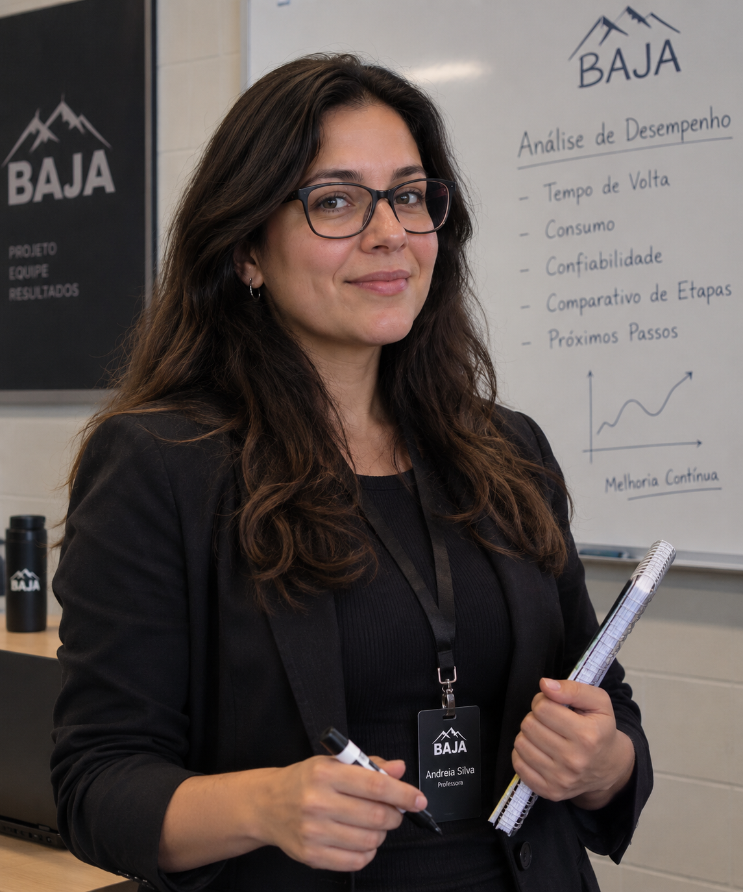
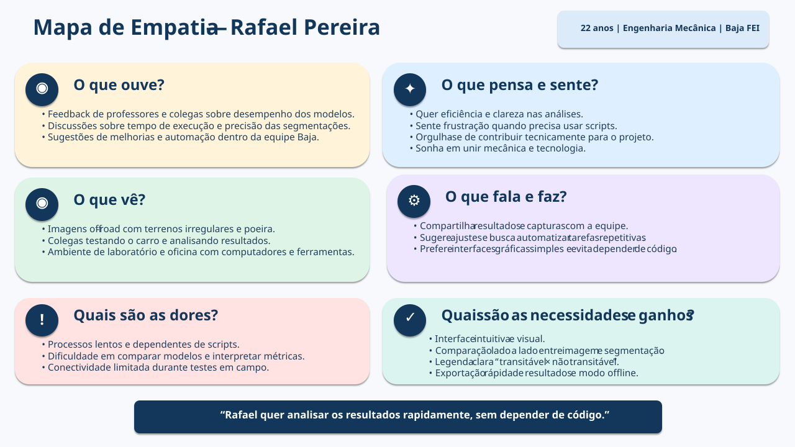

# Entrega 3 — Personas, mapa de empatia, contexto de uso e jornada

**Data:** 23/09/2026  
**Status:** 🟩 concluída  
**Responsabilidade:** 1 persona por integrante; 1 mapa de empatia, 1 contexto de uso consolidado e 1 jornada por equipe (salvo orientação diferente do docente).

## Objetivo da atividade

Representar grupos de usuários de forma útil para decisões de design. Persona não é personagem decorativo: suas características devem alterar requisitos, prioridades, linguagem, fluxos ou critérios de avaliação.

## Atenção a projetos técnicos

Em TCCs sem interface original, a persona pode representar um **profissional que se apropria da contribuição técnica**: DBA, analista, cientista de dados, administrador, pesquisador, técnico, operador, gestor ou especialista de domínio.

Não escolha um perfil apenas porque “parece combinar” com a tecnologia. Explique **qual objetivo esse perfil teria e qual parte da contribuição do TCC produziria valor para ele**. Se ainda for hipótese, mantenha como hipótese/proto-persona a validar.

Também considere papéis diferentes quando houver tarefas distintas, por exemplo:

- operador que executa análises;
- administrador que configura e gerencia permissões;
- especialista que interpreta resultados;
- gestor que consulta relatórios e decide;
- auditor que revisa histórico.

## Entradas da Entrega 1

Antes de criar personas, retome os tipos de usuários, características relevantes, objetivos e hipóteses registradas na Entrega 1. A persona **não deve transformar uma hipótese inicial em fato por meio de uma história fictícia**.

| Item da Entrega 1 | Status inicial | Evidência disponível agora | Como será tratado nesta entrega |
|---|---|---|---|
| Perfil: analista de segmentação (01 §2.4, §7.2) | H | Proto-persona P01; sem observação de uso registrada | **Incorporar** — vira a persona P01, prioritária |
| Perfil: desenvolvedor de modelos (01 §2.2) | H | Perfil descrito pela equipe; nenhuma observação | **Manter como hipótese** — representado por P02, sem confirmação |
| Perfil: gestor de projeto (01 §2.2) | H | Perfil descrito pela equipe; nenhuma observação | **Incorporar** — vira a persona P03 (proto-persona, a validar) |
| Stakeholders: pilotos e mecânicos (01 §2.3) | H | Nenhuma observação direta | **Manter como hipótese** — não viram persona (H03) |
| Objetivo do usuário (01 §3.1) | H | Derivado da contribuição técnica | **Incorporar** — orienta o objetivo da P01 |
| Atividades A01–A05 (01 §3.2, §9.2) | H | Lista construída pela equipe | **Incorporar** — base das tarefas T01–T03 |
| Contexto de uso: laboratório e pistas FEI (01 §5.1) | F | Observação da equipe | **Incorporar** — seção 3 (contexto de uso) |
| Processo atual por scripts (01 §4.1, §4.6) | F (observação interna limitada) | Scripts do projeto | **Manter** — base das dores de P01/P03; não generalizar |
| H01 — benefício esperado com avaliação sistemática | H | E2 não confirmou para o público Baja | **Manter como hipótese** — investigar (objetivo E4) |
| H02 — perfil pode não dominar programação | H | Operacionalizada na P01, sem observação | **Manter como hipótese** |
| H03 — piloto beneficiado de forma indireta | H | Nenhuma persona de piloto criada | **Manter como hipótese** |
| H04 — familiaridade com métricas influencia a decisão | H | Variedade nos três perfis (P01/P02/P03) | **Manter como hipótese** — investigar (objetivo E7) |
| H05 — atividades atuais dependem de scripts | H (evidência interna limitada) | Observação da equipe; E2 não confirma | **Manter** — com limitação explícita |
| H06 — dificuldades principais na comparação | H | Dores escritas pela equipe | **Manter como hipótese** — investigar (objetivos E4/E7) |
| H07 — fatores sociais/papéis/permissões | H | Nada observado | **Manter como hipótese** — investigar (objetivo E7) |
| H08 — necessidade de histórico | H | RC02 rebaixada; F05 não sustentado | **Manter como hipótese** — investigar (objetivo E7) |
| H09 — interfaces conhecidas pelos usuários | H | E2 mostra produtos, não o contexto Baja | **Manter como hipótese** — investigar (objetivo E7) |
| H10 — ferramentas genéricas podem ser complexas | H | Refinada na E2 (depende do produto) | **Manter (refinada)** — investigar (objetivo E7) |
| H11 — padrões de interface familiares | H | E2 observou padrões, não familiaridade no Baja | **Manter como hipótese** — investigar (objetivo E7) |
| H12 — benefício esperado registrado | H | Expectativa registrada em 01 §9.1 | **Manter como hipótese** — investigação contínua |

## 1. Personas

### Persona P01 — Rafael Pereira

**Autor(a):** Tiago — 22.123.017-0  
**Tipo:** primária  
**Base de evidências:** perfil "Analista de segmentação" adotado pela equipe na Entrega 1 (§2.2, §2.4) `[H]` + observação interna do processo atual por scripts (§4.1, §4.6) `[F]`, que **não** cobre usuários finais. **Proto-persona a validar:** não há observação do uso por terceiros nem entrevista.  
**Hipóteses da Entrega 1 relacionadas:** H02, H04, H05, H06

| Campo | Descrição |
|---|---|
| Faixa etária / contexto relevante | Rafael tem 22 anos, cursa Ciência da Computação na FEI e é membro ativo da equipe Baja FEI, onde atua como analista de segmentação e acompanha os testes de campo nos fins de semana. Entrou para o Baja por interesse em visão computacional e no desenvolvimento de um veículo autônomo. No ensino médio fez curso técnico em informática e participou de projetos práticos de programação e análise de dados, o que o deixou curioso por automações e integrações entre sensores e software. |
| Ocupação/papel | Analista de Segmentação |
| Conhecimento do domínio | Conhecimento prático de off‑road e do projeto Baja, com familiaridade em visão computacional e na interpretação de métricas de segmentação. |
| Experiência tecnológica | Intermediária: tem contato com programação no curso (incluindo Python), mas prefere resolver as tarefas de análise por interface a escrever e depurar código. Não atua como desenvolvedor de software. |
| Objetivos |  Validar rapidamente se a segmentação identifica corretamente áreas transitáveis e gerar evidências visuais para reuniões da equipe e relatórios do Baja. |
| Necessidades | Visualização lado a lado (original × segmentação) e exportar imagens e relatórios simples. |
| Dores/frustrações | Dependência de scripts para cada visualização, perda de tempo quando o código quebra e o fato do ter que gerar relatórios manuais. |
| Motivadores | Entregar resultados rápidos e confiáveis para a equipe e automatizar tarefas repetitivas. |
| Restrições/acessibilidade | Prefere atalhos de teclado e workflows com poucos cliques. |
| Ambiente típico de uso | Laboratório da FEI (análises detalhadas) e espaço off-road dentro da FEI. |
| Comportamentos relevantes | Testa várias imagens em sequência/vídeos, salva versões, anota observações e compartilha os resultados com a equipe. |

**Decisões de design influenciadas por P01:**

**1. Tela principal: comparação lado a lado com controles de opacidade e zoom**
- **Descrição:** imagem original e máscara de segmentação exibidas simultaneamente; controles de opacidade e zoom integrados.
- **Justificativa:** permite inspeção rápida de detalhes de terrenos irregulares sem trocar de tela, atendendo ao objetivo de validar rapidamente áreas transitáveis.
- **Base:** `[H]` H04; a comparação de resultado é um padrão presente na E2, mas **transferi-lo** ao nosso contexto continua hipótese.

**2. Legenda com cores consistentes e destaque textual "transitável × não transitável"**
- **Descrição:** paleta fixa entre execuções; rótulo textual sempre visível e de alto contraste.
- **Justificativa:** reduz carga cognitiva ao testar várias imagens em sequência e evita reinterpretação da legenda a cada execução.
- **Base:** `[H]` H04; **RC01** (tradução dos termos técnicos, sustentação **média** na E2) — a dificuldade específica do nosso usuário ainda não foi demonstrada.

**3. Painel de comparação de modelos com métricas essenciais e gráficos rápidos**
- **Descrição:** exibe IoU por classe, acurácia global e gráficos comparativos simples (barras/linhas); números acompanhados de visualização gráfica.
- **Justificativa:** facilita comparar variantes do DeepLabv3+ e gera evidências visuais para reuniões, sem exigir conhecimento avançado em ML.
- **Base:** **RC03** (tabela + gráfico, sustentação **alta** — E6: ambos coexistem no produto analisado); `[H]` H04.

**4. Fluxo sem código: upload por arrastar e soltar, processamento com um clique, histórico e exportação PNG/PDF**
- **Descrição:** upload intuitivo, botão único para executar a segmentação, lista de execuções anteriores e exportação direta de imagens/relatórios.
- **Justificativa:** elimina a dependência de scripts, reduz fricção operacional e acelera a geração de evidências para a equipe.
- **Base:** `[F]` o processo atual exige scripts (01 §4.1, §4.6); **RC04** (feedback de processamento, sustentação **alta** — E5/E1). O item **histórico** depende de **H08/RC02**, ainda **não sustentado**.

**5. Modo offline, mensagens de erro claras, atalhos de teclado e presets de visualização**
- **Descrição:** operação local quando necessário; mensagens orientam solução rápida; atalhos e presets para visualizações frequentes.
- **Justificativa:** atende à conectividade limitada em campo e à preferência por workflows rápidos, mitigando problemas quando não há suporte técnico disponível.
- **Base:** `[H]` — 01 §5.3 (visibilidade/interrupções). Conectividade e uso offline **não** têm evidência; manter como hipótese a investigar.

### Persona P02 - Andreia Silva

**Autor(a):** Mateus Marana - 22.123.026-1  
**Tipo:** Primária  
**Base de evidências:** perfil "Desenvolvedor de modelos" adotado pela equipe na Entrega 1 (§2.2) `[H]`. **Proto-persona a validar:** não há observação de uso nem entrevista. A hipótese H02 ("pode não dominar programação") **não se sustenta** neste perfil — Andreia implementa modelos e escreve Python, como registrado no campo Experiência tecnológica.  
**Hipóteses da Entrega 1 relacionadas:** H01, H04

| Campo | Descrição |
|---|---|
| Faixa etária / contexto relevante | Andreia é uma professora de tempo integral no curso de Engenharia Mecânica, seu amor por pesquisas no ambiente off-road a fez assumir o Baja com o objetivo de ajudar os alunos a desenvolver inovações e melhorias no projeto. Desenvolveu um grande interesse pela área de inteligência artificial quando realizou uma pós na área de visão computacional e hoje busca a construção de um veículo Baja autônomo. Juntando assim seus maiores gostos. |
| Ocupação/papel | Professora Coordenadora da equipe Baja |
| Conhecimento do domínio | Doutora em Engenharia Mecânica, realizou uma pós em Visão Computacional. Conhecimento avançado nos dois assuntos. |
| Experiência tecnológica | Avançada, conseguindo implementar scripts em Python voltados para a Visão Computacional e também desenvolver seus próprios modelos |
| Objetivos | Utilizar os modelos pré-treinados e as métricas apresentadas para desenvolver um veículo Baja autônomo |
| Necessidades | Segmentar imagens em tempo real e em vídeos gravados, ambas com a opção de modelos diversos e analisar os resultados da segmentação. Gostaria também de uma interface que junte todas as funções de forma prática e facilitada |
| Dores/frustrações | Devido a sua grade de aulas e os compromissos com a equipe, ela não tem muito tempo para desenvolver seus próprios modelos de segmentação e treiná-los. Pouco conhecimento em desenvolvimento de interfaces |
| Motivadores | Apresentar uma grande inovação na pesquisa e para a comunidade Baja |
| Restrições/acessibilidade | Gosta de interfaces intuitivas e prefere botões para navegar |
| Ambiente típico de uso | Seu próprio computador pessoal e Pc's da faculdade |
| Comportamentos relevantes | Anota observações e melhorias sempre focando em como avançar na pesquisa |

**Decisões de design influenciadas por P02:**

**1. Interface de análise com acesso rápido aos resultados da segmentação**
- **Descrição:** disponibilizar em uma mesma tela a imagem original, a máscara gerada e a sobreposição entre ambas, permitindo alternar rapidamente entre as visualizações.
- **Justificativa:** Andreia possui conhecimento avançado em Visão Computacional e precisa analisar os resultados para apoiar o desenvolvimento do veículo Baja autônomo. A visualização conjunta facilita a identificação de erros e regiões que precisam ser avaliadas.

**2. Suporte à utilização de diferentes modelos de segmentação**
- **Descrição:** permitir selecionar diferentes modelos disponíveis antes da execução e manter os mesmos parâmetros de entrada e visualização para facilitar a comparação.
- **Justificativa:** Andreia possui conhecimento suficiente para trabalhar com diferentes modelos e tem interesse em avaliar os resultados obtidos. A interface deve facilitar a experimentação sem exigir alterações constantes no código.
- **Base:** padrão observado na E2 — **E1/E5** (seleção de modelo em lista explícita); `[H]` H04.

**3. Comparação de modelos e apresentação de métricas**
- **Descrição:** apresentar métricas relevantes da segmentação, como IoU, acurácia e métricas por classe, acompanhadas de gráficos e comparação entre diferentes modelos ou execuções.
- **Justificativa:** como Andreia possui experiência em Visão Computacional e atua em pesquisa, as métricas são importantes para avaliar objetivamente o desempenho dos modelos e registrar evidências para futuras melhorias no projeto.
- **Base:** **RC03** (tabela + gráfico, sustentação **alta** — E6); `[H]` H04.

**4. Processamento de imagens, vídeos e câmera em um fluxo centralizado**
- **Descrição:** oferecer modos distintos para processar imagens, vídeos gravados e, quando disponível, entrada de câmera em tempo real, mantendo uma estrutura de navegação semelhante entre eles.
- **Justificativa:** a construção de um veículo Baja autônomo exige analisar diferentes fontes de dados. Centralizar essas possibilidades reduz o tempo gasto configurando diferentes ferramentas e permite que Andreia concentre seus esforços na análise dos resultados.
- **Base:** `[H]` — a **câmera em tempo real está fora do recorte** da Entrega 1 (o sistema executa modelos pré-treinados). Imagens e vídeos gravados permanecem; a câmera só entra com evidência.

**5. Histórico de execuções e possibilidade de registrar observações**
- **Descrição:** manter um histórico das segmentações realizadas, registrando informações como modelo utilizado, entrada processada, métricas e resultado, com espaço para observações.
- **Justificativa:** Andreia costuma registrar observações e melhorias relacionadas à pesquisa. O histórico permite relacionar resultados às configurações utilizadas, facilitando a comparação entre experimentos e o acompanhamento da evolução dos modelos.
- **Base:** **RC02 rebaixada a pendência** / F05 **não sustentado**; depende de **H08**. Não tratar como evidência enquanto a necessidade não for demonstrada.

**6. Interface intuitiva, mas com acesso às informações técnicas**
- **Descrição:** utilizar uma navegação simples baseada em botões e componentes visuais, sem esconder informações técnicas relevantes, permitindo consultar parâmetros, modelo utilizado e métricas da execução.
- **Justificativa:** embora Andreia tenha conhecimento técnico avançado, possui pouco conhecimento em desenvolvimento de interfaces. A interface deve reduzir a complexidade da interação sem limitar seu acesso às informações necessárias para a pesquisa.

**7. Exportação dos resultados para documentação e pesquisa**
- **Descrição:** permitir exportar imagens segmentadas, métricas e resultados das comparações para formatos adequados à documentação da pesquisa e apresentação à equipe.
- **Justificativa:** Andreia precisa analisar e registrar resultados para acompanhar melhorias no projeto Baja. A exportação reduz o trabalho manual necessário para preparar evidências e materiais de acompanhamento.
- **Base:** `[H]` H12; não há evidência do fluxo atual de exportação.

### Persona P03 — Larissa Camargo

**Autor(a):** Henrique — 22.123.030-3  
**Tipo:** primária  
**Base de evidências:** perfil "Gestor de projeto" adotado pela própria equipe na Entrega 1 (seção 2.2) + recorte do TCC. **Proto-persona a validar**: não existe observação de uso nem entrevista que a sustente.  
**Hipóteses da Entrega 1 relacionadas:** H01, H04, H06, H12

| Campo | Descrição |
|---|---|
| Faixa etária / contexto relevante | Larissa tem 21 anos e cursa o 6º semestre de Ciência de Computação na FEI. Entrou na equipe Baja FEI em 2025 como **gestora de projeto** — papel de acompanhar os testes do veículo e decidir, junto à coordenação, qual configuração de modelo será adotada. Participa dos encontros semanais no laboratório. *A composição atual da equipe é hipótese de contexto, não levantamento.* |
| Ocupação/papel | **Gestora de projeto da equipe Baja FEI** — consulta resultados consolidados e decide qual modelo adotar nos testes do veículo. Corresponde ao perfil "Gestor de projeto" da Entrega 1, seção 2.2. |
| Conhecimento do domínio | Entende o projeto Baja, o cronograma de testes e o que "transitável × não transitável" significa na prática. **Não domina machine learning nem estatística**: precisa que os resultados cheguem consolidados e com uma interpretação pronta para poder decidir. |
| Experiência tecnológica | Intermediária: usa ferramentas gráficas e planilhas no dia a dia, mas **não escreve código** nem executa os scripts do projeto — depende de outro integrante para rodá-los. Não conhece CVAT, Roboflow nem Supervisely — **H09 permanece aberta** para o nosso público. |
| Objetivos | 1. **Decidir qual modelo adotar** nos testes do veículo, com base em resultados consolidados. 2. **Apresentar e sustentar essa decisão** para a equipe e a coordenação em linguagem simples. |
| Necessidades | Visão **consolidada** do desempenho por modelo (não imagem a imagem); métricas **com referência** para comparar; comparação entre modelos em um só lugar; parecer/recomendação em português, pronto para a reunião. |
| Dores/frustrações | Precisa decidir com base em números soltos que não sabe interpretar; **depende de integrantes técnicos** para entender o resultado; teme adotar um modelo que depois falha em campo; não consegue justificar a escolha perante a coordenação. |
| Motivadores | Tomar uma decisão defensável e reduzir o risco de o veículo usar um modelo inadequado. |
| Restrições/acessibilidade | `[?]` **Não verificada.** Não há registro de restrição de acessibilidade de Larissa. Qualquer necessidade específica (visual, motora ou cognitiva) permanece a investigar e **não deve ser inventada**. |
| Ambiente típico de uso | Laboratório da FEI nos encontros de gestão da equipe, em notebook próprio ou compartilhado; eventualmente em reuniões fora do laboratório, sem garantia de internet. |
| Comportamentos relevantes | Acompanha o cronograma de testes; pede a outro integrante que execute a segmentação; consulta resultados consolidados em planilhas e relatórios; leva a conclusão para as reuniões de decisão da equipe. |

> **As decisões abaixo são hipóteses de design derivadas de uma proto-persona.** Nenhuma foi validada com usuários — a validação é da Entrega 7.

**Decisões de design influenciadas por P03:**

**1. Painel consolidado de desempenho por modelo**
- **Descrição:** visão resumida que reúne o desempenho de cada modelo (métricas agregadas e ranking) em uma única tela, em vez de exigir a leitura imagem a imagem.
- **Justificativa:** P03 decide com base no conjunto, não em uma execução isolada. É a necessidade central da gestora e sustenta H01/H06.

**2. Métricas com referência de comparação**
- **Descrição:** junto do IoU e da acurácia, exibir um valor de comparação sempre que existir (resultado anterior, melhor resultado registrado ou faixa esperada), identificando de onde veio a referência.
- **Justificativa:** sem referência, o número não orienta decisão. Sustenta H04/H06 e corresponde a **RC03 / F02** (sustentação alta na Entrega 2).

**3. Interpretação em linguagem simples ao lado dos números**
- **Descrição:** termos como IoU, acurácia e classe recebem explicação curta em português no ponto de uso, e o painel resume o que o resultado indica — e o que **não** indica.
- **Justificativa:** corresponde a **RC01 / F04**. **Atenção ao grau de sustentação:** a dificuldade específica de P03 com a terminologia ainda é hipótese (sustentação média na Entrega 2) e precisa ser investigada na Entrega 7 antes de virar requisito.

**4. Exportação de relatório executivo**
- **Descrição:** saída em português com imagem de exemplo, tabela resumida, modelo recomendado e o aviso explícito de que **métrica não equivale a segurança de trajeto** (restrição registrada na Entrega 1, seção 4.3).
- **Justificativa:** P03 precisa levar e defender a decisão perante a equipe e a coordenação; o relatório é o produto que ela consome. Liga-se a H01 e H12, **ambas abertas**.

**5. Sinalização de limitações e incerteza**
- **Descrição:** destacar quando o resultado é inconclusivo (poucas amostras, métricas próximas entre modelos) e o que ele **não** garante operacionalmente.
- **Justificativa:** uma decisão de gestão precisa ser defensável; mostrar os limites evita que P03 adote um modelo com base em uma diferença irrelevante. Sustenta H12.

### Síntese das personas

As três personas cobrem **três tarefas diferentes** do mesmo produto — não são a mesma pessoa com nome e foto trocados:

| Persona | Papel | Tarefa central | Dor que orienta o design | Rastreabilidade |
|---|---|---|---|---|
| **P01 — Rafael Pereira** | **analista de segmentação — perfil prioritário** | **T01, T02 e T03** — executar a segmentação, avaliar a qualidade e comparar modelos | Scripts que quebram e métricas sem referência | **R01, R03**, H05, H06 |
| **P02 — Andreia Silva** | pesquisadora / coordenadora | experimentar modelos e acompanhar a evolução da pesquisa | Pouco tempo para treinar modelos e nenhuma interface própria | **R03**, H04 |
| **P03 — Larissa Camargo** | gestora de projeto | **decisão** — consultar resultados consolidados e decidir qual modelo adotar nos testes | Números soltos, sem interpretação, e dependência de colegas técnicos | **R03** (decisão), H01, H12 |

**Persona prioritária: P01.** É o perfil que a Entrega 1 definiu como usuário direto da interface (seção 7.2, "analista de segmentação da equipe Baja FEI") e a quem o objetivo da interface se dirige: *avaliar a qualidade da segmentação e selecionar o modelo adequado*. P02 orienta a evolução da pesquisa e P03 consome o resultado consolidado para decidir — ambas apoiadas na análise produzida por P01.

**Mapa de empatia e jornada foram construídos sobre P01** — agora o perfil prioritário — e continuam coerentes: descrevem o fluxo de análise (executar a segmentação, inspecionar o resultado e levar a evidência à equipe) que é a base sobre a qual P03 decide. Não é necessário refazê-los para P03.

## 2. Mapa de empatia — equipe

**Persona escolhida:** **Rafael Pereira** 
**Justificativa:** Rafael é o usuário primário do sistema de visualização de segmentação semântica. Ele representa o perfil de estudante de Ciência da Computação e analista de segmentação da equipe Baja FEI, que precisa validar rapidamente resultados de modelos sem depender de código.

| Dimensão | Descrição | Base (fato `[F]` / hipótese `[H]`) |
|---|---|---|
| O que pensa e sente | Quer eficiência e clareza nas análises; sente frustração quando precisa recorrer a scripts ou quando o sistema demora a processar; valoriza soluções práticas e visuais; sente orgulho em contribuir tecnicamente para o projeto Baja. | `[H]` H01, H04 — E1 §2.4, §3.1 |
| O que vê | Imagens off‑road com terrenos irregulares e poeira; colegas testando o carro e discutindo resultados; planilhas com métricas; ambiente de laboratório e pistas de teste. | `[H]` H04; `[F]` contexto — 01 §5.1 (laboratórios e pistas da FEI) |
| O que ouve | Feedback de professores e colegas sobre desempenho dos modelos; discussões sobre melhorias no sistema; comentários sobre tempo de execução e precisão das segmentações. | `[H]` H01, H04 |
| O que fala e faz | Compartilha resultados e capturas com a equipe; sugere ajustes; busca automatizar tarefas repetitivas; usa ferramentas gráficas sempre que possível; evita depender de código. | `[H]` H04, H05 |
| Dores | Processos lentos e dependentes de scripts; legendas confusas; dificuldade de comparar modelos. | `[F]` dependência de scripts — 01 §4.1/§4.6; `[H]` H01, H05 — "legendas confusas" sem fonte, permanece hipótese |
| Necessidades / ganhos | Interface intuitiva e visual; comparação lado a lado; legenda clara "transitável × não transitável"; exportação rápida de resultados. | `[H]` H01; apoio de design na E2 — RC01 (termos) e RC03 (tabela + gráfico, sustentação alta) |

## 3. Contexto de uso — consolidação

Consolidação a partir da seção 5 da Entrega 1 (§5.1–§5.6) e das três personas. As marcações `[F]`/`[H]`/`[?]` são as da Entrega 1 — nada aqui foi promovido de hipótese a fato.

| Dimensão | Descrição | Implicação de design |
|---|---|---|
| **Usuários** | Três perfis da própria equipe Baja FEI, sem usuários externos: **P01 (perfil prioritário)** executa a análise e avalia a qualidade, **P02** pesquisa e coordena, **P03** consulta os resultados consolidados e decide. Qualquer membro pode executar — 01 §5.4 `[H]`. O piloto é stakeholder indireto (H03) e **não** interage com a interface. | Interface única, **sem login** (01 §8 descartou usuários/perfis/permissões — F06, F07). Não criar modos "iniciante/especialista" sem evidência; priorizar o que P01 precisa e deixar o avançado acessível sem atrapalhar. |
| **Tarefas** | Três, derivadas de R01–R03: **T01** avaliar a qualidade da segmentação; **T02** enviar imagem e iniciar a execução sem código; **T03** comparar métricas entre modelos. | Um fluxo principal único — **enviar → executar → comparar → exportar** — com a comparação acessível em um passo, não escondida em navegação profunda. |
| **Equipamentos** | Computadores e notebooks capazes de processar imagens e vídeos, no laboratório FEI ou em PCs pessoais — 01 §5.2 `[F]`. Câmeras do veículo e dispositivos móveis **apenas capturam** os dados; a análise acontece no computador. | Desktop primeiro. Entrada por arquivo local. Nada que exija tela grande ou resolução alta. **Uso móvel fica fora do recorte** — não derivar requisito de quem só captura. |
| **Ambiente físico** | Laboratório FEI e pistas off-road da FEI — 01 §5.1 `[F]`. Boa iluminação é necessária para **capturar** imagens boas; visibilidade da tela em ambiente externo e interrupções durante a análise estão registradas como `[H]` a investigar (01 §5.3) — inclusive por P01 e P03, que citam uso fora do laboratório. | Contraste alto (leitura em ambiente com luz forte) e **capacidade de retomar de onde parou** após interrupção. Não exigir conexão durante a análise. Nada disso está confirmado — é para checar na Entrega 7. |
| **Ambiente social/organizacional** | Equipe Baja FEI, com encontros semanais no laboratório. A decisão de **qual modelo adotar** é discutida com a coordenação (objetivo de P03) e as conclusões vão para reuniões e relatórios. | A interface precisa funcionar como **argumento para quem não estava na tela**: a saída exportável é parte do produto, não extra. Metade do valor de P03 está no que ela leva para a reunião. |
| **Papéis/permissões/governança** | **Não há.** 01 §8 descartou CRUD, gestão de usuários, perfis e permissões: o sistema é local e de uso restrito à equipe. H07 (fatores sociais, papéis e colaboração) continua **aberta**. | Nenhuma tela de login, cadastro ou administração. Fora do escopo até que H07 traga evidência contrária — os concorrentes terem isso não é razão para nós termos. |
| **Volume de dados/histórico** | Imagens e vídeos dos testes, com os resultados de segmentação. 01 §5.5 registra `[H]` a necessidade de histórico para comparar registros e acompanhar evolução. A Entrega 2 **rebaixou RC02 a pendência** por conflito com o recorte (nós só *executamos* modelos já disponíveis — não treinamos nem versionamos). | Não construir busca nem filtros agora: **F05 está como "NÃO sustentado"**. Um histórico local simples só entra se H08 se confirmar na Entrega 7 — e a definição do que precisaria ser recuperado vem antes. |

> **Pendência:** esta consolidação é proposta de Henrique e precisa ser validada pela equipe antes da entrega, sobretudo a linha de **volume/histórico**, que depende da decisão sobre H08/RC02.

## 4. Jornada do usuário — equipe

**Persona:** **Rafael Pereira** 
**Objetivo da jornada:** Validar rapidamente se a segmentação identifica corretamente áreas transitáveis, comparar modelos e gerar evidências visuais para a equipe.  
**Início e fim da jornada:** Do momento em que Rafael coleta imagens em campo até a montagem dos materiais para a reunião da equipe.

**Como ler:** as etapas descrevem o processo **atual** (antes da interface); a coluna "Oportunidade de design" é derivada das dores registradas, não do produto pronto.

| Etapa | Situação/ação (hoje) | Objetivo | Pensamento/emoção | Dor | Oportunidade de design | Base da oportunidade (`[F]`/`[H]`) |
|---|---|---|---|---|---|---|
| 1 | Rafael coleta imagens e vídeos nos testes de campo do Baja | Reunir dados reais para analisar | "Preciso de imagens que representem o terreno de verdade" | Iluminação e interrupções no campo | Fora do recorte — a interface começa na análise; a captura é do veículo | `[F]` — 01 §5.1/§5.2 (pistas da FEI; câmeras do veículo); §5.3 `[H]` |
| 2 | Leva os arquivos ao laboratório e prepara o ambiente: abre o script, ajusta parâmetros e caminhos e confere dependências | Iniciar a análise da segmentação | "Se eu esquecer um parâmetro, vai quebrar de novo" | Exige editar código/configuração a cada execução | Fluxo sem código: upload e execução com um clique | `[F]` — 01 §4.1/§4.6 (configurar parâmetros, selecionar arquivos e executar código) |
| 3 | Executa o script e acompanha o processamento pelo terminal | Saber se a segmentação terminou | "Travou ou ainda está rodando?" | Sem feedback claro de progresso; falha exige depurar o código | Indicador de estado (processando / concluído / falhou) com recuperação | `[F]` — 01 §4.1; **RC04** (sustentação **alta** — E5/E1) |
| 4 | Abre as máscaras geradas e compara com a imagem original alternando entre janelas/arquivos | Conferir se a segmentação acertou o terreno | "Vivo abrindo e fechando arquivos para comparar" | Comparação manual, sem visão simultânea | Comparação lado a lado com opacidade/zoom | `[H]` — H04; a E2 **não** observou "lado a lado" — a transferência é hipótese |
| 5 | Interpreta o que cada cor/classe significa na máscara, sem legenda padronizada | Compreender o resultado antes de decidir | "Qual dessas cores era o obstáculo?" | Cores sem padrão fixo; precisa lembrar/reinterpretar a cada execução | Legenda fixa + rótulo textual "transitável × não transitável" | `[H]` — H04; **RC01** (tradução de termos, sustentação **média**) |
| 6 | Lê métricas (IoU, acurácia) do próprio script/notebook ou de planilhas soltas | Comparar modelos e execuções | "Esse número é bom? Comparado com o quê?" | Métricas cruas, sem referência; difícil comparar versões | Painel com tabela + gráfico e valor de referência de comparação | `[F]` — E2/E6 (tabela **e** gráfico coexistem nos produtos); **RC03 (sustentação alta)**; `[H]` H04 |
| 7 | Monta manualmente o material da reunião: salva prints, converte formatos e cola em slides/relatório | Levar o resultado à equipe | "Vou perder tempo montando isso de novo" | Retrabalho a cada reunião para preparar evidências | Exportação direta de imagem + relatório simples | `[H]` — H12; sem evidência do fluxo atual de exportação |

## Síntese

As necessidades e objetivos que devem aparecer nos cenários e tarefas seguintes são: 
* Validação rápida da qualidade da segmentação a partir de imagens de campo.
* Interface sem código para reduzir fricção.
* Visualização clara e consistente (lado a lado, legenda fixa).
* Comparação de modelos com métricas gráficas.
* Exportação simples de resultados.

## Checklist

- [x] Existe pelo menos uma persona por integrante.
- [x] As personas não são apenas diferenças demográficas superficiais.
- [x] Está claro o que é dado real e o que é hipótese/proto-persona. — P01 e P02 declaradas proto-personas, com `[F]`/`[H]` e fonte explícitos; a P03 já estava. *(16/10/2026)*
- [X] A persona não “validou por ficção” uma hipótese da Entrega 1; afirmações continuam marcadas como hipótese quando não há evidência.
- [x] Objetivos e dores têm consequência para o design.
- [x] Contexto de uso está coerente com a Entrega 1.
- [x] Em TCC sem interface original, a persona possui relação explícita com a contribuição técnica.
- [x] Papéis administrativos, técnicos e decisórios só foram criados quando possuem objetivos/tarefas diferentes.
- [x] Jornada possui etapas, dores e oportunidades e não é apenas wireflow. — etapas reescritas pela situação **atual**, com oportunidades derivadas das dores. *(16/10/2026)*
- [x] IDs das personas foram adicionados à rastreabilidade.
