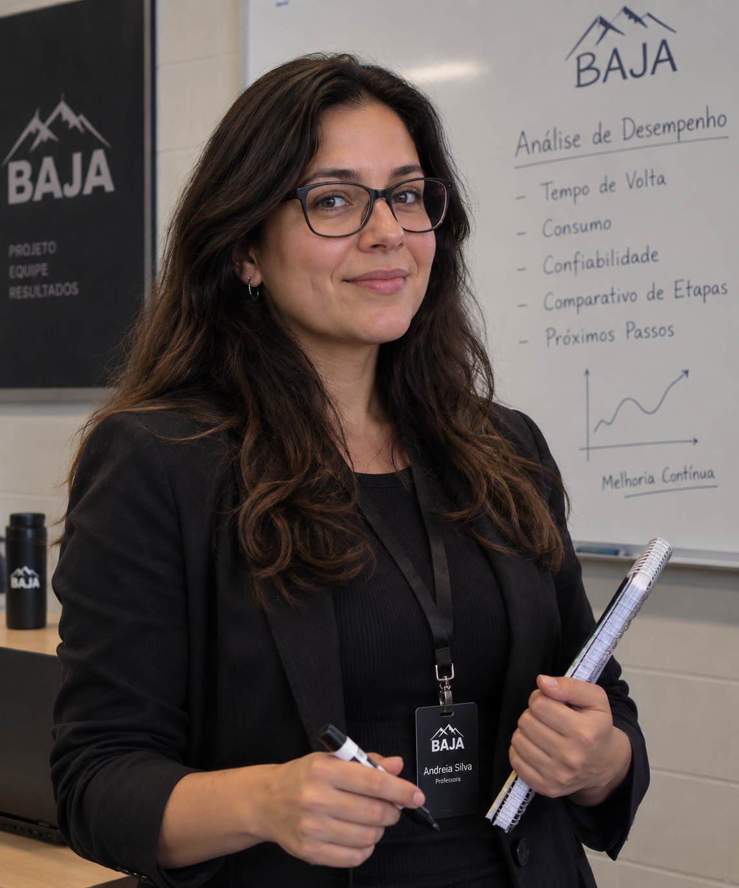
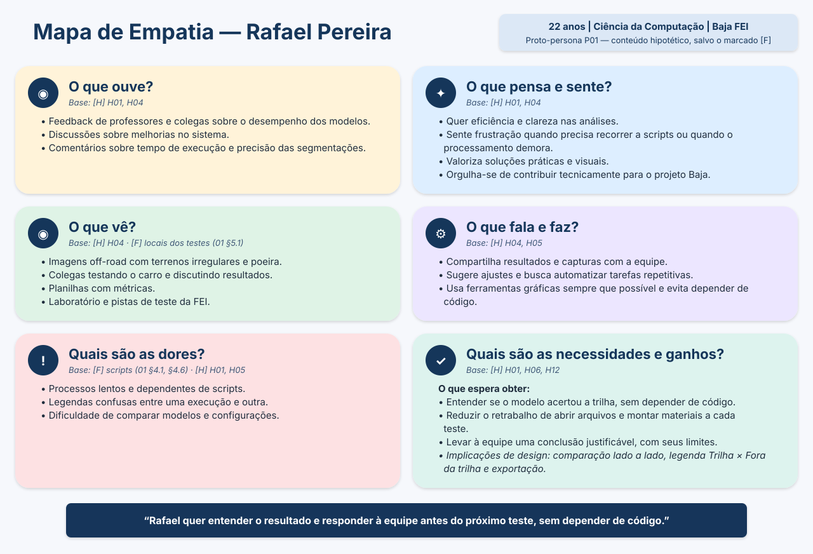

# Entrega 3 — Personas, mapa de empatia, contexto de uso e jornada

**Data:** 23/09/2026 (primeira versão) · 16/10/2026 (revisão) · 10/11/2026 (revisão após feedback)  
**Status:** 🟦 revisada após feedback  
**Responsabilidade:** 1 persona por integrante; 1 mapa de empatia, 1 contexto de uso consolidado e 1 jornada por equipe (salvo orientação diferente do docente).

## Objetivo da atividade

Representar grupos de usuários de forma útil para decisões de design. Persona não é personagem decorativo: suas características devem alterar requisitos, prioridades, linguagem, fluxos ou critérios de avaliação.

## Atenção a projetos técnicos

Em TCCs sem interface original, a persona pode representar um **profissional que se apropria da contribuição técnica**: DBA, analista, cientista de dados, administrador, pesquisador, técnico, operador, gestor ou especialista de domínio.

Não escolha um perfil apenas porque “parece combinar” com a tecnologia. Explique **qual objetivo esse perfil teria e qual parte da contribuição do TCC produziria valor para ele**. Se ainda for hipótese, mantenha como hipótese/proto-persona a validar.

Também considere papéis diferentes quando houver tarefas distintas, por exemplo:

- operador que executa análises;
- administrador que configura e gerencia permissões;
- especialista que interpreta resultados;
- gestor que consulta relatórios e decide;
- auditor que revisa histórico.

## Entradas da Entrega 1

Antes de criar personas, retome os tipos de usuários, características relevantes, objetivos e hipóteses registradas na Entrega 1. A persona **não deve transformar uma hipótese inicial em fato por meio de uma história fictícia**.

| Item da Entrega 1 | Status inicial | Evidência disponível agora | Como será tratado nesta entrega |
|---|---|---|---|
| Perfil: analista de segmentação (01 §2.4, §7.2) | H | Proto-persona P01; sem observação de uso registrada | **Incorporar** — vira a persona P01, prioritária |
| Perfil: pesquisador(a) de modelos (01 §2.2) | H | Perfil descrito pela equipe; nenhuma observação | **Incorporar** — vira a persona P02 (proto-persona, a validar). Na interface, a P02 **define configurações, treina e compara os modelos**; adicionar novas arquiteturas fica fora do recorte |
| Perfil: gestor de projeto (01 §2.2) | H | Perfil descrito pela equipe; nenhuma observação | **Incorporar** — vira a persona P03 (proto-persona, a validar) |
| Stakeholders: pilotos e mecânicos (01 §2.3) | H | Nenhuma observação direta | **Manter como hipótese** — não viram persona (H03) |
| Objetivo do usuário (01 §3.1) | H | Derivado da contribuição técnica | **Incorporar** — orienta o objetivo da P01 |
| Atividades A01–A05 (01 §3.2) e ações AC01–AC06 (01 §9.2) | H | Lista construída pela equipe | **Incorporar** — base das tarefas T01–T08 |
| Contexto de uso: análise no laboratório da FEI depois dos testes de campo (01 §5.1) | F (locais dos testes); H (uso da interface); ? (uso na pista) | Observação da equipe sobre os locais dos testes | **Incorporar** — seção 3 (contexto de uso) |
| Processo atual por scripts (01 §4.1, §4.6) | F (observação interna limitada) | Scripts do projeto | **Manter** — base das dores de P01/P03; não generalizar |
| H01 — benefício esperado com avaliação sistemática | H | E2 não confirmou para o público Baja | **Manter como hipótese** — investigar (objetivo E4) |
| H02 — perfil pode não dominar programação | H | Operacionalizada na P01, sem observação | **Manter como hipótese** |
| H03 — piloto beneficiado de forma indireta | H | Nenhuma persona de piloto criada | **Manter como hipótese** |
| H04 — familiaridade com métricas influencia a decisão | H | Variedade nos três perfis (P01/P02/P03) | **Manter como hipótese** — investigar (objetivo E7) |
| H05 — atividades atuais dependem de scripts | H (evidência interna limitada) | Observação da equipe; E2 não confirma | **Manter** — com limitação explícita |
| H06 — dificuldades principais na comparação | H | Dores escritas pela equipe | **Manter como hipótese** — investigar (objetivos E4/E7) |
| H07 — fatores sociais/papéis/permissões | H | Nada observado | **Manter como hipótese** — investigar (objetivo E7) |
| H08 — necessidade de histórico | H | RC02 rebaixada; F05 não sustentado | **Manter como hipótese** — investigar (objetivo E7) |
| H09 — interfaces conhecidas pelos usuários | H | E2 mostra produtos, não o contexto Baja | **Manter como hipótese** — investigar (objetivo E7) |
| H10 — ferramentas genéricas podem ser complexas | H | Refinada na E2 (depende do produto) | **Manter (refinada)** — investigar (objetivo E7) |
| H11 — padrões de interface familiares | H | E2 observou padrões, não familiaridade no Baja | **Manter como hipótese** — investigar (objetivo E7) |
| H12 — benefício esperado registrado | H | Expectativa registrada em 01 §9.1 | **Manter como hipótese** — investigação contínua |

## 1. Personas

### Persona P01 — Rafael Pereira

**Autor(a):** Tiago Fagundes dos Santos — 22.123.017-0  
**Tipo:** primária — **persona prioritária**  
**Por que é primária:** representa o centro do recorte: executar, inspecionar e comparar segmentações (T01–T03). Rafael decide se a configuração em uso pode continuar nos testes ou se é preciso compará-la com outra, e marca as imagens duvidosas. Entrega à equipe essa conclusão, com as imagens e as métricas que a sustentam e seus limites; é dessa evidência que P02 e P03 partem.  
**Base de evidências:** perfil "Analista de segmentação" adotado pela equipe na Entrega 1 (§2.2, §2.4) `[H]` + observação interna do processo atual por scripts (§4.1, §4.6) `[F]`, que **não** cobre usuários finais. **Proto-persona a validar:** não há observação do uso por terceiros nem entrevista.  
**Hipóteses da Entrega 1 relacionadas:** H02, H04, H05, H06

*Imagem ilustrativa gerada por IA; não retrata uma pessoa real.*

| Campo | Descrição |
|---|---|
| Faixa etária / contexto relevante | Rafael tem 22 anos, cursa Ciência da Computação na FEI e é membro ativo da equipe Baja FEI, onde atua como analista de segmentação e acompanha os testes de campo nos fins de semana. Entrou para o Baja por interesse em visão computacional e no desenvolvimento de um veículo autônomo. No ensino médio fez curso técnico em informática e participou de projetos práticos de programação e análise de dados, o que o deixou curioso por automações e integrações entre sensores e software. Espera que a análise de um teste fique pronta no mesmo dia ou no seguinte, para responder à equipe antes do próximo teste. Trabalha com quem descarrega as imagens das câmeras, com a gestão (P03), que usa sua conclusão, e com a coordenação (P02), que treina as configurações. |
| Ocupação/papel | Analista de Segmentação |
| Conhecimento do domínio | Conhecimento prático de off‑road e do projeto Baja, com familiaridade em visão computacional e na interpretação de métricas de segmentação. |
| Experiência tecnológica | Intermediária: tem contato com programação no curso (incluindo Python), mas prefere resolver as tarefas de análise por interface a escrever e depurar código. Não atua como desenvolvedor de software. |
| Interpretação: sozinho × com apoio | Interpreta sozinho a máscara (se a borda da trilha coincide com a imagem) e lê IoU e acurácia. Precisa de apoio para saber se uma diferença entre configurações é relevante e para separar falha do modelo de falha da imagem; hoje pede a opinião de um colega quando não tem certeza `[H]`. |
| Objetivos | Validar se a segmentação delimita corretamente a região de trilha nas imagens de um teste e dizer à equipe, antes do próximo teste, se a configuração em uso pode continuar, com evidências visuais que mostrem também os limites da análise. O resultado avalia o modelo; não diz se um trajeto é seguro (01 §4.3). |
| Necessidades | Visualização lado a lado (original × segmentação) e exportar imagens e relatórios simples. |
| Dores/frustrações | Dependência de scripts para cada visualização, perda de tempo quando o código quebra e o fato de ter que gerar relatórios manuais. |
| Motivadores | Entregar resultados rápidos e confiáveis para a equipe e automatizar tarefas repetitivas. |
| Restrições/acessibilidade | `[?]` **Não verificada.** Não há registro de restrição de acessibilidade de Rafael; qualquer necessidade específica permanece a investigar e não deve ser inventada. |
| Ambiente típico de uso | Laboratório da FEI, no mesmo dia do teste ou no seguinte, em computador do laboratório ou notebook apoiado na bancada `[H]`. Uso à beira da pista não definido `[?]` (ver seção 3.1). |
| Comportamentos relevantes | Testa várias imagens em sequência/vídeos, salva versões, anota observações e compartilha os resultados com a equipe. Prefere atalhos de teclado e workflows com poucos cliques `[H]`. |

**Decisões de design influenciadas por P01:**

**1. Tela principal: comparação lado a lado com controles de opacidade e zoom**
- **Descrição:** imagem original e máscara de segmentação exibidas simultaneamente; controles de opacidade e zoom integrados.
- **Justificativa:** permite inspeção rápida de detalhes de terrenos irregulares sem trocar de tela, atendendo ao objetivo de validar rapidamente a delimitação da trilha.
- **Base:** `[H]` H04. A E2 não observou comparação lado a lado nos produtos analisados; a transferência é hipótese.
- **Estado:** adotada.

**2. Legenda com cores consistentes e rótulo textual *Trilha* × *Fora da trilha***
- **Descrição:** paleta fixa entre execuções; rótulo textual sempre visível e de alto contraste. A legenda descreve a classificação feita pelo modelo; não indica se o trecho é seguro ou transitável.
- **Justificativa:** reduz carga cognitiva ao testar várias imagens em sequência e evita reinterpretação da legenda a cada execução.
- **Base:** `[H]` H04; **RC01** (tradução dos termos técnicos, sustentação **média** na E2) — a dificuldade específica do nosso usuário ainda não foi demonstrada.
- **Estado:** adotada.

**3. Painel de comparação de modelos com métricas essenciais e gráficos rápidos**
- **Descrição:** exibe IoU, acurácia e tempo de inferência de cada modelo e gráficos comparativos simples (barras/linhas); números acompanhados de visualização gráfica. IoU e acurácia só existem para imagens com anotação de referência.
- **Justificativa:** facilita comparar os modelos do TCC (FCN e DeepLabV3+) e gera evidências visuais para reuniões, sem exigir conhecimento avançado em ML.
- **Base:** **RC03** (tabela + gráfico, sustentação **média** — a E6 mostra tabela de estatística do dataset, não de métricas do modelo); `[H]` H04.
- **Estado:** adotada.

**4. Fluxo sem código: upload por arrastar e soltar, processamento com um clique e exportação PNG/PDF**
- **Descrição:** upload intuitivo, botão único para executar a segmentação e exportação direta de imagens e relatórios, para que a evidência chegue ao grupo da equipe e à reunião de decisão. Uma lista de execuções anteriores (histórico) foi considerada, mas depende da H08.
- **Justificativa:** elimina a dependência de scripts, reduz fricção operacional e acelera a geração de evidências para a equipe.
- **Base:** `[F]` o processo atual exige scripts (01 §4.1, §4.6); **RC04** (feedback de processamento, sustentação **alta** — E5/E1). O item **histórico** depende de **H08/RC02**, ainda **não sustentado**.
- **Estado:** adotada (upload, execução e exportação); **em investigação** (histórico, H08 — fora do recorte até a Entrega 7).

**5. Modo offline, mensagens de erro claras, atalhos de teclado e presets de visualização**
- **Descrição:** operação local quando necessário; mensagens orientam solução rápida; atalhos e presets para visualizações frequentes.
- **Justificativa:** mensagens claras evitam que Rafael precise depurar código quando a execução falha (por exemplo, imagem em formato não aceito); atalhos e presets atendem à preferência por fluxos rápidos. O modo offline só faria sentido se houver análise à beira da pista, o que não está definido.
- **Base:** `[H]` — 01 §5.3 (visibilidade/interrupções). Conectividade e uso offline **não** têm evidência; manter como hipótese a investigar.
- **Estado:** adotada (mensagens de erro claras); **em investigação** (modo offline, atalhos e presets — dependem do contexto de uso e da preferência real, a verificar na Entrega 7).

### Persona P02 - Andreia Silva

**Autor(a):** Mateus Marana Assuena — 22.123.026-1  
**Tipo:** primária  
**Por que é primária:** só ela define configurações de treino e treina os modelos (T08), e compara configurações como experimento de pesquisa (T06, T07). Essas necessidades — escolher parâmetros, acompanhar um treino longo, recuperar-se de uma falha no meio dele e ver a matriz de confusão quando o IoU cai — não são atendidas pela experiência projetada para o Rafael, que usa configurações já treinadas. O conhecimento avançado dela, sozinho, não seria motivo.  
**Base de evidências:** perfil "Pesquisador(a) de modelos" adotado pela equipe na Entrega 1 (§2.2) `[H]`. Na interface, Andreia define configurações de treino, treina e compara os modelos do TCC; adicionar novas arquiteturas fica fora do recorte. **Proto-persona a validar:** não há observação de uso nem entrevista. A hipótese H02 ("pode não dominar programação") **não foi atribuída** a esta personagem, que implementa modelos e escreve Python. Como Andreia é hipotética, isso não refuta a H02 para pessoas reais.  
**Hipóteses da Entrega 1 relacionadas:** H01, H04

*Imagem ilustrativa gerada por IA; não retrata uma pessoa real.*

| Campo | Descrição |
|---|---|
| Faixa etária / contexto relevante | Andreia tem 42 anos `[H]` e é professora em tempo integral no curso de Engenharia Mecânica. O interesse por pesquisa em ambiente off-road a levou a assumir a coordenação do Baja, com o objetivo de ajudar os alunos a desenvolver inovações no projeto. Interessou-se por inteligência artificial ao fazer uma pós-graduação em visão computacional, e hoje sua linha de pesquisa é o veículo Baja autônomo. Espera que cada experimento de treino possa ser comparado ao anterior sem refazer scripts. Trabalha com o Rafael, que usa as configurações que ela treina, e leva as conclusões à reunião em que a gestão (P03) prepara a decisão. *A idade é escolha da proto-persona.* |
| Ocupação/papel | Professora Coordenadora da equipe Baja |
| Conhecimento do domínio | Doutora em Engenharia Mecânica, realizou uma pós em Visão Computacional. Conhecimento avançado nos dois assuntos. |
| Experiência tecnológica | Avançada, conseguindo implementar scripts em Python voltados para a Visão Computacional e também desenvolver seus próprios modelos |
| Interpretação: sozinha × com apoio | Interpreta sozinha métricas, curvas de treino e matriz de confusão. Precisa de apoio da interface só para reunir os resultados de experimentos diferentes no mesmo lugar e saber com qual configuração cada um foi gerado `[H]`. |
| Objetivos | Definir e treinar configurações dos modelos do TCC e comparar seus resultados em imagens e vídeos dos testes, para escolher qual configuração seguir no próximo experimento e qual levar à reunião de decisão. Esse é o objetivo que a interface apoia; o veículo Baja autônomo é o objetivo maior da pesquisa, fora do alcance dela. |
| Necessidades | **Atendidas nesta proposta:** configurar e treinar os modelos disponíveis, acompanhar o treino, segmentar imagens e vídeos gravados e analisar e comparar os resultados em um só lugar. **Consideradas, mas fora do recorte:** segmentação em tempo real pela câmera do veículo e inclusão de novas arquiteturas de modelo (Entrega 1, Delimitação). |
| Dores/frustrações | Pela grade de aulas e pelos compromissos com a equipe, tem pouco tempo para cada experimento: ajustar a configuração, treinar, esperar o treino terminar e só então comparar; quando o treino falha no meio, perde o tempo gasto. A interface pode reduzir esse trabalho de preparação e comparação; desenvolver novas arquiteturas continua fora do alcance dela. |
| Motivadores | Apresentar uma grande inovação na pesquisa e para a comunidade Baja |
| Restrições/acessibilidade | `[?]` **Não verificada.** Não há registro de restrição de acessibilidade de Andreia; qualquer necessidade específica permanece a investigar e não deve ser inventada. |
| Ambiente típico de uso | Sala dos professores ou laboratório, entre aulas, em computador pessoal ou PC da faculdade, em janelas curtas de tempo: inicia um treino e volta depois para conferir `[H]` (ver seção 3.1). |
| Comportamentos relevantes | Anota observações e melhorias focando em como avançar na pesquisa e registra cada experimento em um caderno. Prefere navegar por botões e componentes visuais `[H]`. |

**Decisões de design influenciadas por P02:**

**1. Interface de análise com acesso rápido aos resultados da segmentação**
- **Descrição:** disponibilizar em uma mesma tela a imagem original, a máscara gerada e a sobreposição entre ambas, permitindo alternar rapidamente entre as visualizações.
- **Justificativa:** Andreia possui conhecimento avançado em Visão Computacional e precisa analisar os resultados para apoiar o desenvolvimento do veículo Baja autônomo. A visualização conjunta facilita a identificação de erros e regiões que precisam ser avaliadas.
- **Base:** `[H]` H04; mesma necessidade das decisões 1 e 2 da P01.
- **Estado:** adotada.

**2. Suporte à utilização de diferentes modelos de segmentação**
- **Descrição:** permitir selecionar diferentes modelos disponíveis antes da execução e manter os mesmos parâmetros de entrada e visualização para facilitar a comparação.
- **Justificativa:** Andreia possui conhecimento suficiente para trabalhar com diferentes modelos e tem interesse em avaliar os resultados obtidos. A interface deve facilitar a experimentação sem exigir alterações constantes no código.
- **Base:** padrão observado na E2 — **E1** (seleção de modelo em lista explícita, em imagem de divulgação do CVAT; a captura E5 da Supervisely não mostra a seleção de modelo); `[H]` H04.
- **Estado:** adotada.

**3. Comparação de modelos e apresentação de métricas**
- **Descrição:** apresentar métricas relevantes da segmentação, como IoU, acurácia e tempo de inferência, acompanhadas de gráficos e comparação entre os modelos. IoU e acurácia só existem para imagens com anotação de referência (conjunto de teste do TCC).
- **Justificativa:** como Andreia possui experiência em Visão Computacional e atua em pesquisa, as métricas são importantes para avaliar objetivamente o desempenho dos modelos e registrar evidências para futuras melhorias no projeto.
- **Base:** **RC03** (tabela + gráfico, sustentação **média** — E6); `[H]` H04.
- **Estado:** adotada.

**4. Processamento de imagens e vídeos gravados em um fluxo centralizado**
- **Descrição:** processar imagens e vídeos gravados com a mesma estrutura de navegação.
- **Justificativa:** a construção de um veículo Baja autônomo exige analisar diferentes fontes de dados. Centralizar essas possibilidades reduz o tempo gasto configurando diferentes ferramentas e permite que Andreia concentre seus esforços na análise dos resultados.
- **Base:** `[H]` — necessidade atribuída à proto-persona.
- **Estado:** adotada para imagens e vídeos gravados. **Fora do recorte:** entrada de câmera em tempo real (Entrega 1, Delimitação), registrada apenas como possibilidade futura.

**5. Histórico de execuções e possibilidade de registrar observações**
- **Descrição:** manter um histórico das segmentações realizadas, registrando informações como modelo utilizado, entrada processada, métricas e resultado, com espaço para observações.
- **Justificativa:** Andreia costuma registrar observações e melhorias relacionadas à pesquisa. O histórico permite relacionar resultados às configurações utilizadas, facilitando a comparação entre experimentos e o acompanhamento da evolução dos modelos.
- **Base:** **RC02 rebaixada a pendência** / F05 **não sustentado**; depende de **H08**. Não tratar como evidência enquanto a necessidade não for demonstrada.
- **Estado:** em investigação (H08); fora do recorte até a Entrega 7.

**6. Interface intuitiva, mas com acesso às informações técnicas**
- **Descrição:** utilizar uma navegação simples baseada em botões e componentes visuais, sem esconder informações técnicas relevantes, permitindo consultar parâmetros, modelo utilizado e métricas da execução.
- **Justificativa:** Andreia usa a interface em janelas curtas entre aulas e precisa retomar um experimento rapidamente; uma navegação simples economiza esse tempo. Como pesquisadora, ela precisa ver parâmetros, modelo e métricas para interpretar o resultado, então essas informações não podem ficar escondidas.
- **Base:** `[H]` H04, perfil técnico da persona; sem evidência de uso.
- **Estado:** adotada.

**7. Exportação dos resultados para documentação e pesquisa**
- **Descrição:** permitir exportar imagens segmentadas, métricas e resultados das comparações para formatos adequados à documentação da pesquisa e apresentação à equipe.
- **Justificativa:** Andreia precisa analisar e registrar resultados para acompanhar melhorias no projeto Baja. A exportação reduz o trabalho manual necessário para preparar evidências e materiais de acompanhamento.
- **Base:** `[H]` H12; não há evidência do fluxo atual de exportação.
- **Estado:** adotada.

### Persona P03 — Larissa Camargo

**Autor(a):** Henrique Finatti Silveira Belo Trebbi — 22.123.030-3  
**Tipo:** primária  
**Por que é primária:** Larissa acessa a interface diretamente para comparar o desempenho consolidado das configurações (T04) e para preparar e justificar a decisão (T05), como modelado na Entrega 5. Ela não apenas recebe um relatório do Rafael: precisa de visão por configuração (não imagem a imagem), de referência para julgar se uma diferença é relevante e de explicação dos termos, necessidades que a experiência analítica do Rafael não atende.  
**Base de evidências:** perfil "Gestor de projeto" adotado pela própria equipe na Entrega 1 (seção 2.2) + recorte do TCC. **Proto-persona a validar**: não existe observação de uso nem entrevista que a sustente.  
**Hipóteses da Entrega 1 relacionadas:** H01, H04, H06, H12

*Imagem ilustrativa gerada por IA; não retrata uma pessoa real.*

| Campo | Descrição |
|---|---|
| Faixa etária / contexto relevante | Larissa tem 21 anos e cursa o 6º semestre de Ciência de Computação na FEI. Entrou na equipe Baja FEI em 2025 como **gestora de projeto** — papel de acompanhar os testes do veículo e decidir, junto à coordenação, qual configuração de modelo será adotada. Participa dos encontros semanais no laboratório. Espera chegar à reunião com uma escolha que consiga defender; depende do integrante que executa os modelos (P01) e decide junto com a coordenação (P02). *A composição atual da equipe é hipótese de contexto, não levantamento.* |
| Ocupação/papel | **Gestora de projeto da equipe Baja FEI** — consulta resultados consolidados e prepara, com a coordenação, a decisão sobre qual configuração adotar nos testes do veículo. Corresponde ao perfil "Gestor de projeto" da Entrega 1, seção 2.2. |
| Conhecimento do domínio | Entende o projeto Baja, o cronograma de testes e o que a região de trilha marcada pelo modelo representa no terreno. **Não domina machine learning nem estatística**: precisa que os resultados cheguem consolidados e acompanhados de explicação do que indicam, para formar ela mesma a recomendação. |
| Experiência tecnológica | Intermediária: usa ferramentas gráficas e planilhas no dia a dia, mas **não escreve código** nem executa os scripts do projeto — depende de outro integrante para rodá-los. Não conhece CVAT, Roboflow nem Supervisely — **H09 permanece aberta** para o nosso público. |
| Interpretação: sozinha × com apoio | Lê sozinha uma tabela que compare as configurações. Precisa de apoio para entender IoU e acurácia, saber se uma diferença é relevante e saber o que o resultado não garante `[H]`. |
| Objetivos | 1. **Decidir qual configuração adotar** nos testes do veículo, com base em resultados consolidados. 2. **Apresentar e sustentar essa decisão** para a equipe e a coordenação em linguagem simples. |
| Necessidades | Visão **consolidada** do desempenho por modelo (não imagem a imagem); métricas **com referência** para comparar; comparação entre modelos em um só lugar; explicação em português do que os números indicam e não indicam, para que ela mesma forme e registre a recomendação que leva à reunião. |
| Dores/frustrações | Precisa decidir com base em números soltos que não sabe interpretar; **depende de integrantes técnicos** para entender o resultado; teme adotar um modelo que depois falha em campo; não consegue justificar a escolha perante a coordenação. |
| Motivadores | Tomar uma decisão defensável e reduzir o risco de o veículo usar um modelo inadequado. |
| Restrições/acessibilidade | `[?]` **Não verificada.** Não há registro de restrição de acessibilidade de Larissa. Qualquer necessidade específica (visual, motora ou cognitiva) permanece a investigar e **não deve ser inventada**. |
| Ambiente típico de uso | Antes da reunião semanal, sozinha, no notebook próprio, para preparar a recomendação; durante a reunião no laboratório, com a tela projetada ou compartilhada para a coordenação e os colegas `[H]` (ver seção 3.1). Reuniões fora do laboratório, sem garantia de internet, são possibilidade a investigar `[?]`. |
| Comportamentos relevantes | Acompanha o cronograma de testes; pede a outro integrante que execute a segmentação; consulta resultados consolidados em planilhas e relatórios; leva a conclusão para as reuniões de decisão da equipe. |

> **As decisões abaixo são hipóteses de design derivadas de uma proto-persona.** Nenhuma foi validada com usuários — a validação é da Entrega 7.

**Decisões de design influenciadas por P03:**

**1. Painel consolidado de desempenho por modelo**
- **Descrição:** visão resumida que reúne o desempenho de cada configuração (métricas agregadas, com opção de ordenar por uma métrica escolhida) em uma única tela, em vez de exigir a leitura imagem a imagem. A ordenação organiza as evidências; não é uma recomendação do sistema.
- **Justificativa:** P03 decide com base no conjunto, não em uma execução isolada. É a necessidade central da gestora e se liga a H01/H06, ainda abertas.
- **Estado:** adotada.

**2. Métricas com referência de comparação**
- **Descrição:** junto do IoU e da acurácia, exibir um valor de comparação sempre que existir (resultado anterior, melhor resultado registrado ou faixa esperada), identificando de onde veio a referência.
- **Justificativa:** sem referência, o número não orienta decisão. Liga-se a H04/H06. **Não** vem da Entrega 2: a RC03 trata de tabela × gráfico, não de valor de referência. É hipótese de design derivada da dor "números soltos" (C02), a investigar na Entrega 7.
- **Estado:** adotada como proposta; **em investigação** a origem do valor de referência.

**3. Interpretação em linguagem simples ao lado dos números**
- **Descrição:** termos como IoU, acurácia e classe recebem explicação curta em português no ponto de uso, e o painel resume o que o resultado indica — e o que **não** indica.
- **Justificativa:** corresponde a **RC01 / F04**. **Atenção ao grau de sustentação:** a dificuldade específica de P03 com a terminologia ainda é hipótese (sustentação média na Entrega 2) e precisa ser investigada na Entrega 7 antes de virar requisito.
- **Estado:** em investigação (RC01: quais termos geram dúvida, Entrega 7).

**4. Exportação de relatório executivo**
- **Descrição:** saída em português com imagem de exemplo, tabela resumida, a recomendação que a própria Larissa registra (com suas ressalvas) e o aviso explícito de que **métrica não equivale a segurança de trajeto** (restrição registrada na Entrega 1, seção 4.3).
- **Justificativa:** P03 precisa levar e defender a decisão perante a equipe e a coordenação; o relatório é o produto que ela consome. Liga-se a H01 e H12, **ambas abertas**. A interface organiza as evidências; quem interpreta e recomenda é a Larissa, e a decisão é da reunião com a coordenação.
- **Estado:** adotada.

**5. Sinalização de limitações e incerteza**
- **Descrição:** destacar quando o resultado é inconclusivo (poucas amostras, métricas próximas entre modelos) e o que ele **não** garante operacionalmente.
- **Justificativa:** uma decisão de gestão precisa ser defensável; mostrar os limites evita que P03 adote um modelo com base em uma diferença irrelevante. Liga-se à H12, ainda aberta.
- **Estado:** adotada; o critério do que é "inconclusivo" ainda precisa ser definido pela equipe `[?]`.

### Síntese das personas

As três personas cobrem **três tarefas diferentes** do mesmo produto — não são a mesma pessoa com nome e foto trocados:

| Persona | Papel | Tarefa central | Dor que orienta o design | Rastreabilidade |
|---|---|---|---|---|
| **P01 — Rafael Pereira** | **analista de segmentação — primária, prioritária** | **T01, T02 e T03** — executar a segmentação, avaliar a qualidade e comparar o resultado de uma imagem entre configurações | Scripts que quebram e métricas sem referência | **R01, R03**, H05, H06 |
| **P02 — Andreia Silva** | pesquisadora / coordenadora — primária | **T08, T06 e T07** — configurar e treinar os modelos, analisar os resultados e compará-los, acompanhando a evolução da pesquisa | Pouco tempo para montar scripts de execução e comparação; nenhuma interface própria | **R03**, H04 |
| **P03 — Larissa Camargo** | gestora de projeto — primária | **T04 e T05** — comparar o desempenho consolidado entre configurações e preparar e justificar a decisão de adoção | Números soltos, sem interpretação, e dependência de colegas técnicos | **R03** (decisão), H01, H12 |

**As três personas são primárias, e a P01 é a prioritária.** Cada uma tem necessidades centrais que a experiência projetada para outra não atende (ver "Por que é primária" em cada persona): P01 executa e inspeciona, P02 configura e treina, P03 compara o consolidado e prepara a decisão. Não se trata de três sistemas: as três usam o mesmo fluxo, com pontos de entrada diferentes. A P01 é a prioritária porque é o perfil que a Entrega 1 definiu como usuário direto (seção 7.2) e a quem o objetivo da interface se dirige: *avaliar a qualidade da segmentação e selecionar a configuração a usar nos testes*. Em caso de conflito entre necessidades, o design não pode prejudicar a P01 para atender às outras.

**Mapa de empatia e jornada foram construídos sobre P01**, o perfil prioritário. Descrevem o fluxo de análise (executar a segmentação, inspecionar o resultado e levar a evidência à equipe), que é a base sobre a qual P03 decide; a fase "depois" da jornada mostra esse encontro. Não é necessário refazê-los para P02 e P03.

## 2. Mapa de empatia — equipe

**Persona escolhida:** **Rafael Pereira** 
**Justificativa:** Rafael é a persona prioritária do sistema de visualização de segmentação semântica. Ele representa o perfil de estudante de Ciência da Computação e analista de segmentação da equipe Baja FEI, que precisa validar rapidamente resultados de modelos sem depender de código.

*Figura — mapa de empatia de Rafael, redesenhado em 10/11/2026 com o perfil atual. Cada bloco traz a mesma base `[F]`/`[H]` da tabela abaixo. Fonte: elaboração da equipe.*

| Dimensão | Descrição | Base (fato `[F]` / hipótese `[H]`) |
|---|---|---|
| O que pensa e sente | Quer eficiência e clareza nas análises; sente frustração quando precisa recorrer a scripts ou quando o sistema demora a processar; valoriza soluções práticas e visuais; sente orgulho em contribuir tecnicamente para o projeto Baja. | `[H]` H01, H04 — E1 §2.4, §3.1 |
| O que vê | Imagens off‑road com terrenos irregulares e poeira; colegas testando o carro e discutindo resultados; planilhas com métricas; ambiente de laboratório e pistas de teste. | `[H]` H04; `[F]` contexto — 01 §5.1 (laboratórios e pistas da FEI) |
| O que ouve | Feedback de professores e colegas sobre desempenho dos modelos; discussões sobre melhorias no sistema; comentários sobre tempo de execução e precisão das segmentações. | `[H]` H01, H04 |
| O que fala e faz | Compartilha resultados e capturas com a equipe; sugere ajustes; busca automatizar tarefas repetitivas; usa ferramentas gráficas sempre que possível; evita depender de código. | `[H]` H04, H05 |
| Dores | Processos lentos e dependentes de scripts; legendas confusas; dificuldade de comparar modelos. | `[F]` dependência de scripts — 01 §4.1/§4.6; `[H]` H01, H05 — "legendas confusas" sem fonte, permanece hipótese |
| Necessidades / ganhos | **O que espera obter:** entender se o modelo acertou a trilha sem depender de código; reduzir o retrabalho de abrir arquivos e montar materiais a cada teste; levar à equipe uma conclusão que consiga justificar, com seus limites. **Implicações de design** (não são ganhos em si): comparação lado a lado, legenda *Trilha* × *Fora da trilha* e exportação. | `[H]` H01, H06, H12; apoio de design na E2 — RC01 (termos) e RC03 (tabela + gráfico, sustentação média) |

## 3. Contexto de uso — consolidação

Consolidação da equipe a partir da seção 5 da Entrega 1 (§5.1–§5.6) e das três personas. As marcações `[F]`/`[H]`/`[?]` são as da Entrega 1 — nada aqui foi promovido de hipótese a fato.

| Dimensão | Descrição | Implicação de design |
|---|---|---|
| **Usuários** | Três perfis da própria equipe Baja FEI, sem usuários externos, todos primários: **P01 (prioritária)** executa a análise e avalia a qualidade, **P02** configura, treina e compara como pesquisa, **P03** consulta os resultados consolidados e prepara a decisão. Os papéis seguem 01 §5.4 `[H]`; se há divisão formal deles é a H07. O piloto é stakeholder indireto (H03) e **não** interage com a interface. | Interface única, **sem login** (01 §8 descartou usuários/perfis/permissões — F06, F07). Não criar modos "iniciante/especialista" sem evidência; priorizar o que P01 precisa e deixar o avançado acessível sem atrapalhar. |
| **Tarefas** | Derivadas de R01–R04 e dos cenários da Entrega 4. **P01:** T01 avaliar a qualidade da segmentação de uma imagem; T02 executar a segmentação com uma ou mais configurações disponíveis, sem código; T03 comparar o resultado de uma imagem entre configurações. **P03:** T04 comparar o desempenho consolidado entre modelos; T05 decidir e justificar a adoção de um modelo. **P02:** T08 definir uma configuração e treinar o modelo; T06 analisar visualmente os resultados; T07 comparar os resultados de diferentes modelos (a T02 é compartilhada com a P01). | Um fluxo principal único — **enviar → executar → comparar → exportar** — com a comparação acessível em um passo, não escondida em navegação profunda. |
| **Equipamentos** | Computadores e notebooks capazes de processar imagens e vídeos, no laboratório FEI ou em PCs pessoais — 01 §5.2 `[H]`. Câmeras do veículo e dispositivos móveis **apenas capturam** os dados; a análise acontece no computador. | Desktop primeiro. Entrada por arquivo local. Nada que exija tela grande ou resolução alta. **Uso móvel fica fora do recorte** — não derivar requisito de quem só captura. |
| **Ambiente físico** | Contexto prioritário: análise no laboratório da FEI, depois dos testes de campo — 01 §5.1 (`[F]` locais dos testes; `[H]` análise no laboratório; `[?]` uso à beira da pista). Boa iluminação é necessária para **capturar** imagens boas; visibilidade da tela em ambiente externo e interrupções durante a análise estão registradas como `[H]` a investigar (01 §5.3). O detalhamento por persona está na seção 3.1. | Contraste alto (leitura em ambiente com luz forte) e **capacidade de retomar de onde parou** após interrupção. Não exigir conexão durante a análise. Nada disso está confirmado — é para checar na Entrega 7. |
| **Ambiente social/organizacional** | Equipe Baja FEI, com encontros semanais no laboratório. A decisão de **qual configuração adotar** é preparada pela gestão (P03) e discutida com a coordenação (P02) na reunião semanal; as conclusões vão para reuniões e relatórios. | A interface precisa funcionar como **argumento para quem não estava na tela**: a saída exportável é parte do produto, não extra. Metade do valor de P03 está no que ela leva para a reunião. |
| **Papéis e responsabilidades** | Mesmo sem controles no sistema, há responsabilidades `[H]`: **P01** prepara a análise de cada teste e aponta seus limites; **P02** define e treina as configurações e verifica os limites técnicos de uma comparação; **P03** reúne os resultados e forma a recomendação; a **decisão** é tomada na reunião com a coordenação (P02); a **equipe**, incluindo pilotos e mecânicos (H03), recebe a conclusão. Se essas funções são formais é a H07, aberta. | A interface precisa deixar claro quem gerou cada resultado e com qual configuração, para que a recomendação possa ser conferida. **Sem login, cadastro ou administração**: 01 §8 descartou permissões (F06, F07), e responsabilidade social não exige controle de acesso. |
| **Volume de dados/histórico** | Imagens e vídeos dos testes, com os resultados de segmentação. 01 §5.5 registra `[H]` a necessidade de histórico para comparar registros e acompanhar evolução. A RC02 da Entrega 2 está pendente e depende da H08; guardar configurações treinadas é uma das perguntas dela. | Não construir busca nem filtros agora: **F05 está como "NÃO sustentado"**. Um histórico local simples só entra se H08 se confirmar na Entrega 7 — e a definição do que precisaria ser recuperado vem antes. |

### 3.1 Ambiente de uso por persona

Condições iniciais plausíveis, todas `[H]` salvo indicação; nada aqui foi observado.

| Persona | Situação de uso | Local e equipamento | Com quem | Restrições e condições | A investigar |
|---|---|---|---|---|---|
| **P01 — Rafael** | Análise das imagens de um teste, no mesmo dia ou no seguinte, para responder à equipe antes do próximo teste | Laboratório da FEI, computador do laboratório ou notebook apoiado na bancada; não acompanha o teste enquanto analisa | Sozinho; pede a opinião de um colega quando tem dúvida e envia o resultado ao grupo da equipe | Prazo curto até o próximo teste; interrupções no laboratório compartilhado, o que pede retomar de onde parou | Se há análise à beira da pista, entre testes `[?]`; iluminação e conexão nesse caso `[?]` |
| **P02 — Andreia** | Experimentos de pesquisa: define uma configuração, inicia o treino e volta depois para comparar | Sala dos professores ou laboratório, computador pessoal ou PC da faculdade | Sozinha; leva as conclusões à reunião de coordenação | Janelas curtas entre aulas; treino longo, que pode falhar no meio | Onde o treino roda e se ela o acompanha à distância `[?]` |
| **P03 — Larissa** | Antes da reunião, prepara a recomendação; na reunião, apresenta e discute | Notebook próprio para preparar; na reunião, tela projetada ou compartilhada no laboratório | Prepara sozinha; decide com a coordenação (P02), com o Rafael e outros colegas presentes | Resultados costumam chegar perto da reunião; a tela compartilhada exige leitura a distância | Se a visualização na reunião é individual ou projetada `[?]`; reuniões fora do laboratório, sem internet `[?]` |

## 4. Jornada do usuário — equipe

**Persona:** **Rafael Pereira** 
**Objetivo da jornada:** Validar se a segmentação delimita corretamente a região de trilha nas imagens de um teste, comparar configurações e levar à equipe uma conclusão justificada sobre o **modelo** — não sobre a segurança do trajeto (01 §4.3).  
**Início e fim da jornada:** do teste de campo que gera a dúvida até o uso da conclusão na reunião de decisão.

**Como ler:** a seção 4.1 descreve o processo **atual** (antes da interface) e serve de diagnóstico; a seção 4.2 narra a **experiência pretendida** com a interface, como hipótese, antes, durante e depois do uso.

### 4.1 Processo atual (diagnóstico)

A coluna "Oportunidade de design" é derivada das dores registradas, não do produto pronto.

| Etapa | Situação/ação (hoje) | Objetivo | Pensamento/emoção | Dor | Oportunidade de design | Base da oportunidade (`[F]`/`[H]`) |
|---|---|---|---|---|---|---|
| 1 | Rafael coleta imagens e vídeos nos testes de campo do Baja | Reunir dados reais para analisar | "Preciso de imagens que representem o terreno de verdade" | Iluminação e interrupções no campo | Fora do recorte — a interface começa na análise; a captura é do veículo | `[F]` — 01 §5.1/§5.2 (pistas da FEI; câmeras do veículo); §5.3 `[H]` |
| 2 | Leva os arquivos ao laboratório e prepara o ambiente: abre o script, ajusta parâmetros e caminhos e confere dependências | Iniciar a análise da segmentação | "Se eu esquecer um parâmetro, vai quebrar de novo" | Exige editar código/configuração a cada execução | Fluxo sem código: upload e execução com um clique | `[F]` — 01 §4.1/§4.6 (configurar parâmetros, selecionar arquivos e executar código) |
| 3 | Executa o script e acompanha o processamento pelo terminal | Saber se a segmentação terminou | "Travou ou ainda está rodando?" | Sem feedback claro de progresso; falha exige depurar o código | Indicador de estado (processando / concluído / falhou) com recuperação | `[F]` execução por script — 01 §4.1; `[H]` falta de feedback claro (a existência de scripts não a demonstra); **RC04** (sustentação **alta** — E5/E1) |
| 4 | Abre as máscaras geradas e compara com a imagem original alternando entre janelas/arquivos | Conferir se a segmentação acertou o terreno | "Vivo abrindo e fechando arquivos para comparar" | Comparação manual, sem visão simultânea | Comparação lado a lado com opacidade/zoom | `[H]` — H04; a E2 **não** observou "lado a lado" — a transferência é hipótese |
| 5 | Interpreta a máscara gerada, sem legenda padronizada, para saber qual região o modelo marcou como trilha | Compreender o resultado antes de decidir | "Qual cor é a trilha nesta execução?" | Sem legenda nem padrão de cores; precisa lembrar a convenção e alternar com a imagem original | Legenda fixa + rótulo textual *Trilha* × *Fora da trilha* e sobreposição colorida sobre a imagem; a legenda descreve a classificação do modelo, não a segurança do trecho | `[H]` — H04; **RC01** (tradução de termos, sustentação **média**) |
| 6 | Lê métricas (IoU, acurácia) do próprio script/notebook ou de planilhas soltas | Comparar modelos e execuções | "Esse número é bom? Comparado com o quê?" | Métricas cruas, sem referência; difícil comparar versões | Painel com tabela + gráfico e valor de referência de comparação | `[H]` situação da persona (planilhas soltas não foram observadas; a RC03 vem de produtos concorrentes e não comprova essa prática); **RC03** para a oportunidade (tabela + gráfico, sustentação **média**) |
| 7 | Monta manualmente o material da reunião: salva prints, converte formatos e cola em slides/relatório | Levar o resultado à equipe | "Vou perder tempo montando isso de novo" | Retrabalho a cada reunião para preparar evidências | Exportação direta de imagem + relatório simples | `[H]` — H12; sem evidência do fluxo atual de exportação |

### 4.2 Experiência pretendida com a interface `[H]`

Narrativa hipotética de como a interface poderia apoiar Rafael, sem antecipar telas. Nada aqui foi observado.

| Fase | O que acontece | O que Rafael pensa ou decide | Informação de que precisa | Resultado |
|---|---|---|---|---|
| **Antes** | No teste de sábado, o veículo passou por trechos de sombra e vegetação densa. A equipe quer saber, antes do próximo teste, se a configuração em uso pode continuar. Quem acompanhou o teste descarrega as imagens das câmeras; no dia seguinte, Rafael chega ao laboratório com algumas dezenas de imagens dos trechos mais difíceis. | "Preciso dizer se a configuração atual aguenta esses trechos." | Quais trechos geraram dúvida e qual configuração estava em uso | Uma pergunta concreta para a análise |
| **Durante — preparar** | Seleciona as imagens e escolhe, na lista de configurações disponíveis, a configuração em uso e uma alternativa já treinada pela P02. | "Vou comparar com a última que a Andreia treinou." | Descrição curta de cada configuração (modelo e dados de treino) | Execução pronta para iniciar, sem editar código |
| **Durante — executar** | Inicia a execução e acompanha o estado. Uma imagem em formato não aceito é apontada antes de rodar; as demais seguem. | "Está rodando ou travou?" | Estado em texto (processando, concluído, falhou), progresso e o que fazer em caso de falha | Resultados de todas as imagens válidas |
| **Durante — inspecionar** | Abre cada resultado lado a lado com a imagem original, com a legenda *Trilha* × *Fora da trilha*. Em duas imagens, a máscara perde a trilha na sombra; ele as marca como duvidosas. | "Aqui o modelo errou ou a imagem está ruim demais?" | Sobreposição, zoom e explicação do que a máscara representa | Lista de falhas por trecho, separando dúvida de erro claro |
| **Durante — comparar** | Compara as duas configurações nas mesmas imagens e consulta, em tabela, IoU e acurácia no conjunto de teste e o tempo de inferência. | "A diferença nas sombras é visível; nos números do conjunto de teste, é pequena." | Métricas lado a lado, com o que indicam e não indicam | Conclusão sobre qual configuração se sai melhor **nessas imagens** |
| **Depois — comunicar** | Exporta as imagens comparadas e um resumo e envia ao grupo da equipe: a configuração alternativa errou menos nas sombras, com a ressalva de que foram poucas imagens e de que isso não diz se o trecho é seguro. | "Preciso que entendam o limite dessa análise." | Material com imagens, métricas e ressalvas | Evidência que outras pessoas podem conferir |
| **Depois — usar a conclusão** | Larissa (P03) inclui essa evidência na comparação consolidada e leva a recomendação à reunião; Andreia (P02) comenta os limites técnicos; a reunião decide trocar de configuração ou pedir mais imagens antes do próximo teste. | "A análise serviu para decidir." | — | Decisão registrada e próximo passo definido (novo teste ou novo treino) |

> O benefício esperado não é exportar um arquivo, e sim permitir que a equipe decida antes do próximo teste com uma evidência que todos conseguem conferir (H01 e H12, ambas abertas).

## Síntese

As necessidades e objetivos que devem aparecer nos cenários e tarefas seguintes são: 
* Validação rápida da qualidade da segmentação a partir de imagens de campo.
* Interface sem código para reduzir fricção.
* Visualização clara e consistente (lado a lado, legenda fixa).
* Comparação de modelos com métricas em tabela e em gráfico (IoU e acurácia no conjunto de teste anotado; tempo de inferência).
* Exportação simples de resultados, para comunicar a conclusão e seus limites a quem decide (P03 e coordenação).
* Configuração e treino pela P02, com acompanhamento do treino.

## Checklist

- [x] Existe pelo menos uma persona por integrante.
- [x] As personas não são apenas diferenças demográficas superficiais.
- [x] Está claro o que é dado real e o que é hipótese/proto-persona: as três são proto-personas, com `[F]`/`[H]`/`[?]` e fonte explícitos, e as imagens geradas por IA estão identificadas.
- [x] Cada persona primária tem justificativa própria da classificação.
- [X] A persona não “validou por ficção” uma hipótese da Entrega 1; afirmações continuam marcadas como hipótese quando não há evidência.
- [x] Objetivos e dores têm consequência para o design.
- [x] Contexto de uso está coerente com a Entrega 1.
- [x] Em TCC sem interface original, a persona possui relação explícita com a contribuição técnica.
- [x] Papéis administrativos, técnicos e decisórios só foram criados quando possuem objetivos/tarefas diferentes.
- [x] Jornada possui etapas, dores e oportunidades e não é apenas wireflow: processo atual (diagnóstico) e experiência pretendida antes, durante e depois do uso.
- [x] Cada decisão de design indica seu estado: adotada, em investigação ou fora do recorte.
- [x] O mapa de empatia visual corresponde à persona atual e à tabela do mapa.
- [x] O contexto descreve o ambiente físico e social de cada persona e as responsabilidades na equipe.
- [x] IDs das personas foram adicionados à rastreabilidade.

## Histórico de revisões

| Data | O que mudou | Motivo |
|---|---|---|
| 07/10/2026 | Personas P01–P03 registradas na rastreabilidade; criada a P03 (perfil prioritário da E1 que faltava) | Conclusão parcial da entrega |
| 16/10/2026 | P01 passou a analista de segmentação e persona prioritária; P03 passou a gestora de projeto; P01 e P02 declaradas proto-personas; jornada reescrita pela situação atual | Feedback do professor |
| 08/11/2026 | P02 e P03 reclassificadas como secundárias. P02 redefinida como pesquisadora/coordenadora que configura, treina e compara os modelos do TCC (tempo real sinalizado como fora do recorte; histórico condicionado à H08). Classes alinhadas ao TCC (*Trilha* × *Fora da trilha*) na P01, P03, mapa de empatia e jornada. RC03 citada com sustentação média. "Coordenação" ligada à P02 no contexto de uso. P03 deixa de atribuir o valor de referência à RC03 | Revisão de consistência (`PENDENCIAS.md`: INC-12, INC-22, INC-23, INC-31, INC-32, INC-34, INC-38, INC-39, INC-49) e leitura do repositório do TCC |
| 09/11/2026 | Preferência por atalhos movida para "Comportamentos relevantes" da P01; base da decisão 1 da P01 corrigida (a E2 não observou lado a lado); linhas "Base:" nas decisões 1 e 6 da P02; contexto de uso lista as tarefas T01–T08 por persona e perdeu a nota de pendência; P02 ligada à nova T08 (configurar e treinar); data e síntese ajustadas | Revisão de consistência (`PENDENCIAS.md`: INC-36, INC-37, INC-40, INC-41, INC-42, INC-61) |
| 10/11/2026 | As três personas passam a primárias (P01 continua prioritária), cada uma com justificativa própria; revogada a reclassificação de 08/11/2026. Andreia: objetivo dentro do recorte, idade (42 anos, escolha da proto-persona), necessidades separadas entre atendidas e fora do recorte, justificativa de navegação pela tarefa e H02 como "não atribuída". Acessibilidade de P01 e P02 como `[?]`, com preferências em "Comportamentos". Linha "Interpretação: sozinho × com apoio" e expectativas e relações nas biografias. Estado de cada decisão de design (adotada, em investigação ou fora do recorte); na P03, a interface organiza as evidências e a recomendação é da própria Larissa. Mapa de empatia redesenhado (Ciência da Computação, *Trilha* × *Fora da trilha*, bases [F]/[H], ganhos pela perspectiva de Rafael). Jornada com processo atual (4.1) e experiência pretendida antes, durante e depois (4.2); bases das etapas 3 e 6 corrigidas. Contexto com ambiente por persona (3.1) e papéis e responsabilidades; alinhado à Entrega 1 revisada. Imagens identificadas como geradas por IA; lembretes de edição removidos | Feedback do professor sobre a Entrega 3 |
