# Entrega 5 — Análise de tarefas: HTA, GOMS e CTT

**Data:** 30/10/2026  
**Status:** 🟩 Concluída 
**Responsabilidade:** cada integrante modela pelo menos 1 HTA, 1 GOMS e 1 CTT. As três técnicas podem abordar a mesma funcionalidade ou funcionalidades distintas, conforme a orientação da disciplina.

## Objetivo da atividade

Modelar tarefas importantes sob perspectivas complementares: decomposição hierárquica (HTA), estrutura de metas/métodos/operações (GOMS) e relações temporais entre tarefas (CTT). O diagrama deve ser acompanhado de interpretação textual.

## Para projetos cujo TCC não previa interface

Modele **tarefas humanas relacionadas ao uso da contribuição técnica**, e não a implementação interna do algoritmo. Exemplos de boas tarefas para análise:

- investigar uma consulta de baixo desempenho;
- configurar uma análise e selecionar parâmetros;
- submeter um dataset e verificar sua validade;
- acompanhar uma execução demorada;
- comparar dois resultados/modelos;
- interpretar uma recomendação e decidir se a aceita;
- localizar uma execução anterior usando busca/filtros;
- gerar e compartilhar um relatório;
- administrar papéis/permissões quando isso for parte do trabalho real;
- revisar um alerta e registrar uma decisão.

Um CRUD pode gerar tarefas relevantes, mas “cadastrar usuário” só merece modelagem se tiver significado no domínio (papéis, validações, riscos, permissões, dependências).

## Entradas e premissas da equipe

| Entrada | Onde | Uso nesta entrega |
|---|---|---|
| Tarefas T01–T07 | [`04_cenarios_problema.md`](04_cenarios_problema.md), seção 5 de cada cenário | Origem das tarefas modeladas |
| Personas P01–P03 | [`03_personas_contexto_jornada.md`](03_personas_contexto_jornada.md) | Perfil de quem executa cada tarefa |
| Necessidades R01–R03 | [`../RASTREABILIDADE.md`](../RASTREABILIDADE.md), seção 3 | Ligação entre tarefa e capacidade do TCC |

**Premissas adotadas por todos os integrantes:**

1. **Modela-se o uso proposto.** Os cenários da Entrega 4 descrevem o processo **atual** (scripts, planilhas, mensagens). Esta entrega descreve como a pessoa realizaria a mesma tarefa **com a interface do recorte**, mantendo fora dela o que continua externo (conversa com colegas, reuniões). Cada modelo indica o que veio do cenário e o que é proposta.
2. **As personas são proto-personas.** Frequência, criticidade, condições de trabalho e o próprio uso proposto são hipóteses `[H]` derivadas das Entregas 3 e 4, a validar na Entrega 7.
3. **Notação**, conforme as aulas (Barbosa e Silva, 2010):
   - **HTA:** planos `1>2` (sequencial), `1/2` (seleção ou decisão), `1+2` (paralelo); operações (folhas) com traço duplo abaixo. A tabela usa as colunas da aula, **Objetivos/Operações** e **Problemas e Recomendações**. **Input** e **Feedback** aparecem só na tarefa 0; nas subtarefas ficam plano (nos nós decompostos), ação, problema e recomendação.
   - **GOMS:** representação **textual e indentada** (`GOAL`, `METHOD`, `SEL. RULE`, `OP.`), sem diagrama. O `GOAL 0` não tem método; metas com um único caminho são descritas direto por operadores; métodos e regras de seleção só existem onde há alternativas reais (onde o HTA tem `/` ou `+`). Cada bloco de operadores termina com uma **verificação do usuário**.
   - **CTT:** tipos de tarefa (abstrata, usuário, interação, sistema) e operadores temporais `>>`, `[]>>`, `[]`, `|||`, `|[]|`, `|=|`, `[>` e `|>`. A árvore começa pela **motivação externa** que leva o usuário à interface (`M []>> U`).
   - **Correspondência:** cada escolha do HTA tem métodos equivalentes no GOMS e uma relação equivalente no CTT, registradas em uma tabela por integrante.
5. **Termos do TCC** (Entrega 1, §0.4 e §7.1, revisados em 08/11/2026 a partir do repositório do TCC): **configuração** = modelo (FCN ou DeepLabV3+, ambos com ResNet152) + parâmetros de treino expostos ao usuário: número de épocas, early stopping e paciência, datasets de treino (Freiburg Forest e/ou Synthetic Offroad), batch size e geração de gráficos. As tarefas modeladas nesta entrega **usam** configurações já treinadas; a tarefa de definir e treinar uma configuração (T08, P02/C03) entrou no recorte em 08/11/2026 e ainda não foi modelada (`PENDENCIAS.md`, INC-61). A segmentação é **binária**: as classes da legenda são *Trilha* e *Fora da trilha*. Métricas por modelo (IoU, acurácia) vêm do conjunto de teste anotado do TCC. Os valores usados nos protótipos são ilustrativos.
4. **Arquivos de diagrama** em [`../assets/05_tarefas/`](../assets/README.md), com o padrão `<técnica>_<tarefa>_<descrição>.svg` (ex.: `hta_t05_decidir_modelo.svg`). O SVG é a fonte editável. CTTs extensos têm visão geral e detalhamentos recortados do mesmo arquivo.

## Seleção das tarefas

| ID | Tarefa | Persona/cenário de origem | Frequência/criticidade | Técnicas aplicadas | Autor responsável |
|---|---|---|---|---|---|
| T01 | Avaliar a qualidade da segmentação de uma imagem | P01 / C01 | `[H]` a cada sessão de validação · alta (E4) | GOMS (e objetivo 3 da T03) | Tiago Fagundes dos Santos |
| T02 | Executar a segmentação com uma ou mais configurações disponíveis | P01 / C01; P02 / C03 | `[H]` a cada sessão de validação · alta (E4) | Objetivo 2 do HTA e do CTT da T03 | Tiago Fagundes dos Santos |
| T03 | Comparar o resultado de uma imagem entre configurações | P01 / C01 | `[H]` quando há mais de uma configuração a avaliar · alta (E4) | HTA, CTT | Tiago Fagundes dos Santos |
| T04 | Comparar o desempenho consolidado entre modelos | P03 / C02 | `[H]` antes de cada ciclo de testes · alta (E4) | GOMS | Henrique Finatti Silveira Belo Trebbi |
| T05 | Decidir e justificar a adoção de um modelo | P03 / C02 | `[H]` antes de cada ciclo de testes · alta (E4) | HTA, CTT | Henrique Finatti Silveira Belo Trebbi |
| T06 | Analisar visualmente o resultado da segmentação | P02 / C03 | `[H]` após cada execução de segmentação· alta (E4) | GOMS | Mateus Marana Assuena |
| T07 | Comparar o resultado de diferentes modelos | P02 / C03 | `[H]` quando houver dois ou mais modelos a avaliar · alta (E4) | HTA e CTT | Mateus Marana Assuena |

---

## 1. Henrique Finatti Silveira Belo Trebbi — P03 (Larissa Camargo)

**Autor(a):** Henrique Finatti Silveira Belo Trebbi — 22.123.030-3  
**Persona:** P03 — Larissa Camargo, gestora de projeto  
**Cenário de origem:** C02 — Decisão de modelo a partir de resultados dispersos (processo atual)  
**Tarefas modeladas:** T05 (HTA e CTT) e T04 (GOMS). A T04 é o objetivo 2 da T05: o GOMS detalha esse ramo.  
**Rastreabilidade:** R03; H01, H04, H06, H12; RC01, RC03; decisões de design 1 a 5 da P03 (Entrega 3).

**Recorte comum aos três modelos [H]:**

- Larissa **não executa** a segmentação. As execuções dos modelos candidatos são feitas pelo integrante técnico (P01, tarefa T02) na interface. Larissa usa a interface para **consultar e comparar** os resultados consolidados.
- Ficam **fora da interface**: a pauta da reunião, o contato com o integrante técnico (por mensagem) e a reunião com a coordenação.
- A visão consolidada, o valor de referência das métricas, a explicação no ponto de uso, o aviso de resultado inconclusivo e o resumo exportável vêm das decisões de design da P03 e são **hipóteses de design**, não funcionalidades confirmadas. O resumo exportável não consta no recorte da Entrega 1 (§11) e por isso aparece só como alternativa condicionada.
- A recomendação apoia a decisão sobre o modelo; ela **não** afirma que um trajeto é seguro ou transitável (Entrega 1, §4.3).

### 1.1 HTA — T05 Decidir e justificar a adoção de um modelo

#### Descrição da tarefa

- **Objetivo central [H]:** chegar à reunião com a coordenação com uma recomendação de modelo que Larissa consiga justificar, ou com um adiamento justificado.
- **Entrada [H]:** ciclo de testes e data da reunião semanal; execuções dos modelos candidatos feitas por P01 sobre o mesmo conjunto de imagens com anotação de referência, necessária para calcular as métricas.
- **Resultado [H]:** modelo recomendado com métricas, referência e ressalvas; decisão da coordenação registrada.
- **Exceções [H]:** execução faltante (1.2), dúvida que a explicação não resolve (2.3.3), resultado inconclusivo (3.2 ou 3.3), resumo exportável indisponível (4.1.2).
- **Término:** decisão da coordenação registrada (4.3), seja a adoção de um modelo, seja o adiamento com o que falta executar.

#### Diagrama

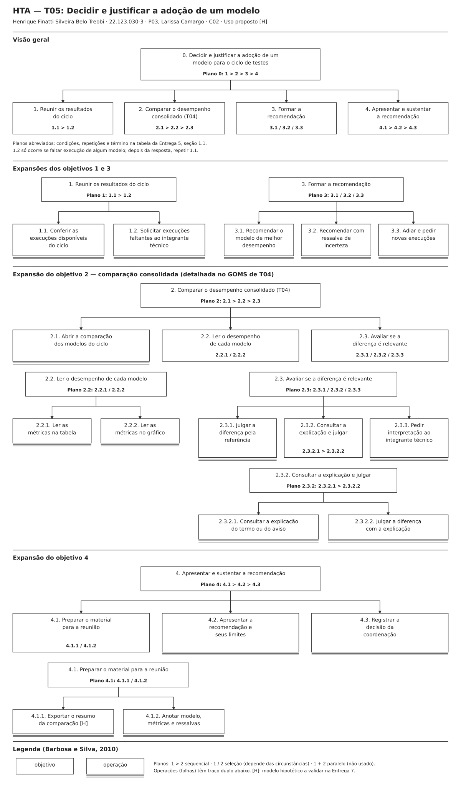

*Figura 1 — HTA de T05, por Henrique Finatti Silveira Belo Trebbi. Visão geral e expansões dos objetivos 1 a 4. [SVG editável](../assets/05_tarefas/hta_t05_decidir_modelo.svg).*

Retângulos representam objetivos; operações (folhas) têm traço duplo abaixo. Os planos usam `>` para sequência e `/` para seleção condicionada. A tabela completa os planos abreviados do diagrama com as condições de cada escolha.

#### Decomposição e planos

| Objetivos / Operações | Problemas e Recomendações |
|---|---|
| **0. Decidir e justificar a adoção de um modelo para o ciclo de testes** | **Input:** ciclo de testes e data da reunião com a coordenação; execuções dos modelos candidatos realizadas por P01 na interface; expectativa de uma escolha defensável, e não apenas do maior número (C02, Q10). **Plano 0:** `1 > 2 > 3 > 4`. Se faltar execução em 1, executar 1.2, aguardar e repetir 1.1. Se 3 terminar em 3.3, o objetivo 4 comunica o adiamento. **Feedback:** recomendação apresentada com modelo, métricas, referência e ressalvas, e decisão da coordenação registrada; ou adiamento registrado com o que falta executar. **Problema:** hoje os números chegam dispersos, sem referência, e a escolha é difícil de sustentar (C02). **Recomendação:** reunir a comparação em um só lugar e apoiar a justificativa em linguagem simples (P03, decisões 1 e 3). |
| **1. Reunir os resultados do ciclo** | **Plano 1:** `1.1 > 1.2`; 1.2 somente se algum modelo candidato não tiver execução. **Recomendação:** mostrar quais modelos têm execução concluída e sobre qual conjunto de imagens. |
| 1.1. Conferir as execuções disponíveis do ciclo | **Ação:** verificar se cada modelo candidato tem execução concluída sobre o mesmo conjunto de imagens. **Problema [H]:** comparar execuções feitas em conjuntos diferentes leva a uma conclusão incorreta. **Recomendação:** identificar o conjunto de imagens e a data de cada execução. |
| 1.2. Solicitar execuções faltantes ao integrante técnico | **Ação:** pedir a P01, por mensagem, a execução dos modelos que faltam. **Problema:** a dependência do colega técnico continua (C02, Q11); a interface não executa por Larissa. **Recomendação:** permitir que Larissa identifique exatamente qual modelo falta, para pedir uma vez só. |
| **2. Comparar o desempenho consolidado (T04)** | **Plano 2:** `2.1 > 2.2 > 2.3`. Detalhado no GOMS de T04 (seção 1.2). **Recomendação:** apresentar todos os modelos do ciclo em uma única visão (P03, decisão 1). |
| 2.1. Abrir a comparação dos modelos do ciclo | **Ação:** abrir a visão consolidada dos modelos do ciclo. **Recomendação:** exibir junto o conjunto de imagens usado, para que Larissa confirme que está comparando o ciclo certo. |
| **2.2. Ler o desempenho de cada modelo** | **Plano 2.2:** `2.2.1 / 2.2.2`. Tabela quando precisa de valores exatos ou as barras estão próximas; gráfico para visão geral quando a diferença é visível. **Recomendação:** oferecer as duas formas (RC03, cuja evidência está em revisão, `PENDENCIAS.md` INC-22). |
| 2.2.1. Ler as métricas na tabela | **Ação:** ler IoU médio e acurácia de cada modelo e o valor de referência. **Recomendação:** destacar o maior valor de cada métrica. |
| 2.2.2. Ler as métricas no gráfico | **Ação:** comparar as barras dos modelos com a linha de referência. **Problema:** barras próximas não permitem ler a diferença; nesse caso, usar 2.2.1. |
| **2.3. Avaliar se a diferença é relevante** | **Plano 2.3:** `2.3.1 / 2.3.2 / 2.3.3`. 2.3.1 se os termos são conhecidos, há referência e a diferença é clara; 2.3.2 se há termo desconhecido, diferença pequena ou aviso de resultado inconclusivo; 2.3.3 se a dúvida persistir depois de 2.3.2. **Problema:** hoje Larissa não sabe se uma diferença pequena é relevante e escolhe o maior número (C02, Q14). |
| 2.3.1. Julgar a diferença pela referência | **Ação:** comparar a diferença entre os modelos com a referência e decidir se ela é relevante. **Problema [H]:** o valor de referência é hipótese de design (P03, decisão 2); sem ele, o julgamento passa a 2.3.2. |
| **2.3.2. Consultar a explicação e julgar** | **Plano 2.3.2:** `2.3.2.1 > 2.3.2.2`. **Recomendação:** explicar no ponto de uso o que a métrica indica e o que não indica (RC01; P03, decisão 3). |
| 2.3.2.1. Consultar a explicação do termo ou do aviso | **Ação:** abrir a explicação de IoU, acurácia ou do aviso de resultado inconclusivo. **Problema:** ainda não se sabe quais termos geram dúvida (C02, Q15); investigar na Entrega 7. |
| 2.3.2.2. Julgar a diferença com a explicação | **Ação:** decidir se a diferença é relevante, se é inconclusiva ou se a dúvida persiste. |
| 2.3.3. Pedir interpretação ao integrante técnico | **Ação:** enviar a dúvida a P01 por mensagem e aguardar a resposta. **Problema:** reintroduz a dependência de colegas que a interface pretende reduzir. **Recomendação:** registrar na Entrega 7 quais dúvidas levam a este passo, para avaliar se a explicação de 2.3.2 é suficiente. |
| **3. Formar a recomendação** | **Plano 3:** `3.1 / 3.2 / 3.3`. 3.1 se a diferença é relevante; 3.2 se é pequena ou inconclusiva, mas a decisão não pode esperar o próximo ciclo; 3.3 se é inconclusiva e há tempo para novas execuções antes do teste. **Problema:** hoje, sem critério, a escolha vai para o número maior (C02). |
| 3.1. Recomendar o modelo de melhor desempenho | **Ação:** escolher o modelo que se destaca nas métricas avaliadas como relevantes. |
| 3.2. Recomendar com ressalva de incerteza | **Ação:** escolher um modelo e registrar que a diferença é pequena ou inconclusiva. **Recomendação:** sinalizar quando o resultado é inconclusivo (P03, decisão 5). |
| 3.3. Adiar e pedir novas execuções | **Ação:** não recomendar ainda e identificar o que precisa ser executado. **Problema:** adiar pode atrasar o ciclo de testes (C02, Q16). |
| **4. Apresentar e sustentar a recomendação** | **Plano 4:** `4.1 > 4.2 > 4.3`. **Problema:** hoje Larissa leva só os números e tem dificuldade de sustentar a escolha (C02, Q17). |
| **4.1. Preparar o material para a reunião** | **Plano 4.1:** `4.1.1 / 4.1.2`. 4.1.1 se a interface oferecer resumo exportável; senão, 4.1.2. **Recomendação:** o material deve trazer modelo, métricas, referência e ressalvas. |
| 4.1.1. Exportar o resumo da comparação [H] | **Ação:** solicitar o resumo e conferir se ele traz o modelo e as ressalvas. **Problema:** exportação não consta no recorte da Entrega 1 (§11); é hipótese de design (P03, decisão 4) a confirmar. |
| 4.1.2. Anotar modelo, métricas e ressalvas | **Ação:** registrar manualmente o que será apresentado. **Problema [H]:** a cópia manual pode introduzir erro de transcrição. |
| 4.2. Apresentar a recomendação e seus limites | **Ação:** expor o modelo, as métricas, as ressalvas e que métrica não equivale a segurança do trajeto (Entrega 1, §4.3). Com 3.3, comunicar o adiamento e o que falta executar. **Recomendação:** incluir a frase de limites no material de 4.1. |
| 4.3. Registrar a decisão da coordenação | **Ação:** anotar o modelo adotado, ou o adiamento e o novo prazo, com o motivo. |

#### Verificação do HTA

O objetivo 0 é uma meta de Larissa no mundo real (decidir e justificar), não "usar o sistema". Cada objetivo decomposto tem dois ou mais filhos e um plano; as folhas são operações. As escolhas (`/`) estão em 2.2, 2.3, 3 e 4.1, todas com condição explícita na tabela; não há paralelismo (`+`). A decomposição para no nível em que a ação passa a depender do desenho da tela, que é tarefa da Entrega 6.

### 1.2 GOMS — T04 Comparar o desempenho consolidado entre modelos

**Abordagem:** GOMS hierárquico, como no exemplo detalhado da aula. Não se aplica o KLM: a interface ainda não está desenhada, e tempos de operadores seriam inventados.

**Precondições [H]:** a comparação está acessível na interface; os modelos candidatos do ciclo têm execução concluída sobre o mesmo conjunto de imagens, com anotação de referência para as métricas (objetivo 1 da T05). As metas 0 e 1 têm um único caminho e não recebem métodos. As metas 2 e 3 correspondem às escolhas 2.2 e 2.3 do HTA e por isso têm métodos e regras de seleção.

```text
GOAL 0: identificar o modelo de melhor desempenho e se a diferença entre os modelos é relevante
  GOAL 1: abrir a comparação dos modelos do ciclo
    OP. 1.1: acionar a comparação entre modelos
    OP. 1.2: localizar o ciclo de testes em pauta
    OP. 1.3: ler os modelos e o conjunto de imagens exibidos
    OP. 1.4: verificar que todos os modelos candidatos aparecem com o mesmo conjunto de imagens
  GOAL 2: ler o desempenho de cada modelo
    METHOD 2.A: ler na tabela
    (SEL. RULE: precisa comparar valores exatos ou as barras do gráfico estão próximas)
      OP. 2.A.1: selecionar a visualização em tabela
      OP. 2.A.2: localizar a linha de cada modelo
      OP. 2.A.3: ler o IoU médio de cada modelo
      OP. 2.A.4: ler a acurácia de cada modelo
      OP. 2.A.5: ler o valor de referência
      OP. 2.A.6: verificar qual modelo tem o maior valor em cada métrica
    METHOD 2.B: ler no gráfico
    (SEL. RULE: quer uma visão geral e as barras dos modelos estão visivelmente separadas)
      OP. 2.B.1: selecionar a visualização em gráfico
      OP. 2.B.2: comparar a altura das barras de cada modelo
      OP. 2.B.3: localizar a linha de referência
      OP. 2.B.4: verificar qual modelo se destaca e em quais métricas
  GOAL 3: avaliar se a diferença entre os modelos é relevante
    METHOD 3.A: julgar pela referência
    (SEL. RULE: termos conhecidos, referência exibida, diferença clara
     e nenhum aviso de resultado inconclusivo)
      OP. 3.A.1: comparar a diferença entre os modelos com a referência
      OP. 3.A.2: decidir se a diferença é relevante
      OP. 3.A.3: verificar que o julgamento se apoia nos valores lidos na meta 2
    METHOD 3.B: consultar a explicação no ponto de uso
    (SEL. RULE: termo desconhecido, diferença pequena, referência ausente
     ou aviso de resultado inconclusivo)
      OP. 3.B.1: acionar a explicação do termo ou do aviso
      OP. 3.B.2: ler o que a métrica indica
      OP. 3.B.3: ler o que a métrica não indica
      OP. 3.B.4: ler o motivo do aviso de incerteza, quando houver
      OP. 3.B.5: decidir se a diferença é relevante, inconclusiva ou se a dúvida persiste
      OP. 3.B.6: verificar se a explicação respondeu à dúvida
    METHOD 3.C: pedir interpretação ao integrante técnico
    (SEL. RULE: a dúvida persiste depois de 3.B)
      OP. 3.C.1: anotar o termo ou a diferença que gerou a dúvida
      OP. 3.C.2: enviar mensagem ao integrante técnico com a dúvida
      OP. 3.C.3: aguardar a resposta
      OP. 3.C.4: ler a interpretação recebida
      OP. 3.C.5: decidir se a diferença é relevante ou inconclusiva
      OP. 3.C.6: verificar que a interpretação recebida é compatível com os valores lidos na meta 2
  OP. 0.1: verificar que identificou o modelo de melhor desempenho e se a diferença é relevante ou inconclusiva
```

**Regras e repetições:** a meta 2 pode ser repetida com o outro método (ex.: começar pelo gráfico e, com barras próximas, passar à tabela). Na meta 3, o método 3.C só é selecionado depois de 3.B, nunca no lugar dele: a explicação no ponto de uso é tentada antes de recorrer ao colega. Enquanto 3.C aguarda a resposta (OP. 3.C.3), a tarefa fica suspensa; no CTT, isso corresponde à suspensão de R por E.

**Correspondência com o HTA da T05:** GOAL 1 ↔ 2.1; GOAL 2 ↔ 2.2 (2.A ↔ 2.2.1, 2.B ↔ 2.2.2); GOAL 3 ↔ 2.3 (3.A ↔ 2.3.1, 3.B ↔ 2.3.2, 3.C ↔ 2.3.3). Ler e comparar são operadores perceptivos; acionar, selecionar e enviar são motores; decidir e verificar são cognitivos.

### 1.3 CTT — T05 Decidir e justificar a adoção de um modelo

**Fronteira dos sistemas:** consulta das execuções, comparação, explicação e resumo na interface proposta; mensagens com o integrante técnico e a reunião com a coordenação fora dela. O sistema exibe e calcula; não decide pelo usuário.

#### Diagrama

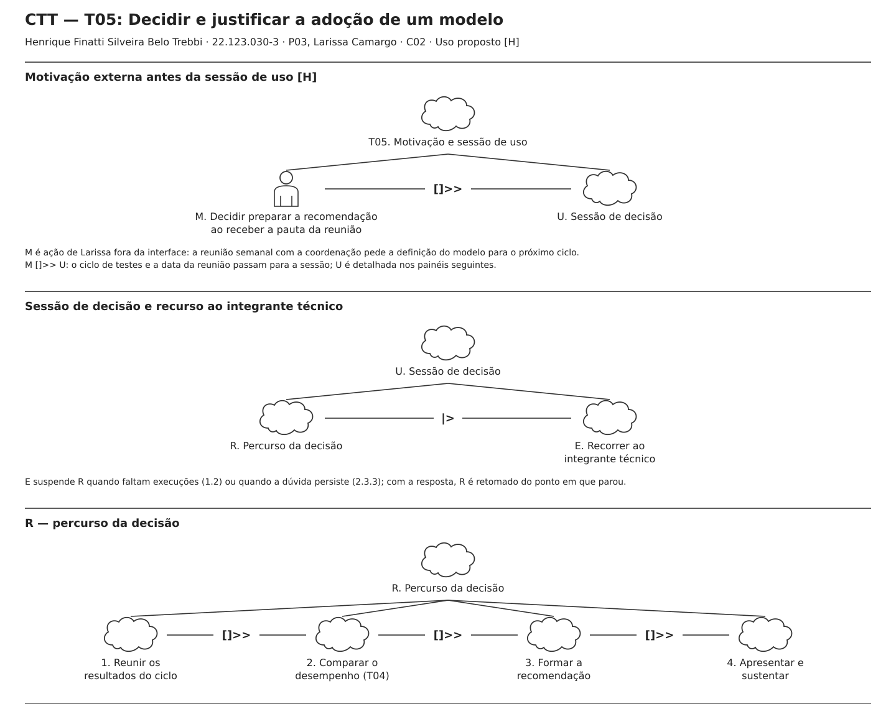

*Figura 2 — CTT de T05, visão geral, por Henrique Finatti Silveira Belo Trebbi. Os detalhamentos abaixo são recortes da mesma árvore, com os mesmos IDs e relações. [SVG completo e editável](../assets/05_tarefas/ctt_t05_decidir_modelo.svg).*

<details>
<summary>T05: detalhamento 1 — ramos 1 e 2</summary>

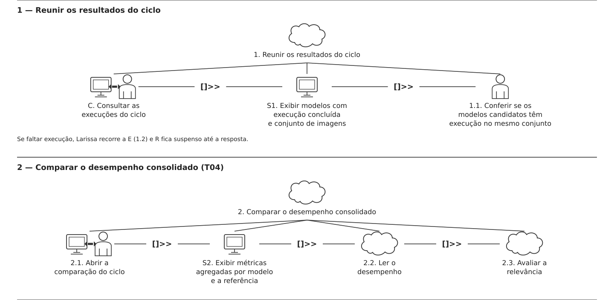

</details>

<details>
<summary>T05: detalhamento 2 — 2.2, 2.3 e 2.3.2</summary>

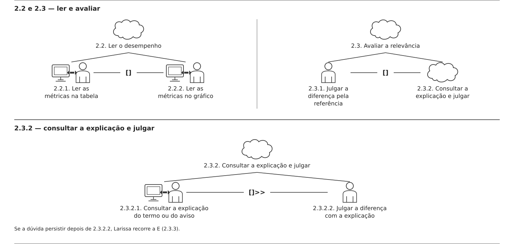

</details>

<details>
<summary>T05: detalhamento 3 — ramos 3, 4 e 4.1</summary>

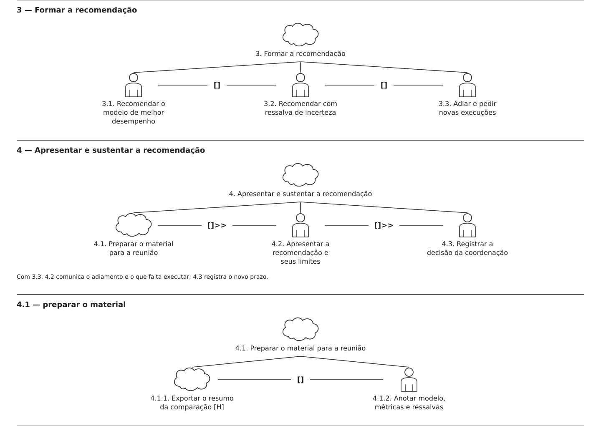

</details>

<details>
<summary>T05: detalhamento 4 — 4.1.1, E e legenda</summary>

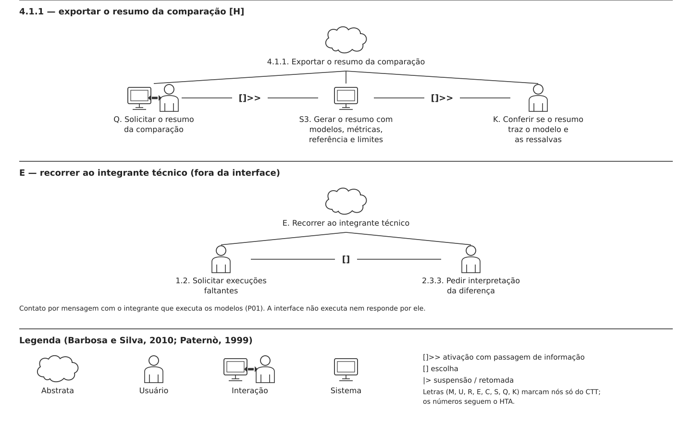

</details>

#### Leitura da árvore

Os IDs numéricos seguem o HTA. As letras marcam nós que só existem no CTT: `M` (motivação externa), `U` (sessão), `R` (percurso), `E` (recurso ao integrante técnico), `C`, `Q` e `K` (interações e conferências) e `S1`–`S3` (tarefas do sistema).

1. **Motivação e sessão:** `T05 = M []>> U`. Fora da interface, a pauta da reunião semanal pede a definição do modelo, e Larissa decide preparar a recomendação. O ciclo de testes e a data da reunião passam para a sessão U.
2. **Sessão:** `U = R |> E`. O percurso R pode ser suspenso por E sempre que faltar execução (1.2) ou a dúvida persistir (2.3.3); com a resposta do colega, R é retomado do ponto em que parou.
3. **Percurso:** `R = 1 []>> 2 []>> 3 []>> 4`. Cada ramo passa sua informação ao seguinte: execuções conferidas, julgamento da diferença, recomendação.
4. **Reunir:** `1 = C []>> S1 []>> 1.1`. Larissa consulta as execuções, o sistema exibe os modelos com execução concluída e o conjunto de imagens, e ela confere se pode comparar.
5. **Comparar:** `2 = 2.1 []>> S2 []>> 2.2 []>> 2.3`, com `2.2 = 2.2.1 [] 2.2.2`, `2.3 = 2.3.1 [] 2.3.2` e `2.3.2 = 2.3.2.1 []>> 2.3.2.2`. O sistema exibe as métricas agregadas e a referência (S2); Larissa escolhe entre tabela e gráfico e entre julgar direto ou consultar a explicação.
6. **Recomendar:** `3 = 3.1 [] 3.2 [] 3.3`. Iniciar uma alternativa desabilita as outras.
7. **Sustentar:** `4 = 4.1 []>> 4.2 []>> 4.3`, com `4.1 = 4.1.1 [] 4.1.2` e `4.1.1 = Q []>> S3 []>> K`. O resumo gerado pelo sistema (S3) é conferido por Larissa (K) antes da reunião.
8. **Recurso ao colega:** `E = 1.2 [] 2.3.3`, ambos fora da interface.

#### Legenda e relações temporais usadas

| Relação CTT | Notação | Ocorrência em T05 |
|---|---|---|
| Ativação com passagem de informação | `T1 []>> T2` | M passa o ciclo e a reunião a U; os ramos 1 a 4 passam execuções, julgamento e recomendação adiante; Q passa o pedido a S3. |
| Escolha | `T1 [] T2` | Tabela ou gráfico (2.2); julgar direto ou consultar a explicação (2.3); as três recomendações (3); exportar ou anotar (4.1); o motivo do recurso ao colega (E). |
| Suspensão/retomada | `T1 \|> T2` | E suspende R; R é retomado depois da resposta do integrante técnico. |

Não há concorrência (`|||`): Larissa lê, julga e prepara a recomendação em sequência. Não há desativação (`[>`): nenhum ramo é encerrado sem retomada.

#### Tipos de tarefas

| Símbolo no diagrama | Tipo | Tarefas no modelo |
|---|---|---|
| Nuvem | Abstrata | T05, U, R, E, ramos 1 a 4, 2.2, 2.3, 2.3.2, 4.1 e 4.1.1. |
| Pessoa | Usuário | M (fora da interface); 1.1, 2.3.1, 2.3.2.2 e K (julgamentos e conferências); 3.1 a 3.3; 4.1.2, 4.2 e 4.3; 1.2 e 2.3.3 (mensagem ao colega, fora da interface). |
| Pessoa e computador, com seta dupla | Interação | C, 2.1, 2.2.1, 2.2.2, 2.3.2.1 e Q. |
| Computador | Sistema | S1 (exibir execuções), S2 (exibir métricas agregadas e referência) e S3 (gerar o resumo). |

### 1.4 Correspondência entre os três modelos

| Escolha no HTA | Métodos no GOMS (T04) | Relação no CTT |
|---|---|---|
| 1: `1.1 > 1.2`, 1.2 só se faltar execução | Precondição do GOMS (execuções disponíveis) | 1.2 está em E, que suspende R (`\|>`) |
| 2.2: `2.2.1 / 2.2.2` | 2.A (tabela) / 2.B (gráfico) | `2.2.1 [] 2.2.2` |
| 2.3: `2.3.1 / 2.3.2 / 2.3.3` | 3.A / 3.B / 3.C | `2.3.1 [] 2.3.2`; 2.3.3 está em E, que suspende R |
| 3: `3.1 / 3.2 / 3.3` | Fora do GOMS (a T04 termina no julgamento da diferença) | `3.1 [] 3.2 [] 3.3` |
| 4.1: `4.1.1 / 4.1.2` | Fora do GOMS | `4.1.1 [] 4.1.2` |

As sequências (`>`) do HTA não recebem métodos no GOMS e aparecem como `[]>>` no CTT. O pedido ao integrante técnico (1.2 e 2.3.3) é uma escolha no HTA, mas no CTT é modelado como suspensão, porque a tarefa fica parada à espera da resposta e é retomada do mesmo ponto.

### 1.5 Síntese e implicações para o projeto

Os modelos são **propostas a validar**, derivadas de C02 e da P03:

1. **Comparação no ciclo certo:** antes de comparar, Larissa precisa confirmar que todos os modelos foram executados sobre o mesmo conjunto de imagens (1.1, GOMS OP. 1.4). A interface deve mostrar isso junto da comparação.
2. **Diferença pequena é o ponto crítico:** o caminho que mais se afasta do processo atual é 2.3.2 (explicação no ponto de uso). Se ele não resolver a dúvida, a tarefa volta a depender do colega (2.3.3), como hoje.
3. **Incerteza explícita:** a recomendação com ressalva (3.2) e o adiamento (3.3) são desfechos legítimos, não falhas da tarefa. A interface não deve forçar a escolha de um "vencedor".
4. **Material para a reunião:** a T05 só termina fora da interface (4.2 e 4.3). O resumo exportável (4.1.1) é a única hipótese de design desta seção fora do recorte da Entrega 1 e precisa ser decidido pela equipe.

**Continuidade da investigação [?]:** na Entrega 7, verificar com um integrante de gestão (perfil P03) como os resultados chegam hoje e com que antecedência (C02, Q11); quais termos geram dúvida (Q15); como ele reconhece que uma diferença é relevante (Q14); e o que leva à reunião (Q17). Esses pontos podem confirmar ou derrubar os métodos 3.B e 3.C e a alternativa 4.1.1.

---

## 2. Tiago Fagundes dos Santos — P01 (Rafael Pereira)

**Autor(a):** Tiago Fagundes dos Santos — 22.123.017-0  
**Persona:** P01 — Rafael Pereira, analista de segmentação (persona prioritária)  
**Cenário de origem:** C01 — Validação manual de segmentação em campo (processo atual)  
**Tarefas modeladas:** T03 (HTA e CTT) e T01 (GOMS). A T02 é o objetivo 2 da T03 e a T01 é o objetivo 3: o GOMS detalha esse ramo.  
**Rastreabilidade:** R01, R02, R03; H02, H04, H05, H06; RC01, RC03, RC04; F01, F03; decisões de design 1, 2 e 3 da P01 (Entrega 3).

**Recorte comum aos três modelos [H]:**

- Rafael executa e avalia a segmentação **pela interface**, sem scripts nem terminal, que é o objetivo do recorte (Entrega 1, §7.1). A persona sabe programar, mas o modelo não oferece o caminho por script (ver `PENDENCIAS.md`, INC-35).
- Ele usa **configurações já treinadas**; definir e treinar uma configuração não faz parte das tarefas da P01 modeladas aqui (ver premissa 5).
- Visualização lado a lado, sobreposição com opacidade e legenda fixa vêm das decisões 1 e 2 da P01. A **confiança do modelo** por região vem da ruptura do C01 ("sem informação sobre a confiança do resultado") e é hipótese de design.
- **Métricas por classe (IoU) só existem quando a imagem tem anotação de referência** (máscara feita à mão). Uma imagem nova de campo normalmente não tem, então a avaliação dela é visual, com apoio da confiança (ver `PENDENCIAS.md`, INC-52). As imagens do conjunto de teste do TCC (Freiburg Forest e Synthetic Offroad) têm máscara de referência.
- Ficam **fora da interface**: a captura das imagens (câmeras do veículo) e a comunicação à equipe. Ficam **fora do modelo**, por falta de sustentação: histórico (H08), exportação, atalhos de teclado (lição da Entrega 2) e modo offline.
- Uma segmentação adequada não autoriza concluir que um trajeto é transitável ou seguro (Entrega 1, §4.3).

### 2.1 HTA — T03 Comparar o resultado de uma imagem entre configurações

#### Descrição da tarefa

- **Objetivo central [H]:** saber qual configuração segmenta melhor uma imagem de campo que gerou dúvida, ou concluir que nenhuma é adequada ou que o resultado é inconclusivo.
- **Entrada [H]:** imagem coletada no teste de campo; configurações disponibilizadas pelo TCC.
- **Resultado [H]:** conclusão registrada e comunicada à equipe.
- **Exceções [H]:** falha na execução (2.3.2), configuração retirada da comparação (2.3.2.2), avaliação inconclusiva (3.3 e 4.2.3), problema na imagem e não no modelo (4.2.2).
- **Término:** conclusão comunicada à equipe (4.3).

#### Diagrama

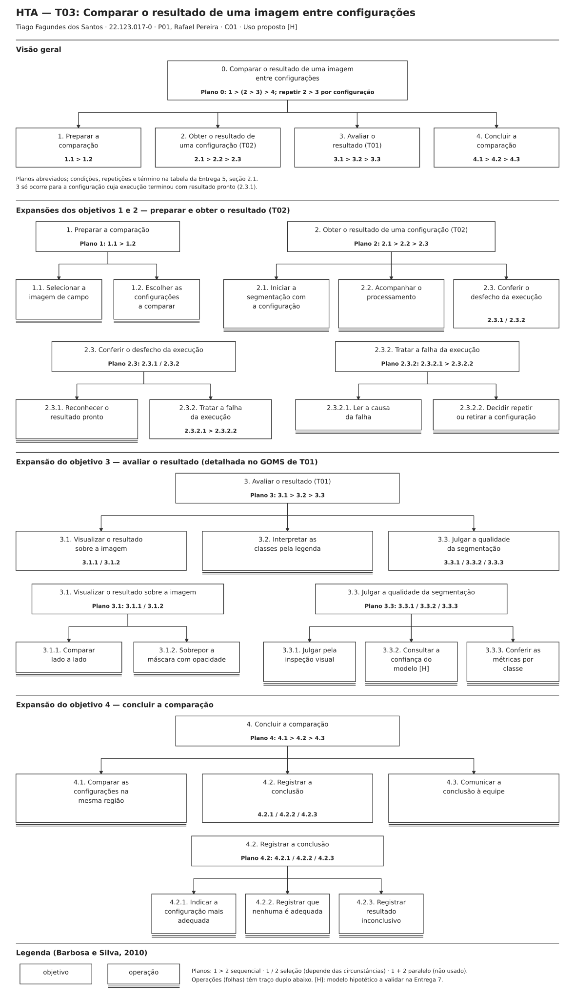

Retângulos representam objetivos; operações (folhas) têm traço duplo abaixo. Os planos usam `>` para sequência e `/` para seleção condicionada. A tabela completa os planos abreviados do diagrama com as condições de cada escolha.

#### Decomposição e planos

| Objetivos / Operações | Problemas e Recomendações |
|---|---|
| **0. Comparar o resultado de uma imagem entre configurações** | **Input:** imagem de campo que gerou dúvida (C01); configurações disponibilizadas pelo TCC; computador do laboratório (Entrega 1, §5.2). **Plano 0:** `1 > (2 > 3) > 4`; repetir `2 > 3` para cada configuração escolhida em 1.2. O objetivo 3 só ocorre se 2 terminar em 2.3.1. **Feedback:** conclusão registrada (configuração mais adequada, nenhuma adequada ou inconclusivo) e comunicada à equipe. **Problema:** hoje cada execução exige script, gera arquivos sem padrão e a comparação se perde entre janelas e planilhas (C01). **Recomendação:** manter a imagem, as configurações e os resultados da mesma comparação reunidos em uma sessão. |
| **1. Preparar a comparação** | **Plano 1:** `1.1 > 1.2`. **Recomendação:** mostrar só as configurações disponibilizadas pelo TCC. |
| 1.1. Selecionar a imagem de campo | **Ação:** escolher o arquivo da imagem coletada no teste. **Recomendação:** exibir a imagem selecionada para Rafael confirmar que é a correta. |
| 1.2. Escolher as configurações a comparar | **Ação:** marcar as configurações a comparar. **Problema [?]:** não se sabe como Rafael decide o que comparar (C01, Q5). **Recomendação:** lista explícita com descrição curta de cada configuração (F01). |
| **2. Obter o resultado de uma configuração (T02)** | **Plano 2:** `2.1 > 2.2 > 2.3`. **Recomendação:** iniciar a execução com um único comando, sem editar parâmetros nem caminhos. |
| 2.1. Iniciar a segmentação com a configuração | **Ação:** confirmar a configuração e iniciar. **Problema:** hoje é preciso ajustar parâmetros e caminhos no script a cada execução (C01; jornada, etapa 2). |
| 2.2. Acompanhar o processamento | **Ação:** acompanhar o estado até a execução concluir ou falhar. **Recomendação:** distinguir processando, concluído e falhou, com indicação de progresso (RC04, F03). Não usar "treinando": Rafael só executa. |
| **2.3. Conferir o desfecho da execução** | **Plano 2.3:** `2.3.1 / 2.3.2`. 2.3.1 se a execução concluiu; 2.3.2 se falhou. |
| 2.3.1. Reconhecer o resultado pronto | **Ação:** reconhecer que o resultado está disponível para avaliação. |
| **2.3.2. Tratar a falha da execução** | **Plano 2.3.2:** `2.3.2.1 > 2.3.2.2`. **Problema:** hoje a falha obriga Rafael a depurar código, mesmo não sendo desenvolvedor (C01). **Recomendação:** dizer o que falhou em linguagem de usuário e o que ele pode fazer. |
| 2.3.2.1. Ler a causa da falha | **Ação:** ler a causa informada. **Problema [H]:** causas técnicas (memória, formato do arquivo) podem não fazer sentido para Rafael. |
| 2.3.2.2. Decidir repetir ou retirar a configuração | **Ação:** repetir a execução (volta a 2.1) ou retirar a configuração da comparação. |
| **3. Avaliar o resultado (T01)** | **Plano 3:** `3.1 > 3.2 > 3.3`. Detalhado no GOMS de T01 (seção 2.2). **Problema:** hoje a máscara é aberta em outra janela e a avaliação não é clara o bastante para apoiar decisões (C01). |
| **3.1. Visualizar o resultado sobre a imagem** | **Plano 3.1:** `3.1.1 / 3.1.2`. 3.1.1 quando precisa ver a imagem original sem a máscara por cima (iluminação, poeira) ou quer uma visão geral; 3.1.2 quando precisa conferir o limite entre classes. **Recomendação:** zoom nas duas visões (P01, decisão 1). |
| 3.1.1. Comparar lado a lado | **Ação:** ver a imagem e a máscara lado a lado, na mesma região. |
| 3.1.2. Sobrepor a máscara com opacidade | **Ação:** sobrepor a máscara à imagem e ajustar a opacidade. |
| 3.2. Interpretar as classes pela legenda | **Ação:** associar cada cor a uma classe pela legenda. **Problema:** hoje as cores não têm padrão entre execuções (jornada, etapa 5). **Recomendação:** paleta fixa e rótulo textual de cada classe (P01, decisão 2; RC01). Os nomes das classes ainda não estão definidos (INC-12). |
| **3.3. Julgar a qualidade da segmentação** | **Plano 3.3:** `3.3.1 / 3.3.2 / 3.3.3`. 3.3.1 se o acerto ou o erro é evidente na região de interesse; 3.3.2 se a inspeção é inconclusiva e a imagem não tem anotação de referência; 3.3.3 se a inspeção é inconclusiva e a imagem tem anotação de referência. **Problema:** hoje Rafael não sabe dizer se a falha é do modelo ou da imagem (C01, Q7). |
| 3.3.1. Julgar pela inspeção visual | **Ação:** comparar a classe atribuída com o terreno visível e decidir. **Problema [?]:** o critério para considerar uma máscara correta ainda não foi levantado (C01, Q7). |
| 3.3.2. Consultar a confiança do modelo [H] | **Ação:** consultar a confiança do modelo na região duvidosa. **Problema [H]:** a confiança não é calibrada e não equivale a acerto. **Recomendação:** explicar o que a confiança indica e o que não indica (RC01). |
| 3.3.3. Conferir as métricas por classe | **Ação:** ler o IoU da classe de interesse. **Problema:** o IoU exige anotação de referência, que imagens novas de campo normalmente não têm (INC-52). **Recomendação:** métricas em tabela e em gráfico (RC03; evidência em revisão, INC-22). |
| **4. Concluir a comparação** | **Plano 4:** `4.1 > 4.2 > 4.3`. **Problema:** hoje as métricas ficam em planilhas diferentes e Rafael "perde o fio da comparação" (C01). |
| 4.1. Comparar as configurações na mesma região | **Ação:** ver os resultados das configurações lado a lado, na mesma região da imagem. **Recomendação:** reunir todas as configurações tratadas em uma única visão, com a avaliação feita em 3. |
| **4.2. Registrar a conclusão** | **Plano 4.2:** `4.2.1 / 4.2.2 / 4.2.3`. 4.2.1 se uma configuração se destaca; 4.2.2 se nenhuma é adequada; 4.2.3 se não há elementos para decidir. **Problema [H]:** onde a conclusão fica guardada depende da necessidade de histórico (H08). |
| 4.2.1. Indicar a configuração mais adequada | **Ação:** indicar a configuração e o motivo. |
| 4.2.2. Registrar que nenhuma é adequada | **Ação:** registrar que nenhuma serve e se o problema parece estar na imagem (captura) ou no modelo. |
| 4.2.3. Registrar resultado inconclusivo | **Ação:** registrar o que impediu a conclusão. |
| 4.3. Comunicar a conclusão à equipe | **Ação:** enviar a conclusão à equipe, fora da interface (C01, Q4). **Problema [H]:** exportar uma imagem comparativa (P01, decisão 4) ajudaria, mas não está no recorte da Entrega 1 até decisão da equipe. |

#### Verificação do HTA

O objetivo 0 é uma meta de Rafael no mundo real (saber qual configuração serve para a imagem), não "usar o sistema". Cada objetivo decomposto tem dois ou mais filhos e um plano; as folhas são operações. As escolhas (`/`) estão em 2.3, 3.1, 3.3 e 4.2, todas com condição explícita; a repetição por configuração está no Plano 0. Não há paralelismo (`+`). A decomposição para no nível em que a ação passa a depender do desenho da tela, que é tarefa da Entrega 6.

### 2.2 GOMS — T01 Avaliar a qualidade da segmentação de uma imagem

**Abordagem:** GOMS hierárquico, como no exemplo detalhado da aula. Não se aplica o KLM: a interface ainda não está desenhada.

**Precondições [H]:** a execução terminou com resultado pronto (2.3.1 da T03); a interface exibe a imagem, a máscara e a legenda. A meta 0 não tem método. A meta 2 tem um único caminho e é descrita direto por operadores. As metas 1 e 3 correspondem às escolhas 3.1 e 3.3 do HTA e por isso têm métodos e regras de seleção.

```text
GOAL 0: avaliar se a segmentação de uma imagem identifica corretamente as regiões do terreno
  GOAL 1: visualizar o resultado sobre a imagem
    METHOD 1.A: comparar lado a lado
    (SEL. RULE: precisa ver a imagem original sem a máscara por cima
     ou quer uma visão geral do resultado)
      OP. 1.A.1: selecionar a visualização lado a lado
      OP. 1.A.2: ampliar a região de interesse
      OP. 1.A.3: localizar a mesma região na imagem e na máscara
      OP. 1.A.4: verificar que a mesma região está visível nas duas
    METHOD 1.B: sobrepor a máscara com opacidade
    (SEL. RULE: precisa conferir o limite entre classes em uma região específica)
      OP. 1.B.1: selecionar a sobreposição
      OP. 1.B.2: ampliar a região de interesse
      OP. 1.B.3: ajustar a opacidade da máscara
      OP. 1.B.4: verificar que o terreno e o limite entre as classes estão visíveis ao mesmo tempo
  GOAL 2: interpretar as classes da máscara
    OP. 2.1: ler a legenda
    OP. 2.2: associar cada cor da região de interesse a uma classe
    OP. 2.3: verificar que todas as cores da região de interesse têm classe na legenda
  GOAL 3: julgar a qualidade da segmentação
    METHOD 3.A: julgar pela inspeção visual
    (SEL. RULE: o acerto ou o erro é evidente na região de interesse)
      OP. 3.A.1: comparar a classe atribuída com o terreno visível na imagem
      OP. 3.A.2: examinar a imagem original em busca de problema de captura
      OP. 3.A.3: decidir se o resultado é adequado ou inadequado
      OP. 3.A.4: verificar que a decisão distingue erro do modelo de problema da imagem
    METHOD 3.B: consultar a confiança do modelo
    (SEL. RULE: inspeção visual inconclusiva e a imagem não tem anotação de referência)
      OP. 3.B.1: acionar a exibição da confiança
      OP. 3.B.2: localizar a região duvidosa
      OP. 3.B.3: ler a confiança do modelo nessa região
      OP. 3.B.4: decidir se o resultado é adequado, inadequado ou inconclusivo
      OP. 3.B.5: verificar que a decisão não trata confiança alta como acerto garantido
    METHOD 3.C: conferir as métricas por classe
    (SEL. RULE: inspeção visual inconclusiva e a imagem tem anotação de referência)
      OP. 3.C.1: abrir as métricas da execução
      OP. 3.C.2: localizar a classe de interesse
      OP. 3.C.3: ler o IoU da classe
      OP. 3.C.4: comparar o IoU com a impressão da inspeção visual
      OP. 3.C.5: decidir se o resultado é adequado, inadequado ou inconclusivo
      OP. 3.C.6: verificar que a decisão se apoia na classe de interesse, e não só na média
  OP. 0.1: verificar que a avaliação indica se o resultado é adequado, inadequado ou inconclusivo, e por quê
```

**Regras e repetições:** a meta 1 pode ser repetida com o outro método (ex.: ver lado a lado e, com dúvida no limite da pista, passar à sobreposição). Na meta 3, Rafael sempre começa pela inspeção visual; os métodos 3.B e 3.C só são selecionados quando ela é inconclusiva, e a escolha entre eles depende de a imagem ter anotação de referência. A comparação **entre** configurações não faz parte da T01: acontece no objetivo 4 da T03.

**Correspondência com o HTA da T03:** GOAL 1 ↔ 3.1 (1.A ↔ 3.1.1, 1.B ↔ 3.1.2); GOAL 2 ↔ 3.2; GOAL 3 ↔ 3.3 (3.A ↔ 3.3.1, 3.B ↔ 3.3.2, 3.C ↔ 3.3.3). Ler, localizar e examinar são operadores perceptivos; selecionar, ampliar e ajustar são motores; associar, decidir e verificar são cognitivos.

### 2.3 CTT — T03 Comparar o resultado de uma imagem entre configurações

**Fronteira dos sistemas:** seleção da imagem, escolha das configurações, execução, visualização, legenda, confiança, métricas e comparação na interface proposta; captura da imagem e comunicação à equipe fora dela. O sistema processa e exibe; não decide qual configuração é a melhor.

#### Diagrama

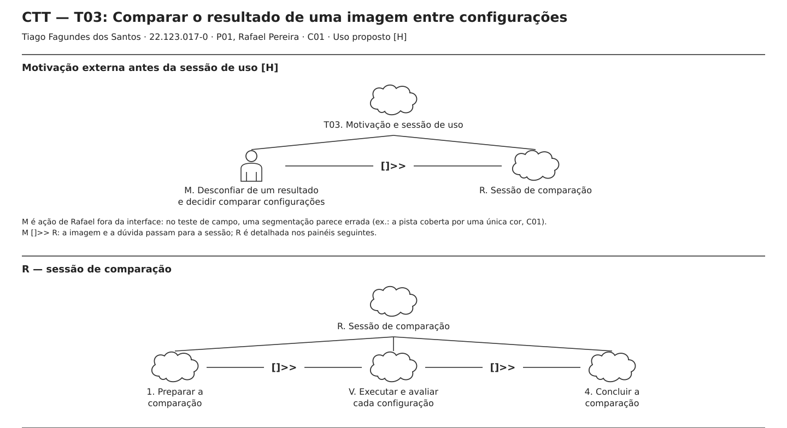

<details>
<summary>T03: detalhamento 1 — preparar e repetir por configuração</summary>

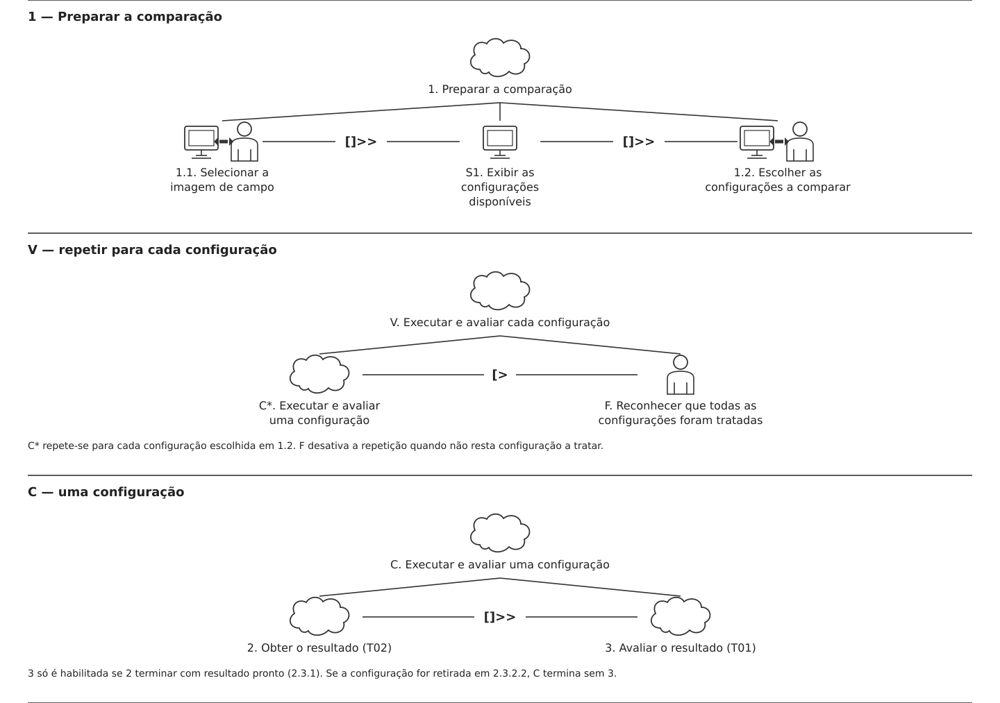

</details>

<details>
<summary>T03: detalhamento 2 — obter o resultado (T02)</summary>

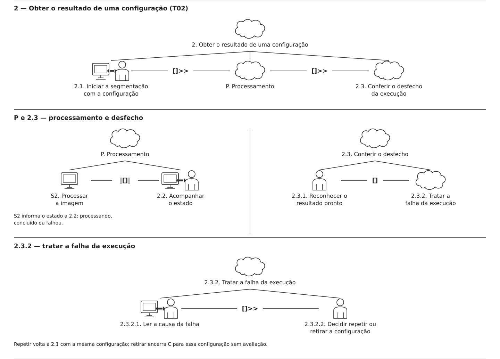

</details>

<details>
<summary>T03: detalhamento 3 — avaliar o resultado (T01)</summary>

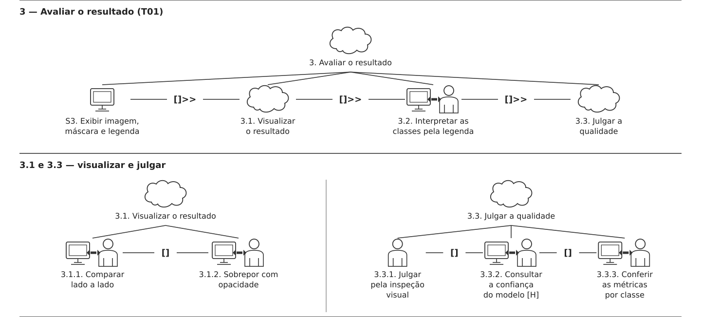

</details>

<details>
<summary>T03: detalhamento 4 — concluir a comparação e legenda</summary>

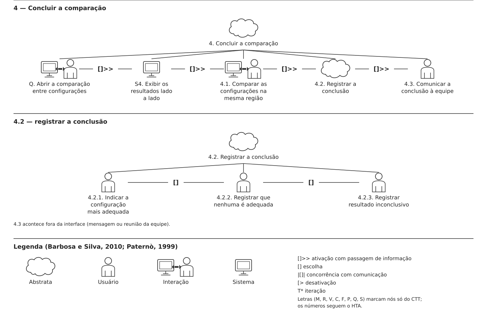

</details>

#### Leitura da árvore

Os IDs numéricos seguem o HTA. As letras marcam nós que só existem no CTT: `M` (motivação externa), `R` (sessão), `V` (repetição por configuração), `C` (uma configuração), `F` (fim da repetição), `P` (processamento), `Q` (abrir a comparação) e `S1`–`S4` (tarefas do sistema).

1. **Motivação e sessão:** `T03 = M []>> R`. No teste de campo, uma segmentação parece errada (ex.: a pista coberta por uma única cor, C01), e Rafael decide comparar configurações. A imagem e a dúvida passam para a sessão.
2. **Sessão:** `R = 1 []>> V []>> 4`.
3. **Preparar:** `1 = 1.1 []>> S1 []>> 1.2`. O sistema exibe as configurações disponíveis (S1) depois que a imagem é selecionada.
4. **Repetir por configuração:** `V = C* [> F`. C se repete para cada configuração escolhida; F (reconhecer que todas foram tratadas) desativa a repetição.
5. **Uma configuração:** `C = 2 []>> 3`. O ramo 3 só é habilitado se 2 terminar com resultado pronto (2.3.1).
6. **Obter o resultado:** `2 = 2.1 []>> P []>> 2.3`, com `P = S2 |[]| 2.2`. O sistema processa a imagem (S2) e, ao mesmo tempo, informa o estado a Rafael, que acompanha (2.2). Depois, `2.3 = 2.3.1 [] 2.3.2` e `2.3.2 = 2.3.2.1 []>> 2.3.2.2`; repetir volta a 2.1, retirar encerra C sem avaliação.
7. **Avaliar:** `3 = S3 []>> 3.1 []>> 3.2 []>> 3.3`, com `3.1 = 3.1.1 [] 3.1.2` e `3.3 = 3.3.1 [] 3.3.2 [] 3.3.3`.
8. **Concluir:** `4 = Q []>> S4 []>> 4.1 []>> 4.2 []>> 4.3`, com `4.2 = 4.2.1 [] 4.2.2 [] 4.2.3`. A comunicação (4.3) acontece fora da interface.

#### Legenda e relações temporais usadas

| Relação CTT | Notação | Ocorrência em T03 |
|---|---|---|
| Ativação com passagem de informação | `T1 []>> T2` | M passa a imagem e a dúvida a R; a imagem passa às configurações (1); o resultado passa à avaliação (C); as avaliações passam à conclusão (4). |
| Escolha | `T1 [] T2` | Resultado pronto ou falha (2.3); lado a lado ou sobreposição (3.1); visual, confiança ou métricas (3.3); as três conclusões (4.2). |
| Concorrência com comunicação | `T1 \|[]\| T2` | S2 processa enquanto Rafael acompanha o estado (2.2), e o sistema comunica processando, concluído ou falhou. |
| Desativação | `T1 [> T2` | F encerra a repetição de C. |
| Iteração | `T*` | C* repete-se para cada configuração. |

Não há suspensão (`|>`): interrupções durante a análise (Entrega 1, §5.3) ainda são hipótese e não foram modeladas.

#### Tipos de tarefas

| Símbolo no diagrama | Tipo | Tarefas no modelo |
|---|---|---|
| Nuvem | Abstrata | T03, R, V, C, P, ramos 1 a 4, 2.3, 2.3.2, 3.1, 3.3 e 4.2. |
| Pessoa | Usuário | M (fora da interface); F; 2.3.1 e 2.3.2.2; 3.3.1; 4.2.1 a 4.2.3; 4.3 (fora da interface). |
| Pessoa e computador, com seta dupla | Interação | 1.1, 1.2, 2.1, 2.2, 2.3.2.1, 3.1.1, 3.1.2, 3.2, 3.3.2, 3.3.3, Q e 4.1. |
| Computador | Sistema | S1 (exibir configurações), S2 (processar a imagem), S3 (exibir imagem, máscara e legenda) e S4 (exibir resultados lado a lado). |

### 2.4 Correspondência entre os três modelos

| Escolha ou repetição no HTA | Métodos no GOMS (T01) | Relação no CTT |
|---|---|---|
| Plano 0: repetir `2 > 3` por configuração | Fora do GOMS (a T01 avalia uma execução) | `V = C* [> F` |
| 2.3: `2.3.1 / 2.3.2` | Fora do GOMS (precondição: resultado pronto) | `2.3.1 [] 2.3.2` |
| 3.1: `3.1.1 / 3.1.2` | 1.A / 1.B | `3.1.1 [] 3.1.2` |
| 3.3: `3.3.1 / 3.3.2 / 3.3.3` | 3.A / 3.B / 3.C | `3.3.1 [] 3.3.2 [] 3.3.3` |
| 4.2: `4.2.1 / 4.2.2 / 4.2.3` | Fora do GOMS | `4.2.1 [] 4.2.2 [] 4.2.3` |

As sequências (`>`) do HTA não recebem métodos no GOMS e aparecem como `[]>>` no CTT. Uma diferença deliberada: no HTA, acompanhar o processamento (2.2) vem depois de iniciar (2.1); no CTT, ele acontece **ao mesmo tempo** que o processamento do sistema (`S2 |[]| 2.2`), o que o HTA não consegue representar porque não modela o sistema.

### 2.5 Síntese e implicações para o projeto

Os modelos são **propostas a validar**, derivadas de C01 e da P01:

1. **Execução sem script, com estado claro:** o ramo 2 só funciona se a interface distinguir processando, concluído e falhou, e explicar a falha em linguagem de usuário (RC04).
2. **Imagem ou modelo:** a ruptura central do C01 é não saber se o erro vem do modelo ou da captura. Ela aparece em 3.A.2 (examinar a imagem original) e em 4.2.2 (registrar onde parece estar o problema).
3. **Métricas dependem de anotação:** para imagens novas de campo, a avaliação é visual, com apoio da confiança `[H]`. A interface não deve prometer IoU para toda imagem (INC-52).
4. **Comparação reunida:** reunir as configurações na mesma visão (4.1) responde ao "perder o fio da comparação" do C01.

**Continuidade da investigação [?]:** na Entrega 7, verificar com um integrante que faz a análise de segmentação (perfil P01) como escolhe as configurações a comparar (C01, Q5); qual critério usa para considerar a máscara correta (Q7); se as imagens de campo costumam ter anotação de referência; se a confiança do modelo ajudaria a decidir; e quantas imagens e configurações avalia por sessão (Q9).

---

## 3. Mateus Marana Assuena — P02 (Andreia Silva)

**Autor(a):** Mateus Marana Assuena — 22.123.026-1  
**Persona:** P02 — Andreia Silva  
**Cenário de origem:** C03 — Experimentação e análises de modelos para segmentação 
**Tarefas modeladas:** T06 e T07
**Rastreabilidade:** R03; H01, H04; Q18, Q21, Q26. R03; H01, H04; Q22, Q24; decisões de design relacionadas à visualização. R03; H01, H04; Q18, Q19, Q20; decisões de design relacionadas à comparação.

**Recorte comum aos três modelos [H]:**

- Andreia executa, analisa e compara os resultados da segmentação **pela interface**, sem precisar recorrer a scripts ou ao terminal. Embora tenha conhecimento de Python e visão computacional, o objetivo do sistema é centralizar essas atividades em uma interface.
- Ela utiliza apenas **modelos pré-treinados disponibilizados pelo sistema**; não cria, treina ou modifica modelos.
- As entradas consideradas são **imagens e vídeos gravados**. A captura de imagens pelas câmeras do veículo fica fora do escopo da interface.
- A análise visual considera a imagem original, as máscaras geradas e as sobreposições, permitindo inspecionar os resultados e identificar diferenças entre modelos.
- A comparação considera a mesma entrada processada por diferentes modelos, para que as diferenças observadas sejam atribuídas aos modelos, e não a arquivos distintos.
- **Métricas são consideradas somente quando estiverem disponíveis** para a execução. Não se presume que todas as imagens possuam anotações de referência ou que todos os indicadores possam ser calculados.
- A avaliação dos resultados combina inspeção visual e indicadores disponíveis, sem presumir que uma métrica isolada determine a qualidade da segmentação.
- Ficam **fora do escopo**: treinamento de modelos, captura de imagens pelo veículo, comunicação dos resultados à equipe, histórico persistente, exportação e modo offline, enquanto não houver requisitos que sustentem essas funcionalidades.
- Uma segmentação adequada não permite concluir, isoladamente, que um terreno ou trajeto é transitável ou seguro para o veículo Baja.

### 3.1 HTA — T07: Comparar o resultado de diferentes modelos

#### Descrição da tarefa
- **Objetivo central[H]**: Comparar dois ou mais modelos pré-treinados sobre uma imagem ou vídeo gravado para obter resultados de segmentação que possam ser analisados posteriormente.
- **Entrada[H]**: imagem ou vídeo gravado e modelos de segmentação disponíveis.
- **Resultado[H]**: segmentações processadas, com máscara gerada e informações sobre o modelo utilizado.
- **Pré-condições[H]**: existência de um arquivo de entrada compatível e de pelo menos dois modelos disponível.
- **Exceções[H]**: arquivo incompatível, modelo indisponível, configuração inválida ou falha durante o processamento.
- **Término[H]**: resultado das segmentações disponibilizado para comparação.

#### Diagrama

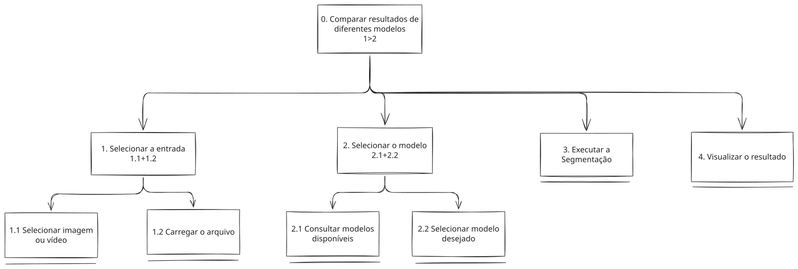

#### Decomposição e planos

| Objetivos / Operações | Problemas e Recomendações |
|---|---|
| **0. Comparar resultados de diferentes modelos** | **Input:** imagens ou vídeos e modelos pré-treinados (C03).<br>**Plano 0:** `1 > 2 > 3 > 4`.<br>**Problema:** as execuções ocorrem em scripts separados, o que dificulta comparar os resultados entre modelos (C03, Q19).<br>**Recomendação:** reunir seleção, execução e visualização em uma única interface, de modo que o usuário compare os modelos sem trocar de ferramenta. |
| **1. Selecionar a entrada** | **Plano 1:** `1.1 + 1.2`.<br>**Ação:** Segmentar imagem/vídeo com mais de um modelo.<br> |
| **2. Comparar resultados visualmente** | **Plano 2:** `2.1 + 2.2`.<br>**Ação:** Comparar resultados atráves das imagens/vídeos segmentados.<br>**Recomendação:** Mostar ambas as imagens na interface |
| 2.1. Consultar imagem original | **Ação:** visualizar a imagem original.<br>**Recomendação:** Exibir imagem original na interface. |
| 2.2. Consultar imagem segmentada | **Ação:** visualizar a imagem segmentada.<br>**Recomendação:** Exibir imagem segmentada na interface|
| **3. Comparar métricas** | **Ação:** Visualizar as métricas de cada modelo e compará-las.<br> |
| 3.1. Visualizar as métricas disponíveis | **Ação:** Utilizar as métricas de cada modelo e compará-las para decidir o melhor modelo.<br>**Recomendação:** Exibir ambas as métricas de maneira ordenada e indicando a qual modelo pertencem. |

**Verificação do HTA**
O objetivo 0 representa uma meta da Andreia no contexto real de pesquisa: comparar diferentes modelos de segmentação para identificar quais apresentam resultados mais adequados, e não simplesmente utilizar o sistema. Cada objetivo decomposto possui duas ou mais subtarefas e um plano associado; as folhas representam operações. A decomposição contempla a execução da segmentação e a visualização dos resultados, necessárias para atingir o objetivo. Não há paralelismo (+) nem escolhas condicionais explicitamente representadas no plano atual.

### 3.2 GOMS — T06 Analisar visualmente os resultados da segmentação

**Abordagem:** GOMS hierárquico, como no exemplo detalhado da aula. Não se aplica o KLM: a interface ainda não está desenhada.

**Precondições [H]:** a execução da segmentação foi concluída com sucesso; os resultados estão disponíveis para consulta; a interface apresenta a imagem original e as saídas da segmentação, como máscara e sobreposição. A meta 0 não possui método próprio. A meta 2 possui três métodos alternativos, escolhidos conforme o tipo de visualização necessário para analisar o resultado.

```text
GOAL 0: analisar visualmente os resultados da segmentação
  GOAL 1: acessar o resultado da segmentação
    OP. 1.1: localizar a execução que deseja analisar
    OP. 1.2: abrir os resultados da execução
    OP. 1.3: identificar a imagem ou o vídeo processado
    OP. 1.4: verificar que os resultados correspondem à entrada selecionada

  GOAL 2: examinar as visualizações do resultado
    METHOD 2.A: analisar a imagem original
    (SEL. RULE: precisa compreender as características da entrada
     ou verificar possíveis problemas na imagem)
      OP. 2.A.1: selecionar a visualização da imagem original
      OP. 2.A.2: observar as regiões de interesse
      OP. 2.A.3: identificar características relevantes do terreno
      OP. 2.A.4: verificar se há problemas visíveis na imagem

    METHOD 2.B: analisar a máscara
    (SEL. RULE: precisa identificar as classes atribuídas pelo modelo
     e verificar a distribuição das regiões segmentadas)
      OP. 2.B.1: selecionar a visualização da máscara
      OP. 2.B.2: observar as regiões segmentadas
      OP. 2.B.3: identificar as cores e regiões representadas
      OP. 2.B.4: verificar a distribuição das classes na máscara

    METHOD 2.C: analisar a sobreposição
    (SEL. RULE: precisa relacionar as regiões segmentadas com a imagem original
     ou verificar os limites entre as classes)
      OP. 2.C.1: selecionar a visualização sobreposta
      OP. 2.C.2: observar a correspondência entre imagem e máscara
      OP. 2.C.3: identificar regiões com possíveis inconsistências
      OP. 2.C.4: verificar se os limites das classes correspondem ao terreno visível

  GOAL 3: identificar possíveis problemas na segmentação
    OP. 3.1: localizar regiões com possíveis erros
    OP. 3.2: comparar as regiões segmentadas com as características da imagem original
    OP. 3.3: identificar classes atribuídas incorretamente ou regiões não segmentadas
    OP. 3.4: verificar se o problema observado pode estar relacionado à imagem de entrada

  GOAL 4: concluir a análise visual
    OP. 4.1: avaliar se o resultado apresenta problemas visíveis
    OP. 4.2: determinar se a segmentação parece adequada ou inadequada
    OP. 4.3: registrar os aspectos que justificam a avaliação
    OP. 4.4: verificar que a conclusão está fundamentada nas evidências visuais
    
```
**Regras e repetições:** na meta 2, os métodos 2.A, 2.B e 2.C podem ser utilizados em conjunto e repetidos conforme a necessidade da análise. A pessoa pode começar pela imagem original, consultar a máscara e, em seguida, utilizar a sobreposição para investigar uma região específica. Na meta 3, a identificação de problemas pode levar à consulta de outra visualização para confirmar a inconsistência.

**Correspondência com o HTA da T07:** GOAL 0 ↔ objetivo principal de analisar visualmente os resultados; GOAL 1 ↔ acesso aos resultados da execução; GOAL 2 ↔ análise das visualizações disponíveis; GOAL 3 ↔ identificação de possíveis problemas; GOAL 4 ↔ conclusão da análise. Observar e localizar são operadores perceptivos; selecionar e abrir são motores; identificar, comparar, avaliar e concluir são cognitivos.

### 3.3 CTT — T07 Comparar o resultado de diferentes modelos

**Fronteira do sistema:** a seleção e o carregamento da imagem ou do vídeo, a consulta e a seleção dos modelos pré-treinados, o início e o acompanhamento da segmentação, e a exibição do resultado (máscara junto à imagem ou ao vídeo original e sobreposição) ocorrem na interface proposta. A escolha da entrada, a decisão de quais modelos testar e a comparação dos resultados entre modelos são realizadas pelo usuário. A análise detalhada de um resultado, como a identificação de regiões suspeitas e o julgamento da qualidade da segmentação, enquanto a comparação entre diferentes configurações pertence à T03. O treinamento ou a obtenção dos modelos pré-treinados e a comunicação dos resultados à equipe ficam fora da interface.

#### Diagrama

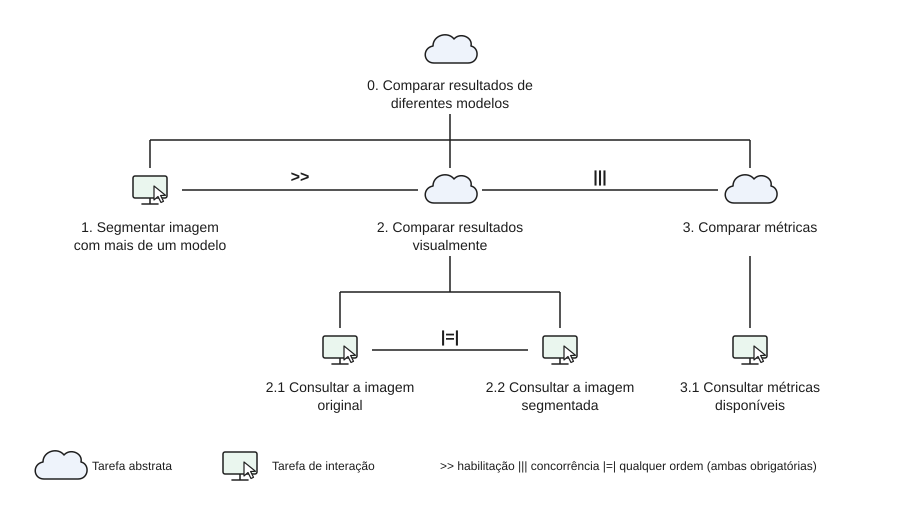

#### Tipos de tarefa e relações temporais usadas

##### Leitura da árvore

Os IDs numéricos identificam as tarefas e coincidem com os do HTA. A árvore não tem nós adicionais, ou seja, não há tarefas do sistema nem ciclos. Tarefas abstratas aparecem como nuvem e tarefas de interação com o ícone de tela e cursor.

1. **Comparar resultados de diferentes modelos:** `0 = 1 >> (2 ||| 3)`. O usuário primeiro segmenta a imagem com mais de um modelo (1). Depois, compara os resultados visualmente (2) e compara as métricas (3), sem ordem imposta entre as duas comparações.
2. **Segmentar imagem com mais de um modelo:** `1`. Tarefa de interação, sem subtarefas. Habilita a comparação: sem as segmentações de pelo menos dois modelos, não há o que comparar.
3. **Comparar resultados visualmente:** `2 = 2.1 |=| 2.2`. O usuário consulta a imagem original (2.1) e a imagem segmentada (2.2). As duas consultas são obrigatórias, mas podem ser feitas em qualquer ordem, o que corresponde ao plano `2.1 + 2.2` do HTA.
4. **Comparar métricas:** `3 = 3.1`. O usuário consulta as métricas disponíveis (3.1) para comparar o desempenho dos modelos.

##### Legenda e relações temporais usadas

| Relação CTT | Notação | Ocorrência em 0 |
|---|---|---|
| Habilitação | `T1 >> T2` | A segmentação (1) precisa ser concluída antes das comparações (2 e 3). Corresponde ao plano `1 > 2` do HTA. |
| Concorrência | `T1 \|\|\| T2` | A comparação visual (2) e a comparação de métricas (3) são independentes entre si. |
| Independência de ordem | `T1 \|=\| T2` | Consultar a imagem original (2.1) e a segmentada (2.2): ambas são obrigatórias, em qualquer ordem. |
| Escolha | `T1 [] T2` | Não há escolha modelada nesta tarefa. |
| Desativação | `T1 [> T2` | Não há desativação modelada nesta tarefa. |
| Iteração | `T*` | Não há repetição modelada. A segmentação com mais de um modelo está dentro da própria tarefa 1. |
| Suspensão | `T1 \|> T2` | Não há suspensão modelada. Interrupções durante a segmentação ou a comparação não foram consideradas. |

O plano do HTA para a tarefa 0 só diz `1 > 2` e não menciona a tarefa 3. Por isso, `2 ||| 3` é uma suposição minha. Se a comparação de métricas só puder acontecer depois da visual, troque por `2 >> 3`. Se forem alternativas, use `2 [] 3`. Nos dois casos, o SVG também precisa ser atualizado.

##### Tipos de tarefas

| Símbolo no diagrama | Tipo | Tarefas no modelo |
|---|---|---|
| Nuvem | Abstrata | T07, C e tarefas 1 a 4. |
| Pessoa | Usuário | 2.1 e 4.1. |
| Pessoa e computador, com seta dupla | Interação | 1.1, 1.2, 2.2, 3.1 e 4.2. |
| Computador | Sistema | S1 (informar o resultado do carregamento), S2 (apresentar os modelos disponíveis), S3 (executar a segmentação e informar o estado) e S4 (exibir a máscara com a imagem ou o vídeo original). |

### 3.4 Correspondência entre os três modelos

| Escolha ou repetição no HTA (T07) | Métodos no GOMS (análise visual) | Relação no CTT (T07) |
|---|---|---|
| Plano 0: `1 > 2 > 3 > 4`, sem repetição representada | Fora do GOMS (a análise começa com o resultado já pronto) | `T07 = 1 []>> C*` e `C = 2 []>> 3 []>> 4` |
| Plano 1: `1.1 + 1.2` | Fora do GOMS | `1 = 1.1 []>> 1.2 []>> S1` |
| Plano 2: `2.1 + 2.2` | Fora do GOMS | `2 = S2 []>> 2.1 []>> 2.2` |
| 3: executar a segmentação (operação única) | Fora do GOMS | `3 = 3.1 []>> S3` |
| 4: visualizar o resultado (operação única, com máscara junto ao original e sobreposição) | 2.A / 2.B / 2.C | `4 = S4 []>> 4.1 [] 4.2` |
| Fora do HTA da T07 | Metas 1, 3 e 4 (acessar o resultado, identificar problemas e concluir) | Fora do CTT |

As sequências do HTA (`>`) não recebem métodos no GOMS e aparecem como `[]>>` no CTT. O GOMS só se conecta à T07 pela meta 2, que detalha a tarefa 4 do HTA: os métodos 2.A (imagem original) e 2.B (máscara) correspondem à visualização conjunta exibida por S4 e examinada em 4.1, e o método 2.C (sobreposição) corresponde a 4.2. A regra de seleção do GOMS equivale à escolha `[]` do CTT.

Há três diferenças deliberadas entre os modelos:

- **Repetição:** o HTA lista os passos de uma única execução. O CTT representa a comparação entre modelos com o ciclo `C*`, que repete 2, 3 e 4 mantendo a entrada definida em 1.
- **De `+` para `[]>>`:** nos planos 1 e 2, o HTA usa `+` (as duas operações são realizadas, sem ordem rígida). O CTT fixa a ordem porque há dependência: o arquivo precisa ser selecionado antes de ser carregado, e os modelos precisam ser consultados antes de um ser escolhido.
- **Sistema:** S1 a S4 aparecem apenas no CTT, pois o HTA e o GOMS modelam somente as ações do usuário. Também não há concorrência (`|[]|`) no CTT: o acompanhamento do processamento é tratado como informação de estado fornecida por S3, e a atividade paralela do usuário durante a espera não foi modelada.

### 3.5 Síntese e implicações para o projeto

Os modelos abaixo são **propostas a validar**, derivadas das recomendações do HTA (C03, Q19, Q24 e Q26) e da estrutura do CTT:

1. **Fluxo único, sem scripts:** hoje cada modelo é executado em um script Python separado (C03, Q26). O ramo `1 → C` do CTT só se sustenta se seleção, execução e visualização ocorrerem na mesma interface.
2. **Estado e erro claros:** S1 e S3 exigem que a interface informe se o carregamento e a execução estão concluídos, em andamento ou com erro, e indique o motivo da falha, como formato de arquivo incompatível. É a principal exceção prevista na descrição da tarefa.
3. **Comparar sem recomeçar:** como `C*` repete apenas 2, 3 e 4, trocar de modelo não deve exigir selecionar e carregar o arquivo de novo. Alternar entre saídas dificulta a análise (C03, Q19), o que sugere manter os resultados de modelos já executados acessíveis para consulta.
4. **Máscara junto ao original, sobreposição sob demanda:** S4 e a escolha entre 4.1 e 4.2 respondem a Q24 e preparam a análise detalhada, cujos métodos 2.A, 2.B e 2.C usam as mesmas três visualizações.

**Continuidade da investigação [?]:** verificar com quem realiza essa comparação no contexto da pesquisa quantos modelos e quantas imagens ou vídeos avalia por sessão; qual critério usa para considerar um resultado melhor que outro; se precisa consultar execuções anteriores depois de trocar de modelo; e quais informações de cada modelo, além do nome e da descrição, ajudam a escolher.

---

## Síntese da equipe

Quais problemas de interação, oportunidades e requisitos apareceram a partir das modelagens? Quais tarefas irão para o protótipo e para o teste de usabilidade?

As três seções modelam o **uso proposto** por perfis diferentes: o analista que executa e avalia (P01), a pesquisadora que experimenta modelos (P02) e a gestora que decide (P03). Os modelos continuam sendo **hipóteses `[H]`** derivadas de proto-personas e precisam ser verificados na Entrega 7. A síntese abaixo reúne o que se repetiu entre as seções.

### Problemas de interação e requisitos comuns

| ID | Problema observado nos modelos | Requisito derivado | Onde aparece |
|---|---|---|---|
| RQ01 | Hoje cada execução exige script; a falha obriga a depurar código. | Executar a segmentação pela interface, com um comando, e mostrar o estado de cada execução (processando, concluído, falhou), com a causa da falha em linguagem de usuário. | T03 obj. 2 e 2.3.2; T07 nó 3 e S3; RC04 |
| RQ02 | Comparar resultados de entradas diferentes leva a conclusões erradas. | Comparar configurações ou modelos **sobre a mesma entrada** (T03, T07) ou **o mesmo conjunto anotado** (T04), e mostrar qual entrada ou conjunto foi usado. | T03 1.1 e 4.1; T07 ciclo `C*`; T04 OP. 1.4; T05 1.1 |
| RQ03 | Alternar entre janelas e arquivos faz perder o fio da comparação. | Reunir original, máscara e sobreposição na mesma tela, com zoom; manter os resultados já executados acessíveis sem recarregar a entrada. | T01 metas 1–2; T06 meta 2; T03 obj. 4; T07 `C*` |
| RQ04 | Cores sem padrão entre execuções exigem reinterpretar a legenda. | Legenda e paleta fixas em todas as visualizações. | T01 meta 2; T03 3.2; T06 2.B |
| RQ05 | Não se sabe se o erro vem do modelo ou da imagem capturada. | Permitir que a pessoa registre a avaliação separando problema da imagem e problema do modelo. | T01 3.A.2; T03 4.2.2; T06 OP. 3.4 |
| RQ06 | Métricas aparecem como se existissem para qualquer imagem. | Mostrar IoU e acurácia **só** quando houver anotação de referência (conjunto de teste do TCC); sem ela, avaliação visual com apoio da confiança do modelo `[H]`. | T01 3.B e 3.C; T04 precondições; recorte da P02; INC-52 |
| RQ07 | Números soltos, sem referência, não sustentam decisão; termos geram dúvida. | Valor de referência, explicação no ponto de uso (o que a métrica indica e não indica) e aviso quando a diferença é pequena. | T04 metas 2–3; T05 2.3 e 3.2; RC01 |
| RQ08 | Há o risco de a interface parecer "escolher" o melhor modelo. | A conclusão e a recomendação são registradas pela pessoa; a interface exibe e calcula, mas não decide. | T03 4.2; T05 obj. 3; T07 fronteira do sistema |
| RQ09 | Parte da tarefa acontece fora da interface. | Não modelar como funcionalidade a comunicação à equipe, o pedido ao integrante técnico e a reunião com a coordenação; a interface só indica o que falta pedir. | T03 4.3; T05 1.2, 2.3.3 e ramo E |

**Oportunidades:** a sobreposição com opacidade (T01 1.B, T06 2.C) e a confiança do modelo (T01 3.B) aparecem como os recursos que mais aproximam a avaliação do que hoje é feito "no olho". O resumo exportável (T05 4.1.1) e o histórico (H08) continuam **fora do recorte** até haver evidência.

**Divergências entre as seções, a resolver na Entrega 9:**

- **T03 e T07 se sobrepõem.** As duas comparam a mesma entrada processada por mais de uma configuração ou modelo; mudam a persona (P01 e P02) e o objetivo (P01 confere a qualidade antes de informar a equipe; P02 experimenta para orientar a pesquisa). Como uma configuração reúne o modelo e os parâmetros de treino, a T03 pode comparar configurações do mesmo modelo, enquanto a T07 compara modelos. **Decisão de 08/11/2026:** manter as duas tarefas separadas nesta entrega e reavaliar a fusão na construção do modelo conceitual (Entrega 9).
- ~~**IDs da P02:** o cenário C03 propunha T07 (executar), T08 (analisar) e T09 (comparar).~~ **Resolvido em 08/11/2026:** o C03 passou a usar T02 (executar, compartilhada com o C01), T06 (analisar) e T07 (comparar), os mesmos IDs desta entrega (`PENDENCIAS.md`, INC-56).

### Tarefas que vão para o protótipo e para o teste

| Tarefa | Protótipo (Entrega 6) | Teste com usuários (Entrega 14) | Por quê |
|---|---|---|---|
| T02 executar | Tela P01 (input de dados e configurações), fluxo PF01 | Sim, dentro do UT01 | Entrada obrigatória de todos os fluxos (RQ01). A simulação da E6 levou à seleção de mais de um modelo por execução. |
| T01 / T06 avaliar uma imagem | Tela P02 (resultado da segmentação), fluxo PF02 | **UT01:** executar a segmentação de uma imagem e avaliar o resultado | A E1 aponta a interpretação do resultado como a atividade mais crítica (§3.4) e ao menos tão frequente quanto o envio (§3.3). |
| T03 / T07 comparar configurações ou modelos | Tela P03 (comparação de modelos), com os dois modelos sobre o mesmo arquivo | **UT02:** comparar duas configurações sobre a mesma imagem e registrar a conclusão | Necessidade central do C01 e do C03 (RQ02, RQ03). |
| T04 comparar o consolidado | Tela P03, fluxo PF03. A E6 usa a mesma tela para a comparação por imagem e a consolidada; separar as duas visões fica para a Entrega 11 | **UT03:** com base no consolidado, preparar a recomendação | Única tarefa da P03 com interface; testa RQ06 e RQ07. |
| T05 decidir e justificar | Não prototipada na E6; o campo "Conclusão" da tela P03 cobre só o registro da conclusão | Sim, dentro do UT03, só até a recomendação | A reunião com a coordenação (4.2, 4.3) fica fora da interface e do teste. |

As tarefas UT01–UT03 são propostas; instruções neutras, critérios de sucesso e perfil dos participantes serão definidos na Entrega 12 (DECIDE).

## Rastreabilidade

| Tarefa | Necessidade | Persona / cenário | Modelos | Atualizar em `RASTREABILIDADE.md` |
|---|---|---|---|---|
| T01–T03 | R01, R02, R03 | P01 / C01 | HTA T03, GOMS T01, CTT T03 (seção 2) | Coluna HTA/GOMS/CTT de R01–R03 — atualizada |
| T04, T05 | R03 | P03 / C02 | HTA T05, GOMS T04, CTT T05 (seção 1) | Coluna HTA/GOMS/CTT de R03 — atualizada |
| T06, T07 | R03 (e R02, pela execução dentro da T07) | P02 / C03 | HTA T07, GOMS T06, CTT T07 (seção 3) | Colunas Cenário, Tarefa e HTA/GOMS/CTT de R03 — atualizadas |

Os requisitos RQ01–RQ09 da síntese ligam estes modelos às telas da Entrega 6 e às tarefas de teste UT01–UT03.

## Checklist

- [x] Cada integrante produziu ao menos 1 HTA, 1 GOMS e 1 CTT. *(Henrique: HTA/CTT T05, GOMS T04; Tiago: HTA/CTT T03, GOMS T01; Mateus: HTA/CTT T07, GOMS T06.)*
- [x] Cada artefato identifica autor e tarefa.
- [ ] Diagramas são legíveis e possuem fonte editável quando possível. *(Pendente: a figura embutida na seção 3.1 não corresponde à tabela do HTA da T07; ver `PENDENCIAS.md`, INC-53.)*
- [x] HTA contém planos, não apenas árvore de tópicos.
- [x] GOMS distingue Goals, Operators, Methods e Selection Rules.
- [x] CTT usa operadores temporais e tipos de tarefa coerentes.
- [x] Há texto explicando cada diagrama.
- [x] Tarefas estão ligadas a cenários/personas na rastreabilidade.
- [x] Em TCC técnico, as tarefas descrevem o que a pessoa faz com a contribuição/resultados, não passos internos do código.
- [x] CRUDs, relatórios, filtros e atividades administrativas foram escolhidos por relevância ao objetivo do usuário. *(Nenhum CRUD, login ou histórico; exportação só como alternativa `[H]` na T05.)*
