# Entrega 5 — Análise de tarefas: HTA, GOMS e CTT

**Data:** 30/10/2026 · 15/11/2026 (revisão após feedback)  
**Status:** 🟦 revisada após feedback  
**Responsabilidade:** cada integrante modela pelo menos 1 HTA, 1 GOMS e 1 CTT. As três técnicas podem abordar a mesma funcionalidade ou funcionalidades distintas, conforme a orientação da disciplina.

## Objetivo da atividade

Modelar tarefas importantes sob perspectivas complementares: decomposição hierárquica (HTA), estrutura de metas/métodos/operações (GOMS) e relações temporais entre tarefas (CTT). O diagrama deve ser acompanhado de interpretação textual.

## Para projetos cujo TCC não previa interface

Modele **tarefas humanas relacionadas ao uso da contribuição técnica**, e não a implementação interna do algoritmo. Exemplos de boas tarefas para análise:

- investigar uma consulta de baixo desempenho;
- configurar uma análise e selecionar parâmetros;
- submeter um dataset e verificar sua validade;
- acompanhar uma execução demorada;
- comparar dois resultados/modelos;
- interpretar uma recomendação e decidir se a aceita;
- localizar uma execução anterior usando busca/filtros;
- gerar e compartilhar um relatório;
- administrar papéis/permissões quando isso for parte do trabalho real;
- revisar um alerta e registrar uma decisão.

Um CRUD pode gerar tarefas relevantes, mas “cadastrar usuário” só merece modelagem se tiver significado no domínio (papéis, validações, riscos, permissões, dependências).

## Entradas e premissas da equipe

| Entrada | Onde | Uso nesta entrega |
|---|---|---|
| Tarefas T01–T08 | [`04_cenarios_problema.md`](04_cenarios_problema.md), seção 5 de cada cenário | Origem das tarefas modeladas |
| Personas P01–P03 | [`03_personas_contexto_jornada.md`](03_personas_contexto_jornada.md) | Perfil de quem executa cada tarefa |
| Necessidades R01–R04 | [`../RASTREABILIDADE.md`](../RASTREABILIDADE.md), seção 3 | Ligação entre tarefa e capacidade do TCC |

**Premissas adotadas por todos os integrantes:**

1. **Modela-se o uso proposto.** Os cenários da Entrega 4 descrevem o processo **atual** (scripts, planilhas, mensagens). Esta entrega descreve como a pessoa realizaria a mesma tarefa **com a interface do recorte**, mantendo fora dela o que continua externo (conversa com colegas, reuniões). Cada modelo indica o que veio do cenário e o que é proposta.
2. **As personas são proto-personas.** Frequência, criticidade, condições de trabalho e o próprio uso proposto são hipóteses `[H]` derivadas das Entregas 3 e 4, a validar na Entrega 7.
3. **Notação**, conforme as aulas (Barbosa e Silva, 2010):
   - **HTA:** planos `1>2` (sequencial), `1/2` (seleção ou decisão), `1+2` (paralelo) e `[n]` (passo que só ocorre sob condição, como continuação de outro); operações (folhas) com traço duplo abaixo. A tabela usa as colunas da aula, **Objetivos/Operações** e **Problemas e Recomendações**. **Input** e **Feedback** aparecem só na tarefa 0; nas subtarefas ficam plano (nos nós decompostos), ação, problema e recomendação.
   - **GOMS:** representação **textual e indentada** (`GOAL`, `METHOD`, `SEL. RULE`, `OP.`), sem diagrama. O `GOAL 0` não tem método; metas com um único caminho são descritas direto por operadores; métodos e regras de seleção só existem onde há alternativas reais (onde o HTA tem `/` ou `+`); um passo condicional do HTA (`[n]`) vira uma submeta condicional dentro do caminho que ele continua. Cada bloco de operadores termina com uma **verificação do usuário**.
   - **CTT:** tipos de tarefa (abstrata, usuário, interação, sistema) e operadores temporais `>>`, `[]>>`, `[]`, `|||`, `|[]|`, `|=|`, `[>` e `|>`, além de iteração (`T*`) e tarefa opcional (`[T]`). A árvore começa pela **motivação externa** que leva o usuário à interface (`M []>> U`).
   - **Correspondência:** cada escolha do HTA tem métodos equivalentes no GOMS e uma relação equivalente no CTT, registradas em uma tabela por integrante.
4. **Arquivos de diagrama** em [`../assets/05_tarefas/`](../assets/README.md), com o padrão `<técnica>_<tarefa>_<descrição>.svg` (ex.: `hta_t05_decidir_modelo.svg`). O SVG é a fonte editável. CTTs extensos têm visão geral e detalhamentos recortados do mesmo arquivo.
5. **Termos do TCC** (Entrega 1, §0.4 e §7.1, revisados em 08/11/2026 a partir do repositório do TCC): **configuração** = modelo (FCN ou DeepLabV3+, ambos com ResNet152) + parâmetros de treino expostos ao usuário: número de épocas, early stopping e paciência, datasets de treino (Freiburg Forest, Synthetic Offroad e/ou CaSSeD), batch size e geração de gráficos. As tarefas modeladas nesta entrega **usam** configurações já treinadas; a tarefa de definir e treinar uma configuração (T08, P02/C03) entrou no recorte em 08/11/2026 e está modelada na seção 3.6, a partir do cenário de interação CI03 da Entrega 9. A segmentação é **binária**: as classes da legenda são *Trilha* e *Fora da trilha*. Métricas por modelo (IoU, acurácia) vêm do conjunto de teste anotado do TCC. Os valores usados nos protótipos são ilustrativos.

## Seleção das tarefas

| ID | Tarefa | Persona/cenário de origem | Frequência/criticidade | Técnicas aplicadas | Autor responsável |
|---|---|---|---|---|---|
| T01 | Avaliar a qualidade da segmentação de uma imagem | P01 / C01 | `[H]` a cada sessão de validação · alta (E4) | GOMS (e objetivo 3 da T03) | Tiago Fagundes dos Santos |
| T02 | Executar a segmentação com uma ou mais configurações disponíveis | P01 / C01; P02 / C03 | `[H]` a cada sessão de validação · alta (E4) | Objetivo 2 do HTA e do CTT da T03 | Tiago Fagundes dos Santos |
| T03 | Comparar o resultado de uma imagem entre configurações | P01 / C01 | `[H]` quando há mais de uma configuração a avaliar · alta (E4) | HTA, CTT | Tiago Fagundes dos Santos |
| T04 | Comparar o desempenho consolidado entre modelos | P03 / C02 | `[H]` antes de cada ciclo de testes · alta (E4) | GOMS | Henrique Finatti Silveira Belo Trebbi |
| T05 | Decidir e justificar a adoção de um modelo | P03 / C02 | `[H]` antes de cada ciclo de testes · alta (E4) | HTA, CTT | Henrique Finatti Silveira Belo Trebbi |
| T06 | Analisar visualmente o resultado da segmentação | P02 / C03 | `[H]` após cada execução de segmentação· alta (E4) | GOMS | Mateus Marana Assuena |
| T07 | Comparar o resultado de diferentes modelos | P02 / C03 | `[H]` quando houver dois ou mais modelos a avaliar · alta (E4) | HTA e CTT | Mateus Marana Assuena |
| T08 | Definir uma configuração de treino e treinar o modelo | P02 / C03 | `[H]` a cada novo experimento · média (E4) | HTA, GOMS e CTT | Mateus Marana Assuena |

---

## 1. Henrique Finatti Silveira Belo Trebbi — P03 (Larissa Camargo)

**Autor(a):** Henrique Finatti Silveira Belo Trebbi — 22.123.030-3  
**Persona:** P03 — Larissa Camargo, gestora de projeto  
**Cenário de origem:** C02 — Decisão de modelo a partir de resultados dispersos (processo atual)  
**Tarefas modeladas:** T05 (HTA e CTT) e T04 (GOMS). A T04 é o objetivo 2 da T05: o GOMS detalha esse ramo.  
**Rastreabilidade:** R03; H01, H04, H06, H12; RC01, RC03; decisões de design 1 a 5 da P03 (Entrega 3).

**Recorte comum aos três modelos [H]:**

- Larissa **não executa** a segmentação. As execuções dos modelos candidatos são feitas pelo integrante técnico (P01, tarefa T02) na interface. Larissa usa a interface para **consultar e comparar** os resultados consolidados.
- Ficam **fora da interface**: a pauta da reunião, o contato com o integrante técnico (por mensagem) e a reunião com a coordenação.
- A visão consolidada, o valor de referência das métricas, a explicação no ponto de uso, a diferença entre configurações e o resumo exportável vêm das decisões de design da P03 e são **hipóteses de design**, não funcionalidades confirmadas. O resumo exportável não consta no recorte da Entrega 1 (§11) e por isso aparece só como alternativa condicionada.
- A recomendação apoia a decisão sobre o modelo; ela **não** afirma que um trajeto é seguro ou transitável (Entrega 1, §4.3).

### 1.1 HTA — T05 Decidir e justificar a adoção de um modelo

#### Descrição da tarefa

- **Objetivo central [H]:** chegar à reunião com a coordenação com uma recomendação de modelo que Larissa consiga justificar, ou com um adiamento justificado.
- **Entrada [H]:** ciclo de testes e data da reunião semanal; execuções dos modelos candidatos feitas por P01 sobre o mesmo conjunto de imagens com anotação de referência, necessária para calcular as métricas.
- **Resultado [H]:** modelo recomendado com métricas, referência e ressalvas; decisão da coordenação registrada.
- **Exceções [H]:** execução faltante (1.2), dúvida que a explicação não resolve (2.3.3), resultado inconclusivo (3.2 ou 3.3), resumo exportável indisponível (4.1.2).
- **Término:** decisão da coordenação registrada (4.3), seja a adoção de um modelo, seja o adiamento com o que falta executar.

#### Diagrama

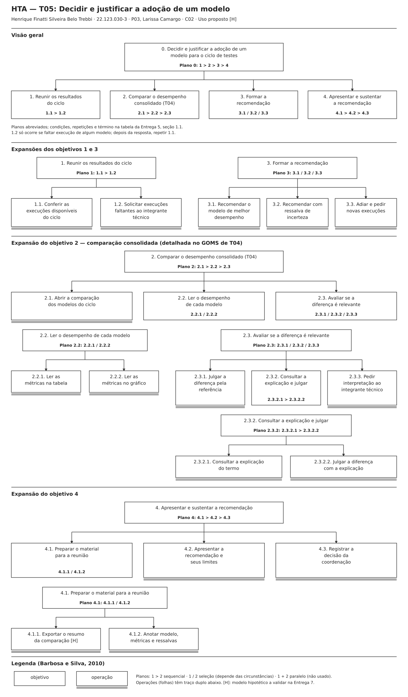

*Figura 1 — HTA de T05, por Henrique Finatti Silveira Belo Trebbi. Visão geral e expansões dos objetivos 1 a 4. [SVG editável](../assets/05_tarefas/hta_t05_decidir_modelo.svg).*

Retângulos representam objetivos; operações (folhas) têm traço duplo abaixo. Os planos usam `>` para sequência, `/` para seleção condicionada e colchetes para um passo que só ocorre sob condição (`[2.3.3]`). A tabela completa os planos abreviados do diagrama com as condições de cada escolha.

#### Decomposição e planos

| Objetivos / Operações | Problemas e Recomendações |
|---|---|
| **0. Decidir e justificar a adoção de um modelo para o ciclo de testes** | **Input:** ciclo de testes e data da reunião com a coordenação; execuções dos modelos candidatos realizadas por P01 na interface; expectativa de uma escolha defensável, e não apenas do maior número (C02, Q10). **Plano 0:** `1 > 2 > 3 > 4`. Se faltar execução em 1, executar 1.2, aguardar e repetir 1.1. Se 3 terminar em 3.3, o objetivo 4 comunica o adiamento. **Feedback:** recomendação apresentada com modelo, métricas, referência e ressalvas, e decisão da coordenação registrada; ou adiamento registrado com o que falta executar. **Problema:** hoje os números chegam dispersos, sem referência, e a escolha é difícil de sustentar (C02). **Recomendação:** reunir a comparação em um só lugar e apoiar a justificativa em linguagem simples (P03, decisões 1 e 3). |
| **1. Reunir os resultados do ciclo** | **Plano 1:** `1.1 > 1.2`; 1.2 somente se algum modelo candidato não tiver execução. **Recomendação:** mostrar quais modelos têm execução concluída e sobre qual conjunto de imagens. |
| 1.1. Conferir as execuções disponíveis do ciclo | **Ação:** verificar se cada modelo candidato tem execução concluída sobre o mesmo conjunto de imagens. **Problema [H]:** comparar execuções feitas em conjuntos diferentes leva a uma conclusão incorreta. **Recomendação:** identificar o conjunto de imagens e a data de cada execução. |
| 1.2. Solicitar execuções faltantes ao integrante técnico | **Ação:** pedir a P01, por mensagem, a execução dos modelos que faltam. **Problema:** a dependência do colega técnico continua (C02, Q11); a interface não executa por Larissa. **Recomendação:** permitir que Larissa identifique exatamente qual modelo falta, para pedir uma vez só. |
| **2. Comparar o desempenho consolidado (T04)** | **Plano 2:** `2.1 > 2.2 > 2.3`. Detalhado no GOMS de T04 (seção 1.2). **Recomendação:** apresentar todos os modelos do ciclo em uma única visão (P03, decisão 1). |
| 2.1. Abrir a comparação dos modelos do ciclo | **Ação:** abrir a visão consolidada dos modelos do ciclo. **Recomendação:** exibir junto o conjunto de imagens usado, para que Larissa confirme que está comparando o ciclo certo. |
| **2.2. Ler o desempenho de cada modelo** | **Plano 2.2:** `2.2.1 / 2.2.2`. Tabela quando precisa de valores exatos ou as barras estão próximas; gráfico para visão geral quando a diferença é visível. **Recomendação:** oferecer as duas formas (RC03, cuja evidência está em revisão, `PENDENCIAS.md` INC-22). |
| 2.2.1. Ler as métricas na tabela | **Ação:** ler IoU médio e acurácia de cada modelo e o valor de referência. **Recomendação:** destacar o maior valor de cada métrica. |
| 2.2.2. Ler as métricas no gráfico | **Ação:** comparar as barras dos modelos com a linha de referência. **Problema:** barras próximas não permitem ler a diferença; nesse caso, usar 2.2.1. |
| **2.3. Avaliar se a diferença é relevante** | **Plano 2.3:** `2.3.1 / (2.3.2 > [2.3.3])`. 2.3.1 se os termos são conhecidos, há referência e a diferença é clara; senão, 2.3.2. O 2.3.3 não é alternativa ao 2.3.2: só acontece depois dele, quando a explicação não resolveu a dúvida; com a resposta, Larissa volta a julgar a diferença (2.3.2.2). **Problema:** hoje Larissa não sabe se uma diferença pequena é relevante e escolhe o maior número (C02, Q14). |
| 2.3.1. Julgar a diferença pela referência | **Ação:** comparar a diferença entre os modelos com a referência e decidir se ela é relevante. **Problema [H]:** o valor de referência é hipótese de design (P03, decisão 2); sem ele, o julgamento passa a 2.3.2. |
| **2.3.2. Consultar a explicação e julgar** | **Plano 2.3.2:** `2.3.2.1 > 2.3.2.2`. **Recomendação:** explicar no ponto de uso o que a métrica indica e o que não indica (RC01; P03, decisão 3). |
| 2.3.2.1. Consultar a explicação do termo | **Ação:** abrir a explicação de IoU ou acurácia. **Problema:** ainda não se sabe quais termos geram dúvida (C02, Q15); investigar na Entrega 7. |
| 2.3.2.2. Julgar a diferença com a explicação | **Ação:** decidir se a diferença é relevante, se é inconclusiva ou se a dúvida persiste. |
| 2.3.3. Pedir interpretação ao integrante técnico | **Ação:** só depois de 2.3.2, se a dúvida persistir: enviar a dúvida a P01 por mensagem e aguardar a resposta. **Problema:** reintroduz a dependência de colegas que a interface pretende reduzir. **Recomendação:** registrar na Entrega 7 quais dúvidas levam a este passo, para avaliar se a explicação de 2.3.2 é suficiente. |
| **3. Formar a recomendação** | **Plano 3:** `3.1 / 3.2 / 3.3`. 3.1 se a diferença é relevante; 3.2 se é pequena ou inconclusiva, mas a decisão não pode esperar o próximo ciclo; 3.3 se é inconclusiva e há tempo para novas execuções antes do teste. **Problema:** hoje, sem critério, a escolha vai para o número maior (C02). |
| 3.1. Recomendar o modelo de melhor desempenho | **Ação:** escolher o modelo que se destaca nas métricas avaliadas como relevantes. |
| 3.2. Recomendar com ressalva de incerteza | **Ação:** escolher um modelo e registrar que a diferença é pequena ou inconclusiva. **Recomendação:** mostrar a diferença entre configurações e o que as métricas não garantem (P03, decisão 5); a incerteza é registrada pela Larissa, e não sinalizada pelo sistema. |
| 3.3. Adiar e pedir novas execuções | **Ação:** não recomendar ainda e identificar o que precisa ser executado. **Problema:** adiar pode atrasar o ciclo de testes (C02, Q16). |
| **4. Apresentar e sustentar a recomendação** | **Plano 4:** `4.1 > 4.2 > 4.3`. **Problema:** hoje Larissa leva só os números e tem dificuldade de sustentar a escolha (C02, Q17). |
| **4.1. Preparar o material para a reunião** | **Plano 4.1:** `4.1.1 / 4.1.2`. 4.1.1 se a interface oferecer resumo exportável; senão, 4.1.2. **Recomendação:** o material deve trazer modelo, métricas, referência e ressalvas. |
| 4.1.1. Exportar o resumo da comparação [H] | **Ação:** solicitar o resumo e conferir se ele traz o modelo e as ressalvas. **Problema:** exportação não consta no recorte da Entrega 1 (§11); é hipótese de design (P03, decisão 4) a confirmar. |
| 4.1.2. Anotar modelo, métricas e ressalvas | **Ação:** registrar manualmente o que será apresentado. **Problema [H]:** a cópia manual pode introduzir erro de transcrição. |
| 4.2. Apresentar a recomendação e seus limites | **Ação:** expor o modelo, as métricas, as ressalvas e que métrica não equivale a segurança do trajeto (Entrega 1, §4.3). Com 3.3, comunicar o adiamento e o que falta executar. **Recomendação:** incluir a frase de limites no material de 4.1. |
| 4.3. Registrar a decisão da coordenação | **Ação:** anotar o modelo adotado, ou o adiamento e o novo prazo, com o motivo. |

#### Verificação do HTA

O objetivo 0 é uma meta de Larissa no mundo real (decidir e justificar), não "usar o sistema". Cada objetivo decomposto tem dois ou mais filhos e um plano; as folhas são operações. As escolhas (`/`) estão em 2.2, 2.3, 3 e 4.1, todas com condição explícita na tabela. Em 2.3, o pedido ao colega (2.3.3) é um passo condicional que continua o 2.3.2, e não uma terceira alternativa. Não há paralelismo (`+`). A decomposição para no nível em que a ação passa a depender do desenho da tela, que é tarefa da Entrega 6.

### 1.2 GOMS — T04 Comparar o desempenho consolidado entre modelos

**Abordagem:** GOMS hierárquico, como no exemplo detalhado da aula. Não se aplica o KLM: a interface ainda não está desenhada, e tempos de operadores seriam inventados.

**Precondições [H]:** a comparação está acessível na interface; os modelos candidatos do ciclo têm execução concluída sobre o mesmo conjunto de imagens, com anotação de referência para as métricas (objetivo 1 da T05). As metas 0 e 1 têm um único caminho e não recebem métodos. As metas 2 e 3 correspondem às escolhas 2.2 e 2.3 do HTA e por isso têm métodos e regras de seleção.

```text
GOAL 0: identificar o modelo de melhor desempenho e se a diferença entre os modelos é relevante
  GOAL 1: abrir a comparação dos modelos do ciclo
    OP. 1.1: acionar a comparação entre modelos
    OP. 1.2: localizar o ciclo de testes em pauta
    OP. 1.3: ler os modelos e o conjunto de imagens exibidos
    OP. 1.4: verificar que todos os modelos candidatos aparecem com o mesmo conjunto de imagens
  GOAL 2: ler o desempenho de cada modelo
    METHOD 2.A: ler na tabela
    (SEL. RULE: precisa comparar valores exatos ou as barras do gráfico estão próximas)
      OP. 2.A.1: selecionar a visualização em tabela
      OP. 2.A.2: localizar a linha de cada modelo
      OP. 2.A.3: ler o IoU médio de cada modelo
      OP. 2.A.4: ler a acurácia de cada modelo
      OP. 2.A.5: ler o valor de referência
      OP. 2.A.6: verificar qual modelo tem o maior valor em cada métrica
    METHOD 2.B: ler no gráfico
    (SEL. RULE: quer uma visão geral e as barras dos modelos estão visivelmente separadas)
      OP. 2.B.1: selecionar a visualização em gráfico
      OP. 2.B.2: comparar a altura das barras de cada modelo
      OP. 2.B.3: localizar a linha de referência
      OP. 2.B.4: verificar qual modelo se destaca e em quais métricas
  GOAL 3: avaliar se a diferença entre os modelos é relevante
    METHOD 3.A: julgar pela referência
    (SEL. RULE: termos conhecidos, referência exibida e diferença clara)
      OP. 3.A.1: comparar a diferença entre os modelos com a referência
      OP. 3.A.2: decidir se a diferença é relevante
      OP. 3.A.3: verificar que o julgamento se apoia nos valores lidos na meta 2
    METHOD 3.B: julgar com a explicação no ponto de uso
    (SEL. RULE: termo desconhecido, diferença pequena ou referência ausente)
      OP. 3.B.1: acionar a explicação do termo (IoU ou acurácia)
      OP. 3.B.2: ler o que a métrica indica
      OP. 3.B.3: ler o que a métrica não indica
      OP. 3.B.4: decidir se a diferença é relevante, inconclusiva ou se a dúvida persiste
      GOAL 3.B.5: obter a interpretação do integrante técnico
      (somente se a dúvida persistir em OP. 3.B.4)
        OP. 3.B.5.1: anotar o termo ou a diferença que gerou a dúvida
        OP. 3.B.5.2: enviar mensagem ao integrante técnico com a dúvida
        OP. 3.B.5.3: aguardar a resposta
        OP. 3.B.5.4: ler a interpretação recebida
        OP. 3.B.5.5: decidir se a diferença é relevante ou inconclusiva
        OP. 3.B.5.6: verificar se a resposta mudou a leitura dos valores; se mudou, repetir a meta 2
      OP. 3.B.6: verificar que o julgamento é compatível com os valores lidos na meta 2
  OP. 0.1: verificar que identificou o modelo de melhor desempenho e se a diferença é relevante ou inconclusiva
```

**Regras e repetições:** a meta 2 pode ser repetida com o outro método (ex.: começar pelo gráfico e, com barras próximas, passar à tabela). Na meta 3, a escolha é feita uma vez, no início: 3.A quando a referência e os termos bastam para julgar; 3.B nos demais casos. Pedir ajuda ao colega não é um método independente: é a submeta condicional 3.B.5, que só ocorre dentro de 3.B quando a explicação não resolve a dúvida. Enquanto 3.B.5 aguarda a resposta (OP. 3.B.5.3), a tarefa fica suspensa; no CTT, isso corresponde à suspensão de R por E. Se a resposta só esclarece o termo, Larissa conclui o julgamento; se mostra que um valor foi mal lido (ex.: a execução usou outro conjunto de imagens), ela volta à meta 2.

**Correspondência com o HTA da T05:** GOAL 1 ↔ 2.1; GOAL 2 ↔ 2.2 (2.A ↔ 2.2.1, 2.B ↔ 2.2.2); GOAL 3 ↔ 2.3 (3.A ↔ 2.3.1, 3.B ↔ `2.3.2 > [2.3.3]`, com a submeta 3.B.5 ↔ 2.3.3). Ler e comparar são operadores perceptivos; acionar, selecionar e enviar são motores; decidir e verificar são cognitivos.

### 1.3 CTT — T05 Decidir e justificar a adoção de um modelo

**Fronteira dos sistemas:** consulta das execuções, comparação, explicação e resumo na interface proposta; mensagens com o integrante técnico e a reunião com a coordenação fora dela. O sistema exibe e calcula; não decide pelo usuário.

#### Diagrama

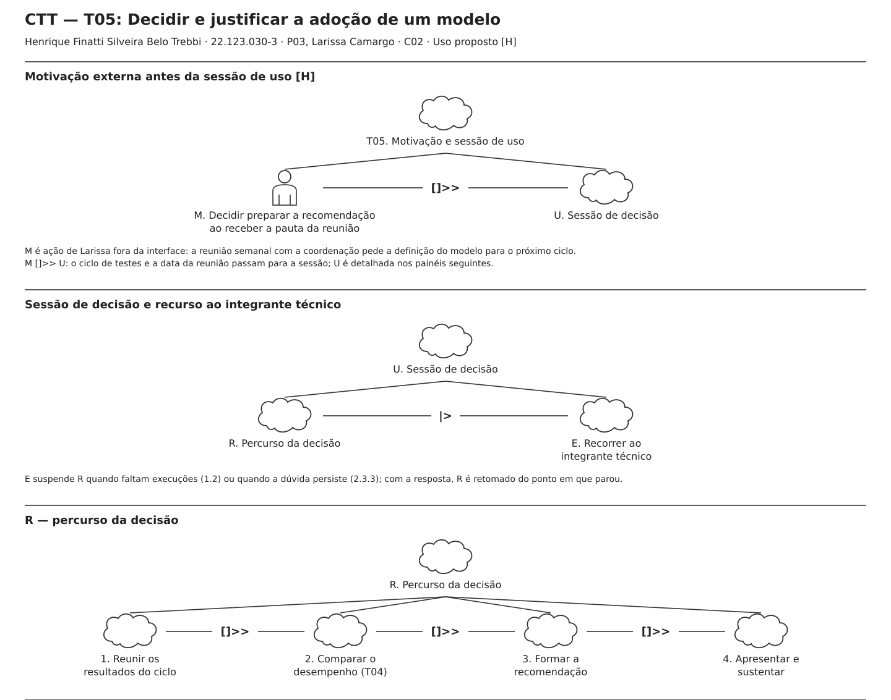

*Figura 2 — CTT de T05, visão geral, por Henrique Finatti Silveira Belo Trebbi. Os detalhamentos abaixo são recortes da mesma árvore, com os mesmos IDs e relações. [SVG completo e editável](../assets/05_tarefas/ctt_t05_decidir_modelo.svg).*

<details>
<summary>T05: detalhamento 1 — ramos 1 e 2</summary>

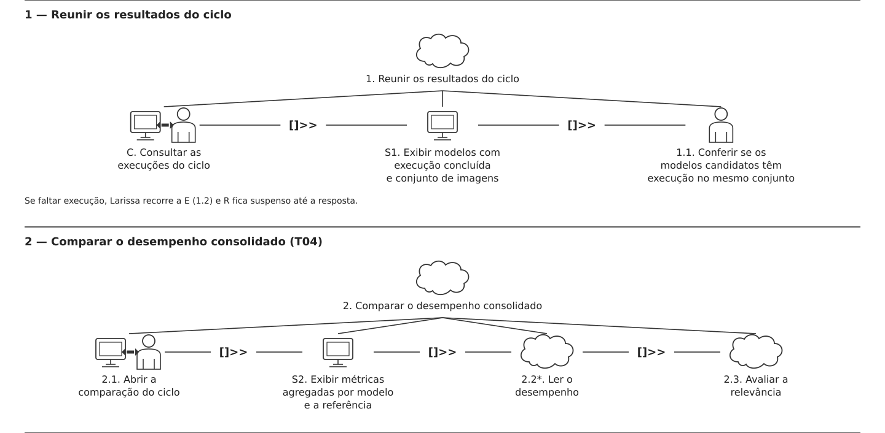

</details>

<details>
<summary>T05: detalhamento 2 — 2.2, 2.3 e 2.3.2</summary>

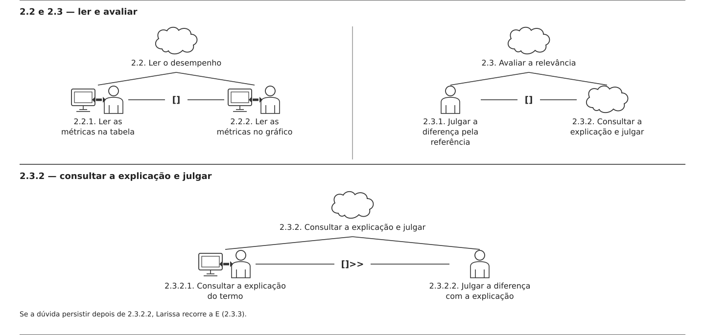

</details>

<details>
<summary>T05: detalhamento 3 — ramos 3, 4 e 4.1</summary>

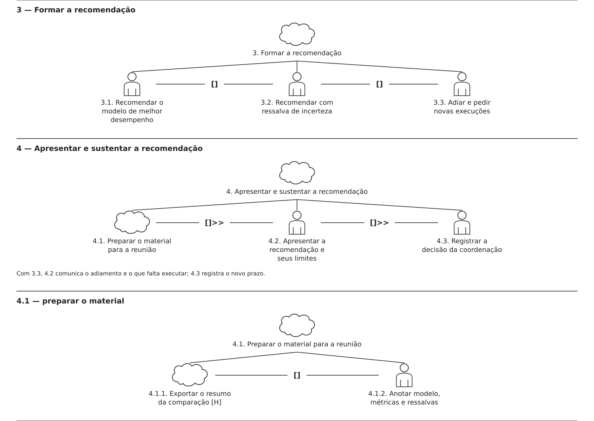

</details>

<details>
<summary>T05: detalhamento 4 — 4.1.1, E e legenda</summary>

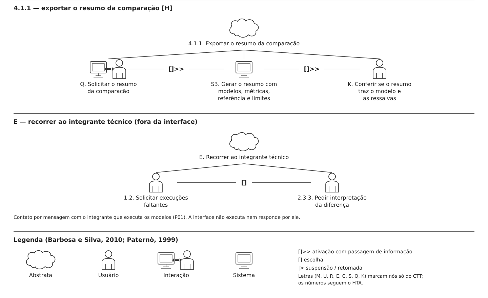

</details>

#### Leitura da árvore

Os IDs numéricos seguem o HTA. As letras marcam nós que só existem no CTT: `M` (motivação externa), `U` (sessão), `R` (percurso), `E` (recurso ao integrante técnico), `C`, `Q` e `K` (interações e conferências) e `S1`–`S3` (tarefas do sistema).

1. **Motivação e sessão:** `T05 = M []>> U`. Fora da interface, a pauta da reunião semanal pede a definição do modelo, e Larissa decide preparar a recomendação. O ciclo de testes e a data da reunião passam para a sessão U.
2. **Sessão:** `U = R |> E`. O percurso R pode ser suspenso por E sempre que faltar execução (1.2) ou a dúvida persistir (2.3.3). A retomada depende da resposta: depois de 1.2, Larissa volta a 1.1 e confere de novo as execuções; depois de 2.3.3, volta a 2.3.2.2 se a interpretação recebida basta para julgar, ou a 2.1 se a resposta muda a leitura dos números (ex.: uma execução usou outro conjunto de imagens) e é preciso conferir os resultados de novo.
3. **Percurso:** `R = 1 []>> 2 []>> 3 []>> 4`. Cada ramo passa sua informação ao seguinte: execuções conferidas, julgamento da diferença, recomendação.
4. **Reunir:** `1 = C []>> S1 []>> 1.1`. Larissa consulta as execuções, o sistema exibe os modelos com execução concluída e o conjunto de imagens, e ela confere se pode comparar.
5. **Comparar:** `2 = 2.1 []>> S2 []>> 2.2* []>> 2.3`, com `2.2* = (2.2.1 [] 2.2.2)*`, `2.3 = 2.3.1 [] 2.3.2` e `2.3.2 = 2.3.2.1 []>> 2.3.2.2`. O sistema exibe as métricas agregadas e a referência (S2); Larissa escolhe entre tabela e gráfico e entre julgar direto ou consultar a explicação. A escolha entre tabela e gráfico pode ser refeita na mesma análise (ex.: começar pelo gráfico e, com barras próximas, passar à tabela); 2.2 termina quando ela passa a 2.3.
6. **Recomendar:** `3 = 3.1 [] 3.2 [] 3.3`. Iniciar uma alternativa desabilita as outras.
7. **Sustentar:** `4 = 4.1 []>> 4.2 []>> 4.3`, com `4.1 = 4.1.1 [] 4.1.2` e `4.1.1 = Q []>> S3 []>> K`. O resumo gerado pelo sistema (S3) é conferido por Larissa (K) antes da reunião.
8. **Recurso ao colega:** `E = 1.2 [] 2.3.3`, ambos fora da interface.

#### Legenda e relações temporais usadas

| Relação CTT | Notação | Ocorrência em T05 |
|---|---|---|
| Ativação com passagem de informação | `T1 []>> T2` | M passa o ciclo e a reunião a U; os ramos 1 a 4 passam execuções, julgamento e recomendação adiante; Q passa o pedido a S3. |
| Escolha | `T1 [] T2` | Tabela ou gráfico (2.2); julgar direto ou consultar a explicação (2.3); as três recomendações (3); exportar ou anotar (4.1); o motivo do recurso ao colega (E). |
| Suspensão/retomada | `T1 \|> T2` | E suspende R; R é retomado depois da resposta do integrante técnico, em 1.1 (depois de 1.2) ou em 2.3.2.2 (depois de 2.3.3), voltando a 2.1 se a resposta mudar a leitura dos números. |
| Iteração | `T*` | 2.2*: a escolha entre tabela e gráfico pode ser feita de novo na mesma análise. |

Não há concorrência (`|||`): Larissa lê, julga e prepara a recomendação em sequência. Não há desativação (`[>`): nenhum ramo é encerrado sem retomada.

#### Tipos de tarefas

| Símbolo no diagrama | Tipo | Tarefas no modelo |
|---|---|---|
| Nuvem | Abstrata | T05, U, R, E, ramos 1 a 4, 2.2, 2.3, 2.3.2, 4.1 e 4.1.1. |
| Pessoa | Usuário | M (fora da interface); 1.1, 2.3.1, 2.3.2.2 e K (julgamentos e conferências); 3.1 a 3.3; 4.1.2, 4.2 e 4.3; 1.2 e 2.3.3 (mensagem ao colega, fora da interface). |
| Pessoa e computador, com seta dupla | Interação | C, 2.1, 2.2.1, 2.2.2, 2.3.2.1 e Q. |
| Computador | Sistema | S1 (exibir execuções), S2 (exibir métricas agregadas e referência) e S3 (gerar o resumo). |

### 1.4 Correspondência entre os três modelos

| Escolha no HTA | Métodos no GOMS (T04) | Relação no CTT |
|---|---|---|
| 1: `1.1 > 1.2`, 1.2 só se faltar execução | Precondição do GOMS (execuções disponíveis) | 1.2 está em E, que suspende R (`\|>`) |
| 2.2: `2.2.1 / 2.2.2` | 2.A (tabela) / 2.B (gráfico); a meta 2 pode ser repetida com o outro método | `(2.2.1 [] 2.2.2)*` |
| 2.3: `2.3.1 / (2.3.2 > [2.3.3])` | 3.A / 3.B, com a submeta condicional 3.B.5 | `2.3.1 [] 2.3.2`; 2.3.3 está em E, que suspende R e devolve a 2.3.2.2 |
| 3: `3.1 / 3.2 / 3.3` | Fora do GOMS (a T04 termina no julgamento da diferença) | `3.1 [] 3.2 [] 3.3` |
| 4.1: `4.1.1 / 4.1.2` | Fora do GOMS | `4.1.1 [] 4.1.2` |

As sequências (`>`) do HTA não recebem métodos no GOMS e aparecem como `[]>>` no CTT. O pedido ao integrante técnico (1.2 e 2.3.3) é um passo condicional no HTA (1.2 só se faltar execução; 2.3.3 só depois de 2.3.2) e uma submeta condicional no GOMS (3.B.5); no CTT, é modelado como suspensão, porque a tarefa fica parada à espera da resposta e é retomada no ponto indicado na leitura da árvore.

### 1.5 Síntese e implicações para o projeto

Os modelos são **propostas a validar**, derivadas de C02 e da P03:

1. **Comparação no ciclo certo:** antes de comparar, Larissa precisa confirmar que todos os modelos foram executados sobre o mesmo conjunto de imagens (1.1, GOMS OP. 1.4). A interface deve mostrar isso junto da comparação.
2. **Diferença pequena é o ponto crítico:** o caminho que mais se afasta do processo atual é 2.3.2 (explicação no ponto de uso). Se ele não resolver a dúvida, a tarefa volta a depender do colega (2.3.3), como hoje.
3. **Incerteza explícita:** a recomendação com ressalva (3.2) e o adiamento (3.3) são desfechos legítimos, não falhas da tarefa. A interface não deve forçar a escolha de um "vencedor".
4. **Material para a reunião:** a T05 só termina fora da interface (4.2 e 4.3). O resumo exportável (4.1.1) é a única hipótese de design desta seção fora do recorte da Entrega 1 e precisa ser decidido pela equipe.

**Continuidade da investigação [?]:** na Entrega 7, verificar com um integrante de gestão (perfil P03) como os resultados chegam hoje e com que antecedência (C02, Q11); quais termos geram dúvida (Q15); como ele reconhece que uma diferença é relevante (Q14); e o que leva à reunião (Q17). Esses pontos podem confirmar ou derrubar o método 3.B, a submeta 3.B.5 e a alternativa 4.1.1.

---

## 2. Tiago Fagundes dos Santos — P01 (Rafael Pereira)

**Autor(a):** Tiago Fagundes dos Santos — 22.123.017-0  
**Persona:** P01 — Rafael Pereira, analista de segmentação (persona prioritária)  
**Cenário de origem:** C01 — Validação manual de segmentação em campo (processo atual)  
**Tarefas modeladas:** T03 (HTA e CTT) e T01 (GOMS). A T02 é o objetivo 2 da T03 e a T01 é o objetivo 3: o GOMS detalha esse ramo.  
**Rastreabilidade:** R01, R02, R03; H02, H04, H05, H06; RC01, RC03, RC04; F01, F03; decisões de design 1, 2 e 3 da P01 (Entrega 3).

**Recorte comum aos três modelos [H]:**

- Rafael executa e avalia a segmentação **pela interface**, sem scripts nem terminal, que é o objetivo do recorte (Entrega 1, §7.1). A persona sabe programar, mas o modelo não oferece o caminho por script (ver `PENDENCIAS.md`, INC-35).
- Ele usa **configurações já treinadas**; definir e treinar uma configuração não faz parte das tarefas da P01 modeladas aqui (ver premissa 5).
- Visualização lado a lado, sobreposição com opacidade e legenda fixa vêm das decisões 1 e 2 da P01. A confiança do modelo por região, proposta a partir da ruptura do C01, foi retirada em 14/11/2026 porque o TCC previsto não a exibe (`PENDENCIAS.md`, INC-66).
- **Métricas por classe (IoU) só existem quando a imagem tem anotação de referência** (máscara feita à mão). Uma imagem nova de campo normalmente não tem, então a avaliação dela é visual (ver `PENDENCIAS.md`, INC-52). As imagens do conjunto de teste do TCC (Freiburg Forest, Synthetic Offroad e CaSSeD) têm máscara de referência.
- Ficam **fora da interface**: a captura das imagens (câmeras do veículo) e a comunicação à equipe. Ficam **fora do modelo**, por falta de sustentação: histórico (H08), exportação, atalhos de teclado (lição da Entrega 2) e modo offline.
- Uma segmentação adequada não autoriza concluir que um trajeto é transitável ou seguro (Entrega 1, §4.3).

### 2.1 HTA — T03 Comparar o resultado de uma imagem entre configurações

#### Descrição da tarefa

- **Objetivo central [H]:** saber qual configuração segmenta melhor uma imagem de campo que gerou dúvida, ou concluir que nenhuma é adequada ou que o resultado é inconclusivo.
- **Entrada [H]:** imagem coletada no teste de campo; configurações disponibilizadas pelo TCC.
- **Resultado [H]:** conclusão registrada e comunicada à equipe.
- **Exceções [H]:** falha na execução (2.3.2), configuração retirada da comparação (2.3.2.2), avaliação inconclusiva (3.3 e 4.2.3), problema na imagem e não no modelo (4.2.2).
- **Término:** conclusão comunicada à equipe (4.3).

#### Diagrama

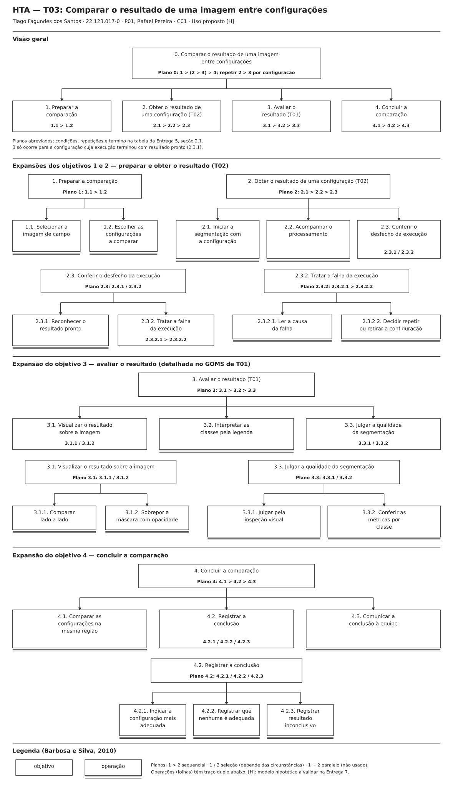

Retângulos representam objetivos; operações (folhas) têm traço duplo abaixo. Os planos usam `>` para sequência, `/` para seleção condicionada e colchetes para um passo que só ocorre sob condição (`[3.3.2]`). A tabela completa os planos abreviados do diagrama com as condições de cada escolha.

#### Decomposição e planos

| Objetivos / Operações | Problemas e Recomendações |
|---|---|
| **0. Comparar o resultado de uma imagem entre configurações** | **Input:** imagem de campo que gerou dúvida (C01); configurações disponibilizadas pelo TCC; computador do laboratório (Entrega 1, §5.2). **Plano 0:** `1 > (2 > 3) > 4`; repetir `2 > 3` para cada configuração escolhida em 1.2. O objetivo 3 só ocorre se 2 terminar em 2.3.1. **Feedback:** conclusão registrada (configuração mais adequada, nenhuma adequada ou inconclusivo) e comunicada à equipe. **Problema:** hoje cada execução exige script, gera arquivos sem padrão e a comparação se perde entre janelas e planilhas (C01). **Recomendação:** manter a imagem, as configurações e os resultados da mesma comparação reunidos em uma sessão. |
| **1. Preparar a comparação** | **Plano 1:** `1.1 > 1.2`. **Recomendação:** mostrar só as configurações disponibilizadas pelo TCC. |
| 1.1. Selecionar a imagem de campo | **Ação:** escolher o arquivo da imagem coletada no teste. **Recomendação:** exibir a imagem selecionada para Rafael confirmar que é a correta. |
| 1.2. Escolher as configurações a comparar | **Ação:** marcar as configurações a comparar. **Problema [?]:** não se sabe como Rafael decide o que comparar (C01, Q5). **Recomendação:** lista explícita com descrição curta de cada configuração (F01). |
| **2. Obter o resultado de uma configuração (T02)** | **Plano 2:** `2.1 > 2.2 > 2.3`. **Recomendação:** iniciar a execução com um único comando, sem editar parâmetros nem caminhos. |
| 2.1. Iniciar a segmentação com a configuração | **Ação:** confirmar a configuração e iniciar. **Problema:** hoje é preciso ajustar parâmetros e caminhos no script a cada execução (C01; jornada, etapa 2). |
| 2.2. Acompanhar o processamento | **Ação:** acompanhar o estado até a execução concluir ou falhar. **Recomendação:** distinguir processando, concluído e falhou, com indicação de progresso (RC04, F03). Não usar "treinando": Rafael só executa. |
| **2.3. Conferir o desfecho da execução** | **Plano 2.3:** `2.3.1 / 2.3.2`. 2.3.1 se a execução concluiu; 2.3.2 se falhou. |
| 2.3.1. Reconhecer o resultado pronto | **Ação:** reconhecer que o resultado está disponível para avaliação. |
| **2.3.2. Tratar a falha da execução** | **Plano 2.3.2:** `2.3.2.1 > 2.3.2.2`. **Problema:** hoje a falha obriga Rafael a depurar código, mesmo não sendo desenvolvedor (C01). **Recomendação:** dizer o que falhou em linguagem de usuário e o que ele pode fazer. |
| 2.3.2.1. Ler a causa da falha | **Ação:** ler a causa informada. **Problema [H]:** causas técnicas (memória, formato do arquivo) podem não fazer sentido para Rafael. |
| 2.3.2.2. Decidir repetir ou retirar a configuração | **Ação:** repetir a execução (volta a 2.1) ou retirar a configuração da comparação. |
| **3. Avaliar o resultado (T01)** | **Plano 3:** `3.1 > 3.2 > 3.3`. Detalhado no GOMS de T01 (seção 2.2). **Problema:** hoje a máscara é aberta em outra janela e a avaliação não é clara o bastante para apoiar decisões (C01). |
| **3.1. Visualizar o resultado sobre a imagem** | **Plano 3.1:** `3.1.1 / 3.1.2`. 3.1.1 quando precisa ver a imagem original sem a máscara por cima (iluminação, poeira) ou quer uma visão geral; 3.1.2 quando precisa conferir o limite entre classes. **Recomendação:** zoom nas duas visões (P01, decisão 1). |
| 3.1.1. Comparar lado a lado | **Ação:** ver a imagem e a máscara lado a lado, na mesma região. |
| 3.1.2. Sobrepor a máscara com opacidade | **Ação:** sobrepor a máscara à imagem e ajustar a opacidade. |
| 3.2. Interpretar as classes pela legenda | **Ação:** associar cada cor a uma classe pela legenda. **Problema:** hoje as cores não têm padrão entre execuções (jornada, etapa 5). **Recomendação:** paleta fixa e rótulo textual de cada classe (P01, decisão 2; RC01). As classes são *Trilha* e *Fora da trilha* (premissa 5). |
| **3.3. Julgar a qualidade da segmentação** | **Plano 3.3:** `3.3.1 > [3.3.2]`. A inspeção visual (3.3.1) sempre acontece; 3.3.2 só ocorre se ela for inconclusiva e a imagem tiver anotação de referência. Sem anotação, um resultado que continua duvidoso termina como inconclusivo. **Problema:** hoje Rafael não sabe dizer se a falha é do modelo ou da imagem (C01, Q7). |
| 3.3.1. Julgar pela inspeção visual | **Ação:** comparar a classe atribuída com o terreno visível e decidir se o resultado é adequado, inadequado ou inconclusivo; apontar a origem provável do erro (modelo ou imagem) só quando a imagem permitir distinguir. **Problema [?]:** o critério para considerar uma máscara correta ainda não foi levantado (C01, Q7). |
| 3.3.2. Conferir as métricas por classe | **Ação:** ler o IoU da classe de interesse e decidir se o resultado é adequado, inadequado ou continua inconclusivo. **Problema:** o IoU exige anotação de referência, que imagens novas de campo normalmente não têm (INC-52). **Recomendação:** métricas em tabela e em gráfico (RC03; evidência em revisão, INC-22). |
| **4. Concluir a comparação** | **Plano 4:** `4.1 > 4.2 > 4.3`. **Problema:** hoje as métricas ficam em planilhas diferentes e Rafael "perde o fio da comparação" (C01). |
| 4.1. Comparar as configurações na mesma região | **Ação:** ver os resultados das configurações lado a lado, na mesma região da imagem. **Recomendação:** reunir todas as configurações tratadas em uma única visão, com a avaliação feita em 3. |
| **4.2. Registrar a conclusão** | **Plano 4.2:** `(4.2.1 / 4.2.2 / 4.2.3) > 4.2.4`. Rafael decide a conclusão (4.2.1 se uma configuração se destaca; 4.2.2 se nenhuma é adequada; 4.2.3 se não há elementos para decidir) e depois a insere na interface (4.2.4). **Recomendação:** guardar a conclusão na sessão da comparação; guardá-la entre sessões é o histórico, que depende da H08. |
| 4.2.1. Concluir que uma configuração é a mais adequada | **Ação:** decidir qual configuração se destaca e por quê. |
| 4.2.2. Concluir que nenhuma é adequada | **Ação:** decidir que nenhuma serve e, se a imagem permitir, se o problema parece estar na imagem (captura) ou no modelo. |
| 4.2.3. Concluir que o resultado é inconclusivo | **Ação:** identificar o que impediu a conclusão. |
| 4.2.4. Inserir a conclusão na interface | **Ação:** registrar na interface a conclusão decidida em 4.2.1, 4.2.2 ou 4.2.3, com o motivo. |
| 4.3. Comunicar a conclusão à equipe | **Ação:** enviar a conclusão à equipe, fora da interface (C01, Q4). **Problema [H]:** exportar uma imagem comparativa (P01, decisão 4) ajudaria, mas não está no recorte da Entrega 1 até decisão da equipe. |

#### Verificação do HTA

O objetivo 0 é uma meta de Rafael no mundo real (saber qual configuração serve para a imagem), não "usar o sistema". Cada objetivo decomposto tem dois ou mais filhos e um plano; as folhas são operações. As escolhas (`/`) estão em 2.3, 3.1 e 4.2, todas com condição explícita; em 3.3, a consulta às métricas é um passo condicional (`[3.3.2]`) que continua a inspeção visual; a repetição por configuração está no Plano 0. Não há paralelismo (`+`). A decomposição para no nível em que a ação passa a depender do desenho da tela, que é tarefa da Entrega 6.

### 2.2 GOMS — T01 Avaliar a qualidade da segmentação de uma imagem

**Abordagem:** GOMS hierárquico, como no exemplo detalhado da aula. Não se aplica o KLM: a interface ainda não está desenhada.

**Precondições [H]:** a execução terminou com resultado pronto (2.3.1 da T03); a interface exibe a imagem, a máscara e a legenda. A meta 0 não tem método. As metas 2 e 3 têm um único caminho e são descritas direto por operadores; a meta 3 tem a submeta condicional 3.4, que corresponde ao passo `[3.3.2]` do HTA. A meta 1 corresponde à escolha 3.1 do HTA e por isso tem métodos e regras de seleção.

```text
GOAL 0: avaliar se a segmentação de uma imagem identifica corretamente as regiões do terreno
  GOAL 1: visualizar o resultado sobre a imagem
    METHOD 1.A: comparar lado a lado
    (SEL. RULE: precisa ver a imagem original sem a máscara por cima
     ou quer uma visão geral do resultado)
      OP. 1.A.1: selecionar a visualização lado a lado
      OP. 1.A.2: ampliar a região de interesse
      OP. 1.A.3: localizar a mesma região na imagem e na máscara
      OP. 1.A.4: verificar que a mesma região está visível nas duas
    METHOD 1.B: sobrepor a máscara com opacidade
    (SEL. RULE: precisa conferir o limite entre classes em uma região específica)
      OP. 1.B.1: selecionar a sobreposição
      OP. 1.B.2: ampliar a região de interesse
      OP. 1.B.3: ajustar a opacidade da máscara
      OP. 1.B.4: verificar que o terreno e o limite entre as classes estão visíveis ao mesmo tempo
  GOAL 2: interpretar as classes da máscara
    OP. 2.1: ler a legenda
    OP. 2.2: associar cada cor da região de interesse a uma classe
    OP. 2.3: verificar que todas as cores da região de interesse têm classe na legenda
  GOAL 3: julgar a qualidade da segmentação
    OP. 3.1: comparar a classe atribuída com o terreno visível na região de interesse
    OP. 3.2: examinar a imagem original em busca de problema de captura
    OP. 3.3: decidir, pela inspeção, se o resultado é adequado, inadequado ou inconclusivo
    GOAL 3.4: conferir as métricas por classe
    (somente se OP. 3.3 for inconclusivo e a imagem tiver anotação de referência)
      OP. 3.4.1: abrir as métricas da execução
      OP. 3.4.2: localizar a classe de interesse
      OP. 3.4.3: ler o IoU da classe
      OP. 3.4.4: comparar o IoU com a impressão da inspeção visual
      OP. 3.4.5: decidir se o resultado é adequado, inadequado ou continua inconclusivo
    OP. 3.5: apontar a origem provável de um erro (modelo ou imagem) só se a evidência permitir;
             senão, registrar que não é possível distinguir
    OP. 3.6: verificar que o julgamento se apoia na classe de interesse e que a incerteza, quando existe, foi mantida
  OP. 0.1: verificar que a avaliação indica se o resultado é adequado, inadequado ou inconclusivo, e por quê
```

**Regras e repetições:** a meta 1 pode ser repetida com o outro método (ex.: ver lado a lado e, com dúvida no limite da pista, passar à sobreposição). Na meta 3, as operações de inspeção visual (OP. 3.1 a 3.3) são comuns a todos os casos; a submeta 3.4 só ocorre quando a inspeção é inconclusiva e a imagem tem anotação de referência. Sem anotação, o julgamento termina na OP. 3.3, e um resultado que continua duvidoso é inconclusivo (T03, 4.2.3). Rafael só aponta a origem do erro (modelo ou imagem) quando a evidência permite (OP. 3.5). A comparação **entre** configurações não faz parte da T01: acontece no objetivo 4 da T03.

**Correspondência com o HTA da T03:** GOAL 1 ↔ 3.1 (1.A ↔ 3.1.1, 1.B ↔ 3.1.2); GOAL 2 ↔ 3.2; GOAL 3 ↔ 3.3 (OP. 3.1 a 3.3 ↔ 3.3.1; GOAL 3.4 ↔ `[3.3.2]`). Ler, localizar e examinar são operadores perceptivos; selecionar, ampliar e ajustar são motores; associar, decidir e verificar são cognitivos.

### 2.3 CTT — T03 Comparar o resultado de uma imagem entre configurações

**Fronteira dos sistemas:** seleção da imagem, escolha das configurações, execução, visualização, legenda, métricas e comparação na interface proposta; captura da imagem e comunicação à equipe fora dela. O sistema processa e exibe; não decide qual configuração é a melhor.

#### Diagrama

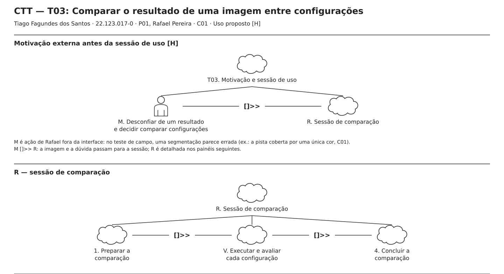

<details>
<summary>T03: detalhamento 1 — preparar e repetir por configuração</summary>

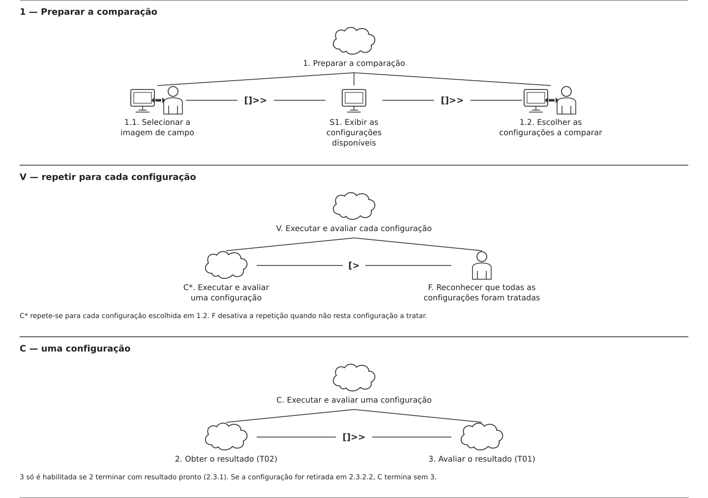

</details>

<details>
<summary>T03: detalhamento 2 — obter o resultado (T02)</summary>

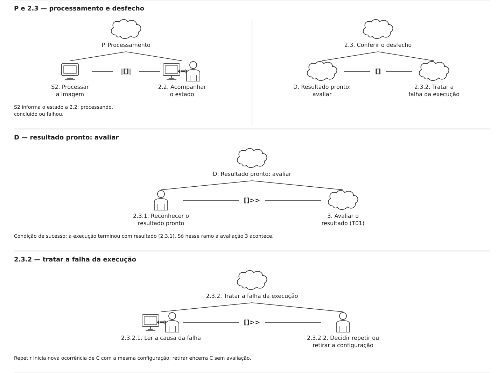

</details>

<details>
<summary>T03: detalhamento 3 — avaliar o resultado (T01)</summary>

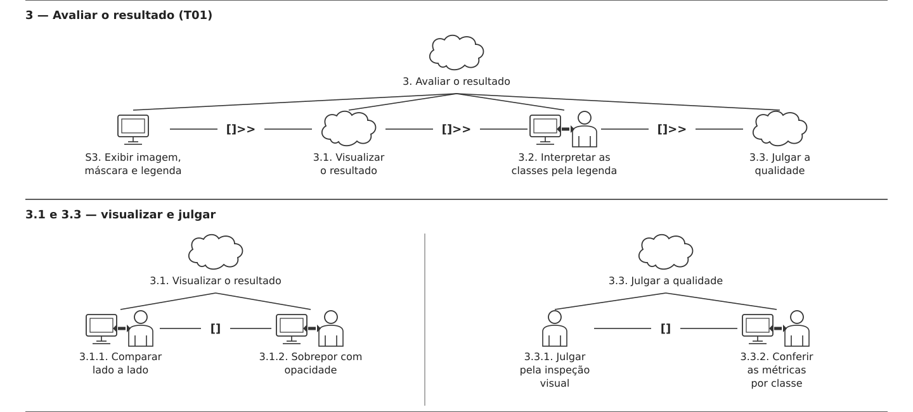

</details>

<details>
<summary>T03: detalhamento 4 — concluir a comparação e legenda</summary>

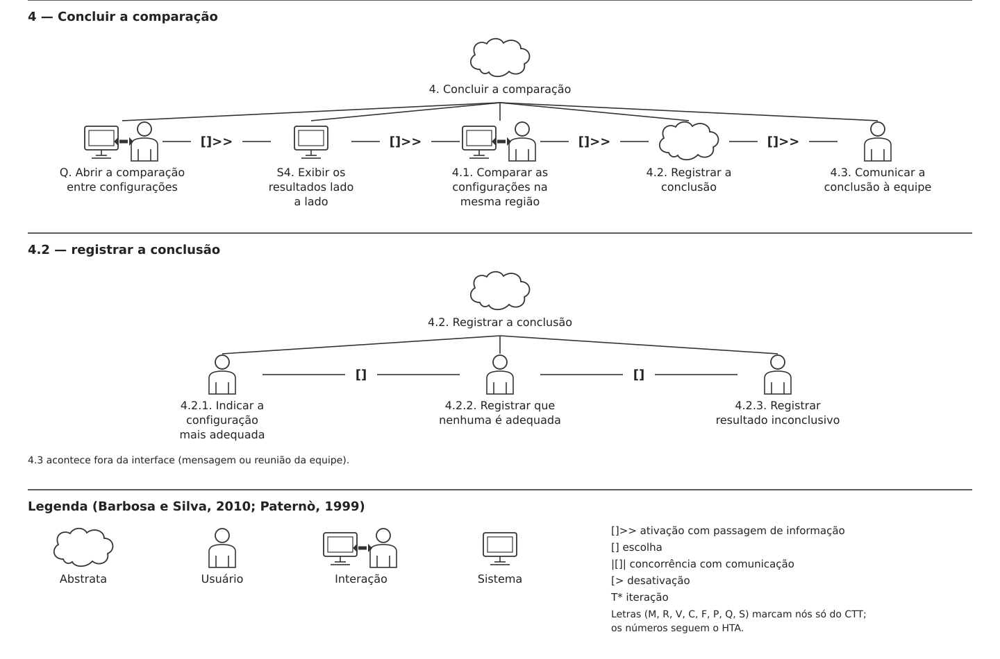

</details>

#### Leitura da árvore

Os IDs numéricos seguem o HTA. As letras marcam nós que só existem no CTT: `M` (motivação externa), `R` (sessão), `V` (repetição por configuração), `C` (uma configuração), `F` (fim da repetição), `P` (processamento), `D` (resultado pronto), `J` (decidir a conclusão), `Q` (abrir a comparação) e `S1`–`S5` (tarefas do sistema).

1. **Motivação e sessão:** `T03 = M []>> R`. No teste de campo, uma segmentação parece errada (ex.: a pista coberta por uma única cor, C01), e Rafael decide comparar configurações. A imagem e a dúvida passam para a sessão.
2. **Sessão:** `R = 1 []>> V []>> 4`.
3. **Preparar:** `1 = 1.1 []>> S1 []>> 1.2`. O sistema exibe as configurações disponíveis (S1) depois que a imagem é selecionada.
4. **Repetir por configuração:** `V = C* [> F`. C se repete para cada configuração escolhida; F (reconhecer que todas foram tratadas) desativa a repetição.
5. **Uma configuração:** `C = 2.1 []>> P []>> 2.3`. Os três nós correspondem ao objetivo 2 do HTA (T02). A avaliação fica dentro do ramo de sucesso de 2.3, para que nenhuma sequência obrigue a avaliar um resultado que não existe.
6. **Processamento e desfecho:** `P = S2 |[]| 2.2`. O sistema processa a imagem (S2) e, ao mesmo tempo, informa o estado a Rafael, que acompanha (2.2). Depois, `2.3 = D [] 2.3.2`. Com sucesso, `D = 2.3.1 []>> 3`: Rafael reconhece o resultado pronto e o avalia. Com falha, `2.3.2 = 2.3.2.1 []>> 2.3.2.2`: repetir inicia nova ocorrência de C com a mesma configuração; retirar encerra C sem avaliação.
7. **Avaliar:** `3 = S3 []>> 3.1* []>> 3.2 []>> 3.3`, com `3.1* = (3.1.1 [] 3.1.2)*` e `3.3 = 3.3.1 []>> [3.3.2]`. A escolha entre lado a lado e sobreposição pode ser refeita na mesma análise; 3.1 termina quando Rafael passa a 3.2. As métricas (3.3.2) só são consultadas se a inspeção visual for inconclusiva e a imagem tiver anotação de referência.
8. **Concluir:** `4 = Q []>> S4 []>> 4.1 []>> 4.2 []>> 4.3`, com `4.2 = J []>> 4.2.4 []>> S5` e `J = 4.2.1 [] 4.2.2 [] 4.2.3`. Rafael decide a conclusão (J, julgamento) e a insere na interface (4.2.4); o sistema a guarda na sessão da comparação (S5). Guardá-la entre sessões é o histórico, que depende da H08. A comunicação (4.3) acontece fora da interface.

#### Legenda e relações temporais usadas

| Relação CTT | Notação | Ocorrência em T03 |
|---|---|---|
| Ativação com passagem de informação | `T1 []>> T2` | M passa a imagem e a dúvida a R; a imagem passa às configurações (1); o resultado pronto passa à avaliação (D); as avaliações passam à conclusão (4); a conclusão decidida passa ao registro (4.2.4). |
| Escolha | `T1 [] T2` | Resultado pronto ou falha (2.3: D ou 2.3.2); lado a lado ou sobreposição (3.1); as três conclusões (J). |
| Concorrência com comunicação | `T1 \|[]\| T2` | S2 processa enquanto Rafael acompanha o estado (2.2), e o sistema comunica processando, concluído ou falhou. |
| Desativação | `T1 [> T2` | F encerra a repetição de C. |
| Iteração | `T*` | C* repete-se para cada configuração; 3.1* permite refazer a escolha de visualização na mesma análise. |
| Opcional | `[T]` | 3.3.2: métricas só quando a inspeção é inconclusiva e a imagem tem anotação de referência. |

Não há suspensão (`|>`): interrupções durante a análise (Entrega 1, §5.3) ainda são hipótese e não foram modeladas.

#### Tipos de tarefas

| Símbolo no diagrama | Tipo | Tarefas no modelo |
|---|---|---|
| Nuvem | Abstrata | T03, R, V, C, P, D, J, ramos 1, 3 e 4, 2.3, 2.3.2, 3.1, 3.3 e 4.2. |
| Pessoa | Usuário | M (fora da interface); F; 2.3.1 e 2.3.2.2; 3.3.1; 4.2.1 a 4.2.3; 4.3 (fora da interface). |
| Pessoa e computador, com seta dupla | Interação | 1.1, 1.2, 2.1, 2.2, 2.3.2.1, 3.1.1, 3.1.2, 3.2, 3.3.2, Q, 4.1 e 4.2.4. |
| Computador | Sistema | S1 (exibir configurações), S2 (processar a imagem), S3 (exibir imagem, máscara e legenda), S4 (exibir resultados lado a lado) e S5 (guardar a conclusão na sessão). |

### 2.4 Correspondência entre os três modelos

| Escolha ou repetição no HTA | Métodos no GOMS (T01) | Relação no CTT |
|---|---|---|
| Plano 0: repetir `2 > 3` por configuração | Fora do GOMS (a T01 avalia uma execução) | `V = C* [> F` |
| 2.3: `2.3.1 / 2.3.2` | Fora do GOMS (precondição: resultado pronto) | `D [] 2.3.2`, com `D = 2.3.1 []>> 3` |
| 3.1: `3.1.1 / 3.1.2` | 1.A / 1.B; a meta 1 pode ser repetida com o outro método | `(3.1.1 [] 3.1.2)*` |
| 3.3: `3.3.1 > [3.3.2]` | OP. 3.1 a 3.3 e a submeta condicional 3.4 | `3.3.1 []>> [3.3.2]` |
| 4.2: `(4.2.1 / 4.2.2 / 4.2.3) > 4.2.4` | Fora do GOMS | `J []>> 4.2.4 []>> S5`, com `J = 4.2.1 [] 4.2.2 [] 4.2.3` |

As sequências (`>`) do HTA não recebem métodos no GOMS e aparecem como `[]>>` no CTT. Uma diferença deliberada: no HTA, acompanhar o processamento (2.2) vem depois de iniciar (2.1); no CTT, ele acontece **ao mesmo tempo** que o processamento do sistema (`S2 |[]| 2.2`), o que o HTA não consegue representar porque não modela o sistema. Outra: no CTT, a avaliação (3) fica dentro do ramo de sucesso de 2.3 (D), enquanto no HTA é irmã de 2; o Plano 0 do HTA expressa a mesma condição em texto (o objetivo 3 só ocorre se 2 terminar em 2.3.1).

### 2.5 Síntese e implicações para o projeto

Os modelos são **propostas a validar**, derivadas de C01 e da P01:

1. **Execução sem script, com estado claro:** o ramo 2 só funciona se a interface distinguir processando, concluído e falhou, e explicar a falha em linguagem de usuário (RC04).
2. **Imagem ou modelo:** a ruptura central do C01 é não saber se o erro vem do modelo ou da captura. Ela aparece nas OP. 3.2 e 3.5 do GOMS (examinar a imagem original e apontar a origem só quando a evidência permite) e em 4.2.2 (concluir onde parece estar o problema). Quando não é possível distinguir, o resultado é inconclusivo.
3. **Métricas dependem de anotação:** para imagens novas de campo, a avaliação é visual. A interface não deve prometer IoU para toda imagem (INC-52).
4. **Comparação reunida:** reunir as configurações na mesma visão (4.1) responde ao "perder o fio da comparação" do C01.

**Continuidade da investigação [?]:** na Entrega 7, verificar com um integrante que faz a análise de segmentação (perfil P01) como escolhe as configurações a comparar (C01, Q5); qual critério usa para considerar a máscara correta (Q7); se as imagens de campo costumam ter anotação de referência; e quantas imagens e configurações avalia por sessão (Q9).

---

## 3. Mateus Marana Assuena — P02 (Andreia Silva)

**Autor(a):** Mateus Marana Assuena — 22.123.026-1  
**Persona:** P02 — Andreia Silva  
**Cenário de origem:** C03 — Experimentação e análises de modelos para segmentação 
**Tarefas modeladas:** T06 (GOMS), T07 (HTA e CTT) e T08 (HTA, GOMS e CTT, seção 3.6)  
**Rastreabilidade:** R03; H01, H04; Q18, Q21, Q26. R03; H01, H04; Q22, Q24; decisões de design relacionadas à visualização. R03; H01, H04; Q18, Q19, Q20; decisões de design relacionadas à comparação.

**Recorte comum aos três modelos [H]:**

- Andreia executa, analisa e compara os resultados da segmentação **pela interface**, sem precisar recorrer a scripts ou ao terminal. Embora tenha conhecimento de Python e visão computacional, o objetivo do sistema é centralizar essas atividades em uma interface.
- Nas tarefas T06 e T07, ela utiliza **configurações já treinadas e disponibilizadas pelo sistema**. Definir uma configuração e treinar o modelo é a T08, no recorte desde 08/11/2026 (premissa 5) e modelada na seção 3.6.
- As entradas consideradas são **imagens e vídeos gravados**. A captura de imagens pelas câmeras do veículo fica fora do escopo da interface.
- A análise visual considera a imagem original, as máscaras geradas e as sobreposições, permitindo inspecionar os resultados e identificar diferenças entre modelos.
- A comparação considera a mesma entrada processada por diferentes modelos, para que as diferenças observadas sejam atribuídas aos modelos, e não a arquivos distintos.
- **Métricas são consideradas somente quando estiverem disponíveis** para a execução. Não se presume que todas as imagens possuam anotações de referência ou que todos os indicadores possam ser calculados.
- A avaliação dos resultados combina inspeção visual e indicadores disponíveis, sem presumir que uma métrica isolada determine a qualidade da segmentação.
- Ficam **fora do escopo**: captura de imagens pelo veículo, comunicação dos resultados à equipe, histórico persistente, exportação e modo offline, enquanto não houver requisitos que sustentem essas funcionalidades.
- Uma segmentação adequada não permite concluir, isoladamente, que um terreno ou trajeto é transitável ou seguro para o veículo Baja.

### 3.1 HTA — T07: Comparar o resultado de diferentes modelos

#### Descrição da tarefa
- **Objetivo central [H]:** saber se uma configuração (outro modelo ou outros parâmetros de treino) segmenta melhor a mesma entrada do que a configuração de referência, para decidir o que levar à reunião e o que testar no próximo experimento (C03, Q28).
- **Entrada [H]:** imagens ou quadros extraídos dos vídeos dos testes; configurações treinadas disponíveis no sistema.
- **Resultado [H]:** conclusão registrada: configuração candidata, nenhuma ou comparação inconclusiva, com ressalvas e o próximo experimento.
- **Pré-condições [H]:** entrada em formato aceito e pelo menos duas configurações disponíveis.
- **Exceções [H]:** arquivo em formato não aceito (1.1), falha na execução (2.3.2), diferença pequena demais para decidir (5.1, que termina como inconclusiva).
- **Término:** conclusão registrada (5.2). A comunicação da conclusão à equipe acontece fora da interface.

#### Diagrama

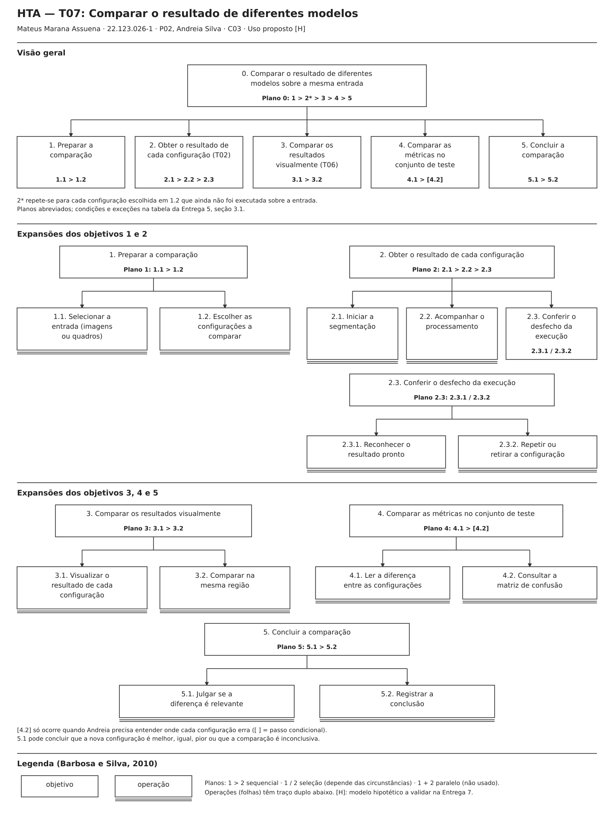

*Figura — HTA de T07, por Mateus Marana Assuena. Gerado por [`hta_t07.py`](../scripts/diagramas/hta_t07.py).*

Retângulos representam objetivos; operações (folhas) têm traço duplo abaixo. Os planos usam `>` para sequência, `/` para seleção condicionada e colchetes para um passo que só ocorre sob condição (`[4.2]`); o asterisco indica repetição. A tabela completa os planos abreviados do diagrama com as condições de cada passo.

#### Decomposição e planos

| Objetivos / Operações | Problemas e Recomendações |
|---|---|
| **0. Comparar o resultado de diferentes modelos sobre a mesma entrada** | **Input:** imagens ou quadros dos testes e configurações treinadas disponíveis (C03, Q21). **Plano 0:** `1 > 2* > 3 > 4 > 5`; repetir 2 para cada configuração escolhida em 1.2 que ainda não foi executada sobre a entrada. Se, ao fim de 2*, restar menos de duas configurações com resultado, Andreia volta a 1.2. **Feedback:** conclusão registrada junto da comparação: configuração candidata, nenhuma ou comparação inconclusiva, com as ressalvas e o próximo experimento. **Problema:** hoje cada configuração é executada em um script separado e as saídas ficam em janelas diferentes, o que esconde diferenças pequenas na borda da trilha (C03, Q19 e Q24). **Recomendação:** reunir seleção, execução, visualização e métricas em uma única interface. |
| **1. Preparar a comparação** | **Plano 1:** `1.1 > 1.2`. **Recomendação:** mostrar só as configurações treinadas disponíveis, com descrição curta (F01). |
| 1.1. Selecionar a entrada (imagens ou quadros) | **Ação:** escolher as imagens ou os quadros extraídos dos trechos que interessam ao experimento. **Problema [H]:** vídeos têm resoluções diferentes conforme a câmera (C03, Q21). **Recomendação:** informar antes da execução se algum arquivo está em formato não aceito. |
| 1.2. Escolher as configurações a comparar | **Ação:** marcar a configuração de referência e as configurações a testar. **Recomendação:** mostrar o modelo e os parâmetros de cada configuração, para que as diferenças observadas possam ser atribuídas a eles (C03, Q18). |
| **2. Obter o resultado de cada configuração (T02)** | **Plano 2:** `2.1 > 2.2 > 2.3`, repetido por configuração (Plano 0). **Recomendação:** não exigir que a entrada seja selecionada de novo a cada configuração. |
| 2.1. Iniciar a segmentação | **Ação:** iniciar a execução da configuração sobre a entrada. **Problema:** hoje cada execução exige um script separado (C03, Q26). |
| 2.2. Acompanhar o processamento | **Ação:** acompanhar o estado até concluir ou falhar. **Recomendação:** distinguir processando, concluído e falhou, com a causa da falha em linguagem de usuário (RC04, F03). |
| **2.3. Conferir o desfecho da execução** | **Plano 2.3:** `2.3.1 / 2.3.2`. 2.3.1 se a execução concluiu; 2.3.2 se falhou. |
| 2.3.1. Reconhecer o resultado pronto | **Ação:** reconhecer que o resultado está disponível; a configuração entra na comparação. |
| 2.3.2. Repetir ou retirar a configuração | **Ação:** ler a causa da falha e repetir a execução (nova ocorrência de 2) ou retirar a configuração da comparação. **Problema [H]:** a causa técnica (ex.: falta de memória) pode não indicar o que fazer. **Recomendação:** dizer em linguagem de usuário o que falhou e o que pode ser feito. |
| **3. Comparar os resultados visualmente (T06)** | **Plano 3:** `3.1 > 3.2`. Detalhado no GOMS da T06 (seção 3.2). **Problema:** alternar janelas faz Andreia perder diferenças pequenas na borda da trilha (C03, Q24). |
| 3.1. Visualizar o resultado de cada configuração | **Ação:** ver a imagem original, a máscara de cada configuração e a sobreposição. **Recomendação:** as quatro informações ao mesmo tempo, com legenda fixa (RQ03, RQ04). |
| 3.2. Comparar na mesma região | **Ação:** comparar as configurações na mesma região ampliada da mesma imagem. **Recomendação:** manter a região ampliada igual entre as configurações (RQ02, RQ03). |
| **4. Comparar as métricas no conjunto de teste** | **Plano 4:** `4.1 > [4.2]`; 4.2 só quando Andreia precisa entender onde cada configuração erra. **Problema:** as métricas valem para o conjunto de teste, não para os quadros de campo, que são avaliados visualmente (C03, Q20; RQ06). |
| 4.1. Ler a diferença entre as configurações | **Ação:** ler IoU, acurácia e tempo de inferência de cada configuração e a diferença entre elas. **Recomendação:** mostrar a diferença sem julgar se ela é relevante (RQ08). |
| 4.2. Consultar a matriz de confusão | **Ação:** ver quanto do que era *Trilha* foi marcado como *Fora da trilha*, e o contrário, em cada configuração. |
| **5. Concluir a comparação** | **Plano 5:** `5.1 > 5.2`. **Problema:** hoje Andreia chega à reunião só com um "talvez" (C03, Q25). |
| 5.1. Julgar se a diferença é relevante | **Ação:** decidir, com a comparação visual (3) e as métricas (4), se a nova configuração é melhor, igual ou pior, ou se a comparação é inconclusiva (ex.: melhora em sombras largas, mas ainda perde a trilha em trechos estreitos; C03, Q22). **Problema [?]:** o critério de Andreia para considerar um resultado insatisfatório (perder a trilha em sombras ou trechos estreitos, C03, Q22) ainda precisa ser confirmado na Entrega 7. |
| 5.2. Registrar a conclusão | **Ação:** registrar na interface a configuração candidata, nenhuma ou que a comparação foi inconclusiva, com as ressalvas e o próximo experimento. **Recomendação:** guardar a conclusão na sessão da comparação (RQ08); guardá-la entre sessões é o histórico, que depende da H08. |

#### Verificação do HTA

O objetivo 0 é uma meta de Andreia no mundo real (saber se uma configuração é melhor para decidir o próximo passo do experimento), e não "usar o sistema". Cada objetivo decomposto tem dois ou mais filhos e um plano; as folhas são operações. Os planos usam `>` porque há dependência entre os passos (a entrada vem antes das configurações, e a execução vem antes da comparação). A escolha (`/`) está em 2.3, com condição explícita; a matriz de confusão (`[4.2]`) é um passo condicional; a repetição por configuração está no Plano 0. Não há paralelismo (`+`).

### 3.2 GOMS — T06 Analisar visualmente os resultados da segmentação

**Abordagem:** GOMS hierárquico, como no exemplo detalhado da aula. Não se aplica o KLM: a interface ainda não está desenhada.

**Precondições [H]:** a execução da segmentação foi concluída com sucesso; os resultados estão disponíveis para consulta; a interface apresenta a imagem original e as saídas da segmentação, como máscara e sobreposição. A meta 0 não possui método próprio. A meta 2 possui três métodos alternativos, escolhidos conforme o tipo de visualização necessário para analisar o resultado.

```text
GOAL 0: analisar visualmente os resultados da segmentação
  GOAL 1: acessar o resultado da segmentação
    OP. 1.1: localizar a execução que deseja analisar
    OP. 1.2: abrir os resultados da execução
    OP. 1.3: identificar a imagem ou o vídeo processado
    OP. 1.4: verificar que os resultados correspondem à entrada selecionada

  GOAL 2: examinar as visualizações do resultado
    METHOD 2.A: analisar a imagem original
    (SEL. RULE: precisa compreender as características da entrada
     ou verificar possíveis problemas na imagem)
      OP. 2.A.1: selecionar a visualização da imagem original
      OP. 2.A.2: observar as regiões de interesse
      OP. 2.A.3: identificar características relevantes do terreno
      OP. 2.A.4: verificar se há problemas visíveis na imagem

    METHOD 2.B: analisar a máscara
    (SEL. RULE: precisa identificar as classes atribuídas pelo modelo
     e verificar a distribuição das regiões segmentadas)
      OP. 2.B.1: selecionar a visualização da máscara
      OP. 2.B.2: observar as regiões segmentadas
      OP. 2.B.3: identificar as cores e regiões representadas
      OP. 2.B.4: verificar a distribuição das classes na máscara

    METHOD 2.C: analisar a sobreposição
    (SEL. RULE: precisa relacionar as regiões segmentadas com a imagem original
     ou verificar os limites entre as classes)
      OP. 2.C.1: selecionar a visualização sobreposta
      OP. 2.C.2: observar a correspondência entre imagem e máscara
      OP. 2.C.3: identificar regiões com possíveis inconsistências
      OP. 2.C.4: verificar se os limites das classes correspondem ao terreno visível

  GOAL 3: identificar possíveis problemas na segmentação
    OP. 3.1: localizar regiões com possíveis erros
    OP. 3.2: comparar as regiões segmentadas com as características da imagem original
    OP. 3.3: identificar classes atribuídas incorretamente ou regiões não segmentadas
    OP. 3.4: verificar se o problema observado pode estar relacionado à imagem de entrada;
             quando a imagem não permitir distinguir, manter a dúvida

  GOAL 4: concluir a análise visual
    OP. 4.1: avaliar se o resultado apresenta problemas visíveis
    OP. 4.2: determinar se a segmentação parece adequada, inadequada ou se a análise é inconclusiva
    OP. 4.3: registrar os aspectos que justificam a avaliação
    OP. 4.4: verificar que a conclusão está fundamentada nas evidências visuais
    
```
**Regras e repetições:** na meta 2, os métodos 2.A, 2.B e 2.C são alternativas, escolhidas pelas regras de seleção. Cada método termina quando a verificação final do bloco é atendida (2.A.4, 2.B.4 ou 2.C.4), isto é, quando a pessoa obteve a informação que aquela visualização oferece. Usar mais de uma visualização na mesma análise é repetir a meta 2 com outro método: a pessoa pode começar pela imagem original, consultar a máscara e, em seguida, repetir a meta com a sobreposição para investigar uma região específica. A pessoa volta à meta 2 quando a visualização usada não basta para a meta 3 (ex.: a máscara mostra uma região suspeita, mas só a sobreposição permite conferir o limite com o terreno); a meta 2 termina quando ela tem as visualizações de que precisa. Para uma consulta, as três vistas são alternativas; para a análise completa, podem ser complementares. Na meta 4, um resultado que continua duvidoso termina como inconclusivo.

**Correspondência com o HTA da T07:** o GOMS da T06 detalha a análise de um resultado, aplicada a cada configuração dentro do objetivo 3 do HTA da T07. GOAL 1 ↔ 2.3.1 (reconhecer e acessar o resultado pronto); GOAL 2 ↔ 3.1 (2.A, 2.B e 2.C são as visualizações de 3.1); GOAL 3 ↔ 3.2 (identificar problemas na mesma região); GOAL 4 alimenta 5.1 (julgar se a diferença é relevante). Observar e localizar são operadores perceptivos; selecionar e abrir são motores; identificar, comparar, avaliar e concluir são cognitivos.

### 3.3 CTT — T07 Comparar o resultado de diferentes modelos

**Fronteira do sistema:** a seleção da entrada, a escolha das configurações, a execução, a exibição dos resultados (imagem original, máscaras e sobreposição), das métricas e da diferença entre configurações, e o registro da conclusão acontecem na interface proposta. A decisão de comparar, o julgamento da relevância da diferença e a comunicação dos resultados à equipe são de Andreia; os dois últimos ficam fora da interface. O sistema mostra e calcula, mas não decide (RQ08).

#### Diagrama

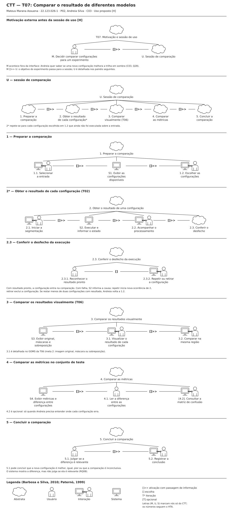

*Figura — CTT de T07, por Mateus Marana Assuena. Gerado por [`ctt_t07.py`](../scripts/diagramas/ctt_t07.py).*

#### Leitura da árvore

Os IDs numéricos seguem o HTA. As letras marcam nós que só existem no CTT: `M` (motivação externa), `U` (sessão) e `S1`–`S4` (tarefas do sistema).

1. **Motivação e sessão:** `T07 = M []>> U`. Fora da interface, Andreia decide comparar configurações para um experimento (C03, Q28); o objetivo do experimento passa para a sessão U.
2. **Sessão:** `U = 1 []>> 2* []>> 3 []>> 4 []>> 5`. Cada ramo passa sua informação ao seguinte: entrada e configurações, resultados, comparação visual, diferença nas métricas e conclusão. O ramo 2 se repete para cada configuração escolhida.
3. **Preparar:** `1 = 1.1 []>> S1 []>> 1.2`. Andreia seleciona a entrada, o sistema exibe as configurações disponíveis e ela escolhe as que vai comparar.
4. **Obter o resultado:** `2 = 2.1 []>> S2 []>> 2.2 []>> 2.3`, com `2.3 = 2.3.1 [] 2.3.2`. Andreia inicia a segmentação, o sistema executa e informa o estado, e ela acompanha. Com resultado pronto (2.3.1), a configuração entra na comparação; com falha (2.3.2), ela repete a execução (nova ocorrência de 2) ou retira a configuração. Se restar menos de duas configurações com resultado, ela volta a 1.2.
5. **Comparar visualmente:** `3 = S3 []>> 3.1 []>> 3.2`. O sistema exibe original, máscaras e sobreposição; Andreia visualiza o resultado de cada configuração (detalhado no GOMS da T06) e compara na mesma região.
6. **Comparar as métricas:** `4 = S4 []>> 4.1 []>> [4.2]`. O sistema exibe as métricas e a diferença entre configurações; Andreia lê a diferença e, se precisar, consulta a matriz de confusão (4.2 é opcional).
7. **Concluir:** `5 = 5.1 []>> 5.2`. Andreia julga se a diferença é relevante (melhor, igual, pior ou inconclusiva) e registra a conclusão na interface, que a guarda na sessão da comparação.

#### Legenda e relações temporais usadas

| Relação CTT | Notação | Ocorrência em T07 |
|---|---|---|
| Ativação com passagem de informação | `T1 []>> T2` | M passa o objetivo do experimento a U; os ramos 1 a 5 passam entrada, resultados e julgamentos adiante; S1 a S4 passam o que exibem à ação seguinte. |
| Escolha | `T1 [] T2` | Resultado pronto ou falha (2.3). |
| Iteração | `T*` | O ramo 2 se repete para cada configuração escolhida em 1.2 e, depois de uma falha, quando Andreia repete a execução. |
| Opcional | `[T]` | 4.2 (matriz de confusão) só acontece quando Andreia precisa entender onde cada configuração erra. |

Não há concorrência (`|||`) nem suspensão (`|>`): a comparação segue em sequência dentro de uma sessão.

#### Tipos de tarefas

| Símbolo no diagrama | Tipo | Tarefas no modelo |
|---|---|---|
| Nuvem | Abstrata | T07, U, ramos 1 a 5 e 2.3. |
| Pessoa | Usuário | M (fora da interface), 2.3.1, 4.1 e 5.1. |
| Pessoa e computador, com seta dupla | Interação | 1.1, 1.2, 2.1, 2.2, 2.3.2, 3.1, 3.2, 4.2 e 5.2. |
| Computador | Sistema | S1 (exibir as configurações disponíveis), S2 (executar e informar o estado), S3 (exibir original, máscaras e sobreposição) e S4 (exibir métricas e diferença entre configurações). |

### 3.4 Correspondência entre os três modelos

| Passo no HTA (T07) | Métodos no GOMS (T06) | Relação no CTT (T07) |
|---|---|---|
| Plano 0: `1 > 2* > 3 > 4 > 5` | Fora do GOMS | `T07 = M []>> U` e `U = 1 []>> 2* []>> 3 []>> 4 []>> 5` |
| Plano 1: `1.1 > 1.2` | Fora do GOMS | `1 = 1.1 []>> S1 []>> 1.2` |
| Plano 2: `2.1 > 2.2 > 2.3`, repetido por configuração | Fora do GOMS (a T06 parte de uma execução concluída) | `2* = 2.1 []>> S2 []>> 2.2 []>> 2.3` |
| 2.3: `2.3.1 / 2.3.2` | Meta 1 (acessar o resultado) parte de 2.3.1 | `2.3.1 [] 2.3.2` |
| 3.1: visualizar o resultado de cada configuração | Meta 2: 2.A / 2.B / 2.C (imagem original, máscara ou sobreposição) | `S3 []>> 3.1` |
| 3.2: comparar na mesma região | Meta 3 (identificar possíveis problemas) | `3.1 []>> 3.2` |
| Plano 4: `4.1 > [4.2]` | Fora do GOMS | `4 = S4 []>> 4.1 []>> [4.2]` |
| Plano 5: `5.1 > 5.2` | Meta 4 (concluir a análise visual) alimenta 5.1 | `5 = 5.1 []>> 5.2` |

As sequências do HTA (`>`) aparecem como `[]>>` no CTT e não recebem métodos no GOMS. O GOMS da T06 detalha a análise de **um** resultado; na T07, ele é aplicado a cada configuração dentro do objetivo 3, e a regra de seleção da meta 2 corresponde à escolha da visualização em 3.1. As tarefas do sistema (S1 a S4) e a motivação externa (M) aparecem só no CTT, porque o HTA e o GOMS modelam as ações de Andreia.

### 3.5 Síntese e implicações para o projeto

Os modelos abaixo são **propostas a validar**, derivadas do C03 (Q19, Q24 e Q26) e do cenário de interação CI03 da Entrega 9:

1. **Fluxo único, sem scripts:** hoje cada configuração é executada em um script separado (C03, Q26). Os ramos 1 e 2 do CTT só se sustentam se seleção, execução e visualização ocorrerem na mesma interface.
2. **Estado e erro claros:** S2 exige que a interface informe se a execução está processando, concluída ou com erro, e o motivo da falha. Formato não aceito (1.1) e falha na execução (2.3.2) são as exceções previstas.
3. **Comparar sem recomeçar:** como só o ramo 2 se repete, trocar ou acrescentar uma configuração não deve exigir selecionar a entrada de novo, e os resultados já executados continuam disponíveis para a comparação (C03, Q19).
4. **Máscaras junto ao original, na mesma região:** S3 e o passo 3.2 respondem à Q24 (ver as quatro informações ao mesmo tempo) e usam as visualizações do GOMS da T06.

**Continuidade da investigação [?]:** verificar com quem realiza essa comparação no contexto da pesquisa quantas configurações e quantas imagens ou quadros avalia por sessão; qual critério usa para considerar um resultado melhor que outro; se precisa consultar experimentos anteriores; e quais informações de cada configuração, além do nome e da descrição, ajudam a escolher.

### 3.6 Modelagem da T08 — Definir uma configuração de treino e treinar o modelo

**Autor(a):** Mateus Marana Assuena — 22.123.026-1  
**Base:** cenário C03 (Q18, Q26 e Q27) e cenário de interação CI03 e conversa da seção 2.3 da Entrega 9  
**Recorte [H]:** Andreia define a configuração com os parâmetros expostos ao usuário (premissa 5) e treina pela interface. Parâmetros internos do treino e novas arquiteturas ficam fora. Os valores padrão são os do TCC (Entrega 9, seção 4).

#### 3.6.1 HTA — T08

**Descrição da tarefa**

- **Objetivo central [H]:** ter uma nova configuração treinada e disponível para comparação, para testar uma hipótese do experimento (por exemplo, se mais épocas e outro dataset melhoram a trilha em sombra; C03, Q28).
- **Entrada [H]:** o que Andreia quer testar; modelos e datasets do TCC; valores padrão dos parâmetros.
- **Resultado [H]:** configuração treinada, com nome, disponível entre as configurações e com métricas no conjunto de teste.
- **Exceções [H]:** valor fora do permitido (1.2), nome repetido (1.3), treino interrompido por falha (2.3.2).
- **Término:** configuração conferida (3). A comparação com outras configurações é a T07.

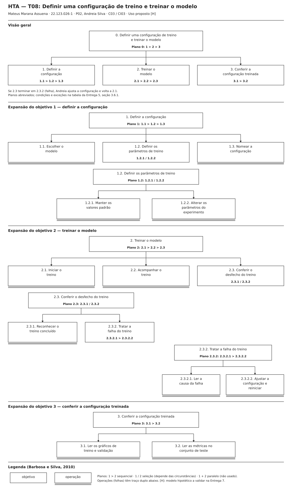

*Figura — HTA de T08, por Mateus Marana Assuena. Gerado por [`hta_t08.py`](../scripts/diagramas/hta_t08.py).*

| Objetivos / Operações | Problemas e Recomendações |
|---|---|
| **0. Definir uma configuração de treino e treinar o modelo** | **Input:** o que testar (C03, Q18 e Q28), modelos e datasets do TCC, valores padrão. **Plano 0:** `1 > 2 > 3`; se 2.3 terminar em 2.3.2, Andreia ajusta a configuração e repete 2. **Feedback:** nova configuração disponível, com nome e métricas no conjunto de teste. **Problema:** hoje a configuração é ajustada em scripts e, se o treino falha no meio, o tempo é perdido (C03, Q26). **Recomendação:** definir e treinar pela interface, mantendo a configuração quando o treino falha. |
| **1. Definir a configuração** | **Plano 1:** `1.1 > 1.2 > 1.3`. **Recomendação:** mostrar só os parâmetros expostos ao usuário, com os valores padrão (D2). |
| 1.1. Escolher o modelo | **Ação:** escolher FCN ou DeepLabV3+. |
| **1.2. Definir os parâmetros de treino** | **Plano 1.2:** `1.2.1 / 1.2.2`. 1.2.1 se o experimento não depende dos parâmetros; 1.2.2 se o experimento testa um ou mais deles (épocas, early stopping e paciência, datasets de treino, batch size, geração de gráficos). **Recomendação:** não permitir valores fora do permitido (por exemplo, nenhum dataset de treino). |
| 1.2.1. Manter os valores padrão | **Ação:** aceitar os valores padrão do TCC. |
| 1.2.2. Alterar os parâmetros do experimento | **Ação:** alterar só os parâmetros que o experimento testa. **Problema [H]:** batch size maior usa mais memória e pode interromper o treino (C03, Q26). **Recomendação:** explicar o efeito de cada parâmetro no ponto de uso. |
| 1.3. Nomear a configuração | **Ação:** aceitar ou editar o nome sugerido. **Recomendação:** sugerir um nome único a partir do modelo e das épocas `[H]` (Entrega 9, seção 4). |
| **2. Treinar o modelo** | **Plano 2:** `2.1 > 2.2 > 2.3`. **Problema:** Andreia trabalha em janelas curtas, entre aulas (C03, Q27). |
| 2.1. Iniciar o treino | **Ação:** iniciar o treino com a configuração definida. |
| 2.2. Acompanhar o treino | **Ação:** ao voltar, consultar a época atual e os gráficos. **Recomendação:** mostrar o estado e o progresso por época, sem exigir que Andreia fique na frente da tela (RC04). |
| **2.3. Conferir o desfecho do treino** | **Plano 2.3:** `2.3.1 / 2.3.2`. 2.3.1 se o treino terminou; 2.3.2 se falhou. |
| 2.3.1. Reconhecer o treino concluído | **Ação:** reconhecer que o treino terminou, pelas épocas ou por early stopping. **Recomendação:** explicar quando o treino terminou antes das épocas pedidas. |
| **2.3.2. Tratar a falha do treino** | **Plano 2.3.2:** `2.3.2.1 > 2.3.2.2`. |
| 2.3.2.1. Ler a causa da falha | **Ação:** ler a causa informada (por exemplo, falta de memória). |
| 2.3.2.2. Ajustar a configuração e reiniciar | **Ação:** ajustar o parâmetro sugerido (por exemplo, batch size menor) e voltar a 2.1. **Recomendação:** manter a configuração preenchida para que só o ajuste seja feito. |
| **3. Conferir a configuração treinada** | **Plano 3:** `3.1 > 3.2`. |
| 3.1. Ler os gráficos de treino e validação | **Ação:** ver a evolução do treino por época. |
| 3.2. Ler as métricas no conjunto de teste | **Ação:** ler IoU, acurácia e tempo de inferência da nova configuração. **Recomendação:** a configuração passa a aparecer entre as disponíveis para a T07. |

**Verificação do HTA:** o objetivo 0 é uma meta de Andreia no mundo real (ter uma configuração treinada para testar uma hipótese do experimento). Cada objetivo decomposto tem dois ou mais filhos e um plano; as escolhas (`/`) estão em 1.2 e 2.3, com condição explícita, e a repetição após falha está no Plano 0. Não há paralelismo (`+`).

#### 3.6.2 GOMS — T08

**Abordagem:** GOMS hierárquico, sem KLM. **Precondições [H]:** Andreia já decidiu o que testar; os modelos e os datasets do TCC estão disponíveis. As metas 1.2 e 2.3 correspondem às escolhas do HTA e por isso têm métodos e regras de seleção.

```text
GOAL 0: ter uma nova configuração treinada e disponível para comparação
  GOAL 1: definir a configuração
    OP. 1.1: escolher o modelo
    GOAL 1.2: definir os parâmetros de treino
      METHOD 1.2.A: manter os valores padrão
      (SEL. RULE: o experimento não depende dos parâmetros de treino)
        OP. 1.2.A.1: ler os valores padrão exibidos
        OP. 1.2.A.2: verificar que os valores atendem ao experimento
      METHOD 1.2.B: alterar os parâmetros do experimento
      (SEL. RULE: o experimento testa um ou mais parâmetros)
        OP. 1.2.B.1: localizar o parâmetro que o experimento testa
        OP. 1.2.B.2: informar o novo valor
        OP. 1.2.B.3: ler a explicação do efeito do parâmetro, quando houver dúvida
        OP. 1.2.B.4: verificar que os demais parâmetros continuam com os valores desejados
    OP. 1.3: aceitar ou editar o nome sugerido para a configuração
  GOAL 2: treinar o modelo
    OP. 2.1: iniciar o treino
    OP. 2.2: consultar o estado, a época atual e os gráficos ao voltar
    GOAL 2.3: conferir o desfecho do treino
      METHOD 2.3.A: reconhecer o treino concluído
      (SEL. RULE: o estado é "concluído")
        OP. 2.3.A.1: ler o motivo do término (épocas ou early stopping)
        OP. 2.3.A.2: verificar que a configuração aparece entre as disponíveis
      METHOD 2.3.B: tratar a falha do treino
      (SEL. RULE: o estado é "falhou")
        OP. 2.3.B.1: ler a causa da falha
        OP. 2.3.B.2: ajustar o parâmetro sugerido
        OP. 2.3.B.3: reiniciar o treino
        OP. 2.3.B.4: verificar que a configuração foi mantida, exceto pelo ajuste
  GOAL 3: conferir a configuração treinada
    OP. 3.1: ler os gráficos de treino e validação
    OP. 3.2: ler as métricas no conjunto de teste
    OP. 3.3: verificar que a configuração está pronta para a comparação (T07)
```

**Regras e repetições:** depois do método 2.3.B, a meta 2 recomeça (OP. 2.2 e meta 2.3) até o treino concluir ou Andreia desistir da configuração. **Correspondência com o HTA:** GOAL 1.2 ↔ 1.2 (1.2.A ↔ 1.2.1, 1.2.B ↔ 1.2.2); GOAL 2.3 ↔ 2.3 (2.3.A ↔ 2.3.1, 2.3.B ↔ 2.3.2). Ler e localizar são operadores perceptivos; escolher, informar, iniciar e reiniciar são motores; verificar é cognitivo.

#### 3.6.3 CTT — T08

**Fronteira do sistema:** a exibição dos modelos, dos parâmetros e dos valores padrão, a validação, o treino, o estado e as métricas acontecem na interface. A decisão sobre o que testar é de Andreia, fora dela.

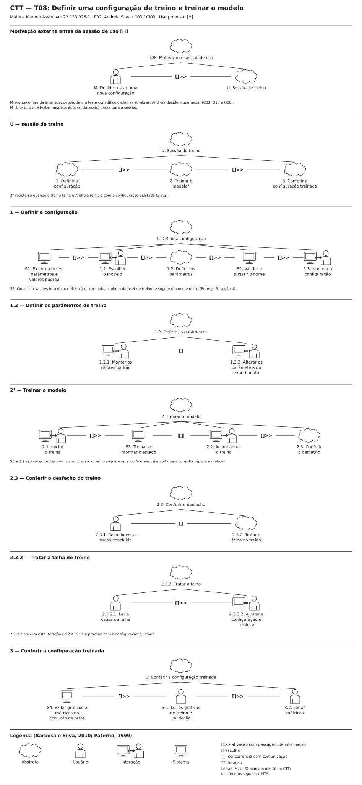

*Figura — CTT de T08, por Mateus Marana Assuena. Gerado por [`ctt_t08.py`](../scripts/diagramas/ctt_t08.py).*

**Leitura da árvore:**

1. `T08 = M []>> U`: fora da interface, Andreia decide o que testar; isso passa para a sessão de treino.
2. `U = 1 []>> 2* []>> 3`: definir, treinar e conferir. O ramo 2 se repete quando o treino falha e é reiniciado.
3. `1 = S1 []>> 1.1 []>> 1.2 []>> S2 []>> 1.3`, com `1.2 = 1.2.1 [] 1.2.2`. O sistema exibe modelos, parâmetros e valores padrão; depois de Andreia definir os parâmetros, valida os valores e sugere o nome (S2).
4. `2 = 2.1 []>> (S3 |[]| 2.2) []>> 2.3`, com `2.3 = 2.3.1 [] 2.3.2` e `2.3.2 = 2.3.2.1 []>> 2.3.2.2`. O treino (S3) e o acompanhamento (2.2) são concorrentes com comunicação: o treino segue enquanto Andreia sai e volta para consultar a época e os gráficos.
5. `3 = S4 []>> 3.1 []>> 3.2`. O sistema exibe gráficos e métricas, e Andreia confere a configuração.

| Relação CTT | Notação | Ocorrência em T08 |
|---|---|---|
| Ativação com passagem de informação | `T1 []>> T2` | M passa o que testar a U; a configuração definida em 1 passa ao treino; o resultado do treino passa à conferência. |
| Escolha | `T1 [] T2` | Manter ou alterar os parâmetros (1.2); treino concluído ou falha (2.3). |
| Concorrência com comunicação | `T1 \|[]\| T2` | O treino (S3) e o acompanhamento (2.2) acontecem ao mesmo tempo, e o estado do treino é comunicado a Andreia. |
| Iteração | `T*` | O ramo 2 se repete depois de uma falha tratada em 2.3.2. |

| Símbolo no diagrama | Tipo | Tarefas no modelo |
|---|---|---|
| Nuvem | Abstrata | T08, U, ramos 1 a 3, 1.2, 2.3 e 2.3.2. |
| Pessoa | Usuário | M (fora da interface), 2.3.1, 2.3.2.1, 3.1 e 3.2. |
| Pessoa e computador, com seta dupla | Interação | 1.1, 1.2.1, 1.2.2, 1.3, 2.1, 2.2 e 2.3.2.2. |
| Computador | Sistema | S1 (exibir modelos, parâmetros e valores padrão), S2 (validar e sugerir o nome), S3 (treinar e informar o estado) e S4 (exibir gráficos e métricas). |

#### 3.6.4 Correspondência e implicações

| Escolha ou repetição no HTA (T08) | Métodos no GOMS (T08) | Relação no CTT (T08) |
|---|---|---|
| 1.2: `1.2.1 / 1.2.2` | 1.2.A / 1.2.B | `1.2.1 [] 1.2.2` |
| 2.3: `2.3.1 / 2.3.2` | 2.3.A / 2.3.B | `2.3.1 [] 2.3.2` |
| Plano 0: repetir 2 depois de 2.3.2 | Meta 2 recomeça depois de 2.3.B | `2*` |
| 2.2: acompanhar o treino | OP. 2.2 | `S3 \|[]\| 2.2` |

**Implicações [H]:** (1) a interface deve mostrar só os parâmetros expostos, com valores padrão e restrições, e impedir valores inválidos antes do treino; (2) o estado do treino precisa ser consultável a qualquer momento, porque Andreia sai e volta; (3) uma falha não pode apagar a configuração, para que o reinício custe só o ajuste; (4) ao terminar, a configuração passa a estar disponível para a T07, com métricas no conjunto de teste. **Continuidade da investigação [?]:** a investigação contextual da Entrega 7 (I03, sessão 1) deve confirmar se a sequência definir → treinar → conferir corresponde ao que acontece hoje e quais parâmetros Andreia costuma alterar.

---

## Síntese da equipe

Quais problemas de interação, oportunidades e requisitos apareceram a partir das modelagens? Quais tarefas irão para o protótipo e para o teste de usabilidade?

As três seções modelam o **uso proposto** por perfis diferentes: o analista que executa e avalia (P01), a pesquisadora que experimenta modelos (P02) e a gestora que decide (P03). Os modelos continuam sendo **hipóteses `[H]`** derivadas de proto-personas e precisam ser verificados na Entrega 7. A síntese abaixo reúne o que se repetiu entre as seções.

### Problemas de interação e requisitos comuns

| ID | Problema observado nos modelos | Requisito derivado | Onde aparece |
|---|---|---|---|
| RQ01 | Hoje cada execução exige script; a falha obriga a depurar código. | Executar a segmentação pela interface, com um comando, e mostrar o estado de cada execução (processando, concluído, falhou), com a causa da falha em linguagem de usuário. | T03 obj. 2 e 2.3.2; T07 obj. 2 e S2; T08 2.3.2; RC04 |
| RQ02 | Comparar resultados de entradas diferentes leva a conclusões erradas. | Comparar configurações ou modelos **sobre a mesma entrada** (T03, T07) ou **o mesmo conjunto anotado** (T04), e mostrar qual entrada ou conjunto foi usado. | T03 1.1 e 4.1; T07 obj. 2* e 3.2; T04 OP. 1.4; T05 1.1 |
| RQ03 | Alternar entre janelas e arquivos faz perder o fio da comparação. | Reunir original, máscara e sobreposição na mesma tela, com zoom; manter os resultados já executados acessíveis sem recarregar a entrada. | T01 metas 1–2; T06 meta 2; T03 obj. 4; T07 3.1 e 3.2 |
| RQ04 | Cores sem padrão entre execuções exigem reinterpretar a legenda. | Legenda e paleta fixas em todas as visualizações. | T01 meta 2; T03 3.2; T06 2.B |
| RQ05 | Não se sabe se o erro vem do modelo ou da imagem capturada. | Permitir que a pessoa registre a avaliação separando problema da imagem e problema do modelo. | T01 OP. 3.2 e 3.5; T03 4.2.2; T06 OP. 3.4 |
| RQ06 | Métricas aparecem como se existissem para qualquer imagem. | Mostrar IoU e acurácia **só** quando houver anotação de referência (conjunto de teste do TCC); sem ela, avaliação visual. | T01 OP. 3.3 e submeta 3.4; T04 precondições; recorte da P02; INC-52 |
| RQ07 | Números soltos, sem referência, não sustentam decisão; termos geram dúvida. | Valor de referência, diferença entre configurações e explicação no ponto de uso (o que a métrica indica e não indica); quem julga se a diferença é relevante é a pessoa. | T04 metas 2–3; T05 2.3 e 3.2; RC01 |
| RQ08 | Há o risco de a interface parecer "escolher" o melhor modelo. | A conclusão e a recomendação são registradas pela pessoa; a interface exibe e calcula, mas não decide. | T03 4.2; T05 obj. 3; T07 5.1 e 5.2 |
| RQ09 | Parte da tarefa acontece fora da interface. | Não modelar como funcionalidade a comunicação à equipe, o pedido ao integrante técnico e a reunião com a coordenação; a interface só indica o que falta pedir. | T03 4.3; T05 1.2, 2.3.3 e ramo E |

**Oportunidades:** a sobreposição com opacidade (T01 1.B, T06 2.C) aparece como o recurso que mais aproxima a avaliação do que hoje é feito "no olho". O resumo exportável (T05 4.1.1) e o histórico (H08) continuam **fora do recorte** até haver evidência.

**Divergências entre as seções, a resolver na Entrega 9:**

- **T03 e T07 se sobrepõem.** As duas comparam a mesma entrada processada por mais de uma configuração ou modelo; mudam a persona (P01 e P02) e o objetivo (P01 confere a qualidade antes de informar a equipe; P02 experimenta para orientar a pesquisa). Como uma configuração reúne o modelo e os parâmetros de treino, a T03 pode comparar configurações do mesmo modelo, enquanto a T07 compara modelos. **Decisão de 08/11/2026:** manter as duas tarefas separadas nesta entrega e reavaliar a fusão na construção do modelo conceitual (Entrega 9). **Reavaliado em 14/11/2026, na Entrega 9:** T03 e T07 continuam como tarefas separadas nesta entrega e correspondem a um único objetivo no mapa consolidado (O05).
- ~~**IDs da P02:** o cenário C03 propunha T07 (executar), T08 (analisar) e T09 (comparar).~~ **Resolvido em 08/11/2026:** o C03 passou a usar T02 (executar, compartilhada com o C01), T06 (analisar) e T07 (comparar), os mesmos IDs desta entrega (`PENDENCIAS.md`, INC-56).

### Tarefas que vão para o protótipo e para o teste

| Tarefa | Protótipo (Entrega 6) | Teste com usuários (Entrega 14) | Por quê |
|---|---|---|---|
| T02 executar | Tela P01 (input de dados e configurações), fluxo PF01 | Sim, dentro do UT01 | Entrada obrigatória de todos os fluxos (RQ01). A simulação da E6 levou à seleção de mais de um modelo por execução. |
| T01 / T06 avaliar uma imagem | Tela P02 (resultado da segmentação), fluxo PF02 | **UT01:** executar a segmentação de uma imagem e avaliar o resultado | A E1 aponta a interpretação do resultado como a atividade mais crítica (§3.4) e ao menos tão frequente quanto o envio (§3.3). |
| T03 / T07 comparar configurações ou modelos | Tela P03 (comparação de modelos), com os dois modelos sobre o mesmo arquivo | **UT02:** comparar duas configurações sobre a mesma imagem e registrar a conclusão | Necessidade central do C01 e do C03 (RQ02, RQ03). |
| T04 comparar o consolidado | Tela P03, fluxo PF03. A E6 usa a mesma tela para a comparação por imagem e a consolidada; separar as duas visões fica para a Entrega 11 | **UT03:** com base no consolidado, preparar a recomendação | Única tarefa da P03 com interface; testa RQ06 e RQ07. |
| T05 decidir e justificar | Não prototipada na E6; o campo "Conclusão" da tela P03 cobre só o registro da conclusão | Sim, dentro do UT03, só até a recomendação | A reunião com a coordenação (4.2, 4.3) fica fora da interface e do teste. |

As tarefas UT01–UT03 são propostas; instruções neutras, critérios de sucesso e perfil dos participantes serão definidos na Entrega 12 (DECIDE).

## Rastreabilidade

| Tarefa | Necessidade | Persona / cenário | Modelos | Atualizar em `RASTREABILIDADE.md` |
|---|---|---|---|---|
| T01–T03 | R01, R02, R03 | P01 / C01 | HTA T03, GOMS T01, CTT T03 (seção 2) | Coluna HTA/GOMS/CTT de R01–R03 — atualizada |
| T04, T05 | R03 | P03 / C02 | HTA T05, GOMS T04, CTT T05 (seção 1) | Coluna HTA/GOMS/CTT de R03 — atualizada |
| T06, T07 | R03 (e R02, pela execução dentro da T07) | P02 / C03 | HTA T07, GOMS T06, CTT T07 (seção 3) | Colunas Cenário, Tarefa e HTA/GOMS/CTT de R03 — atualizadas |
| T08 | R04 | P02 / C03 | HTA, GOMS e CTT T08 (seção 3.6) | Coluna HTA/GOMS/CTT de R04 — atualizada |

Os requisitos RQ01–RQ09 da síntese ligam estes modelos às telas da Entrega 6 e às tarefas de teste UT01–UT03.

## Checklist

- [x] Cada integrante produziu ao menos 1 HTA, 1 GOMS e 1 CTT. *(Henrique: HTA/CTT T05, GOMS T04; Tiago: HTA/CTT T03, GOMS T01; Mateus: HTA/CTT T07, GOMS T06 e HTA/GOMS/CTT T08.)*
- [x] Cada artefato identifica autor e tarefa.
- [x] Diagramas são legíveis e possuem fonte editável quando possível. *(Todos os HTA e CTT são gerados pelos scripts em `scripts/diagramas/`.)*
- [x] HTA contém planos, não apenas árvore de tópicos.
- [x] GOMS distingue Goals, Operators, Methods e Selection Rules.
- [x] CTT usa operadores temporais e tipos de tarefa coerentes.
- [x] Escolhas, passos condicionais, repetições e caminhos de falha têm representação equivalente no HTA, no GOMS e no CTT (tabela de correspondência de cada seção).
- [x] Os julgamentos podem terminar como inconclusivos (T01, T03, T05, T06 e T07), e a interface não decide pela pessoa (RQ08).
- [x] Há texto explicando cada diagrama.
- [x] Tarefas estão ligadas a cenários/personas na rastreabilidade.
- [x] Em TCC técnico, as tarefas descrevem o que a pessoa faz com a contribuição/resultados, não passos internos do código.
- [x] CRUDs, relatórios, filtros e atividades administrativas foram escolhidos por relevância ao objetivo do usuário. *(Nenhum CRUD, login ou histórico; exportação só como alternativa `[H]` na T05.)*

## Histórico de revisões

| Data | O que mudou | Motivo |
|---|---|---|
| 14/11/2026 | Premissa 5 e seção 2: dataset CaSSeD incluído entre os datasets do TCC | Revisão de consistência com o repositório do TCC (`PENDENCIAS.md`: INC-65) |
| 14/11/2026 | Seção 1: o aviso automático de resultado inconclusivo sai do recorte comum, do HTA da T05 (2.3, 2.3.2.1 e 3.2) e do GOMS da T04 (regras 3.A e 3.B); RQ07 passa a citar a diferença entre configurações, cuja relevância é julgada pela pessoa. Diagramas da T05 regenerados | Decisão da equipe na Entrega 9 (`PENDENCIAS.md`: INC-67) |
| 14/11/2026 | Seção 2: a confiança do modelo sai do recorte comum, do HTA e do CTT da T03 (3.3.2 removido; 3.3.3 passa a 3.3.2) e do GOMS da T01 (método 3.B removido; 3.C passa a 3.B); RQ06 e "Oportunidades" ajustadas. Diagramas da T03 regenerados | Decisão da equipe na Entrega 9 (`PENDENCIAS.md`: INC-66) |
| 14/11/2026 | Seção 3: o recorte comum deixa de dizer que treinar fica fora do escopo e remete à T08 (premissa 5); regras e repetições do GOMS da T06 tratam os métodos como alternativas, com repetição da meta | Revisão de consistência (`PENDENCIAS.md`: INC-64 e INC-55) |
| 14/11/2026 | Seção 3: HTA da T07 refeito e gerado por script (planos com `>`, repetição por configuração, objetivos de comparar visualmente, comparar métricas e concluir, Feedback da tarefa 0); CTT da T07 refeito com a motivação externa `M []>>` e alinhado ao HTA; correspondência e síntese da seção revistas; T08 modelada (HTA, GOMS e CTT, seção 3.6) a partir do CI03 da Entrega 9 | Revisão de consistência (`PENDENCIAS.md`: INC-53, INC-54, INC-55 e INC-61) |
| 15/11/2026 | Aplicação do parecer da Entrega 5. **Seção 1:** plano 2.3 do HTA da T05 passa a `2.3.1 / (2.3.2 > [2.3.3])`; no GOMS da T04, o antigo método 3.C vira a submeta condicional 3.B.5; o CTT da T05 explica a retomada depois de E e permite repetir a escolha entre tabela e gráfico (`2.2*`). **Seção 2:** GOMS da T01 com a meta 3 em caminho único, término inconclusivo e a submeta condicional 3.4; HTA da T03 com `3.3.1 > [3.3.2]` e a ação 4.2.4 (inserir a conclusão); CTT da T03 com o caminho de falha na estrutura (`2.3 = D [] 2.3.2`), `3.1*`, `[3.3.2]` e o registro separado em julgamento (J), interação (4.2.4) e sistema (S5); classes do item 3.2 corrigidas. **Seção 3:** HTA e CTT da T07 com o desfecho da execução (2.3), `[4.2]` e conclusão inconclusiva; GOMS da T06 com critério de conclusão dos métodos e término inconclusivo. Entradas (T01–T08, R01–R04), ordem das premissas, RQ05 e RQ06. Diagramas da T03, T05 e T07 regenerados pelos scripts | Feedback do professor sobre a Entrega 5 |
