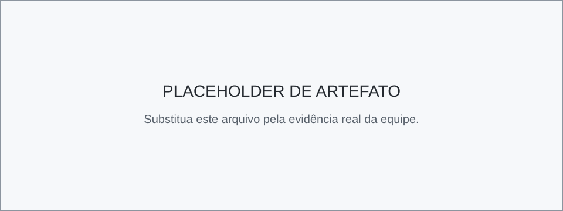

# Entrega 6 — Prototipação em papel

**Data:** {{01/11/2026}}  
**Status:** 🟨 em andamento 
**Responsabilidade:** 1 solução integrada por equipe

## Objetivo da atividade

Externalizar rapidamente ideias de interação em baixa fidelidade para explorar alternativas antes de investir em detalhes visuais. O valor da atividade está no **ciclo construir → simular → observar → revisar**, não na beleza do desenho.

## 1. Escopo do protótipo

**Personas:** {Rafael Pereira e Larissa Camargo}  
**Cenários/tarefas cobertos:** {Cenário 01: Validação Manual de segmentação em campo (T01;T02) | Cenário C02 — Decisão de modelo a partir de resultados dispersos (T04) }  
**Objetivos principais:** Os objetivos deste protótipo são disponibilizar uma tela inicial que permita ao usuário selecionar imagens ou vídeos para análise e escolher o modelo de segmentação que será utilizado na execução. Além disso, a interface deve facilitar a geração e visualização dos resultados da segmentação, apresentando as métricas de desempenho de forma clara e intuitiva para apoiar a avaliação da qualidade dos resultados. O sistema também deve possibilitar a comparação entre diferentes modelos e configurações, permitindo identificar qual deles apresenta melhor desempenho na segmentação de imagens e vídeos em ambientes off-road, auxiliando a equipe Baja FEI na tomada de decisões durante os testes e análises

## 1.1 Possíveis famílias de interface

Escolha apenas o que for coerente com tarefas e cenários. Para TCCs técnicos, o protótipo pode explorar:

**Selecionados**: 
- **dashboard** para monitoramento e tomada de decisão;
- **configuração/parametrização** para preparar algoritmo/modelo/processo;
- **entrada/seleção de dados** com validação;
<!-- - **acompanhamento de execução** com progresso, fila, cancelamento e recuperação; -->
- **relatório/resultados** com explicação, gráficos e exportação;
<!-- - **histórico** com busca, filtros, ordenação e detalhes; -->
- **comparação** entre execuções, versões, algoritmos ou períodos;
<!-- - **administração** de usuários, papéis, permissões ou entidades do domínio; -->
<!-- - **auditoria/logs** traduzidos para o perfil; -->
<!-- - **alertas/ocorrências** com ação de resposta. -->

<!-- > Não desenhe todas essas telas por obrigação. O objetivo da baixa fidelidade é experimentar a **estrutura da interação** necessária para as tarefas priorizadas. -->

## 2. Fluxos escolhidos

| Fluxo | Tarefa/objetivo | Por que foi priorizado |
|---|---|---|
| PF01 | T02: Executar a segmentação de imagens com uma configuração disponível | Foi priorizado por representar uma das etapas iniciais e essenciais do processo. O usuário precisa selecionar os arquivos que deseja processar e definir as configurações disponíveis, como o modelo de segmentação e os parâmetros de execução. Esse fluxo permite iniciar o processamento de maneira organizada e de acordo com a necessidade da análise. |
| PF02 | T01: Avaliar a qualidade da segmentação de uma imagem | Foi priorizado porque, após a execução da segmentação, é necessário avaliar a qualidade do resultado obtido. A apresentação de métricas permite identificar o nível de precisão do modelo e verificar seu desempenho na identificação das diferentes classes, auxiliando o usuário na interpretação dos resultados. |
| PF03 | T04: Comparar o desempenho consolidado entre modelos | Foi priorizado porque a aplicação oferece a possibilidade de utilizar diferentes modelos de segmentação. Dessa forma, é importante permitir a comparação de seus desempenhos por meio de métricas e resultados visuais, ajudando o usuário a identificar qual modelo apresenta melhores resultados para o contexto de imagens off-road e, consequentemente, qual é mais adequado para utilização. |

## 3. Telas e estados

<!-- - Numere as telas/estados (`P01`, `P02`...).
- Indique controles que mudam o estado.
- Mostre pelo menos caminhos principais e estados de erro/retorno relevantes.

 -->

| Protótipo | imagem |
| Input dados + Configuração |  |
| Resultado Segmentação |  |
| Comparação Modelos |  |

## 4. Simulação / walkthrough

Realize uma simulação com uma pessoa que não participou da elaboração dessas telas. Um colega pode ser usado **para essa iteração formativa**, mas isso não substitui os participantes finais da Entrega 14.

| Observação | Tela/ação | Evidência | Consequência para o design |
|---|---|---|---|
| {{...}} | {{...}} | {{...}} | {{...}} |

## 5. Alterações após a simulação

| Antes | Problema | Depois | Justificativa |
|---|---|---|---|
| {{...}} | {{...}} | {{...}} | {{...}} |

## Checklist

- [ ] O protótipo cobre tarefas relevantes da Entrega 5.
- [ ] Cada tela/estado pode ser justificado por uma tarefa, decisão ou informação necessária.
- [ ] O projeto não criou dashboard/CRUD/login apenas para parecer “completo”.
- [ ] Telas/estados estão numerados e navegáveis na documentação.
- [ ] Há pelo menos uma simulação/walkthrough documentado.
- [ ] Críticas não foram apenas listadas: geraram decisão de revisão.
- [ ] O protótipo continua em baixa fidelidade; detalhes visuais não mascaram problemas de fluxo.
