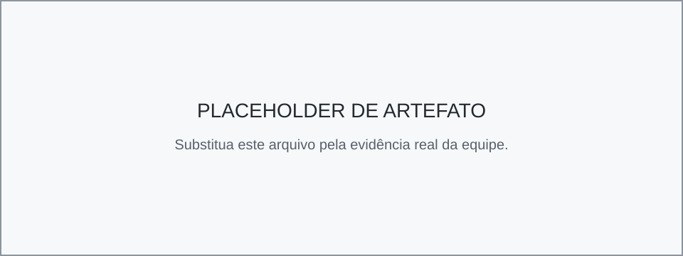
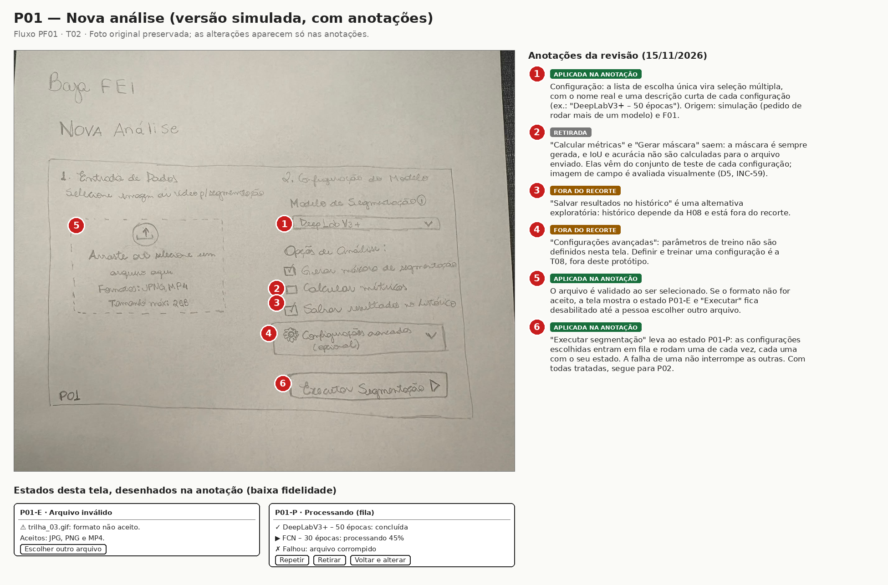
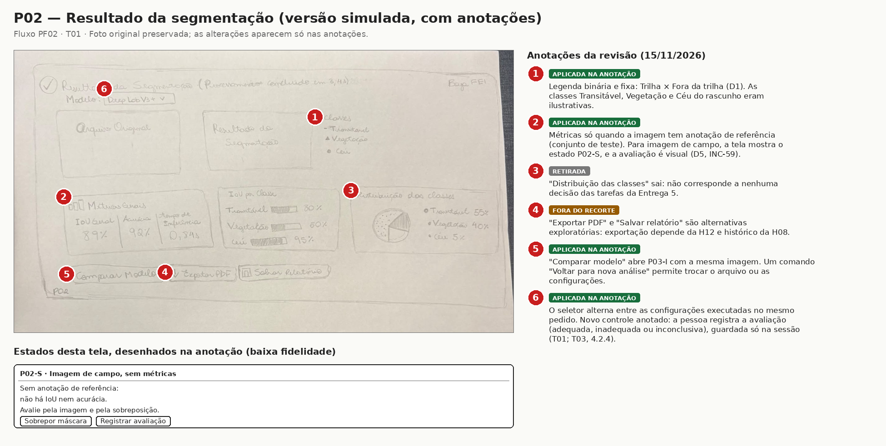
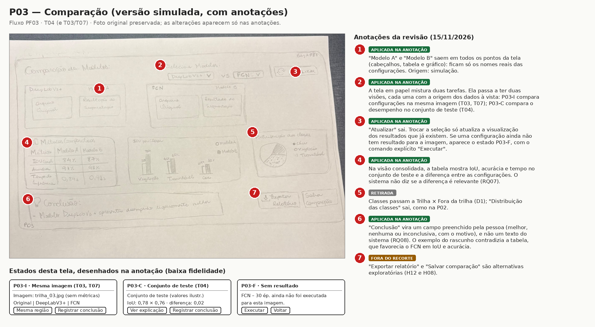
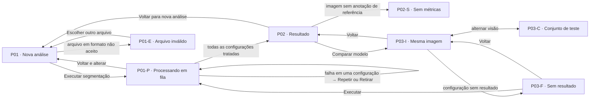

# Entrega 6 — Prototipação em papel

**Data:** 01/11/2026 · 15/11/2026 (revisão após feedback)  
**Status:** 🟦 revisada após feedback  
**Responsabilidade:** 1 solução integrada por equipe

## Objetivo da atividade

Externalizar rapidamente ideias de interação em baixa fidelidade para explorar alternativas antes de investir em detalhes visuais. O valor da atividade está no **ciclo construir → simular → observar → revisar**, não na beleza do desenho.

## 1. Escopo do protótipo

**Personas:** P01 (Rafael Pereira, analista de segmentação) e P03 (Larissa Camargo, gestão)  
**Cenários/tarefas cobertos:** C01 — Validação manual de segmentação em campo (T02 e T01) | C02 — Decisão de modelo a partir de resultados dispersos (T04)  
**Objetivos principais das pessoas [H]:**

- **Rafael** quer executar a segmentação de uma imagem dos testes sem depender de scripts e saber se o modelo delimitou corretamente a região de trilha (T02, T01).
- **Larissa** quer comparar o desempenho das configurações no conjunto de teste para preparar uma recomendação que consiga justificar (T04).

Para isso, o protótipo explora como a pessoa escolhe o arquivo e as configurações, como acompanha a execução, como interpreta o resultado e como compara configurações.

## 1.1 Possíveis famílias de interface

Escolha apenas o que for coerente com tarefas e cenários. Para TCCs técnicos, o protótipo pode explorar:

**Exploradas nesta entrega:**

- **Entrada/seleção de dados**, com validação (P01): escolher o arquivo e a configuração já treinada (uma, no rascunho; uma ou mais, depois da revisão da seção 5).
- **Configuração/parametrização**, limitada à escolha da configuração usada na execução. Definir parâmetros de treino e treinar (T08) entrou no recorte depois deste protótipo, em 08/11/2026, e não foi explorado aqui.
- **Relatório/resultados**, com explicação e gráficos (P02): imagem original, resultado e métricas, com o que elas indicam.
- **Comparação** entre configurações (P03).
- **Dashboard**, só no sentido da visão consolidada das métricas que a T04 exige (P03). Não se trata de um painel de monitoramento.
- **Acompanhamento de execução**: não foi desenhado nos rascunhos; aparece nas anotações da revisão (seção 3).

**Não exploradas ou fora do recorte:** histórico (depende da H08), exportação de relatórios (depende da H12), administração, cadastro e login (descartados na Entrega 1, §8), auditoria/logs e alertas. Os rascunhos trazem botões de histórico e exportação; eles são alternativas exploratórias, não funcionalidades decididas (ver seção 3).

## 2. Fluxos escolhidos

| Fluxo | Tarefa/objetivo | Por que foi priorizado |
|---|---|---|
| PF01 | T02: Executar a segmentação com uma ou mais configurações disponíveis | Foi priorizado por representar uma das etapas iniciais e essenciais do processo. O usuário precisa selecionar os arquivos que deseja processar e escolher as configurações disponíveis. Esse fluxo permite iniciar o processamento de maneira organizada e de acordo com a necessidade da análise. |
| PF02 | T01: Avaliar a qualidade da segmentação de uma imagem | Foi priorizado porque, após a execução da segmentação, é necessário avaliar a qualidade do resultado obtido. Quando a imagem tem anotação de referência, as métricas ajudam a verificar o desempenho nas duas classes (*Trilha* e *Fora da trilha*); quando não tem, a avaliação é visual. |
| PF03 | T04: Comparar o desempenho consolidado entre modelos | Foi priorizado porque a aplicação oferece a possibilidade de utilizar diferentes configurações. É importante permitir a comparação de seus desempenhos por meio de métricas e resultados visuais, para que a pessoa forme a sua própria conclusão sobre qual configuração usar. |

**Qual tarefa a P03 cobre.** O rascunho da P03 foi feito para a T04, mas mostra a imagem original e o resultado de cada modelo, o que corresponde à comparação por imagem da T03 e da T07, e não identifica o conjunto que sustenta os números. Na revisão (seção 3.3), a tela passa a ter duas visões, com a origem dos dados escrita no topo: **P03-I** compara configurações sobre a mesma imagem (T03, T07); **P03-C** compara o desempenho agregado no conjunto de teste (T04). Assim a pessoa sabe se está comparando a mesma entrada ou resultados agregados do mesmo conjunto.

## 3. Telas e estados

<!-- - Numere as telas/estados (`P01`, `P02`...).
- Indique controles que mudam o estado.
- Mostre pelo menos caminhos principais e estados de erro/retorno relevantes.

 -->

As fotos são a **versão simulada** (v1) e foram preservadas sem alteração. A revisão foi feita com **anotações** sobre cada foto, geradas por [`scripts/prototipos/anotacoes.py`](../scripts/prototipos/anotacoes.py). Cada anotação traz marcadores numerados, a situação de cada alteração (aplicada na anotação, retirada ou fora do recorte) e os estados da tela desenhados em baixa fidelidade. Nomes de arquivo, configurações e números nas anotações são ilustrativos.

### 3.1. P01 — Nova análise (input de dados e configurações)

*Figura — P01, versão simulada (v1), fluxo PF01, T02. Controles: área de envio do arquivo, escolha do modelo, opções de análise, configurações avançadas e "Executar segmentação". Foto do rascunho em papel.*

*Figura — P01 com as anotações da revisão: seleção múltipla com execução em fila, validação do arquivo, controles retirados ou fora do recorte e os estados P01-E (arquivo inválido) e P01-P (processando em fila).*

### 3.2. P02 — Resultado da segmentação

*Figura — P02, versão simulada (v1), fluxo PF02, T01. Controles: seletor de modelo, "Comparar modelo", "Exportar PDF" e "Salvar relatório". Foto do rascunho em papel.*

*Figura — P02 com as anotações da revisão: legenda binária, métricas só com anotação de referência, registro da avaliação pela pessoa e o estado P02-S (imagem de campo, sem métricas).*

### 3.3. P03 — Comparação entre modelos

*Figura — P03, versão simulada (v1), fluxo PF03, T04. Controles: dois seletores de modelo, "Atualizar", "Exportar relatório" e "Salvar comparação". Foto do rascunho em papel.*

*Figura — P03 com as anotações da revisão: nomes reais, duas visões com a origem dos dados (P03-I, mesma imagem; P03-C, conjunto de teste), conclusão registrada pela pessoa e o estado P03-F (configuração sem resultado).*

### 3.4. Fluxo, estados e caminhos de retorno

- **Seleção múltipla e fila:** as configurações escolhidas na P01 entram em uma fila e rodam uma de cada vez. Cada configuração tem o seu estado (na fila, processando, concluída ou falhou). Se uma falha, as demais continuam; a falha aparece na linha da configuração, com a causa e os comandos "Repetir" e "Retirar". A P02 abre quando todas foram tratadas; uma configuração retirada não aparece nela.
- **"Atualizar" (P03):** foi retirado. Trocar a seleção só atualiza a visualização dos resultados que já existem; pedir uma nova execução é o comando explícito "Executar", no estado P03-F.
- **Métricas:** IoU e acurácia aparecem quando a imagem tem anotação de referência (conjunto de teste). Para uma imagem de campo, a P02 e a P03-I mostram que não há métricas e que a avaliação é visual.

## 4. Simulação / walkthrough

Realize uma simulação com uma pessoa que não participou da elaboração dessas telas. Um colega pode ser usado **para essa iteração formativa**, mas isso não substitui os participantes finais da Entrega 14.

### 4.1. Como a sessão foi feita

- **Participantes:** colegas da disciplina, que não participaram da elaboração das telas. Não se registram dados pessoais. O número de participantes e a data da sessão não foram anotados `[?]`.
- **Relação com a validação citada em `PENDENCIAS.md` (INC-59):** é a mesma atividade. O que lá aparecia como "validação com o professor" é esta sessão.
- **Tarefa proposta:** carregar uma imagem e ver os resultados.
- **Percurso:** P01 (selecionar o arquivo e o modelo e executar) → P02 (ver o resultado) → P03 (comparar modelos).
- **Intervenções:** os participantes precisaram de um pouco de ajuda para saber o fluxo entre as telas, isto é, como passar de uma tela para a outra.
- **Registro:** textual, nesta seção. Não houve gravação.

### 4.2. Observações

| Observação | Tipo | Tela/ação | O que a pessoa fez ou disse | Consequência para o design |
|---|---|---|---|---|
| Precisou de ajuda para seguir o fluxo entre as telas | Dificuldade observada durante a tarefa | Passagem P01 → P02 → P03 | Durante a tarefa, não identificou sozinha como passar de uma tela para a outra, e a equipe precisou indicar o caminho | Fluxo com estados e caminhos de retorno explícitos (seção 3.4) |
| "É muito confuso ler modelo A e modelo B ao invés dos nomes" | Dificuldade de interpretação, expressa ao comentar a tela | P03, métricas comparativas | Comentou ao ler a tabela e o gráfico, que chamam os modelos de "Modelo A" e "Modelo B" | Usar os nomes reais das configurações |
| "Eu gostaria de conseguir rodar mais de um modelos ao mesmo tempo" | Preferência expressa | P01, escolha do modelo | Pediu para executar mais de um modelo, já que a tela obriga a escolher um | Seleção múltipla, com execução em fila |

As notas do gerador [`scripts/prototipos/wireframes.py`](../scripts/prototipos/wireframes.py) que citam a simulação ("não entendi como as telas se conectam", "não entendi o progresso", "gostaria de ver as imagens segmentadas") são **propostas da equipe**, e não falas registradas nesta sessão. O gerador não faz parte desta entrega (seção 5).

## 5. Alterações após a simulação

A tabela separa o que foi **decidido** do que foi **aplicado** e diz onde ver cada alteração. As telas em papel não foram redesenhadas: as alterações aplicadas estão nas anotações da seção 3.

| Origem | Antes (versão simulada) | Problema | Alteração decidida | Situação | Onde ver |
|---|---|---|---|---|---|
| Simulação (Modelo A/B) | A P03 chama os modelos de "Modelo A" e "Modelo B" | Não deixa claro qual modelo está sendo analisado | Usar os nomes reais das configurações | Aplicada na anotação | P03, nota 1 |
| Simulação (mais de um modelo) | A P01 permite escolher um único modelo | É preciso esperar uma execução terminar para pedir outra | Seleção múltipla; as configurações rodam em fila, uma de cada vez, cada uma com o seu estado; a falha de uma não interrompe as outras | Aplicada na anotação | P01, notas 1 e 6; estado P01-P |
| Simulação (ajuda com o fluxo) | Só o caminho de sucesso estava desenhado | Os participantes precisaram de ajuda para seguir o fluxo | Estados de processamento, arquivo inválido, falha, sem métricas e sem resultado, com caminhos de volta | Aplicada na anotação | Estados P01-E, P01-P, P02-S e P03-F; seção 3.4 |
| Decisões D1 e D5 (INC-59) | Classes *Transitável*, *Vegetação* e *Céu*; métricas para qualquer arquivo | Ensinaria um comportamento incompatível com o TCC | Legenda *Trilha* × *Fora da trilha*; métricas só com anotação de referência; estado sem métricas | Aplicada na anotação | P01, nota 2; P02, notas 1 a 3; P03, nota 5 |
| Recorte da Entrega 1 | Histórico, exportação e configurações avançadas nos rascunhos | Apareciam como funcionalidades decididas | Marcados como alternativas exploratórias, fora do recorte | Aplicada na anotação | P01, notas 3 e 4; P02, nota 4; P03, nota 7 |
| Entrega 5 (T03/T07 × T04) | A P03 mistura comparação por imagem e consolidada | A origem dos dados comparados não aparece | Duas visões, P03-I e P03-C, com a origem escrita | Aplicada na anotação | P03, nota 2; seção 2 |
| Entrega 5 (RQ08) | "Conclusão" escrita como texto do sistema | Parece que o sistema decide, e o texto contradizia a tabela | Campo preenchido pela pessoa: melhor, nenhuma ou inconclusiva, com o motivo | Aplicada na anotação | P03, nota 6 |
| Revisão do fluxo | "Atualizar" sem efeito definido | Atualizar a visualização e pedir nova execução são ações diferentes | Trocar a seleção atualiza a visualização; executar é um comando explícito | Aplicada na anotação | P03, nota 3; estado P03-F |

**Fica para a Entrega 11:** redesenhar as telas com essas alterações. O gerador [`scripts/prototipos/wireframes.py`](../scripts/prototipos/wireframes.py) ("versão 2") **não foi incorporado** a esta entrega: ele usa classes, configurações e a confiança do modelo já retiradas do projeto e serve apenas como rascunho de trabalho da equipe.

## Checklist

- [X] O protótipo cobre tarefas relevantes da Entrega 5.
- [X] Cada tela/estado pode ser justificado por uma tarefa, decisão ou informação necessária.
- [X] O projeto não criou dashboard/CRUD/login apenas para parecer “completo”. *(Não há login nem CRUD; a visão consolidada da P03 responde à T04. Histórico e exportação dos rascunhos foram marcados como fora do recorte.)*
- [X] Telas/estados estão numerados e navegáveis na documentação. *(Estados nas anotações; fluxo e retornos na seção 3.4.)*
- [X] Há pelo menos uma simulação/walkthrough documentado. *(Seção 4.1.)*
- [X] Críticas não foram apenas listadas: geraram decisão de revisão.
- [X] A versão simulada está preservada, e as alterações aplicadas estão identificadas (seção 5).
- [X] O protótipo continua em baixa fidelidade; detalhes visuais não mascaram problemas de fluxo.

## Histórico de revisões

| Data | O que mudou | Motivo |
|---|---|---|
| 08/11/2026 | Nome da T02 no PF01 atualizado para "Executar a segmentação com uma ou mais configurações disponíveis", o que incorpora a segunda alteração da seção 5. Os rascunhos em papel **não** foram alterados. Registrado que eles ainda usam classes ilustrativas (*Transitável*, *Vegetação*, *Céu*) e mostram IoU por classe para um arquivo qualquer. No TCC, a segmentação é binária (*Trilha* × *Fora da trilha*) e IoU e acurácia só existem para imagens com anotação de referência. As duas correções serão aplicadas no protótipo da Entrega 11 | Revisão de consistência (`PENDENCIAS.md`: INC-05, INC-12, INC-52, INC-59) e leitura do repositório do TCC |
| 15/11/2026 | Aplicação do parecer da Entrega 6. Objetivos reescritos pelo que a pessoa quer alcançar e famílias de interface delimitadas (seção 1); explicação de qual tarefa a P03 cobre (seção 2); fotos mantidas como versão simulada e revisão feita por anotações geradas por `scripts/prototipos/anotacoes.py`, com estados P01-E, P01-P, P02-S, P03-I, P03-C e P03-F e fluxo com caminhos de retorno (seção 3); relato da sessão e tipo de cada observação (seção 4); alterações separadas entre decididas e aplicadas, seleção múltipla com execução em fila (seção 5); checklist revisto. O gerador `wireframes.py` foi identificado como não incorporado | Feedback do professor sobre a Entrega 6 |
