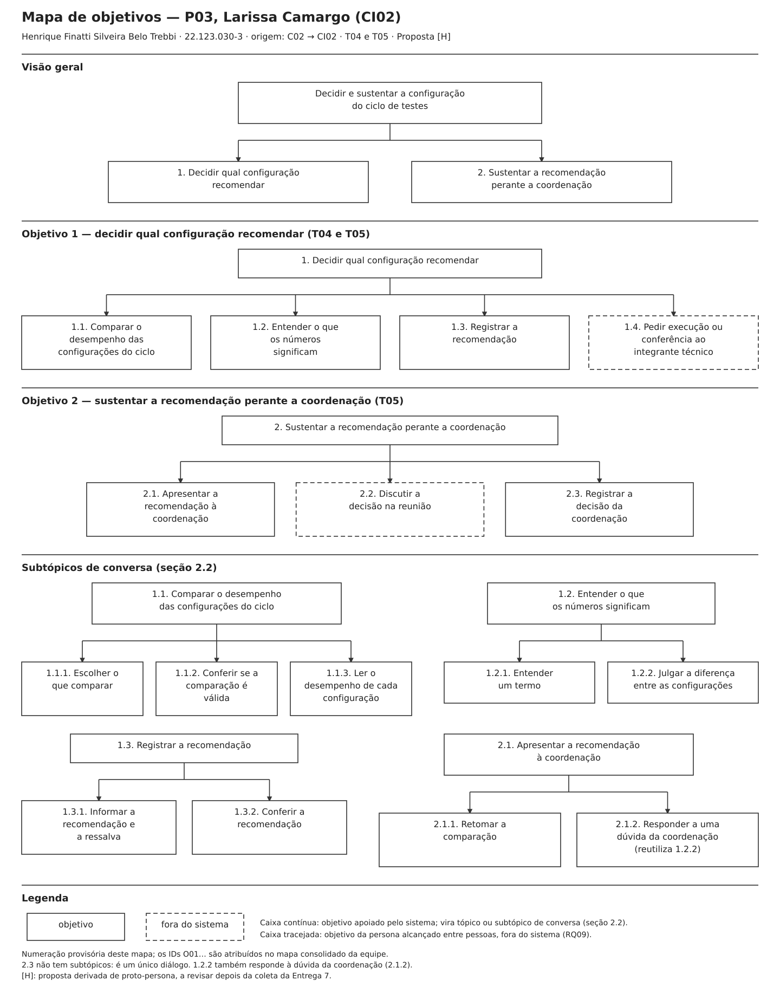

# Entrega 9 — Modelo conceitual e design centrado na comunicação

**Data:** 12/11/2026 (início)  
**Status:** 🟨 em andamento  
**Responsabilidade:** soluções individuais, com consolidação da equipe para mapa de objetivos e esquema de signos.

## Objetivo da atividade

Passar do cenário de problema para uma concepção da interação, explicitando objetivos, tópicos de conversa, falas e signos que a interface deverá comunicar/manipular.

## Transformando resultados técnicos em conceitos compreensíveis

Em TCCs algorítmicos ou orientados a dados, esta entrega deve evitar que a interface exponha apenas estruturas internas do código. Identifique os **conceitos e signos que fazem sentido para o usuário**.

Exemplos:

- `query plan`, custo estimado, recomendação e impacto para um DBA;
- modelo, dataset, versão, execução e métrica para engenheiro de IA;
- período, indicador, grupo, tendência e filtro para gestor/analista;
- alerta, severidade, evidência, responsável e status para analista de segurança.

Se um termo técnico for necessário, modele como será comunicado, explicado e relacionado à tarefa.

Dashboards, relatórios, filtros e CRUDs devem aparecer no modelo conceitual por meio dos **objetivos, signos e conversas** que justificam sua existência.

## 1. Cenários de interação

Para cada cenário de problema, produza uma versão em que a solução já pode ser descrita. **Destaque claramente o texto alterado** em relação ao cenário original.

> **Como ler os cenários desta seção.** Cada cenário de interação parte do **cenário refinado** da Entrega 4 e usa a mesma [convenção de marcação](04_cenarios_problema.md#convenção-de-marcação-do-refinamento): texto normal = mantido do cenário de problema; **negrito** = novo, trazido pela solução; *itálico* = trecho reescrito. O número entre colchetes (`[1]`, `[2]`…) antes de um trecho remete à linha correspondente da tabela "Diferenças relevantes" logo abaixo do cenário.
>
> Os cenários descrevem o que a pessoa faz e o que o sistema responde, **sem detalhes de interface** (rótulos, botões, tipos de componente), que ficam para as Entregas 10 e 11. As três personas são proto-personas: os cenários de interação são **propostas de design `[H]`**, a revisar depois da coleta da Entrega 7.

### CI01 — {{título}}

**Autor(a):** Tiago Fagundes dos Santos — 22.123.017-0  
**Origem:** cenário problema C01 — Validação manual de segmentação em campo

{{cenário de interação com alterações marcadas}}

#### Diferenças relevantes

| # | Alteração | Por que foi necessária | Evidência/artefato que justifica |
|---|---|---|---|
| {{...}} | {{...}} | {{...}} | {{...}} |

### CI02 — Recomendação de configuração a partir da comparação consolidada

**Autor(a):** Henrique Finatti Silveira Belo Trebbi — 22.123.030-3  
**Origem:** cenário problema C02 — Decisão de modelo a partir de resultados dispersos  
**Persona:** P03 (Larissa Camargo, gestora de projeto)  
**Tarefas apoiadas:** T04 (comparar o desempenho consolidado entre modelos) e T05 (decidir e justificar a adoção de um modelo), na parte que acontece na interface  
**Rastreabilidade:** R03; H01, H04, H06, H12; RC01; RQ02, RQ07, RQ08, RQ09; decisões de design 1, 2, 3 e 5 da P03 (Entrega 3)

Larissa Camargo é gestora de projeto da equipe Baja FEI e não escreve código nem domina machine learning ou estatística. A decisão precisa ocorrer antes de cada ciclo de testes porque a configuração escolhida será usada no veículo; o que se espera é uma escolha defensável, não apenas o maior número. A decisão é compartilhada com a coordenação: Larissa reúne os resultados e recomenda, e a palavra final é discutida no grupo.

O episódio a seguir é uma situação construída pela equipe `[H]`. [1] *Na semana anterior a um ciclo de testes, o integrante que executa os modelos processa as duas configurações candidatas sobre o mesmo conjunto de teste anotado, cada configuração em uma execução, e avisa Larissa de que os resultados estão prontos.* **Larissa não espera mensagens nem planilhas: assim que as execuções terminam, ela pede ao sistema a comparação das configurações do ciclo.** [2] **O sistema reúne as duas configurações em uma só visão, informando o conjunto de imagens e a data de cada execução, e Larissa confirma que as duas foram avaliadas no mesmo conjunto.** São duas configurações: uma com IoU médio de 0,78 e outra com 0,76, ambos calculados no conjunto de teste anotado. [3] **Junto de cada métrica, o sistema mostra o valor de referência adotado pela equipe e de onde ele veio `[H]`, e destaca a configuração com o maior valor em cada métrica.**

[4] *Ela vê o IoU, a acurácia, o tempo de inferência e os valores por classe (Trilha e Fora da trilha)* **e, quando não sabe o que um termo significa, pede a explicação ao próprio sistema. A explicação diz, em português, o que a métrica indica e o que não indica: o IoU médio, por exemplo, resume o acerto em todas as imagens do conjunto, mas não mostra em que tipo de trecho a configuração erra, e nenhuma métrica garante que um trajeto é seguro.** [5] *Como a diferença é de 0,02,* **o sistema avisa que o resultado é inconclusivo: a diferença é pequena demais para indicar, sozinha, qual configuração é melhor `[H]`.**

[6] **Larissa entende que não basta escolher o maior número. Ela registra na comparação a recomendação da configuração de 0,78, com a ressalva de que a diferença é pequena e de que o desempenho nos trechos de sombra não foi conferido. Fora do sistema, pede ao integrante técnico que compare as duas configurações em imagens com sombra antes do teste.**

[7] *Na reunião, no laboratório, mostra à coordenação a comparação e a recomendação registrada, com as métricas, a referência e a ressalva.* *A coordenação (P02) pergunta se 0,02 de diferença importa e se a configuração foi vista em imagens com sombra; Larissa responde que a diferença, sozinha, é inconclusiva e que a conferência nas sombras já foi pedida.* [8] **A coordenação aceita a recomendação com a condição de que a conferência nas sombras seja feita antes do teste, e Larissa anota a decisão e a condição junto da recomendação.** [9] *Larissa sente que entende o que está recomendando e que consegue sustentar a escolha, mesmo quando o resultado não é conclusivo.*

#### Diferenças relevantes

| # | Alteração | Por que foi necessária | Evidência/artefato que justifica |
|---|---|---|---|
| 1 | Os resultados deixam de chegar por mensagens e planilhas separadas: o integrante técnico executa as configurações no sistema, e Larissa consulta a comparação assim que as execuções terminam, sem depender da véspera da reunião. | No C02, os resultados dispersos e a chegada na véspera impediam Larissa de entender os números antes de decidir (Q11). | C02, Q11 e Q14; RQ01 (executar pela interface, T02); RQ09 (o aviso ao integrante técnico continua fora do sistema); E5 §1, objetivo 1 do HTA T05 |
| 2 | O sistema reúne as configurações do ciclo em uma só visão e informa o conjunto de imagens e a data de cada execução; Larissa confere que foram avaliadas no mesmo conjunto. | Comparar execuções de conjuntos diferentes leva a uma conclusão incorreta; antes, a comparação era feita em arquivos separados. | RQ02; E5 §1, HTA T05 1.1 e GOMS T04 OP. 1.4; E3, decisão de design 1 da P03; E8 §1 (Papéis/permissões) |
| 3 | Cada métrica aparece com um valor de referência, identificado pela origem, e o maior valor de cada métrica é destacado. | Sem referência, Larissa não sabia se um número era bom (Q13). O destaque organiza a leitura, mas não recomenda: a recomendação continua sendo dela (linha 6). | E3, decisão de design 2 da P03 (a origem da referência está em investigação `[?]`); RQ07; E5 §1, HTA T05 2.2.1 e 2.3.1 |
| 4 | Larissa passa a usar o tempo de inferência e os valores por classe, que antes ignorava, e consulta a explicação dos termos no próprio sistema, em vez de depender de um colega. A explicação diz o que a métrica indica e o que não indica, inclusive que nenhuma métrica garante a segurança do trajeto. | No C02, ela ignorava métricas que não sabia como pesavam e dependia de um colega para entender IoU, acurácia por classe e "trilha" (Q13, Q15). | RC01; RQ07; E3, decisão de design 3 da P03; E5 §1, HTA T05 2.3.2; E1 §4.3 (métrica não equivale a segurança do trajeto); E8 §1 (Restrições) |
| 5 | Diante da diferença de 0,02, o sistema avisa que o resultado é inconclusivo. | No C02, Larissa não sabia julgar uma diferença pequena e escolhia o maior número por falta de critério (Q14). | E3, decisão de design 5 da P03 (o critério de "inconclusivo" ainda precisa ser definido pela equipe `[?]`); RQ07; E5 §1, HTA T05 2.3.2 e 3.2 |
| 6 | Larissa registra a recomendação com uma ressalva e pede, fora do sistema, uma conferência nas imagens com sombra. | A recomendação com ressalva é um desfecho legítimo, não uma falha; o sistema exibe e calcula, mas quem recomenda é a pessoa. O pedido ao colega continua por mensagem. | RQ08; RQ09; E5 §1, HTA T05 3.2 e 2.3.3 e síntese 1.5 (item 3); E6, tela de comparação (campo de conclusão) |
| 7 | Na reunião, Larissa mostra a comparação e a recomendação registrada na tela do laboratório, em vez de um print das planilhas com o maior valor destacado à mão. Ela responde às perguntas da coordenação com a explicação e o aviso de inconclusivo. | O print não sustentava a escolha (Q17). O cenário não usa o relatório exportável (decisão de design 4 da P03), porque ele está fora do recorte da Entrega 1 (§11) e ainda depende de decisão da equipe. | C02, Q17; E3, ambiente típico de uso da P03 (tela projetada ou compartilhada na reunião `[H]`) e §3.1; E5 §1, HTA T05 4.1.2 e 4.2 e síntese 1.5 (item 4) |
| 8 | O desfecho muda: em vez de a configuração falhar nas sombras e a decisão ser revista depois do teste, a coordenação aceita a recomendação com a condição de conferir as sombras antes do teste, e Larissa anota a decisão. | A ressalva leva a conferência para antes do teste, o que reduz o risco de retrabalho descrito no C02 (Q16). A reunião continua fora do sistema. | C02, Q16; H06; E5 §1, HTA T05 4.3 e fronteira do CTT T05 |
| 9 | O sentimento final se inverte: Larissa entende o que recomenda e sustenta a escolha, mesmo com resultado inconclusivo. | É o benefício esperado da interface para a P03: decidir de forma defensável sem depender dos colegas técnicos para entender os números. | H12; E3, objetivos e motivadores da P03 |

**O que não muda:** o perfil de Larissa, a decisão compartilhada com a coordenação, os valores do episódio (0,78 e 0,76 no conjunto de teste anotado) e as atividades que continuam fora do sistema (o aviso de que os resultados estão prontos, o pedido de conferência ao integrante técnico e a reunião).

### CI03 — {{título}}

**Autor(a):** Mateus Marana Assuena — 22.123.026-1  
**Origem:** cenário problema C03 — Experimentação e análises de modelos para segmentação

{{cenário de interação com alterações marcadas}}

#### Diferenças relevantes

| # | Alteração | Por que foi necessária | Evidência/artefato que justifica |
|---|---|---|---|
| {{...}} | {{...}} | {{...}} | {{...}} |

## 2. Design centrado na comunicação

Cada integrante descreve, como conversa, o cenário de interação que escreveu na seção 1. Os tópicos são objetivos da persona; os subtópicos são os diálogos que ela trava com o sistema para alcançá-los.

**Convenção:** `U` = usuário; `D` = preposto do designer/sistema, conforme a abordagem de Engenharia Semiótica adotada na disciplina. Nas falas, os **signos** (conceitos que a interface precisa comunicar ou que o usuário manipula) aparecem em **negrito** e serão consolidados no esquema de signos da seção 4. Linhas marcadas como *ruptura* descrevem um desvio previsto da conversa e como o preposto o trata. Nomes de configuração em negrito com `[H]` (ex.: **DeepLabV3+ – 30 épocas**) são exemplos: a forma de nomear as configurações ainda não foi definida `[?]`.

### 2.1 CI01

**Autor(a):** Tiago Fagundes dos Santos — 22.123.017-0  
**Nome do cenário:** CI01 — {{título}}

| Tópico > subtópico | Falas e signos envolvidos | Intenção/efeito esperado |
|---|---|---|
| {{objetivo}} | `U: ...` / `D: ...` | {{...}} |
| > {{subtópico}} | {{...}} | {{...}} |

### 2.2 CI02

**Autor(a):** Henrique Finatti Silveira Belo Trebbi — 22.123.030-3  
**Nome do cenário:** CI02 — Recomendação de configuração a partir da comparação consolidada  
**Persona:** P03 (Larissa Camargo)

| Tópico > subtópico | Falas e signos envolvidos | Intenção/efeito esperado |
|---|---|---|
| **comparar o desempenho das configurações do ciclo** (T04) | `U:` Quero comparar as configurações candidatas para o próximo **ciclo de testes**. | Larissa parte do objetivo dela (o ciclo), não de arquivos ou execuções soltas. |
| > escolher o que comparar | `D:` Estas são as **configurações** com **execução concluída**. Cada uma mostra o **conjunto de teste anotado** em que foi avaliada e a **data da execução**. Quais você quer comparar? `U:` As duas candidatas deste ciclo. | Tornar visível, antes da comparação, sobre quais dados cada resultado foi calculado (CI02 [2]; RQ02). |
| > *ruptura:* execução faltante | `D:` A configuração **DeepLabV3+ – 30 épocas** `[H]` ainda não tem **execução concluída** neste ciclo. Para incluí-la, peça a execução ao integrante que executa os modelos. `U:` Vou pedir e volto depois. | Dizer exatamente o que falta e o que fazer fora do sistema, para que Larissa peça uma vez só (HTA T05 1.2). |
| > conferir se a comparação é válida | `D:` As duas configurações foram avaliadas no mesmo **conjunto de teste anotado**. A comparação é válida. | Confirmar a condição para comparar, sem exigir que Larissa abra arquivos (HTA T05 1.1; GOMS T04 OP. 1.4). |
| > *ruptura:* conjuntos diferentes | `D:` A configuração **FCN – 50 épocas** `[H]` foi avaliada em outro **conjunto de teste anotado**. Comparar resultados de conjuntos diferentes pode levar a uma conclusão errada. Quer continuar mesmo assim ou pedir uma nova execução? `U:` Vou pedir uma nova execução. | Alertar antes de uma comparação inválida e deixar a decisão com Larissa (RQ02). |
| > ler o desempenho de cada configuração | `D:` Este é o desempenho de cada configuração no **conjunto de teste anotado**: **IoU médio**, **acurácia**, **tempo de inferência** e **valores por classe** (**Trilha** e **Fora da trilha**). Junto de cada métrica está o **valor de referência** e a **origem da referência**. A configuração com o **maior valor** em cada métrica está destacada. `U:` Quero ver os valores exatos. `D:` Aqui estão os valores em tabela. Você também pode vê-los em gráfico. | Reunir todas as configurações em uma só visão, com referência, sem que o destaque do maior valor pareça uma recomendação do sistema (CI02 [3]; RQ07; RC03). |
| **entender o que os números significam** (T04) | `U:` Não sei se esses números são bons nem o que alguns deles querem dizer. | Os termos técnicos deixam de depender de um colega para serem explicados (CI02 [4]). |
| > entender um termo | `U:` O que é **IoU médio**? `D:` O **IoU médio** compara as regiões que a configuração marcou como **Trilha** e **Fora da trilha** com as regiões anotadas no **conjunto de teste anotado**: quanto mais perto de 1, mais elas coincidem. Ele indica o acerto geral; ele **não** mostra em que tipo de trecho a configuração erra. Nenhuma **métrica** garante que um trajeto é seguro. | Explicar no ponto de uso o que a métrica indica e o que não indica, inclusive o limite de segurança (RC01; E1 §4.3). |
| > julgar a diferença entre as configurações | `D:` **Resultado inconclusivo:** a diferença de 0,02 no **IoU médio** é pequena demais para indicar, sozinha, qual configuração é melhor. `U:` Por que é inconclusiva? `D:` Diferenças desse tamanho podem não se repetir em outro conjunto de imagens. Vale conferir as configurações nos trechos que preocupam a equipe antes de decidir. `U:` Então não basta escolher o maior número. | Avisar sem ser perguntado quando a diferença não sustenta uma escolha e explicar o motivo, para que Larissa não escolha "o número maior" (CI02 [5]; decisão de design 5 da P03). O critério de "inconclusivo" ainda precisa ser definido pela equipe `[?]`. |
| **registrar a recomendação** (T05) | `U:` Quero registrar qual configuração vou recomendar para o ciclo. | A conclusão é de Larissa; o sistema guarda, mas não decide (RQ08). |
| > informar a recomendação e a ressalva | `D:` Qual **configuração** você recomenda? Como o resultado foi **inconclusivo**, quer registrar uma **ressalva**? `U:` Recomendo a configuração de **IoU médio** 0,78. **Ressalva:** a diferença é pequena e o desempenho nos trechos de sombra não foi conferido. | Convidar a registrar a incerteza, sem impedir a recomendação (CI02 [6]; HTA T05 3.2). |
| > conferir a recomendação | `D:` **Recomendação** registrada para o **ciclo de testes**: configuração de 0,78, comparada com a de 0,76 no mesmo **conjunto de teste anotado**, com o **valor de referência** e a **ressalva**. `U:` Está certo. | Larissa confere o que vai sustentar na reunião antes de sair da conversa. |
| **apresentar a recomendação à coordenação** (T05) | `U:` Quero mostrar a comparação e a recomendação deste ciclo. | Retomar, durante a reunião, o que foi preparado antes, sem recriar a comparação (CI02 [7]). |
| > retomar a comparação | `D:` Aqui estão a comparação das configurações, a **recomendação** e a **ressalva** registradas para este **ciclo de testes**. | Mostrar à coordenação a mesma informação que Larissa usou para decidir. |
| > responder a uma dúvida da coordenação | `U:` A coordenação quer saber se 0,02 de diferença importa. `D:` *(mesmo diálogo de "julgar a diferença entre as configurações")* | Larissa responde com a explicação do sistema, em vez de repetir que o número é maior. |
| **registrar a decisão da coordenação** (T05) | `U:` A coordenação aceitou a recomendação, com a **condição** de conferir os trechos de sombra antes do teste. `D:` **Decisão** registrada junto da **recomendação**: aceita, com a **condição** informada. | Deixar a decisão e a condição ligadas à comparação que as sustentou (CI02 [8]; HTA T05 4.3). |

**Fora da conversa com o sistema:** o aviso de que as execuções estão prontas, o pedido de conferência nas imagens com sombra ao integrante técnico e a discussão na reunião acontecem entre pessoas (RQ09). O sistema só indica o que falta pedir (ruptura "execução faltante").

**Signos que esta conversa introduz:** ciclo de testes, configuração, nome da configuração `[?]`, execução concluída, data da execução, conjunto de teste anotado, IoU médio, acurácia, tempo de inferência, valores por classe (Trilha, Fora da trilha), valor de referência, origem da referência, maior valor, métrica, resultado inconclusivo, recomendação, ressalva, decisão e condição. O formato do **nome da configuração** (só o modelo, o modelo com o parâmetro principal ou um nome dado por quem treina) será definido no esquema de signos (seção 4), junto com o CI03, porque a configuração é criada no treino (T08).

### 2.3 CI03

**Autor(a):** Mateus Marana Assuena — 22.123.026-1  
**Nome do cenário:** CI03 — {{título}}

| Tópico > subtópico | Falas e signos envolvidos | Intenção/efeito esperado |
|---|---|---|
| {{objetivo}} | `U: ...` / `D: ...` | {{...}} |
| > {{subtópico}} | {{...}} | {{...}} |

## 3. Mapa de objetivos

Cada integrante apresenta seu mapa e a equipe cria um **mapa consolidado**, eliminando duplicidades e resolvendo conflitos de nomenclatura.

### 3.1 Mapas individuais

Cada mapa parte do objetivo geral da persona e chega aos tópicos e subtópicos da conversa da seção 2. Caixas contínuas são objetivos apoiados pelo sistema; caixas tracejadas são objetivos que a persona alcança fora dele, entre pessoas. A numeração de cada mapa é provisória: os IDs `O01`… são atribuídos no mapa consolidado (3.2). Os diagramas são gerados pelos scripts em [`scripts/diagramas/`](../scripts/diagramas/README.md).

#### Mapa da P01 (CI01)

**Autor(a):** Tiago Fagundes dos Santos — 22.123.017-0

{{mapa de objetivos a partir do CI01}}

#### Mapa da P03 (CI02)

**Autor(a):** Henrique Finatti Silveira Belo Trebbi — 22.123.030-3

*Figura 1 — Mapa de objetivos da P03 (Larissa Camargo) a partir do CI02, por Henrique Finatti Silveira Belo Trebbi. Gerado por [`mapa_objetivos_ci02.py`](../scripts/diagramas/mapa_objetivos_ci02.py).*

- **Objetivo geral:** decidir e sustentar a configuração do ciclo de testes, que reúne os dois objetivos da P03 na Entrega 3 (decidir qual configuração adotar; apresentar e sustentar a decisão).
- **Objetivo 1 (T04 e T05):** os tópicos 1.1 a 1.3 são os três primeiros tópicos da seção 2.2. O 1.4 fica fora do sistema: é o pedido ao integrante técnico da ruptura "execução faltante" e da conferência nas imagens com sombra (CI02 [6]).
- **Objetivo 2 (T05):** 2.1 e 2.3 são os dois últimos tópicos da seção 2.2. O 2.2 é a discussão na reunião, que acontece fora do sistema (RQ09).
- **Reuso:** responder a uma dúvida da coordenação (2.1.2) usa o mesmo diálogo de julgar a diferença entre as configurações (1.2.2).

#### Mapa da P02 (CI03)

**Autor(a):** Mateus Marana Assuena — 22.123.026-1

{{mapa de objetivos a partir do CI03}}

### 3.2 Mapa consolidado

#### Dicionário de objetivos

| ID | Objetivo | Persona(s) | Cenário(s) | Prioridade |
|---|---|---|---|---|
| O01 | {{...}} | {{P01}} | {{CI01}} | {{...}} |

## 4. Esquema conceitual de signos

Consolide as informações em **uma tabela única**.

| Grupo | Signo | Origem | Observações/semântica | Tipo de conteúdo | Restrição | Valor padrão | Prevenção | Recuperação |
|---|---|---|---|---|---|---|---|---|
| Credenciais | usuário | domínio | {{...}} | texto | não nulo | — | {{...}} | {{...}} |

### Regras para os signos

- Use o vocabulário do domínio do usuário.
- Evite duplicar o mesmo conceito com nomes diferentes.
- Diferencie informação fornecida pelo usuário, produzida pelo sistema e derivada do domínio.
- Registre prevenção e recuperação apenas quando fizer sentido; explique as siglas usadas.

## Síntese

Quais objetivos/tópicos/signos deverão necessariamente aparecer nos diagramas MoLIC?

## Checklist

- [ ] Cenários de interação mostram alterações em relação aos cenários de problema.
- [ ] Cada solução individual identifica autor e cenário de origem.
- [ ] Tópicos/falas/signos são coerentes com objetivos do usuário.
- [ ] Mapas individuais foram consolidados.
- [ ] O esquema de signos está em uma tabela única e sem duplicações conceituais.
- [ ] Nomes de objetivos/signos serão reutilizados na Entrega 10.
- [ ] Em TCC técnico, signos representam conceitos do domínio compreensíveis ao usuário, não apenas variáveis/estruturas internas.
- [ ] Padrões como dashboard, relatório, filtros, administração e CRUD possuem objetivos e signos correspondentes.
- [ ] A interface comunica não só o resultado técnico, mas também seu significado para a tarefa.
