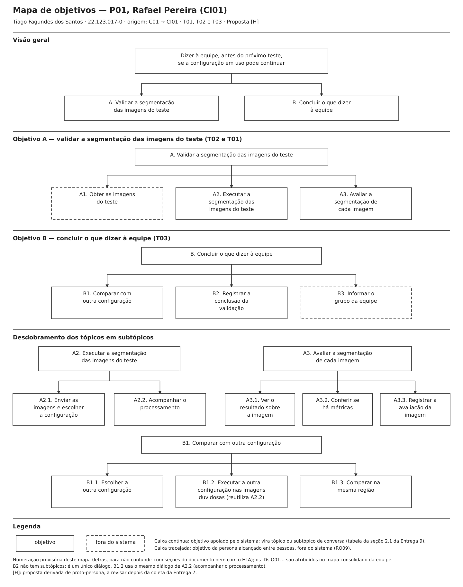
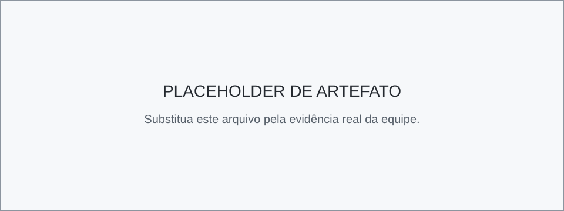

# Entrega 9 — Modelo conceitual e design centrado na comunicação

**Data:** 12/11/2026 (início)  
**Status:** 🟨 em andamento  
**Responsabilidade:** soluções individuais, com consolidação da equipe para mapa de objetivos e esquema de signos.

## Objetivo da atividade

Passar do cenário de problema para uma concepção da interação, explicitando objetivos, tópicos de conversa, falas e signos que a interface deverá comunicar/manipular.

## Transformando resultados técnicos em conceitos compreensíveis

Em TCCs algorítmicos ou orientados a dados, esta entrega deve evitar que a interface exponha apenas estruturas internas do código. Identifique os **conceitos e signos que fazem sentido para o usuário**.

Exemplos:

- `query plan`, custo estimado, recomendação e impacto para um DBA;
- modelo, dataset, versão, execução e métrica para engenheiro de IA;
- período, indicador, grupo, tendência e filtro para gestor/analista;
- alerta, severidade, evidência, responsável e status para analista de segurança.

Se um termo técnico for necessário, modele como será comunicado, explicado e relacionado à tarefa.

Dashboards, relatórios, filtros e CRUDs devem aparecer no modelo conceitual por meio dos **objetivos, signos e conversas** que justificam sua existência.

## 1. Cenários de interação

Para cada cenário de problema, produza uma versão em que a solução já pode ser descrita. **Destaque claramente o texto alterado** em relação ao cenário original.

> **Como ler os cenários desta seção.** Cada cenário de interação parte do **cenário refinado** da Entrega 4 e usa a mesma [convenção de marcação](04_cenarios_problema.md#convenção-de-marcação-do-refinamento): texto normal = mantido do cenário de problema; **negrito** = novo, trazido pela solução; *itálico* = trecho reescrito. O número entre colchetes (`[1]`, `[2]`…) antes de um trecho remete à linha correspondente da tabela "Diferenças relevantes" logo abaixo do cenário.
>
> Os cenários descrevem o que a pessoa faz e o que o sistema responde, **sem detalhes de interface** (rótulos, botões, tipos de componente), que ficam para as Entregas 10 e 11. As três personas são proto-personas: os cenários de interação são **propostas de design `[H]`**, a revisar depois da coleta da Entrega 7.

### CI01 — Validação de segmentação e comparação de configurações sem scripts

**Autor(a):** Tiago Fagundes dos Santos — 22.123.017-0  
**Origem:** cenário problema C01 — Validação manual de segmentação em campo  
**Persona:** P01 (Rafael Pereira, analista de segmentação)  
**Tarefas apoiadas:** T02 (executar a segmentação com uma ou mais configurações disponíveis), T01 (avaliar a qualidade da segmentação de uma imagem) e T03 (comparar o resultado de uma imagem entre configurações)  
**Rastreabilidade:** R01, R02, R03; H02, H04, H05, H06; RC01, RC03, RC04; F01, F03; RQ01–RQ06, RQ08, RQ09; decisões de design 1 a 5 da P01 (Entrega 3)

Rafael acompanha os testes do Baja em terrenos off-road dentro da FEI e coleta imagens com câmeras acopladas ao veículo. A validação acontece no laboratório, no mesmo dia do teste ou no dia seguinte, sobre algumas dezenas de imagens escolhidas dos trechos mais difíceis do percurso. Rafael é quem executa a validação, sozinho; as imagens são descarregadas das câmeras por quem acompanhou o teste. Ele precisa validar se o modelo de segmentação está delimitando corretamente a região de trilha para dizer à equipe, antes do próximo teste, se a configuração em uso pode continuar sendo usada. Quem decide se a configuração é mantida ou se é preciso compará-la com outra é a gestão (P03), com a coordenação (P02), na reunião semanal; o grupo da equipe, incluindo quem pilota, só precisa ser informado da configuração que vai para o próximo teste.

**O episódio a seguir é uma situação construída pela equipe `[H]`.** [1] *No dia seguinte a um teste, Rafael envia ao sistema as 30 imagens escolhidas e indica a configuração em uso, DeepLabV3+ – 30 épocas `[H]`, sem abrir cada imagem nem rodar código.* [2] **Antes de começar, o sistema avisa que duas imagens estão em um formato que ele não aceita, diz quais são e em que formato precisam estar; Rafael as deixa de fora e segue com as outras 28.** [3] **Durante o processamento, o sistema mostra o andamento de cada imagem e avisa quando todas terminam. Se uma execução falhasse, o sistema diria o que deu errado e o que fazer, em vez de exigir que ele depure os scripts do projeto.** [4] *Os resultados ficam reunidos na mesma sessão, cada imagem junto da sua máscara e da configuração que a gerou, sem pastas organizadas à mão.*

[5] **Para avaliar cada imagem, Rafael vê a imagem original e a máscara ao mesmo tempo e, quando precisa conferir a borda da trilha, sobrepõe a máscara à imagem, ajustando a transparência e ampliando a região. As cores de *Trilha* e *Fora da trilha* são sempre as mesmas, e o nome de cada classe acompanha a cor.** Em uma das imagens, a máscara cobre quase toda a pista com uma única cor. [6] *O sistema informa que essa imagem não tem anotação de referência e que, por isso, não há IoU nem acurácia para ela, e oferece a confiança do modelo em cada região, explicando que confiança alta não garante acerto `[H]`.* **A confiança é baixa em toda a imagem. Ao examinar a original, Rafael percebe que a câmera estava contra o sol.**

[7] *Ele considera uma máscara correta quando a borda da trilha coincide com o que vê na imagem original e registra cada imagem como correta ou duvidosa;* **para as duvidosas, indica se o problema parece estar na imagem (captura) ou no modelo. A imagem contra o sol fica registrada como problema de captura, e oito imagens de trechos com sombra ficam duvidosas por problema do modelo.** *Como as duvidosas são muitas, percebe que precisa comparar com outra configuração.*

[8] *Para escolher a outra configuração,* **o sistema mostra as configurações disponíveis, cada uma com uma descrição curta e com o IoU e a acurácia no conjunto de teste anotado. Em vez de supor que a mais recente é a melhor, Rafael escolhe a DeepLabV3+ – 50 épocas `[H]`, que tem os melhores valores no conjunto de teste, e a executa sobre as oito imagens duvidosas.** [9] *O sistema reúne as duas configurações na mesma visão, sobre a mesma imagem e na mesma região ampliada, junto das avaliações que Rafael já registrou;* **ele passa pelas oito imagens sem perder o fio da comparação. A segunda configuração delimita melhor a trilha em seis delas; duas continuam duvidosas.**

[10] **Rafael registra a conclusão: nas imagens com sombra deste teste, a DeepLabV3+ – 50 épocas foi mais adequada; duas imagens ficaram inconclusivas e uma teve problema de captura. Fora do sistema, informa o grupo da equipe de que a configuração em uso falha nos trechos de sombra e de que vale comparar as duas configurações na reunião semanal.** [11] *Rafael sente que a análise ficou clara o bastante para apoiar a decisão da equipe e que não perdeu tempo com tarefas repetitivas.*

#### Diferenças relevantes

| # | Alteração | Por que foi necessária | Evidência/artefato que justifica |
|---|---|---|---|
| 1 | Rafael envia as imagens e indica a configuração ao sistema, sem abrir cada imagem nem rodar o script. | No C01, cada imagem exigia abrir o arquivo e rodar o código manualmente. | C01 (cenário inicial e Q8); RQ01; E5 §2, HTA T03 1.1 e 2.1; E3, decisão de design 4 da P01 (envio e execução sem código) |
| 2 | O sistema verifica o formato das imagens antes de começar e diz quais estão fora do formato aceito e como corrigir. | Os erros mais comuns (formato não aceito, arquivo fora do lugar) só eram percebidos quando a execução parava (Q8). Verificar antes evita a falha no meio do processamento. | C01, Q8; E3, decisão de design 5 da P01 (mensagens de erro claras); RQ01 |
| 3 | O sistema mostra o andamento de cada imagem, avisa ao terminar e, em caso de falha, explica em linguagem de usuário o que deu errado e o que fazer. | No C01, a falha obrigava Rafael a depurar scripts que não conhece por dentro, e uma falha no dia do teste deixava a equipe sem resposta (Q2). | RC04; F03; RQ01; E5 §2, HTA T03 2.2 e 2.3.2 e síntese 2.5 (item 1); E8 §1 (Tempo de processamento) |
| 4 | Os resultados ficam reunidos na sessão (imagem, máscara e configuração), sem pastas organizadas à mão. | No C01, as pastas eram nomeadas pela data do teste e as métricas ficavam em planilhas à parte (Q3). O cenário não supõe histórico entre sessões, que continua fora do recorte até a H08 ser confirmada. | C01, Q3; RQ03; E8 §1 (Volume de dados/histórico); H08 |
| 5 | Rafael vê a imagem e a máscara ao mesmo tempo, sobrepõe a máscara com transparência ajustável, amplia a região, e as cores e os nomes das classes são fixos. | No C01, as máscaras eram abertas em janelas separadas e as cores não tinham padrão entre execuções. | E3, decisões de design 1 e 2 da P01; RQ03; RQ04; E5 §2, HTA T03 3.1 e 3.2 e GOMS T01 metas 1 e 2 |
| 6 | Para uma imagem sem anotação de referência, o sistema informa que não há IoU nem acurácia e oferece a confiança do modelo por região, com o aviso de que confiança alta não garante acerto. | A ruptura central do C01 era a falta de informação sobre a confiança do resultado. As métricas só existem para imagens com anotação de referência. | C01 (ruptura da máscara de uma cor só); RQ06; RC01; E5 §2, GOMS T01 3.B; E8 §1 (Restrições: estado "sem métricas"); `PENDENCIAS.md`, INC-52. A confiança do modelo é hipótese de design `[H]` |
| 7 | Rafael registra cada imagem como correta ou duvidosa e, nas duvidosas, se o problema parece ser da imagem ou do modelo. | No C01, ele não conseguia dizer se a falha era do modelo ou da imagem, e marcava as duvidosas fora do sistema. O critério visual de correção (Q7) continua o mesmo. | C01, Q7; RQ05; E5 §2, GOMS T01 3.A.2, HTA T03 4.2.2 e síntese 2.5 (item 2) |
| 8 | Ao escolher a configuração para comparar, Rafael vê a descrição e as métricas de cada uma no conjunto de teste anotado, em vez de supor que a mais recente é a melhor. | No C01, ele escolhia a configuração mais recente sem conferir as métricas, porque elas estavam em outra planilha (Q5). | C01, Q5; F01; E3, decisão de design 3 da P01; E5 §2, HTA T03 1.2 |
| 9 | O sistema reúne as duas configurações na mesma visão, sobre a mesma imagem e na mesma região, com as avaliações já registradas. | No C01, as máscaras ficavam em janelas separadas e as métricas em planilhas diferentes, e Rafael perdia o fio da comparação. | RQ02; RQ03; E5 §2, HTA T03 4.1 e síntese 2.5 (item 4) |
| 10 | Rafael registra a conclusão (configuração mais adequada, imagens inconclusivas e problema de captura) e informa o grupo fora do sistema, sugerindo a comparação na reunião. | A conclusão é dele; o sistema exibe e organiza, mas não decide. A decisão continua com a gestão e a coordenação (Q4). O cenário não usa a exportação de imagens (decisão de design 4 da P01), porque ela está fora do recorte da Entrega 1 até decisão da equipe. | C01, Q4; RQ08; RQ09; E5 §2, HTA T03 4.2 e 4.3; `PENDENCIAS.md`, INC-63 (exportação) |
| 11 | O sentimento final se inverte: a análise fica clara o bastante para apoiar a decisão, sem tarefas repetitivas. | É o benefício esperado da interface para a P01. | H05; H06; E3, objetivos da P01 |

**O que não muda:** o contexto da validação (laboratório, dia do teste ou seguinte, imagens dos trechos difíceis), quem decide e quem é informado (Q4), o critério visual de correção (Q7) e as atividades que continuam fora do sistema (descarregar as imagens das câmeras e informar o grupo da equipe).

### CI02 — Recomendação de configuração a partir da comparação consolidada

**Autor(a):** Henrique Finatti Silveira Belo Trebbi — 22.123.030-3  
**Origem:** cenário problema C02 — Decisão de modelo a partir de resultados dispersos  
**Persona:** P03 (Larissa Camargo, gestora de projeto)  
**Tarefas apoiadas:** T04 (comparar o desempenho consolidado entre modelos) e T05 (decidir e justificar a adoção de um modelo), na parte que acontece na interface  
**Rastreabilidade:** R03; H01, H04, H06, H12; RC01; RQ02, RQ07, RQ08, RQ09; decisões de design 1, 2, 3 e 5 da P03 (Entrega 3)

Larissa Camargo é gestora de projeto da equipe Baja FEI e não escreve código nem domina machine learning ou estatística. A decisão precisa ocorrer antes de cada ciclo de testes porque a configuração escolhida será usada no veículo; o que se espera é uma escolha defensável, não apenas o maior número. A decisão é compartilhada com a coordenação: Larissa reúne os resultados e recomenda, e a palavra final é discutida no grupo.

O episódio a seguir é uma situação construída pela equipe `[H]`. [1] *Na semana anterior a um ciclo de testes, o integrante que executa os modelos processa as duas configurações candidatas sobre o mesmo conjunto de teste anotado, cada configuração em uma execução, e avisa Larissa de que os resultados estão prontos.* **Larissa não espera mensagens nem planilhas: assim que as execuções terminam, ela pede ao sistema a comparação das configurações do ciclo.** [2] **O sistema reúne as duas configurações em uma só visão, informando o conjunto de imagens e a data de cada execução, e Larissa confirma que as duas foram avaliadas no mesmo conjunto.** São duas configurações: uma com IoU médio de 0,78 e outra com 0,76, ambos calculados no conjunto de teste anotado. [3] **Junto de cada métrica, o sistema mostra o valor de referência adotado pela equipe e de onde ele veio `[H]`, e destaca a configuração com o maior valor em cada métrica.**

[4] *Ela vê o IoU, a acurácia, o tempo de inferência e os valores por classe (Trilha e Fora da trilha)* **e, quando não sabe o que um termo significa, pede a explicação ao próprio sistema. A explicação diz, em português, o que a métrica indica e o que não indica: o IoU médio, por exemplo, resume o acerto em todas as imagens do conjunto, mas não mostra em que tipo de trecho a configuração erra, e nenhuma métrica garante que um trajeto é seguro.** [5] *Como a diferença é de 0,02,* **o sistema avisa que o resultado é inconclusivo: a diferença é pequena demais para indicar, sozinha, qual configuração é melhor `[H]`.**

[6] **Larissa entende que não basta escolher o maior número. Ela registra na comparação a recomendação da configuração de 0,78, com a ressalva de que a diferença é pequena e de que o desempenho nos trechos de sombra não foi conferido. Fora do sistema, pede ao integrante técnico que compare as duas configurações em imagens com sombra antes do teste.**

[7] *Na reunião, no laboratório, mostra à coordenação a comparação e a recomendação registrada, com as métricas, a referência e a ressalva.* *A coordenação (P02) pergunta se 0,02 de diferença importa e se a configuração foi vista em imagens com sombra; Larissa responde que a diferença, sozinha, é inconclusiva e que a conferência nas sombras já foi pedida.* [8] **A coordenação aceita a recomendação com a condição de que a conferência nas sombras seja feita antes do teste, e Larissa anota a decisão e a condição junto da recomendação.** [9] *Larissa sente que entende o que está recomendando e que consegue sustentar a escolha, mesmo quando o resultado não é conclusivo.*

#### Diferenças relevantes

| # | Alteração | Por que foi necessária | Evidência/artefato que justifica |
|---|---|---|---|
| 1 | Os resultados deixam de chegar por mensagens e planilhas separadas: o integrante técnico executa as configurações no sistema, e Larissa consulta a comparação assim que as execuções terminam, sem depender da véspera da reunião. | No C02, os resultados dispersos e a chegada na véspera impediam Larissa de entender os números antes de decidir (Q11). | C02, Q11 e Q14; RQ01 (executar pela interface, T02); RQ09 (o aviso ao integrante técnico continua fora do sistema); E5 §1, objetivo 1 do HTA T05 |
| 2 | O sistema reúne as configurações do ciclo em uma só visão e informa o conjunto de imagens e a data de cada execução; Larissa confere que foram avaliadas no mesmo conjunto. | Comparar execuções de conjuntos diferentes leva a uma conclusão incorreta; antes, a comparação era feita em arquivos separados. | RQ02; E5 §1, HTA T05 1.1 e GOMS T04 OP. 1.4; E3, decisão de design 1 da P03; E8 §1 (Papéis/permissões) |
| 3 | Cada métrica aparece com um valor de referência, identificado pela origem, e o maior valor de cada métrica é destacado. | Sem referência, Larissa não sabia se um número era bom (Q13). O destaque organiza a leitura, mas não recomenda: a recomendação continua sendo dela (linha 6). | E3, decisão de design 2 da P03 (a origem da referência está em investigação `[?]`); RQ07; E5 §1, HTA T05 2.2.1 e 2.3.1 |
| 4 | Larissa passa a usar o tempo de inferência e os valores por classe, que antes ignorava, e consulta a explicação dos termos no próprio sistema, em vez de depender de um colega. A explicação diz o que a métrica indica e o que não indica, inclusive que nenhuma métrica garante a segurança do trajeto. | No C02, ela ignorava métricas que não sabia como pesavam e dependia de um colega para entender IoU, acurácia por classe e "trilha" (Q13, Q15). | RC01; RQ07; E3, decisão de design 3 da P03; E5 §1, HTA T05 2.3.2; E1 §4.3 (métrica não equivale a segurança do trajeto); E8 §1 (Restrições) |
| 5 | Diante da diferença de 0,02, o sistema avisa que o resultado é inconclusivo. | No C02, Larissa não sabia julgar uma diferença pequena e escolhia o maior número por falta de critério (Q14). | E3, decisão de design 5 da P03 (o critério de "inconclusivo" ainda precisa ser definido pela equipe `[?]`); RQ07; E5 §1, HTA T05 2.3.2 e 3.2 |
| 6 | Larissa registra a recomendação com uma ressalva e pede, fora do sistema, uma conferência nas imagens com sombra. | A recomendação com ressalva é um desfecho legítimo, não uma falha; o sistema exibe e calcula, mas quem recomenda é a pessoa. O pedido ao colega continua por mensagem. | RQ08; RQ09; E5 §1, HTA T05 3.2 e 2.3.3 e síntese 1.5 (item 3); E6, tela de comparação (campo de conclusão) |
| 7 | Na reunião, Larissa mostra a comparação e a recomendação registrada na tela do laboratório, em vez de um print das planilhas com o maior valor destacado à mão. Ela responde às perguntas da coordenação com a explicação e o aviso de inconclusivo. | O print não sustentava a escolha (Q17). O cenário não usa o relatório exportável (decisão de design 4 da P03), porque ele está fora do recorte da Entrega 1 (§11) e ainda depende de decisão da equipe (`PENDENCIAS.md`, INC-63). | C02, Q17; E3, ambiente típico de uso da P03 (tela projetada ou compartilhada na reunião `[H]`) e §3.1; E5 §1, HTA T05 4.1.2 e 4.2 e síntese 1.5 (item 4) |
| 8 | O desfecho muda: em vez de a configuração falhar nas sombras e a decisão ser revista depois do teste, a coordenação aceita a recomendação com a condição de conferir as sombras antes do teste, e Larissa anota a decisão. | A ressalva leva a conferência para antes do teste, o que reduz o risco de retrabalho descrito no C02 (Q16). A reunião continua fora do sistema. | C02, Q16; H06; E5 §1, HTA T05 4.3 e fronteira do CTT T05 |
| 9 | O sentimento final se inverte: Larissa entende o que recomenda e sustenta a escolha, mesmo com resultado inconclusivo. | É o benefício esperado da interface para a P03: decidir de forma defensável sem depender dos colegas técnicos para entender os números. | H12; E3, objetivos e motivadores da P03 |

**O que não muda:** o perfil de Larissa, a decisão compartilhada com a coordenação, os valores do episódio (0,78 e 0,76 no conjunto de teste anotado) e as atividades que continuam fora do sistema (o aviso de que os resultados estão prontos, o pedido de conferência ao integrante técnico e a reunião).

### CI03 — {{título}}

**Autor(a):** Mateus Marana Assuena — 22.123.026-1  
**Origem:** cenário problema C03 — Experimentação e análises de modelos para segmentação

{{cenário de interação com alterações marcadas}}

#### Diferenças relevantes

| # | Alteração | Por que foi necessária | Evidência/artefato que justifica |
|---|---|---|---|
| {{...}} | {{...}} | {{...}} | {{...}} |

## 2. Design centrado na comunicação

Cada integrante descreve, como conversa, o cenário de interação que escreveu na seção 1. Os tópicos são objetivos da persona; os subtópicos são os diálogos que ela trava com o sistema para alcançá-los.

**Convenção:** `U` = usuário; `D` = preposto do designer/sistema, conforme a abordagem de Engenharia Semiótica adotada na disciplina. Nas falas, os **signos** (conceitos que a interface precisa comunicar ou que o usuário manipula) aparecem em **negrito** e serão consolidados no esquema de signos da seção 4. Linhas marcadas como *ruptura* descrevem um desvio previsto da conversa e como o preposto o trata. Nomes de configuração em negrito com `[H]` (ex.: **DeepLabV3+ – 30 épocas**) são exemplos: a forma de nomear as configurações ainda não foi definida `[?]`.

### 2.1 CI01

**Autor(a):** Tiago Fagundes dos Santos — 22.123.017-0  
**Nome do cenário:** CI01 — Validação de segmentação e comparação de configurações sem scripts  
**Persona:** P01 (Rafael Pereira)

| Tópico > subtópico | Falas e signos envolvidos | Intenção/efeito esperado |
|---|---|---|
| **executar a segmentação das imagens do teste** (T02) | `U:` Quero segmentar as imagens do teste de ontem com a configuração em uso. | Rafael parte do objetivo dele (as imagens do teste), sem abrir arquivos nem rodar código (CI01 [1]; RQ01). |
| > enviar as imagens e escolher a configuração | `D:` Quais **imagens** você quer segmentar e com qual **configuração**? Estas são as **configurações disponíveis**, cada uma com uma **descrição** e com o **IoU** e a **acurácia** no **conjunto de teste anotado**. `U:` Estas 30 imagens, com a **DeepLabV3+ – 30 épocas** `[H]`. | Mostrar desde o início o que cada configuração é e como se saiu no conjunto de teste (F01; decisão de design 3 da P01). |
| > *ruptura:* formato não aceito | `D:` 2 das 30 **imagens** estão em um **formato** que não consigo processar: IMG_0412 e IMG_0415 `[H]`. Aceito imagens em JPG ou PNG `[H]`. Quer seguir com as outras 28 ou trocar esses arquivos antes? `U:` Sigo com as 28. | Avisar antes de começar, dizendo quais arquivos e como corrigir, em vez de a execução parar no meio (CI01 [2]; C01, Q8). |
| > acompanhar o processamento | `D:` **Processando:** 12 de 28 **imagens** concluídas com a **DeepLabV3+ – 30 épocas**. `D:` **Concluído:** as 28 **imagens** foram segmentadas. Os resultados estão reunidos nesta **sessão**. | Deixar claro o **estado** da execução (processando, concluído, falhou) e avisar quando terminar (CI01 [3] e [4]; RC04; F03). |
| > *ruptura:* falha na execução | `D:` **Falhou:** a segmentação da imagem IMG_0430 `[H]` não terminou porque faltou memória no computador `[H]`. As outras imagens não foram afetadas. Você pode tentar de novo ou deixar essa imagem de fora. `U:` Tento de novo. | Dizer o que falhou e o que fazer, em linguagem de usuário, sem exigir depuração (CI01 [3]; RQ01; HTA T03 2.3.2). |
| **avaliar a segmentação de cada imagem** (T01) | `U:` Quero conferir se a segmentação está certa em cada imagem. | A avaliação acontece no mesmo lugar em que a execução terminou (CI01 [5]). |
| > ver o resultado sobre a imagem | `U:` Quero ver esta imagem com a máscara. `D:` Aqui estão a **imagem original** e a **máscara**, com a **legenda**: **Trilha** e **Fora da trilha**, sempre com as mesmas cores. `U:` Quero sobrepor a máscara e ampliar a borda da trilha. `D:` Esta é a **sobreposição**, com a **transparência** que você escolher, ampliada na região indicada. | Avaliar sem alternar entre janelas e sem reinterpretar cores (CI01 [5]; RQ03; RQ04; decisões de design 1 e 2 da P01). |
| > conferir se há métricas | `U:` Qual é o **IoU** desta imagem? `D:` Esta **imagem** não tem **anotação de referência**, por isso não há **IoU** nem **acurácia** para ela. Posso mostrar a **confiança do modelo** em cada região. Confiança alta não garante que a segmentação esteja certa. `U:` Mostre. `D:` A **confiança do modelo** é baixa em toda a imagem. | Não prometer métricas para imagens de campo e explicar o que a confiança indica e o que não indica (CI01 [6]; RQ06; RC01; INC-52). A confiança é hipótese de design `[H]`. |
| > registrar a avaliação da imagem | `U:` Esta imagem está **duvidosa**: o problema é da **captura**, a câmera estava contra o sol. `D:` Registrado: **duvidosa**, **problema na imagem (captura)**. `U:` Estas oito, de trechos com sombra, estão **duvidosas** por **problema no modelo**. As demais estão **corretas**. `D:` Registrado. | Separar erro do modelo de problema da imagem, ao lado do resultado (CI01 [7]; RQ05). |
| **comparar com outra configuração** (T03) | `U:` Há muitas duvidosas. Quero comparar essas imagens com outra configuração. | A comparação nasce da avaliação, sobre as mesmas imagens (CI01 [7] e [8]). |
| > escolher a outra configuração | `D:` Estas são as **configurações disponíveis**, com a **descrição** e as **métricas no conjunto de teste anotado**. A **DeepLabV3+ – 30 épocas** já foi executada nestas imagens. `U:` Quero a **DeepLabV3+ – 50 épocas** `[H]`, que tem os melhores valores no conjunto de teste. | Escolher pela informação disponível, e não por supor que a mais recente é a melhor (CI01 [8]; C01, Q5). |
| > executar a outra configuração nas imagens duvidosas | `U:` Execute nas oito imagens duvidosas. `D:` *(mesmo diálogo de "acompanhar o processamento")* | Reaproveitar a mesma conversa de execução, sem um caminho novo para aprender. |
| > comparar na mesma região | `D:` Aqui estão as duas **configurações** sobre a mesma **imagem**, na mesma região ampliada, com a **avaliação** que você registrou. `U:` Nesta, a segunda delimita melhor a borda da trilha. | Manter o fio da comparação imagem a imagem (CI01 [9]; RQ02; RQ03; HTA T03 4.1). |
| **registrar a conclusão da validação** (T03) | `U:` Quero registrar a conclusão. `D:` Qual **configuração** foi mais adequada, quais **imagens** ficaram **inconclusivas** e em quais houve **problema na imagem (captura)**? `U:` A **DeepLabV3+ – 50 épocas** foi mais adequada nas imagens com sombra; duas ficaram **inconclusivas**; uma teve problema de **captura**. `D:` **Conclusão** registrada para as imagens deste teste. | A conclusão é de Rafael; o sistema organiza, mas não escolhe (CI01 [10]; RQ08; HTA T03 4.2). |
| > *ruptura:* imagens sem avaliação | `D:` Três **imagens** ainda não têm **avaliação**. Quer concluir assim mesmo ou avaliá-las antes? `U:` Vou avaliá-las antes. | Rafael considera a validação concluída quando todas as imagens estão marcadas (C01, Q7); o sistema avisa antes de registrar uma conclusão incompleta. |

**Fora da conversa com o sistema:** descarregar as imagens das câmeras (feito por quem acompanhou o teste) e informar o grupo da equipe sobre a conclusão (RQ09).

**Signos que esta conversa introduz:** imagem, formato aceito, configuração, nome da configuração `[?]`, descrição da configuração, métricas no conjunto de teste anotado (IoU, acurácia), estado da execução (processando, concluído, falhou), causa da falha, sessão, imagem original, máscara, legenda (Trilha, Fora da trilha), sobreposição, transparência, anotação de referência, confiança do modelo, avaliação da imagem (correta, duvidosa), origem do problema (imagem/captura ou modelo), imagem inconclusiva e conclusão. Os exemplos de nomes de arquivo, formatos e causa da falha são ilustrativos `[H]`.

### 2.2 CI02

**Autor(a):** Henrique Finatti Silveira Belo Trebbi — 22.123.030-3  
**Nome do cenário:** CI02 — Recomendação de configuração a partir da comparação consolidada  
**Persona:** P03 (Larissa Camargo)

| Tópico > subtópico | Falas e signos envolvidos | Intenção/efeito esperado |
|---|---|---|
| **comparar o desempenho das configurações do ciclo** (T04) | `U:` Quero comparar as configurações candidatas para o próximo **ciclo de testes**. | Larissa parte do objetivo dela (o ciclo), não de arquivos ou execuções soltas. |
| > escolher o que comparar | `D:` Estas são as **configurações** com **execução concluída**. Cada uma mostra o **conjunto de teste anotado** em que foi avaliada e a **data da execução**. Quais você quer comparar? `U:` As duas candidatas deste ciclo. | Tornar visível, antes da comparação, sobre quais dados cada resultado foi calculado (CI02 [2]; RQ02). |
| > *ruptura:* execução faltante | `D:` A configuração **DeepLabV3+ – 30 épocas** `[H]` ainda não tem **execução concluída** neste ciclo. Para incluí-la, peça a execução ao integrante que executa os modelos. `U:` Vou pedir e volto depois. | Dizer exatamente o que falta e o que fazer fora do sistema, para que Larissa peça uma vez só (HTA T05 1.2). |
| > conferir se a comparação é válida | `D:` As duas configurações foram avaliadas no mesmo **conjunto de teste anotado**. A comparação é válida. | Confirmar a condição para comparar, sem exigir que Larissa abra arquivos (HTA T05 1.1; GOMS T04 OP. 1.4). |
| > *ruptura:* conjuntos diferentes | `D:` A configuração **FCN – 50 épocas** `[H]` foi avaliada em outro **conjunto de teste anotado**. Comparar resultados de conjuntos diferentes pode levar a uma conclusão errada. Quer continuar mesmo assim ou pedir uma nova execução? `U:` Vou pedir uma nova execução. | Alertar antes de uma comparação inválida e deixar a decisão com Larissa (RQ02). |
| > ler o desempenho de cada configuração | `D:` Este é o desempenho de cada configuração no **conjunto de teste anotado**: **IoU médio**, **acurácia**, **tempo de inferência** e **valores por classe** (**Trilha** e **Fora da trilha**). Junto de cada métrica está o **valor de referência** e a **origem da referência**. A configuração com o **maior valor** em cada métrica está destacada. `U:` Quero ver os valores exatos. `D:` Aqui estão os valores em tabela. Você também pode vê-los em gráfico. | Reunir todas as configurações em uma só visão, com referência, sem que o destaque do maior valor pareça uma recomendação do sistema (CI02 [3]; RQ07; RC03). |
| **entender o que os números significam** (T04) | `U:` Não sei se esses números são bons nem o que alguns deles querem dizer. | Os termos técnicos deixam de depender de um colega para serem explicados (CI02 [4]). |
| > entender um termo | `U:` O que é **IoU médio**? `D:` O **IoU médio** compara as regiões que a configuração marcou como **Trilha** e **Fora da trilha** com as regiões anotadas no **conjunto de teste anotado**: quanto mais perto de 1, mais elas coincidem. Ele indica o acerto geral; ele **não** mostra em que tipo de trecho a configuração erra. Nenhuma **métrica** garante que um trajeto é seguro. | Explicar no ponto de uso o que a métrica indica e o que não indica, inclusive o limite de segurança (RC01; E1 §4.3). |
| > julgar a diferença entre as configurações | `D:` **Resultado inconclusivo:** a diferença de 0,02 no **IoU médio** é pequena demais para indicar, sozinha, qual configuração é melhor. `U:` Por que é inconclusiva? `D:` Diferenças desse tamanho podem não se repetir em outro conjunto de imagens. Vale conferir as configurações nos trechos que preocupam a equipe antes de decidir. `U:` Então não basta escolher o maior número. | Avisar sem ser perguntado quando a diferença não sustenta uma escolha e explicar o motivo, para que Larissa não escolha "o número maior" (CI02 [5]; decisão de design 5 da P03). O critério de "inconclusivo" ainda precisa ser definido pela equipe `[?]`. |
| **registrar a recomendação** (T05) | `U:` Quero registrar qual configuração vou recomendar para o ciclo. | A conclusão é de Larissa; o sistema guarda, mas não decide (RQ08). |
| > informar a recomendação e a ressalva | `D:` Qual **configuração** você recomenda? Como o resultado foi **inconclusivo**, quer registrar uma **ressalva**? `U:` Recomendo a configuração de **IoU médio** 0,78. **Ressalva:** a diferença é pequena e o desempenho nos trechos de sombra não foi conferido. | Convidar a registrar a incerteza, sem impedir a recomendação (CI02 [6]; HTA T05 3.2). |
| > conferir a recomendação | `D:` **Recomendação** registrada para o **ciclo de testes**: configuração de 0,78, comparada com a de 0,76 no mesmo **conjunto de teste anotado**, com o **valor de referência** e a **ressalva**. `U:` Está certo. | Larissa confere o que vai sustentar na reunião antes de sair da conversa. |
| **apresentar a recomendação à coordenação** (T05) | `U:` Quero mostrar a comparação e a recomendação deste ciclo. | Retomar, durante a reunião, o que foi preparado antes, sem recriar a comparação (CI02 [7]). |
| > retomar a comparação | `D:` Aqui estão a comparação das configurações, a **recomendação** e a **ressalva** registradas para este **ciclo de testes**. | Mostrar à coordenação a mesma informação que Larissa usou para decidir. |
| > responder a uma dúvida da coordenação | `U:` A coordenação quer saber se 0,02 de diferença importa. `D:` *(mesmo diálogo de "julgar a diferença entre as configurações")* | Larissa responde com a explicação do sistema, em vez de repetir que o número é maior. |
| **registrar a decisão da coordenação** (T05) | `U:` A coordenação aceitou a recomendação, com a **condição** de conferir os trechos de sombra antes do teste. `D:` **Decisão** registrada junto da **recomendação**: aceita, com a **condição** informada. | Deixar a decisão e a condição ligadas à comparação que as sustentou (CI02 [8]; HTA T05 4.3). |

**Fora da conversa com o sistema:** o aviso de que as execuções estão prontas, o pedido de conferência nas imagens com sombra ao integrante técnico e a discussão na reunião acontecem entre pessoas (RQ09). O sistema só indica o que falta pedir (ruptura "execução faltante").

**Signos que esta conversa introduz:** ciclo de testes, configuração, nome da configuração `[?]`, execução concluída, data da execução, conjunto de teste anotado, IoU médio, acurácia, tempo de inferência, valores por classe (Trilha, Fora da trilha), valor de referência, origem da referência, maior valor, métrica, resultado inconclusivo, recomendação, ressalva, decisão e condição. O formato do **nome da configuração** (só o modelo, o modelo com o parâmetro principal ou um nome dado por quem treina) será definido no esquema de signos (seção 4), junto com o CI03, porque a configuração é criada no treino (T08).

### 2.3 CI03

**Autor(a):** Mateus Marana Assuena — 22.123.026-1  
**Nome do cenário:** CI03 — {{título}}

| Tópico > subtópico | Falas e signos envolvidos | Intenção/efeito esperado |
|---|---|---|
| {{objetivo}} | `U: ...` / `D: ...` | {{...}} |
| > {{subtópico}} | {{...}} | {{...}} |

## 3. Mapa de objetivos

Cada integrante apresenta seu mapa e a equipe cria um **mapa consolidado**, eliminando duplicidades e resolvendo conflitos de nomenclatura.

### 3.1 Mapas individuais

Cada mapa parte do objetivo geral da persona e chega aos tópicos e subtópicos da conversa da seção 2. Caixas contínuas são objetivos apoiados pelo sistema; caixas tracejadas são objetivos que a persona alcança fora dele, entre pessoas. Cada mapa numera os objetivos com letras (A, B), os tópicos com letra e número (A1, A2…) e os subtópicos com mais um nível (A1.1…), para não confundir com as seções deste documento nem com a numeração do HTA da Entrega 5. Essa numeração é provisória: os IDs `O01`… são atribuídos no mapa consolidado (3.2). Os diagramas são gerados pelos scripts em [`scripts/diagramas/`](../scripts/diagramas/README.md).

#### Mapa da P01 (CI01)

**Autor(a):** Tiago Fagundes dos Santos — 22.123.017-0

*Figura 1 — Mapa de objetivos da P01 (Rafael Pereira) a partir do CI01, por Tiago Fagundes dos Santos. Gerado por [`mapa_objetivos_ci01.py`](../scripts/diagramas/mapa_objetivos_ci01.py).*

- **Objetivo geral:** dizer à equipe, antes do próximo teste, se a configuração em uso pode continuar, que é o objetivo da P01 na Entrega 3 e a resposta à Q1 do C01.
- **Objetivo A (T02 e T01):** A2 e A3 são os dois primeiros tópicos da seção 2.1. O A1 fica fora do sistema: as imagens são descarregadas das câmeras por quem acompanhou o teste (C01, Q6).
- **Objetivo B (T03):** B1 e B2 são os dois últimos tópicos da seção 2.1. O B3 é o aviso ao grupo da equipe, que acontece fora do sistema (RQ09).
- **Reuso:** executar a outra configuração nas imagens duvidosas (B1.2) usa o mesmo diálogo de acompanhar o processamento (A2.2).

#### Mapa da P03 (CI02)

**Autor(a):** Henrique Finatti Silveira Belo Trebbi — 22.123.030-3

*Figura 2 — Mapa de objetivos da P03 (Larissa Camargo) a partir do CI02, por Henrique Finatti Silveira Belo Trebbi. Gerado por [`mapa_objetivos_ci02.py`](../scripts/diagramas/mapa_objetivos_ci02.py).*

- **Objetivo geral:** decidir e sustentar a configuração do ciclo de testes, que reúne os dois objetivos da P03 na Entrega 3 (decidir qual configuração adotar; apresentar e sustentar a decisão).
- **Objetivo A (T04 e T05):** os tópicos A1 a A3 são os três primeiros tópicos da seção 2.2. O A4 fica fora do sistema: é o pedido ao integrante técnico da ruptura "execução faltante" e da conferência nas imagens com sombra (CI02 [6]).
- **Objetivo B (T05):** B1 e B3 são os dois últimos tópicos da seção 2.2. O B2 é a discussão na reunião, que acontece fora do sistema (RQ09).
- **Reuso:** responder a uma dúvida da coordenação (B1.2) usa o mesmo diálogo de julgar a diferença entre as configurações (A2.2).

#### Mapa da P02 (CI03)

**Autor(a):** Mateus Marana Assuena — 22.123.026-1

{{mapa de objetivos a partir do CI03}}

### 3.2 Mapa consolidado

#### Dicionário de objetivos

| ID | Objetivo | Persona(s) | Cenário(s) | Prioridade |
|---|---|---|---|---|
| O01 | {{...}} | {{P01}} | {{CI01}} | {{...}} |

## 4. Esquema conceitual de signos

Consolide as informações em **uma tabela única**.

| Grupo | Signo | Origem | Observações/semântica | Tipo de conteúdo | Restrição | Valor padrão | Prevenção | Recuperação |
|---|---|---|---|---|---|---|---|---|
| Credenciais | usuário | domínio | {{...}} | texto | não nulo | — | {{...}} | {{...}} |

### Regras para os signos

- Use o vocabulário do domínio do usuário.
- Evite duplicar o mesmo conceito com nomes diferentes.
- Diferencie informação fornecida pelo usuário, produzida pelo sistema e derivada do domínio.
- Registre prevenção e recuperação apenas quando fizer sentido; explique as siglas usadas.

## Síntese

Quais objetivos/tópicos/signos deverão necessariamente aparecer nos diagramas MoLIC?

## Checklist

- [ ] Cenários de interação mostram alterações em relação aos cenários de problema.
- [ ] Cada solução individual identifica autor e cenário de origem.
- [ ] Tópicos/falas/signos são coerentes com objetivos do usuário.
- [ ] Mapas individuais foram consolidados.
- [ ] O esquema de signos está em uma tabela única e sem duplicações conceituais.
- [ ] Nomes de objetivos/signos serão reutilizados na Entrega 10.
- [ ] Em TCC técnico, signos representam conceitos do domínio compreensíveis ao usuário, não apenas variáveis/estruturas internas.
- [ ] Padrões como dashboard, relatório, filtros, administração e CRUD possuem objetivos e signos correspondentes.
- [ ] A interface comunica não só o resultado técnico, mas também seu significado para a tarefa.
