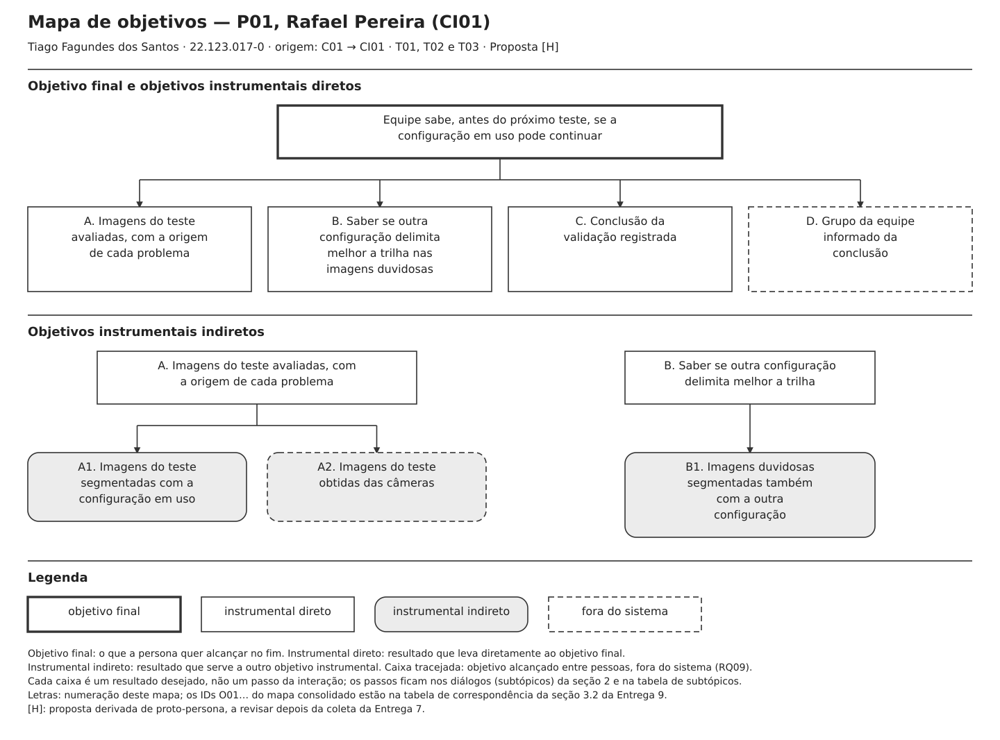
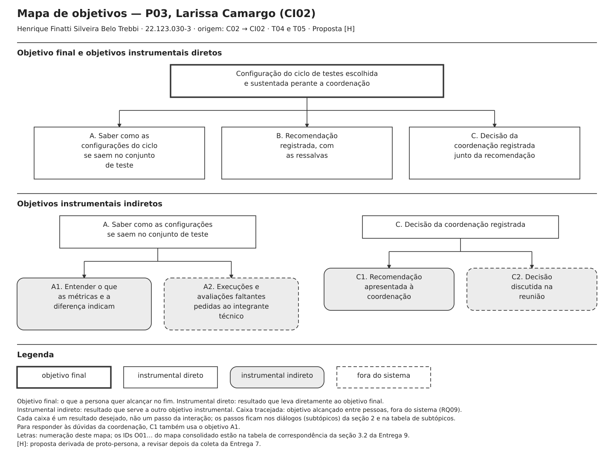
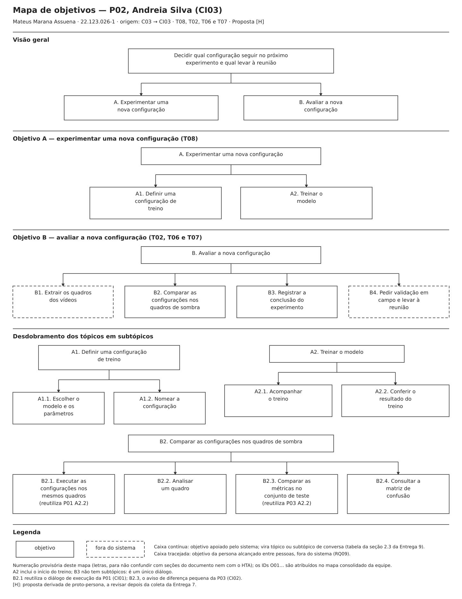
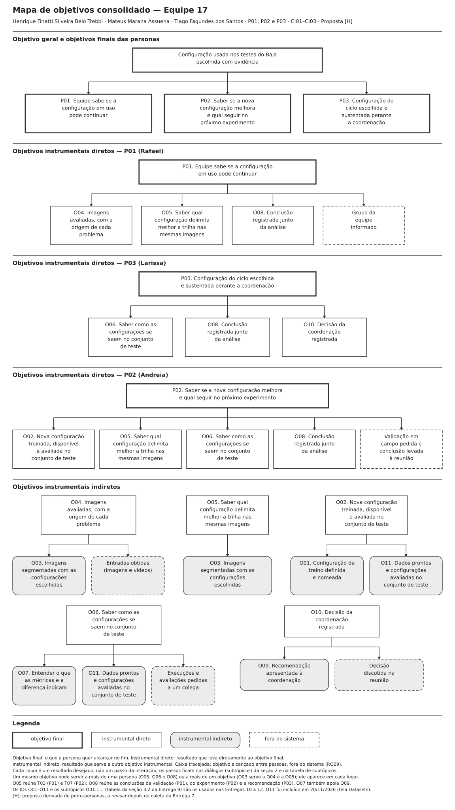

# Entrega 9 — Modelo conceitual e design centrado na comunicação

**Data:** 12/11/2026 (início) · 14/11/2026 (primeira versão completa)  
**Status:** 🟩 concluída  
**Responsabilidade:** soluções individuais, com consolidação da equipe para mapa de objetivos e esquema de signos.

## Objetivo da atividade

Passar do cenário de problema para uma concepção da interação, explicitando objetivos, tópicos de conversa, falas e signos que a interface deverá comunicar/manipular.

## Transformando resultados técnicos em conceitos compreensíveis

Em TCCs algorítmicos ou orientados a dados, esta entrega deve evitar que a interface exponha apenas estruturas internas do código. Identifique os **conceitos e signos que fazem sentido para o usuário**.

Exemplos:

- `query plan`, custo estimado, recomendação e impacto para um DBA;
- modelo, dataset, versão, execução e métrica para engenheiro de IA;
- período, indicador, grupo, tendência e filtro para gestor/analista;
- alerta, severidade, evidência, responsável e status para analista de segurança.

Se um termo técnico for necessário, modele como será comunicado, explicado e relacionado à tarefa.

Dashboards, relatórios, filtros e CRUDs devem aparecer no modelo conceitual por meio dos **objetivos, signos e conversas** que justificam sua existência.

## 1. Cenários de interação

Para cada cenário de problema, produza uma versão em que a solução já pode ser descrita. **Destaque claramente o texto alterado** em relação ao cenário original.

> **Como ler os cenários desta seção.** Cada cenário de interação parte do **cenário refinado** da Entrega 4 e usa a mesma [convenção de marcação](04_cenarios_problema.md#convenção-de-marcação-do-refinamento): texto normal = mantido do cenário de problema; **negrito** = novo, trazido pela solução; *itálico* = trecho reescrito. O número entre colchetes (`[1]`, `[2]`…) antes de um trecho remete à linha correspondente da tabela "Diferenças relevantes" logo abaixo do cenário.
>
> Os cenários descrevem o que a pessoa faz e o que o sistema responde, **sem detalhes de interface** (rótulos, botões, tipos de componente), que ficam para as Entregas 10 e 11. As três personas são proto-personas: os cenários de interação são **propostas de design `[H]`**, a revisar depois da coleta da Entrega 7.

### CI01 — Validação de segmentação e comparação de configurações sem scripts

**Autor(a):** Tiago Fagundes dos Santos — 22.123.017-0  
**Origem:** cenário problema C01 — Validação manual de segmentação em campo  
**Persona:** P01 (Rafael Pereira, analista de segmentação)  
**Tarefas apoiadas:** T02 (executar a segmentação com uma ou mais configurações disponíveis), T01 (avaliar a qualidade da segmentação de uma imagem) e T03 (comparar o resultado de uma imagem entre configurações)  
**Rastreabilidade:** R01, R02, R03; H02, H04, H05, H06; RC01, RC03, RC04; F01, F03; RQ01–RQ06, RQ08, RQ09; decisões de design 1 a 5 da P01 (Entrega 3)

Rafael acompanha os testes do Baja em terrenos off-road dentro da FEI e coleta imagens com câmeras acopladas ao veículo. A validação acontece no laboratório, no mesmo dia do teste ou no dia seguinte, sobre algumas dezenas de imagens escolhidas dos trechos mais difíceis do percurso. Rafael é quem executa a validação, sozinho; as imagens são descarregadas das câmeras por quem acompanhou o teste. Ele precisa validar se o modelo de segmentação está delimitando corretamente a região de trilha para dizer à equipe, antes do próximo teste, se a configuração em uso pode continuar sendo usada. Quem decide se a configuração é mantida ou se é preciso compará-la com outra é a gestão (P03), com a coordenação (P02), na reunião semanal; o grupo da equipe, incluindo quem pilota, só precisa ser informado da configuração que vai para o próximo teste.

**O episódio a seguir é uma situação construída pela equipe `[H]`.** [1] *No dia seguinte a um teste, Rafael envia ao sistema as 30 imagens escolhidas e indica a configuração em uso, DeepLabV3+ – 30 épocas `[H]`, sem abrir cada imagem nem rodar código.* [2] **Antes de começar, o sistema avisa que duas imagens estão em um formato que ele não aceita, diz quais são e em que formato precisam estar; Rafael as deixa de fora e segue com as outras 28.** [3] **Durante o processamento, o sistema mostra o andamento de cada imagem e avisa quando todas terminam. Se uma execução falhasse, o sistema diria o que deu errado e o que fazer, em vez de exigir que ele depure os scripts do projeto.** [4] *Os resultados ficam reunidos na mesma sessão, cada imagem junto da sua máscara e da configuração que a gerou, sem pastas organizadas à mão.*

[5] **Para avaliar cada imagem, Rafael vê a imagem original e a máscara ao mesmo tempo e, quando precisa conferir a borda da trilha, sobrepõe a máscara à imagem, ajustando a transparência e ampliando a região. As cores de *Trilha* e *Fora da trilha* são sempre as mesmas, e o nome de cada classe acompanha a cor.** Em uma das imagens, a máscara cobre quase toda a pista com uma única cor. [6] *O sistema informa que essa imagem não tem anotação de referência e que, por isso, não há IoU nem acurácia para ela: a avaliação é visual.* **Ao examinar a imagem original com a máscara sobreposta e ampliada, Rafael percebe que a câmera estava contra o sol.**

[7] *Ele considera uma máscara correta quando a borda da trilha coincide com o que vê na imagem original e registra cada imagem como correta ou duvidosa;* **para as duvidosas, indica se o problema parece estar na imagem (captura) ou no modelo. A imagem contra o sol fica registrada como problema de captura, e oito imagens de trechos com sombra ficam duvidosas por problema do modelo.** *Como as duvidosas são muitas, percebe que precisa comparar com outra configuração.*

[8] *Para escolher a outra configuração,* **o sistema mostra as configurações disponíveis, cada uma com uma descrição curta e com o IoU e a acurácia no conjunto de teste. Em vez de supor que a mais recente é a melhor, Rafael escolhe a DeepLabV3+ – 50 épocas `[H]`, que tem os melhores valores no conjunto de teste, e a executa sobre as oito imagens duvidosas.** [9] *O sistema reúne as duas configurações na mesma visão, sobre a mesma imagem e na mesma região ampliada, junto das avaliações que Rafael já registrou;* **ele passa pelas oito imagens sem perder o fio da comparação. A segunda configuração delimita melhor a trilha em seis delas; duas continuam duvidosas.**

[10] **Rafael registra a conclusão: nas imagens com sombra deste teste, a DeepLabV3+ – 50 épocas foi mais adequada; duas imagens ficaram inconclusivas e uma teve problema de captura. Fora do sistema, informa o grupo da equipe de que a configuração em uso falha nos trechos de sombra e de que vale comparar as duas configurações na reunião semanal.** [11] *Rafael sente que a análise ficou clara o bastante para apoiar a decisão da equipe e que não perdeu tempo com tarefas repetitivas.*

#### Diferenças relevantes

| # | Alteração | Por que foi necessária | Evidência/artefato que justifica |
|---|---|---|---|
| 1 | Rafael envia as imagens e indica a configuração ao sistema, sem abrir cada imagem nem rodar o script. | No C01, cada imagem exigia abrir o arquivo e rodar o código manualmente. | C01 (cenário inicial e Q8); RQ01; E5 §2, HTA T03 1.1 e 2.1; E3, decisão de design 4 da P01 (envio e execução sem código) |
| 2 | O sistema verifica o formato das imagens antes de começar e diz quais estão fora do formato aceito e como corrigir. | Os erros mais comuns (formato não aceito, arquivo fora do lugar) só eram percebidos quando a execução parava (Q8). Verificar antes evita a falha no meio do processamento. | C01, Q8; E3, decisão de design 5 da P01 (mensagens de erro claras); RQ01 |
| 3 | O sistema mostra o andamento de cada imagem, avisa ao terminar e, em caso de falha, explica em linguagem de usuário o que deu errado e o que fazer. | No C01, a falha obrigava Rafael a depurar scripts que não conhece por dentro, e uma falha no dia do teste deixava a equipe sem resposta (Q2). | RC04; F03; RQ01; E5 §2, HTA T03 2.2 e 2.3.2 e síntese 2.5 (item 1); E8 §1 (Tempo de processamento) |
| 4 | Os resultados ficam reunidos na sessão (imagem, máscara e configuração), sem pastas organizadas à mão. | No C01, as pastas eram nomeadas pela data do teste e as métricas ficavam em planilhas à parte (Q3). O cenário não supõe histórico entre sessões, que continua fora do recorte até a H08 ser confirmada. | C01, Q3; RQ03; E8 §1 (Volume de dados/histórico); H08 |
| 5 | Rafael vê a imagem e a máscara ao mesmo tempo, sobrepõe a máscara com transparência ajustável, amplia a região, e as cores e os nomes das classes são fixos. | No C01, as máscaras eram abertas em janelas separadas e as cores não tinham padrão entre execuções. | E3, decisões de design 1 e 2 da P01; RQ03; RQ04; E5 §2, HTA T03 3.1 e 3.2 e GOMS T01 metas 1 e 2 |
| 6 | Para uma imagem sem anotação de referência, o sistema informa que não há IoU nem acurácia e que a avaliação é visual; Rafael examina a imagem original com a máscara sobreposta e ampliada. | No C01, Rafael não sabia se a falha era do modelo ou da imagem. As métricas só existem para imagens com anotação de referência, e o TCC previsto não exibe a confiança do modelo; a distinção entre modelo e imagem fica com a avaliação visual e o registro da origem do problema (linha 7). | C01 (ruptura da máscara de uma cor só); RQ06; E8 §1 (Restrições: estado "sem métricas"); `PENDENCIAS.md`, INC-52 e INC-66 (confiança do modelo retirada em 14/11/2026) |
| 7 | Rafael registra cada imagem como correta ou duvidosa e, nas duvidosas, se o problema parece ser da imagem ou do modelo. | No C01, ele não conseguia dizer se a falha era do modelo ou da imagem, e marcava as duvidosas fora do sistema. O critério visual de correção (Q7) continua o mesmo. | C01, Q7; RQ05; E5 §2, GOMS T01 3.A.2, HTA T03 4.2.2 e síntese 2.5 (item 2) |
| 8 | Ao escolher a configuração para comparar, Rafael vê a descrição e as métricas de cada uma no conjunto de teste, em vez de supor que a mais recente é a melhor. | No C01, ele escolhia a configuração mais recente sem conferir as métricas, porque elas estavam em outra planilha (Q5). | C01, Q5; F01; E3, decisão de design 3 da P01; E5 §2, HTA T03 1.2 |
| 9 | O sistema reúne as duas configurações na mesma visão, sobre a mesma imagem e na mesma região, com as avaliações já registradas. | No C01, as máscaras ficavam em janelas separadas e as métricas em planilhas diferentes, e Rafael perdia o fio da comparação. | RQ02; RQ03; E5 §2, HTA T03 4.1 e síntese 2.5 (item 4) |
| 10 | Rafael registra a conclusão (configuração mais adequada, imagens inconclusivas e problema de captura) e informa o grupo fora do sistema, sugerindo a comparação na reunião. | A conclusão é dele; o sistema exibe e organiza, mas não decide. A decisão continua com a gestão e a coordenação (Q4). O cenário não usa a exportação de imagens (decisão de design 4 da P01), porque ela está fora do recorte da Entrega 1 até decisão da equipe. | C01, Q4; RQ08; RQ09; E5 §2, HTA T03 4.2 e 4.3; `PENDENCIAS.md`, INC-63 (exportação) |
| 11 | O sentimento final se inverte: a análise fica clara o bastante para apoiar a decisão, sem tarefas repetitivas. | É o benefício esperado da interface para a P01. | H05; H06; E3, objetivos da P01 |

**O que não muda:** o contexto da validação (laboratório, dia do teste ou seguinte, imagens dos trechos difíceis), quem decide e quem é informado (Q4), o critério visual de correção (Q7) e as atividades que continuam fora do sistema (descarregar as imagens das câmeras e informar o grupo da equipe).

### CI02 — Recomendação de configuração a partir da comparação consolidada

**Autor(a):** Henrique Finatti Silveira Belo Trebbi — 22.123.030-3  
**Origem:** cenário problema C02 — Decisão de modelo a partir de resultados dispersos  
**Persona:** P03 (Larissa Camargo, gestora de projeto)  
**Tarefas apoiadas:** T04 (comparar o desempenho consolidado entre modelos) e T05 (decidir e justificar a adoção de um modelo), na parte que acontece na interface  
**Rastreabilidade:** R03; H01, H04, H06, H12; RC01; RQ02, RQ07, RQ08, RQ09; decisões de design 1, 2 e 3 da P03 (Entrega 3)

Larissa Camargo é gestora de projeto da equipe Baja FEI e não escreve código nem domina machine learning ou estatística. A decisão precisa ocorrer antes de cada ciclo de testes porque a configuração escolhida será usada no veículo; o que se espera é uma escolha defensável, não apenas o maior número. A decisão é compartilhada com a coordenação: Larissa reúne os resultados e recomenda, e a palavra final é discutida no grupo.

O episódio a seguir é uma situação construída pela equipe `[H]`. [1] *Na semana anterior a um ciclo de testes, o integrante que executa os modelos processa as duas configurações candidatas sobre o mesmo conjunto de teste, cada configuração em uma execução, e avisa Larissa de que os resultados estão prontos.* **Larissa não espera mensagens nem planilhas: assim que as execuções terminam, ela pede ao sistema a comparação das configurações do ciclo.** [2] **O sistema reúne as duas configurações em uma só visão, informando o conjunto de imagens e a data de cada execução, e Larissa confirma que as duas foram avaliadas no mesmo conjunto.** São duas configurações: uma com IoU médio de 0,78 e outra com 0,76, ambos calculados no conjunto de teste. [3] **Junto de cada métrica, o sistema mostra o valor de referência adotado pela equipe e de onde ele veio `[H]`, e destaca a configuração com o maior valor em cada métrica.**

[4] *Ela vê o IoU, a acurácia, o tempo de inferência e os valores por classe (Trilha e Fora da trilha)* **e, quando não sabe o que um termo significa, pede a explicação ao próprio sistema. A explicação diz, em português, o que a métrica indica e o que não indica: o IoU médio, por exemplo, resume o acerto em todas as imagens do conjunto, mas não mostra em que tipo de trecho a configuração erra, e nenhuma métrica garante que um trajeto é seguro.** [5] **O sistema mostra a diferença entre as configurações em cada métrica, sem dizer se ela é relevante.** *A diferença é de 0,02;* **com a explicação do IoU médio, Larissa julga que 0,02, sozinho, não basta para escolher e que a média não mostra se as configurações erram nos trechos de sombra que preocupam a equipe.**

[6] **Larissa entende que não basta escolher o maior número. Ela registra na comparação a recomendação da configuração de 0,78, com a ressalva de que a diferença é pequena e de que o desempenho nos trechos de sombra não foi conferido. Fora do sistema, pede ao integrante técnico que compare as duas configurações em imagens com sombra antes do teste.**

[7] *Na reunião, no laboratório, mostra à coordenação a comparação e a recomendação registrada, com as métricas, a referência e a ressalva.* *A coordenação (P02) pergunta se 0,02 de diferença importa e se a configuração foi vista em imagens com sombra; Larissa responde que a diferença, sozinha, é inconclusiva e que a conferência nas sombras já foi pedida.* [8] **A coordenação aceita a recomendação com a condição de que a conferência nas sombras seja feita antes do teste, e Larissa anota a decisão e a condição junto da recomendação.** [9] *Larissa sente que entende o que está recomendando e que consegue sustentar a escolha, mesmo quando o resultado não é conclusivo.*

#### Diferenças relevantes

| # | Alteração | Por que foi necessária | Evidência/artefato que justifica |
|---|---|---|---|
| 1 | Os resultados deixam de chegar por mensagens e planilhas separadas: o integrante técnico executa as configurações no sistema, e Larissa consulta a comparação assim que as execuções terminam, sem depender da véspera da reunião. | No C02, os resultados dispersos e a chegada na véspera impediam Larissa de entender os números antes de decidir (Q11). | C02, Q11 e Q14; RQ01 (executar pela interface, T02); RQ09 (o aviso ao integrante técnico continua fora do sistema); E5 §1, objetivo 1 do HTA T05 |
| 2 | O sistema reúne as configurações do ciclo em uma só visão e informa o conjunto de imagens e a data de cada execução; Larissa confere que foram avaliadas no mesmo conjunto. | Comparar execuções de conjuntos diferentes leva a uma conclusão incorreta; antes, a comparação era feita em arquivos separados. | RQ02; E5 §1, HTA T05 1.1 e GOMS T04 OP. 1.4; E3, decisão de design 1 da P03; E8 §1 (Papéis/permissões) |
| 3 | Cada métrica aparece com um valor de referência, identificado pela origem, e o maior valor de cada métrica é destacado. | Sem referência, Larissa não sabia se um número era bom (Q13). O destaque organiza a leitura, mas não recomenda: a recomendação continua sendo dela (linha 6). | E3, decisão de design 2 da P03 (a origem da referência está em investigação `[?]`); RQ07; E5 §1, HTA T05 2.2.1 e 2.3.1 |
| 4 | Larissa passa a usar o tempo de inferência e os valores por classe, que antes ignorava, e consulta a explicação dos termos no próprio sistema, em vez de depender de um colega. A explicação diz o que a métrica indica e o que não indica, inclusive que nenhuma métrica garante a segurança do trajeto. | No C02, ela ignorava métricas que não sabia como pesavam e dependia de um colega para entender IoU, acurácia por classe e "trilha" (Q13, Q15). | RC01; RQ07; E3, decisão de design 3 da P03; E5 §1, HTA T05 2.3.2; E1 §4.3 (métrica não equivale a segurança do trajeto); E8 §1 (Restrições) |
| 5 | O sistema mostra a diferença entre as configurações; Larissa, com a explicação da métrica, julga que a diferença de 0,02 não basta para escolher. | No C02, Larissa não sabia julgar uma diferença pequena e escolhia o maior número por falta de critério (Q14). O sistema calcula e explica, mas não julga se a diferença é relevante: o julgamento é dela. | RQ07 (explicação no ponto de uso); RQ08; E5 §1, HTA T05 2.3.2 e 3.2; `PENDENCIAS.md`, INC-67 (aviso automático de resultado inconclusivo retirado em 14/11/2026) |
| 6 | Larissa registra a recomendação com uma ressalva e pede, fora do sistema, uma conferência nas imagens com sombra. | A recomendação com ressalva é um desfecho legítimo, não uma falha; o sistema exibe e calcula, mas quem recomenda é a pessoa. O pedido ao colega continua por mensagem. | RQ08; RQ09; E5 §1, HTA T05 3.2 e 2.3.3 e síntese 1.5 (item 3); E6, tela de comparação (campo de conclusão) |
| 7 | Na reunião, Larissa mostra a comparação e a recomendação registrada na tela do laboratório, em vez de um print das planilhas com o maior valor destacado à mão. Ela responde às perguntas da coordenação com a explicação da métrica e o próprio julgamento sobre a diferença. | O print não sustentava a escolha (Q17). O cenário não usa o relatório exportável (decisão de design 4 da P03), porque ele está fora do recorte da Entrega 1 (§11) e ainda depende de decisão da equipe (`PENDENCIAS.md`, INC-63). | C02, Q17; E3, ambiente típico de uso da P03 (tela projetada ou compartilhada na reunião `[H]`) e §3.1; E5 §1, HTA T05 4.1.2 e 4.2 e síntese 1.5 (item 4) |
| 8 | O desfecho muda: em vez de a configuração falhar nas sombras e a decisão ser revista depois do teste, a coordenação aceita a recomendação com a condição de conferir as sombras antes do teste, e Larissa anota a decisão. | A ressalva leva a conferência para antes do teste, o que reduz o risco de retrabalho descrito no C02 (Q16). A reunião continua fora do sistema. | C02, Q16; H06; E5 §1, HTA T05 4.3 e fronteira do CTT T05 |
| 9 | O sentimento final se inverte: Larissa entende o que recomenda e sustenta a escolha, mesmo com resultado inconclusivo. | É o benefício esperado da interface para a P03: decidir de forma defensável sem depender dos colegas técnicos para entender os números. | H12; E3, objetivos e motivadores da P03 |

**O que não muda:** o perfil de Larissa, a decisão compartilhada com a coordenação, os valores do episódio (0,78 e 0,76 no conjunto de teste) e as atividades que continuam fora do sistema (o aviso de que os resultados estão prontos, o pedido de conferência ao integrante técnico e a reunião).

### CI03 — Treino e comparação de uma nova configuração em uma janela curta

**Autor(a):** Mateus Marana Assuena — 22.123.026-1  
**Origem:** cenário problema C03 — Experimentação e análises de modelos para segmentação  
**Persona:** P02 (Andreia Silva, pesquisadora e coordenadora)  
**Tarefas apoiadas:** T08 (definir uma configuração de treino e treinar o modelo), T02 (executar a segmentação com uma ou mais configurações disponíveis), T06 (analisar visualmente os resultados da segmentação) e T07 (comparar o resultado de diferentes modelos)  
**Rastreabilidade:** R02, R03, R04; H01, H04, H08; RC01, RC04; RQ01–RQ03, RQ06–RQ08; decisões de design 1, 2, 3 e 6 da P02 (Entrega 3)

Andreia é professora em tempo integral e coordenadora da equipe Baja FEI, onde acompanha pesquisas voltadas ao desenvolvimento de um veículo autônomo para terrenos off-road. Com formação avançada em Engenharia Mecânica e especialização em Visão Computacional, possui conhecimentos para desenvolver modelos próprios e implementar scripts em Python. O veículo autônomo é o objetivo maior da pesquisa; neste cenário, ela trabalha com os modelos do TCC (FCN e DeepLabV3+), ajustando a configuração de treino e comparando resultados. Faz os experimentos na sala dos professores ou no laboratório, entre aulas, em janelas curtas: inicia um treino e volta horas depois para ver se terminou.

O episódio a seguir é uma situação construída pela equipe `[H]`. [1] *Depois de um teste em que a configuração em uso, DeepLabV3+ – 30 épocas `[H]`, teve dificuldade nos trechos de sombra,* Andreia quer saber se mais épocas de treino e a inclusão do dataset Synthetic Offroad melhoram a trilha em sombra, para decidir se vale levar a nova configuração à reunião de coordenação. Ao escolher o que testar, prioriza a qualidade da borda da trilha em sombra e vegetação densa e, em segundo lugar, o tempo de inferência, pensando no uso futuro no veículo. As entradas são vídeos das câmeras do veículo, com resoluções diferentes conforme a câmera; ela extrai cerca de 40 quadros dos trechos de sombra.

[2] *Para experimentar uma configuração diferente,* **ela a define no próprio sistema: escolhe o modelo DeepLabV3+ e ajusta os parâmetros de treino que o sistema expõe (50 épocas em vez de 30, os datasets Freiburg Forest e Synthetic Offroad, o batch size, o early stopping com a paciência e a geração de gráficos), partindo dos valores padrão. O sistema não aceita valores fora do permitido, como nenhum dataset de treino escolhido, e sugere o nome DeepLabV3+ – 50 épocas `[H]`, que ela mantém.** [3] *Inicia o treino e vai dar aula.* **Ao voltar, encontra o estado do treino: ele parou na época 18 por falta de memória. O sistema explica a causa em poucas palavras, mantém a configuração preenchida e sugere reduzir o batch size; ela aceita e reinicia sem refazer a configuração.** [4] **Na janela seguinte, o sistema mostra que o treino terminou na época 41, porque o early stopping o encerrou quando a validação parou de melhorar, com os gráficos de treino e validação. A nova configuração passa a aparecer entre as configurações disponíveis, já com as métricas no conjunto de teste.**

[5] *Ela executa as duas configurações sobre os mesmos 40 quadros, sem scripts, e acompanha o processamento.* [6] *Para julgar um quadro, vê ao mesmo tempo a imagem original, a máscara de cada configuração e a sobreposição,* **sem alternar janelas, e por isso nota diferenças pequenas na borda da trilha.** [7] *Depois, consulta as métricas no conjunto de teste:* **o sistema mostra a diferença entre as configurações: o IoU da classe *Trilha* e a acurácia sobem só 0,01. Andreia julga que esse ganho, sozinho, não basta para dizer que a nova configuração é melhor. Para entender onde cada configuração erra, ela consulta a matriz de confusão de cada uma. O sistema lembra que os quadros de campo não têm anotação de referência e que, neles, a avaliação é visual.**

[8] *Nos quadros, a nova configuração melhora nas sombras largas, mas ainda perde a trilha nos trechos estreitos;* **ela registra a conclusão junto da comparação: resultado inconclusivo nas métricas, melhora visual nas sombras largas, falha nos trechos estreitos e, como próximo experimento, testar outro conjunto de dados.** [9] **Em vez de levar um "talvez", decide manter a DeepLabV3+ – 50 épocas como configuração candidata e, fora do sistema, pede a Rafael (P01) que a valide nas imagens do próximo teste antes de levá-la à reunião de coordenação, onde Larissa (P03) prepara a decisão.** Continua registrando o experimento no caderno de pesquisa, porque recuperar experimentos anteriores no sistema depende da H08.

[10] *O tempo de Andreia vai para a pesquisa: a falha no treino custou só um reinício, e a comparação lhe deu uma conclusão clara sobre o que fazer a seguir.*

#### Diferenças relevantes

| # | Alteração | Por que foi necessária | Evidência/artefato que justifica |
|---|---|---|---|
| 1 | O gatilho deixa de ser a falha da configuração no teste do C02 e passa a ser a dificuldade observada nos trechos de sombra. | No CI02, a ressalva sobre as sombras leva a conferência para antes do teste; o CI03 não pode partir de uma falha que o CI02 evita. O objetivo do experimento (Q28) continua o mesmo. | C03, Q28; CI02 [8] |
| 2 | Andreia define a configuração no sistema: escolhe o modelo e ajusta só os parâmetros expostos, partindo de valores padrão; o sistema recusa valores fora do permitido e sugere um nome para a configuração. | No C03, a configuração era ajustada em scripts (Q26). Configurar e treinar estão dentro do recorte desde a D2; parâmetros internos e novas arquiteturas continuam fora. | D2 (`PENDENCIAS.md`); E1 §7.1; RAST R04; T08 (C03); E8 §1 (Capacidades); `PENDENCIAS.md`, INC-61 e INC-64. O formato do nome da configuração está em aberto `[?]` (seção 2.2) |
| 3 | O treino interrompido por falta de memória é explicado em linguagem de usuário, a configuração é mantida e o sistema sugere reduzir o batch size; Andreia reinicia sem refazer a configuração. | No C03, a falha no meio do treino custou uma tarde (Q26). A interrupção continua possível (depende do equipamento), mas a retomada fica mais curta. | C03, Q26; RC04; RQ01; E8 §1 (Tempo de processamento: falha por memória e progresso por época) |
| 4 | O sistema mostra o estado do treino por época, o encerramento por early stopping e os gráficos de treino e validação; a configuração treinada fica disponível com as métricas do conjunto de teste. | Andreia trabalha em janelas curtas e precisa saber, ao voltar, em que ponto o treino está. Ao terminar, a nova configuração precisa estar pronta para ser executada e comparada. | C03, Q27; RC04 (evidência visual E5 da RAST §7: barras de época e gráficos de treino na Supervisely); E3, ambiente típico de uso e dores da P02 |
| 5 | As duas configurações são executadas sobre os mesmos quadros, pela interface. | No C03, cada modelo era executado em um script separado (Q19, Q26). | RQ01; RQ02; E3, decisão de design 2 da P02; E5 §3, HTA T07 1 e síntese 3.5 (itens 1 e 3) |
| 6 | Imagem original, máscaras e sobreposição aparecem ao mesmo tempo, sem alternar janelas. | Alternar janelas fazia Andreia perder diferenças pequenas na borda da trilha (Q24). | C03, Q24; RQ03; E3, decisão de design 1 da P02; E5 §3, GOMS T06 e síntese 3.5 (item 4) |
| 7 | As métricas do conjunto de teste vêm com a diferença entre as configurações e com a matriz de confusão de cada uma; o sistema lembra que os quadros de campo são avaliados visualmente. Andreia julga se a diferença é relevante. | O ganho de 0,01 não mostrava o problema nos quadros de campo (Q20). O sistema mostra a diferença como no CI02, sem julgá-la, e a matriz de confusão é a métrica que Andreia já usa para ver onde o modelo erra. | C03, Q20; RQ06; RQ07; E3, decisão de design 3 da P02; CI02 [5] |
| 8 | Andreia registra a conclusão junto da comparação, com o que melhorou, o que falhou e o próximo experimento. | A conclusão é dela; o sistema organiza, mas não decide. | C03, Q22; RQ08; E3, decisão de design 6 da P02 (acesso às informações técnicas) |
| 9 | O desfecho muda de "talvez" para uma decisão clara: manter a nova configuração como candidata e pedir validação em campo a Rafael antes da reunião. O caderno de pesquisa continua sendo o registro entre experimentos. | Liga o experimento ao CI01 (Rafael compara a configuração em uso com a mais nova) e ao CI02 (Larissa compara as candidatas). O cenário não supõe histórico de experimentos nem exportação, que continuam fora do recorte. | C03, Q23, Q25 e Q28; CI01 [8]; CI02; H08; RQ09; `PENDENCIAS.md`, INC-63 (exportação; decisão de design 7 da P02) |
| 10 | O sentimento final se inverte: a falha custa só um reinício e a comparação dá uma conclusão clara. | É o benefício esperado da interface para a P02: menos tempo de preparação e comparação, mais tempo para a pesquisa. | H01; H04; E3, objetivos e dores da P02 |

**O que não muda:** o perfil e o contexto de Andreia (janelas curtas entre aulas), o objetivo do experimento (Q28), os critérios de escolha (Q18), as entradas (quadros extraídos dos vídeos, Q21), o resultado visual nos quadros (melhora nas sombras largas, falha nos trechos estreitos) e as atividades que continuam fora do sistema (extrair os quadros, o caderno de pesquisa, o pedido a Rafael e a reunião de coordenação).

## 2. Design centrado na comunicação

Cada integrante descreve, como conversa, o cenário de interação que escreveu na seção 1. Os tópicos são objetivos da persona; os subtópicos são os diálogos que ela trava com o sistema para alcançá-los.

**Convenção:** `U` = usuário; `D` = preposto do designer/sistema, conforme a abordagem de Engenharia Semiótica adotada na disciplina. Nas falas, os **signos** (conceitos que a interface precisa comunicar ou que o usuário manipula) aparecem em **negrito** e serão consolidados no esquema de signos da seção 4. Linhas marcadas como *ruptura* descrevem um desvio previsto da conversa e como o preposto o trata. Nomes de configuração em negrito com `[H]` (ex.: **DeepLabV3+ – 30 épocas**) são exemplos: a forma de nomear as configurações ainda não foi definida `[?]`.

### 2.1 CI01

**Autor(a):** Tiago Fagundes dos Santos — 22.123.017-0  
**Nome do cenário:** CI01 — Validação de segmentação e comparação de configurações sem scripts  
**Persona:** P01 (Rafael Pereira)

| Tópico > subtópico | Falas e signos envolvidos | Intenção/efeito esperado |
|---|---|---|
| **executar a segmentação das imagens do teste** (T02) | `U:` Quero segmentar as imagens do teste de ontem com a configuração em uso. | Rafael parte do objetivo dele (as imagens do teste), sem abrir arquivos nem rodar código (CI01 [1]; RQ01). |
| > enviar as imagens e escolher a configuração | `D:` Quais **imagens** você quer segmentar e com qual **configuração**? Estas são as **configurações disponíveis**, cada uma com uma **descrição** e com o **IoU** e a **acurácia** no **conjunto de teste**. `U:` Estas 30 imagens, com a **DeepLabV3+ – 30 épocas** `[H]`. | Mostrar desde o início o que cada configuração é e como se saiu no conjunto de teste (F01; decisão de design 3 da P01). |
| > *ruptura:* formato não aceito | `D:` 2 das 30 **imagens** estão em um **formato** que não consigo processar: IMG_0412 e IMG_0415 `[H]`. Aceito imagens em JPG ou PNG `[H]`. Quer seguir com as outras 28 ou trocar esses arquivos antes? `U:` Sigo com as 28. | Avisar antes de começar, dizendo quais arquivos e como corrigir, em vez de a execução parar no meio (CI01 [2]; C01, Q8). |
| > acompanhar o processamento | `D:` **Processando:** 12 de 28 **imagens** concluídas com a **DeepLabV3+ – 30 épocas**. `D:` **Concluído:** as 28 **imagens** foram segmentadas. Os resultados estão reunidos nesta **sessão**. | Deixar claro o **estado** da execução (processando, concluído, falhou) e avisar quando terminar (CI01 [3] e [4]; RC04; F03). |
| > *ruptura:* falha na execução | `D:` **Falhou:** a segmentação da imagem IMG_0430 `[H]` não terminou porque faltou memória no computador `[H]`. As outras imagens não foram afetadas. Você pode tentar de novo ou deixar essa imagem de fora. `U:` Tento de novo. | Dizer o que falhou e o que fazer, em linguagem de usuário, sem exigir depuração (CI01 [3]; RQ01; HTA T03 2.3.2). |
| **avaliar a segmentação de cada imagem** (T01) | `U:` Quero conferir se a segmentação está certa em cada imagem. | A avaliação acontece no mesmo lugar em que a execução terminou (CI01 [5]). |
| > ver o resultado sobre a imagem | `U:` Quero ver esta imagem com a máscara. `D:` Aqui estão a **imagem original** e a **máscara**, com a **legenda**: **Trilha** e **Fora da trilha**, sempre com as mesmas cores. `U:` Quero sobrepor a máscara e ampliar a borda da trilha. `D:` Esta é a **sobreposição**, com a **transparência** que você escolher, ampliada na região indicada. | Avaliar sem alternar entre janelas e sem reinterpretar cores (CI01 [5]; RQ03; RQ04; decisões de design 1 e 2 da P01). |
| > conferir se há métricas | `U:` Qual é o **IoU** desta imagem? `D:` Esta **imagem** não tem **anotação de referência**, por isso não há **IoU** nem **acurácia** para ela. A avaliação desta imagem é visual: compare a **máscara** com a **imagem original**. `U:` Vou sobrepor a máscara e ampliar a região. | Não prometer métricas para imagens de campo e dizer o que fazer sem elas (CI01 [6]; RQ06; INC-52). |
| > registrar a avaliação da imagem | `U:` Esta imagem está **duvidosa**: o problema é da **captura**, a câmera estava contra o sol. `D:` Registrado: **duvidosa**, **problema na imagem (captura)**. `U:` Estas oito, de trechos com sombra, estão **duvidosas** por **problema no modelo**. As demais estão **corretas**. `D:` Registrado. | Separar erro do modelo de problema da imagem, ao lado do resultado (CI01 [7]; RQ05). |
| **comparar com outra configuração** (T03) | `U:` Há muitas duvidosas. Quero comparar essas imagens com outra configuração. | A comparação nasce da avaliação, sobre as mesmas imagens (CI01 [7] e [8]). |
| > escolher a outra configuração | `D:` Estas são as **configurações disponíveis**, com a **descrição** e as **métricas no conjunto de teste**. A **DeepLabV3+ – 30 épocas** já foi executada nestas imagens. `U:` Quero a **DeepLabV3+ – 50 épocas** `[H]`, que tem os melhores valores no conjunto de teste. | Escolher pela informação disponível, e não por supor que a mais recente é a melhor (CI01 [8]; C01, Q5). |
| > executar a outra configuração nas imagens duvidosas | `U:` Execute nas oito imagens duvidosas. `D:` *(mesmo diálogo de "acompanhar o processamento")* | Reaproveitar a mesma conversa de execução, sem um caminho novo para aprender. |
| > comparar na mesma região | `D:` Aqui estão as duas **configurações** sobre a mesma **imagem**, na mesma região ampliada, com a **avaliação** que você registrou. `U:` Nesta, a segunda delimita melhor a borda da trilha. | Manter o fio da comparação imagem a imagem (CI01 [9]; RQ02; RQ03; HTA T03 4.1). |
| **registrar a conclusão da validação** (T03) | `U:` Quero registrar a conclusão. `D:` Qual **configuração** foi mais adequada, quais **imagens** ficaram **inconclusivas** e em quais houve **problema na imagem (captura)**? `U:` A **DeepLabV3+ – 50 épocas** foi mais adequada nas imagens com sombra; duas ficaram **inconclusivas**; uma teve problema de **captura**. `D:` **Conclusão** registrada para as imagens deste teste. | A conclusão é de Rafael; o sistema organiza, mas não escolhe (CI01 [10]; RQ08; HTA T03 4.2). |
| > *ruptura:* imagens sem avaliação | `D:` Três **imagens** ainda não têm **avaliação**. Quer concluir assim mesmo ou avaliá-las antes? `U:` Vou avaliá-las antes. | Rafael considera a validação concluída quando todas as imagens estão marcadas (C01, Q7); o sistema avisa antes de registrar uma conclusão incompleta. |

**Fora da conversa com o sistema:** descarregar as imagens das câmeras (feito por quem acompanhou o teste) e informar o grupo da equipe sobre a conclusão (RQ09).

**Signos que esta conversa introduz:** imagem, formato aceito, configuração, nome da configuração `[?]`, descrição da configuração, métricas no conjunto de teste (IoU, acurácia), estado da execução (processando, concluído, falhou), causa da falha, sessão, imagem original, máscara, legenda (Trilha, Fora da trilha), sobreposição, transparência, anotação de referência, avaliação da imagem (correta, duvidosa), origem do problema (imagem/captura ou modelo), imagem inconclusiva e conclusão. Os exemplos de nomes de arquivo, formatos e causa da falha são ilustrativos `[H]`.

### 2.2 CI02

**Autor(a):** Henrique Finatti Silveira Belo Trebbi — 22.123.030-3  
**Nome do cenário:** CI02 — Recomendação de configuração a partir da comparação consolidada  
**Persona:** P03 (Larissa Camargo)

| Tópico > subtópico | Falas e signos envolvidos | Intenção/efeito esperado |
|---|---|---|
| **comparar o desempenho das configurações do ciclo** (T04) | `U:` Quero comparar as configurações candidatas para o próximo **ciclo de testes**. | Larissa parte do objetivo dela (o ciclo), não de arquivos ou execuções soltas. |
| > escolher o que comparar | `D:` Estas são as **configurações** com **execução concluída**. Cada uma mostra o **conjunto de teste** em que foi avaliada e a **data da execução**. Quais você quer comparar? `U:` As duas candidatas deste ciclo. | Tornar visível, antes da comparação, sobre quais dados cada resultado foi calculado (CI02 [2]; RQ02). |
| > *ruptura:* execução faltante | `D:` A configuração **DeepLabV3+ – 30 épocas** `[H]` ainda não tem **execução concluída** neste ciclo. Para incluí-la, peça a execução ao integrante que executa os modelos. `U:` Vou pedir e volto depois. | Dizer exatamente o que falta e o que fazer fora do sistema, para que Larissa peça uma vez só (HTA T05 1.2). |
| > conferir se a comparação é válida | `D:` As duas configurações foram avaliadas no mesmo **conjunto de teste**. A comparação é válida. | Confirmar a condição para comparar, sem exigir que Larissa abra arquivos (HTA T05 1.1; GOMS T04 OP. 1.4). |
| > *ruptura:* conjuntos diferentes | `D:` A configuração **FCN – 50 épocas** `[H]` foi avaliada em outro **conjunto de teste**. Comparar resultados de conjuntos diferentes pode levar a uma conclusão errada. Quer continuar mesmo assim ou pedir uma nova execução? `U:` Vou pedir uma nova execução. | Alertar antes de uma comparação inválida e deixar a decisão com Larissa (RQ02). |
| > ler o desempenho de cada configuração | `D:` Este é o desempenho de cada configuração no **conjunto de teste**: **IoU médio**, **acurácia**, **tempo de inferência** e **valores por classe** (**Trilha** e **Fora da trilha**). Junto de cada métrica está o **valor de referência** e a **origem da referência**. A configuração com o **maior valor** em cada métrica está destacada. `U:` Quero ver os valores exatos. `D:` Aqui estão os valores em tabela. Você também pode vê-los em gráfico. | Reunir todas as configurações em uma só visão, com referência, sem que o destaque do maior valor pareça uma recomendação do sistema (CI02 [3]; RQ07; RC03). |
| **entender o que os números significam** (T04) | `U:` Não sei se esses números são bons nem o que alguns deles querem dizer. | Os termos técnicos deixam de depender de um colega para serem explicados (CI02 [4]). |
| > entender um termo | `U:` O que é **IoU médio**? `D:` O **IoU médio** compara as regiões que a configuração marcou como **Trilha** e **Fora da trilha** com as regiões anotadas no **conjunto de teste**: quanto mais perto de 1, mais elas coincidem. Ele indica o acerto geral; ele **não** mostra em que tipo de trecho a configuração erra. Nenhuma **métrica** garante que um trajeto é seguro. | Explicar no ponto de uso o que a métrica indica e o que não indica, inclusive o limite de segurança (RC01; E1 §4.3). |
| > julgar a diferença entre as configurações | `U:` A diferença de 0,02 no **IoU médio** importa? `D:` A **diferença entre configurações** é de 0,02 no **IoU médio**, no **conjunto de teste**. Não indico se ela é relevante: isso depende do critério de vocês. O **IoU médio** resume o acerto geral; ele não mostra em que tipo de trecho cada configuração erra. `U:` Então 0,02, sozinho, não basta: preciso saber como elas se saem nos trechos de sombra. | Mostrar a diferença e o limite da métrica, sem julgar por Larissa; o julgamento é dela, e não "o número maior" (CI02 [5]; RQ07; RQ08). |
| **registrar a recomendação** (T05) | `U:` Quero registrar qual configuração vou recomendar para o ciclo. | A conclusão é de Larissa; o sistema guarda, mas não decide (RQ08). |
| > informar a recomendação e a ressalva | `D:` Qual **configuração** você recomenda? Quer registrar uma **ressalva**? `U:` Recomendo a configuração de **IoU médio** 0,78. **Ressalva:** a diferença é pequena e o desempenho nos trechos de sombra não foi conferido. | Oferecer o registro de ressalvas, sem impedir a recomendação (CI02 [6]; HTA T05 3.2). |
| > conferir a recomendação | `D:` **Recomendação** registrada para o **ciclo de testes**: configuração de 0,78, comparada com a de 0,76 no mesmo **conjunto de teste**, com o **valor de referência** e a **ressalva**. `U:` Está certo. | Larissa confere o que vai sustentar na reunião antes de sair da conversa. |
| **apresentar a recomendação à coordenação** (T05) | `U:` Quero mostrar a comparação e a recomendação deste ciclo. | Retomar, durante a reunião, o que foi preparado antes, sem recriar a comparação (CI02 [7]). |
| > retomar a comparação | `D:` Aqui estão a comparação das configurações, a **recomendação** e a **ressalva** registradas para este **ciclo de testes**. | Mostrar à coordenação a mesma informação que Larissa usou para decidir. |
| > responder a uma dúvida da coordenação | `U:` A coordenação quer saber se 0,02 de diferença importa. `D:` *(mesmo diálogo de "julgar a diferença entre as configurações")* | Larissa responde com a explicação do sistema, em vez de repetir que o número é maior. |
| **registrar a decisão da coordenação** (T05) | `U:` A coordenação aceitou a recomendação, com a **condição** de conferir os trechos de sombra antes do teste. `D:` **Decisão** registrada junto da **recomendação**: aceita, com a **condição** informada. | Deixar a decisão e a condição ligadas à comparação que as sustentou (CI02 [8]; HTA T05 4.3). |

**Fora da conversa com o sistema:** o aviso de que as execuções estão prontas, o pedido de conferência nas imagens com sombra ao integrante técnico e a discussão na reunião acontecem entre pessoas (RQ09). O sistema só indica o que falta pedir (ruptura "execução faltante").

**Signos que esta conversa introduz:** ciclo de testes, configuração, nome da configuração `[?]`, execução concluída, data da execução, conjunto de teste, IoU médio, acurácia, tempo de inferência, valores por classe (Trilha, Fora da trilha), valor de referência, origem da referência, maior valor, métrica, diferença entre configurações, recomendação, ressalva, decisão e condição. O formato do **nome da configuração** (só o modelo, o modelo com o parâmetro principal ou um nome dado por quem treina) será definido no esquema de signos (seção 4), junto com o CI03, porque a configuração é criada no treino (T08).

### 2.3 CI03

**Autor(a):** Mateus Marana Assuena — 22.123.026-1  
**Nome do cenário:** CI03 — Treino e comparação de uma nova configuração em uma janela curta  
**Persona:** P02 (Andreia Silva)

| Tópico > subtópico | Falas e signos envolvidos | Intenção/efeito esperado |
|---|---|---|
| **definir uma configuração de treino** (T08) | `U:` Quero treinar uma nova configuração para melhorar a trilha em sombra. | Andreia parte do objetivo do experimento, não de arquivos de script (CI03 [2]; Q28). |
| > escolher o modelo e os parâmetros | `D:` Qual **modelo** você quer treinar? Estes são os **parâmetros de treino** que você pode ajustar, com os **valores padrão**: **épocas**, **early stopping** e **paciência**, **datasets de treino**, **batch size** e **geração de gráficos**. `U:` **DeepLabV3+**, 50 **épocas**, **datasets** Freiburg Forest e Synthetic Offroad, **batch size** 16 `[H]`, **early stopping** com **paciência** 5 `[H]` e gráficos ligados. | Expor só os parâmetros do recorte, com valores de partida, e deixar claro que o resto é interno (D2; decisão de design 6 da P02). |
| > *ruptura:* valor fora do permitido | `D:` Escolha pelo menos um **dataset de treino** para continuar. | Impedir uma configuração que não pode ser treinada, em vez de deixar o treino falhar depois. |
| > nomear a configuração | `D:` Sugiro o nome **DeepLabV3+ – 50 épocas** `[H]`, a partir do **modelo** e das **épocas**. Quer manter? `U:` Mantenho. | Dar à configuração um **nome** que as outras personas reconheçam ao executar e comparar. O formato do nome continua em aberto `[?]`. |
| **treinar o modelo** (T08) | `U:` Pode iniciar o treino. `D:` **Treino** iniciado com a **DeepLabV3+ – 50 épocas**. Você pode sair; o **estado do treino** fica disponível quando voltar. | Combinar com a rotina em janelas curtas: iniciar e voltar depois (CI03 [3]; Q27). |
| > acompanhar o treino | `U:` Em que ponto está o treino? `D:` **Treinando:** **época** 12 de 50. Estes são os **gráficos de treino e validação** até agora. | Mostrar o progresso por época e a evolução do treino (CI03 [4]; RC04). |
| > *ruptura:* treino interrompido | `D:` **Falhou:** o treino parou na **época** 18 porque faltou memória no computador. A **configuração** foi mantida. Reduzir o **batch size** costuma resolver; quer reiniciar com **batch size** 8 `[H]`? `U:` Sim, reinicie. | Explicar a causa e oferecer o caminho de volta sem refazer a configuração (CI03 [3]; E8 §1). |
| > conferir o resultado do treino | `D:` **Treino concluído** na **época** 41: o **early stopping** encerrou o treino porque o desempenho na validação não melhorou nas últimas 5 **épocas**. A **DeepLabV3+ – 50 épocas** está entre as **configurações disponíveis**, com o **IoU** da classe **Trilha**, a **acurácia**, o **tempo de inferência** e a **matriz de confusão** no **conjunto de teste**. | Explicar por que o treino terminou antes das 50 épocas e deixar a configuração pronta para uso (CI03 [4]). |
| **comparar as configurações nos quadros de sombra** (T02, T06 e T07) | `U:` Quero comparar a nova configuração com a **DeepLabV3+ – 30 épocas** nestes 40 **quadros** de sombra. | A comparação acontece sobre a mesma entrada (CI03 [5]; RQ02). |
| > executar as configurações nos mesmos quadros | `U:` Execute as duas configurações nestes **quadros**. `D:` *(mesmo diálogo de "acompanhar o processamento" do CI01, seção 2.1)* | Reaproveitar a conversa de execução já usada pela P01. |
| > analisar um quadro | `U:` Quero ver este **quadro** nas duas configurações. `D:` Aqui estão a **imagem original**, a **máscara** de cada **configuração** e a **sobreposição**, ao mesmo tempo, com a **legenda** **Trilha** e **Fora da trilha**. | Ver as quatro informações juntas, sem alternar janelas, para notar diferenças pequenas na borda da trilha (CI03 [6]; Q24; RQ03). |
| > comparar as métricas no conjunto de teste | `D:` No **conjunto de teste**, a **diferença entre configurações** é de +0,01 no **IoU** da classe **Trilha** e na **acurácia**, a favor da **DeepLabV3+ – 50 épocas**. `D:` Estes **quadros** não têm **anotação de referência**; neles, a avaliação é visual. `U:` Um ganho de 0,01, sozinho, não basta para dizer que a nova é melhor. | Mostrar a diferença sem julgá-la, como no CI02, e não estender as métricas aos quadros de campo (CI03 [7]; RQ06; RQ08). |
| > consultar a matriz de confusão | `U:` Onde cada configuração erra? `D:` Esta é a **matriz de confusão** de cada **configuração** no **conjunto de teste**: mostra quanto do que era **Trilha** foi marcado como **Fora da trilha**, e o contrário. | Dar a Andreia a métrica que ela já usa para entender o tipo de erro (CI03 [7]; C03, Q20). |
| **registrar a conclusão do experimento** | `U:` Conclusão: inconclusivo nas métricas; melhora visual nas sombras largas; ainda perde a trilha nos trechos estreitos. Mantenho a **DeepLabV3+ – 50 épocas** como **configuração candidata**. **Próximo experimento:** testar outro conjunto de dados. `D:` **Conclusão** registrada junto da comparação, com a **DeepLabV3+ – 50 épocas** marcada como **configuração candidata**. | A conclusão e a decisão sobre o próximo passo são de Andreia; o sistema registra, mas não decide (CI03 [8] e [9]; RQ08). |

**Fora da conversa com o sistema:** extrair os quadros dos vídeos, registrar o experimento no caderno de pesquisa (o histórico depende da H08), pedir a Rafael a validação em campo e levar a conclusão à reunião de coordenação (RQ09).

**Signos que esta conversa introduz:** modelo (DeepLabV3+, FCN), parâmetros de treino (épocas, early stopping, paciência, datasets de treino, batch size, geração de gráficos), valor padrão, nome da configuração `[?]`, treino, estado do treino (treinando, concluído, falhou), época, gráficos de treino e validação, configuração candidata, quadro, matriz de confusão e próximo experimento. Também reutiliza signos das seções 2.1 e 2.2: configuração, configurações disponíveis, conjunto de teste, IoU, acurácia, tempo de inferência, anotação de referência, imagem original, máscara, sobreposição, legenda, diferença entre configurações e conclusão. Os valores de batch size e paciência são ilustrativos `[H]`.

## 3. Mapa de objetivos

Cada integrante apresenta seu mapa e a equipe cria um **mapa consolidado**, eliminando duplicidades e resolvendo conflitos de nomenclatura.

### 3.1 Mapas individuais

Cada mapa parte do objetivo geral da persona e chega aos tópicos e subtópicos da conversa da seção 2. Caixas contínuas são objetivos apoiados pelo sistema; caixas tracejadas são objetivos que a persona alcança fora dele, entre pessoas. Cada mapa numera os objetivos com letras (A, B), os tópicos com letra e número (A1, A2…) e os subtópicos com mais um nível (A1.1…), para não confundir com as seções deste documento nem com a numeração do HTA da Entrega 5. Essa numeração é provisória: os IDs `O01`… são atribuídos no mapa consolidado (3.2). Os diagramas são gerados pelos scripts em [`scripts/diagramas/`](../scripts/diagramas/README.md).

#### Mapa da P01 (CI01)

**Autor(a):** Tiago Fagundes dos Santos — 22.123.017-0

*Figura 1 — Mapa de objetivos da P01 (Rafael Pereira) a partir do CI01, por Tiago Fagundes dos Santos. Gerado por [`mapa_objetivos_ci01.py`](../scripts/diagramas/mapa_objetivos_ci01.py).*

- **Objetivo geral:** dizer à equipe, antes do próximo teste, se a configuração em uso pode continuar, que é o objetivo da P01 na Entrega 3 e a resposta à Q1 do C01.
- **Objetivo A (T02 e T01):** A2 e A3 são os dois primeiros tópicos da seção 2.1. O A1 fica fora do sistema: as imagens são descarregadas das câmeras por quem acompanhou o teste (C01, Q6).
- **Objetivo B (T03):** B1 e B2 são os dois últimos tópicos da seção 2.1. O B3 é o aviso ao grupo da equipe, que acontece fora do sistema (RQ09).
- **Reuso:** executar a outra configuração nas imagens duvidosas (B1.2) usa o mesmo diálogo de acompanhar o processamento (A2.2).

#### Mapa da P03 (CI02)

**Autor(a):** Henrique Finatti Silveira Belo Trebbi — 22.123.030-3

*Figura 2 — Mapa de objetivos da P03 (Larissa Camargo) a partir do CI02, por Henrique Finatti Silveira Belo Trebbi. Gerado por [`mapa_objetivos_ci02.py`](../scripts/diagramas/mapa_objetivos_ci02.py).*

- **Objetivo geral:** decidir e sustentar a configuração do ciclo de testes, que reúne os dois objetivos da P03 na Entrega 3 (decidir qual configuração adotar; apresentar e sustentar a decisão).
- **Objetivo A (T04 e T05):** os tópicos A1 a A3 são os três primeiros tópicos da seção 2.2. O A4 fica fora do sistema: é o pedido ao integrante técnico da ruptura "execução faltante" e da conferência nas imagens com sombra (CI02 [6]).
- **Objetivo B (T05):** B1 e B3 são os dois últimos tópicos da seção 2.2. O B2 é a discussão na reunião, que acontece fora do sistema (RQ09).
- **Reuso:** responder a uma dúvida da coordenação (B1.2) usa o mesmo diálogo de julgar a diferença entre as configurações (A2.2).

#### Mapa da P02 (CI03)

**Autor(a):** Mateus Marana Assuena — 22.123.026-1

*Figura 3 — Mapa de objetivos da P02 (Andreia Silva) a partir do CI03, por Mateus Marana Assuena. Gerado por [`mapa_objetivos_ci03.py`](../scripts/diagramas/mapa_objetivos_ci03.py).*

- **Objetivo geral:** decidir qual configuração seguir no próximo experimento e qual levar à reunião, que é o objetivo da P02 na Entrega 3 e a resposta à Q28 do C03.
- **Objetivo A (T08):** A1 e A2 são os dois primeiros tópicos da seção 2.3. O início do treino faz parte de A2.
- **Objetivo B (T02, T06 e T07):** B2 e B3 são os dois últimos tópicos da seção 2.3. B1 (extrair os quadros dos vídeos) e B4 (pedir a validação em campo a Rafael e levar a conclusão à reunião) ficam fora do sistema.
- **Reuso entre personas:** executar as configurações nos mesmos quadros (B2.1) usa o diálogo de acompanhar o processamento da P01 (A2.2), e comparar as métricas no conjunto de teste (B2.3) usa o diálogo de julgar a diferença da P03 (A2.2).

### 3.2 Mapa consolidado

O mapa consolidado junta os três mapas individuais sob um objetivo geral comum: escolher, com evidência, a configuração do modelo usada nos testes do Baja. Os objetivos ficam em quatro grupos (A a D) e recebem os IDs `O01` a `O10`, com subtópicos `O01.1`…, que serão reutilizados nas Entregas 10 e 11. Objetivos alcançados fora do sistema aparecem tracejados e não recebem ID.

*Figura 4 — Mapa de objetivos consolidado da equipe, a partir dos mapas da P01, da P02 e da P03. Gerado por [`mapa_objetivos_consolidado.py`](../scripts/diagramas/mapa_objetivos_consolidado.py).*

#### Decisões da consolidação

1. **T03 e T07 viram um único objetivo (O05).** Nas seções 2.1 e 2.3, comparar configurações sobre a mesma entrada é a mesma conversa para a P01 e a P02: escolher as configurações, executar na mesma entrada e ver os resultados na mesma imagem e região. Muda a motivação (Rafael valida as imagens de um teste; Andreia avalia um experimento), não a interação. Na Entrega 5, T03 e T07 continuam como tarefas separadas, porque a análise de tarefas descreve a motivação e o contexto de cada persona. A decisão completa a reavaliação prevista em 08/11/2026 (Entrega 5, síntese da equipe) e está registrada no `RASTREABILIDADE.md`, seção 5.
2. **As três conclusões viram um único objetivo (O08).** A conclusão da validação (P01), a do experimento (P02) e a recomendação (P03) têm a mesma estrutura de conversa: a pessoa informa a conclusão, com ressalvas, e o sistema a registra junto da análise que a sustenta. O conteúdo de cada uma (configuração indicada, imagens inconclusivas, configuração candidata, ressalva, próximo passo) fica para o esquema de signos (seção 4).
3. **Comparar por imagem (O05) e comparar o consolidado (O06) continuam separados.** O05 compara resultados sobre a mesma imagem; O06 compara as métricas de cada configuração no conjunto de teste. São informações e perguntas diferentes (T03/T07 × T04).
4. **O07 (entender o que os números significam) fica separado de O06.** Explicar um termo e julgar se uma diferença é relevante são usados em mais de um ponto: pela P03 na comparação e na reunião (O09.2) e pela P02 no experimento.
5. **Nomes unificados.** "Quadro" (P02) e "imagem" (P01) são tratados como a mesma entrada nos objetivos; a distinção entre imagem e quadro extraído de vídeo fica para o esquema de signos. "Recomendação" (P03) passa a ser um tipo de conclusão (O08) e, na reunião, o nome do objetivo O09.
6. **Objetivos fora do sistema agrupados:** obter as entradas (P01 e P02); pedir execução, conferência ou validação a um colega (P02 e P03); comunicar as conclusões ao grupo (P01); discutir a decisão na reunião de coordenação (P02 e P03).

#### Correspondência com os mapas individuais

| Mapa individual | Tópico (subtópicos) | Objetivo consolidado |
|---|---|---|
| P01 (CI01) | A1 Obter as imagens do teste | fora do sistema |
| P01 (CI01) | A2 Executar a segmentação das imagens do teste (A2.1, A2.2) | O03 (O03.1, O03.2) |
| P01 (CI01) | A3 Avaliar a segmentação de cada imagem (A3.1, A3.2, A3.3) | O04 (O04.1, O04.2, O04.3) |
| P01 (CI01) | B1 Comparar com outra configuração (B1.1, B1.2, B1.3) | O05 (O05.1; B1.2 usa O03; O05.2) |
| P01 (CI01) | B2 Registrar a conclusão da validação | O08 |
| P01 (CI01) | B3 Informar o grupo da equipe | fora do sistema |
| P03 (CI02) | A1 Comparar o desempenho das configurações do ciclo (A1.1, A1.2, A1.3) | O06 (O06.1, O06.2, O06.3) |
| P03 (CI02) | A2 Entender o que os números significam (A2.1, A2.2) | O07 (O07.1, O07.2) |
| P03 (CI02) | A3 Registrar a recomendação (A3.1, A3.2) | O08 (O08.1, O08.2) |
| P03 (CI02) | A4 Pedir execução ou conferência ao integrante técnico | fora do sistema |
| P03 (CI02) | B1 Apresentar a recomendação à coordenação (B1.1, B1.2) | O09 (O09.1, O09.2) |
| P03 (CI02) | B2 Discutir a decisão na reunião | fora do sistema |
| P03 (CI02) | B3 Registrar a decisão da coordenação | O10 |
| P02 (CI03) | A1 Definir uma configuração de treino (A1.1, A1.2) | O01 (O01.1, O01.2) |
| P02 (CI03) | A2 Treinar o modelo (A2.1, A2.2) | O02 (O02.1, O02.2) |
| P02 (CI03) | B1 Extrair os quadros dos vídeos | fora do sistema |
| P02 (CI03) | B2 Comparar as configurações nos quadros de sombra (B2.1, B2.2, B2.3, B2.4) | O05 (B2.1 usa O03; B2.2 → O05.2; B2.3 → O06.3 e O07.2; B2.4 → O06.4) |
| P02 (CI03) | B3 Registrar a conclusão do experimento | O08 |
| P02 (CI03) | B4 Pedir validação em campo e levar à reunião | fora do sistema |

#### Dicionário de objetivos

| ID | Objetivo | Persona(s) | Cenário(s) | Tarefas | Prioridade |
|---|---|---|---|---|---|
| O01 | Definir uma configuração de treino: escolher o modelo e os parâmetros expostos e nomear a configuração | P02 | CI03 | T08 | Média |
| O02 | Treinar o modelo e acompanhar o treino até a configuração ficar disponível | P02 | CI03 | T08 | Média |
| O03 | Executar a segmentação de imagens ou quadros com uma ou mais configurações disponíveis | P01, P02 | CI01, CI03 | T02 | Alta |
| O04 | Avaliar a segmentação de uma imagem: ver o resultado, conferir se há métricas e registrar a avaliação | P01, P02 | CI01, CI03 | T01, T06 | Alta |
| O05 | Comparar configurações sobre a mesma entrada, na mesma imagem e região | P01, P02 | CI01, CI03 | T03, T07 | Alta |
| O06 | Comparar o desempenho consolidado das configurações no conjunto de teste | P03, P02 | CI02, CI03 | T04, T07 | Alta |
| O07 | Entender o que os números significam e julgar se uma diferença é relevante | P03, P02 | CI02, CI03 | T04 | Alta |
| O08 | Registrar a conclusão junto da análise que a sustenta (validação, experimento ou recomendação) | P01, P02, P03 | CI01, CI02, CI03 | T03, T05, T07 | Alta |
| O09 | Apresentar a recomendação à coordenação, retomando a análise | P03 | CI02 | T05 | Alta |
| O10 | Registrar a decisão da coordenação junto da recomendação | P03 | CI02 | T05 | Alta |

A prioridade segue a das tarefas na Entrega 4 (seção 5 de cada cenário): T01 a T07 têm prioridade alta e T08, média.

## 4. Esquema conceitual de signos

Consolide as informações em **uma tabela única**.

A tabela reúne os signos das conversas das seções 2.1, 2.2 e 2.3, agrupados pelo conceito a que pertencem. Os nomes dos signos são os usados na interface e serão reutilizados nas Entregas 10 e 11.

**Legenda das colunas e siglas**

- **Origem:** **domínio** = conceito do TCC ou do trabalho da equipe Baja, que existe fora do sistema; **usuário** = a pessoa informa ou escolhe; **sistema** = o sistema produz, calcula ou organiza.
- **Prevenção** de rupturas: **PP** (prevenção passiva) = o sistema explica a linguagem da interface para evitar o erro; **PA** (prevenção ativa) = o sistema impede a fala inválida; **AL** (prevenção apoiada, alerta) = o sistema descreve uma situação de risco e pede que a pessoa decida.
- **Recuperação** de rupturas: **RA** (recuperação apoiada) = o sistema descreve o problema e ajuda a retomar a conversa; **CE** (captura de erro) = o sistema descreve o problema e indica o que fazer fora dele.
- **Valor padrão "(TCC)":** valor padrão da configuração do TCC previsto.

| Grupo | Signo | Origem | Observações/semântica | Tipo de conteúdo | Restrição | Valor padrão | Prevenção | Recuperação |
|---|---|---|---|---|---|---|---|---|
| Configuração | configuração | domínio | Modelo + parâmetros de treino expostos ao usuário (D2). É o que se treina, executa e compara (O01–O06). | composto | só configurações treinadas podem ser executadas | — | — | — |
| Configuração | nome da configuração | usuário | Identifica a configuração em todas as conversas. Formato proposto: modelo + número de épocas (ex.: DeepLabV3+ – 50 épocas), sugerido pelo sistema e editável `[H]`. | texto | não nulo; único | sugestão "modelo – N épocas" | PP: informa que o nome identifica a configuração para toda a equipe; PA: a sugestão nunca repete um nome existente | RA: aponta o nome repetido e pede outro |
| Configuração | modelo | domínio | Arquitetura de segmentação do TCC, ambas com ResNet152. Novas arquiteturas ficam fora do recorte. | seleção simples | {FCN, DeepLabV3+} | — | PA: só oferece os modelos do TCC | — |
| Configuração | épocas | usuário | Número máximo de vezes que o treino percorre os datasets de treino. | número inteiro | ≥ 1 | 200 (TCC) | PA: aceita só inteiros positivos | — |
| Configuração | early stopping | usuário | Encerra o treino antes do número de épocas quando o desempenho na validação para de melhorar. | sim/não | — | sim (TCC) | — | — |
| Configuração | paciência | usuário | Número de épocas sem melhora na validação até o early stopping encerrar o treino. | número inteiro | ≥ 1; só vale com early stopping ligado | 5 (TCC) | PA: só pode ser informada com early stopping ligado | — |
| Configuração | datasets de treino | usuário | Conjuntos de imagens anotadas usados no treino. | seleção múltipla | pelo menos um; {Freiburg Forest, Synthetic Offroad} `[?]` | todos (TCC) | PA: não permite continuar sem dataset (seção 2.3) | — |
| Configuração | batch size | usuário | Quantas imagens o treino processa por vez; valores maiores usam mais memória do computador. | número inteiro | ≥ 1 | 4 (TCC) | PP: avisa que valores maiores exigem mais memória | RA: depois de falha por falta de memória, sugere um valor menor e mantém a configuração (seção 2.3) |
| Configuração | geração de gráficos | usuário | Define se o treino gera os gráficos de treino e validação. | sim/não | — | sim (TCC) | — | — |
| Configuração | descrição da configuração | sistema | Resumo do modelo e dos parâmetros, para escolher sem abrir os detalhes (F01). | texto | — | gerada a partir dos parâmetros | — | — |
| Configuração | situação da configuração | sistema | Em que ponto a configuração está: em treino, disponível, candidata (marcada por quem conclui o experimento, O08) ou em uso (a partir da decisão da coordenação, O10) `[H]`. | estado | um valor por vez | em treino | — | — |
| Processamento | estado | sistema | Situação de uma execução ou de um treino: processando (execução) ou treinando (treino), concluído ou falhou (RC04). Um único signo para os dois processos. | estado | — | — | — | RA: no estado "falhou", mostra a causa e o que fazer (seções 2.1 e 2.3) |
| Processamento | progresso | sistema | Quanto do processamento já terminou: imagens concluídas, na execução; época atual de N, no treino. | número | ≤ total de imagens ou de épocas | — | — | — |
| Processamento | causa da falha | sistema | Motivo de uma execução ou de um treino não terminar, em linguagem de usuário (ex.: falta de memória no computador). | texto | — | — | — | RA: quando a pessoa pode resolver no sistema (repetir, mudar o batch size); CE: quando depende de algo fora dele (ex.: liberar memória ou usar outro computador) |
| Processamento | motivo do término do treino | sistema | Se o treino terminou ao atingir as épocas ou antes, por early stopping. | texto | — | — | PP: explica por que o treino terminou antes das épocas pedidas | — |
| Processamento | gráficos de treino e validação | sistema | Evolução do treino por época. | gráfico | só existe com geração de gráficos ligada | — | — | — |
| Entrada | imagem | usuário | Fotografia dos testes ou quadro extraído de vídeo. Na conversa da P02, "quadro" é a imagem extraída de vídeo; na interface, o signo é sempre "imagem". Exibida sem alteração como "imagem original" ao lado da máscara. | arquivo de imagem | formato aceito | — | PP: informa os formatos aceitos; AL: antes de executar, aponta as imagens fora do formato e pergunta se segue sem elas (seção 2.1) | — |
| Entrada | formato aceito | sistema | Formatos de arquivo que o sistema processa (ex.: JPG ou PNG `[H]`). | lista | — | — | — | — |
| Entrada | anotação de referência | domínio | Máscara feita à mão que indica a resposta certa. Vem dos datasets do TCC; o usuário não envia anotações (fora do recorte). Só as imagens do conjunto de teste têm; imagens novas de campo não. | sim/não | — | — | PP: explica que, sem anotação, não há IoU nem acurácia (RQ06) | — |
| Entrada | conjunto de teste | domínio | Parte dos datasets do TCC separada para teste: imagens com anotação de referência que não são usadas no treino. É onde o IoU, a acurácia e a matriz de confusão são calculados (D5); as métricas não valem para as imagens dos testes do Baja. Nas entregas anteriores, aparece como "conjunto de teste anotado". | conjunto de imagens | — | — | PP: identifica o conjunto usado em cada resultado | — |
| Entrada | sessão | sistema | Reúne as imagens, as configurações executadas e os resultados da análise atual. Não é histórico entre análises (H08). | agrupamento | — | — | — | — |
| Entrada | data da execução | sistema | Quando a configuração foi executada sobre um conjunto. | data | — | data da execução | — | — |
| Resultado | máscara | sistema | Classificação de cada ponto da imagem em *Trilha* ou *Fora da trilha*, por uma configuração. | imagem | uma por imagem e configuração | — | — | — |
| Resultado | classe | domínio | *Trilha* ou *Fora da trilha* (D1). Descreve a classificação do modelo; não indica se o trecho é seguro. | seleção simples | {Trilha, Fora da trilha} | — | — | — |
| Resultado | legenda | sistema | Cor e nome de cada classe, iguais em todas as visualizações (RQ04). | lista | cores fixas | cores fixas | PP: o nome da classe acompanha sempre a cor | — |
| Resultado | sobreposição | sistema | Máscara exibida por cima da imagem original. | imagem | — | — | — | — |
| Resultado | transparência | usuário | Quanto da máscara aparece na sobreposição. | número (percentual) | 0% a 100% | 50% `[H]` | — | — |
| Resultado | região ampliada | usuário | Área da imagem ampliada pela pessoa, mantida igual entre configurações na comparação (O05.2). | área da imagem | dentro da imagem | imagem inteira | — | — |
| Métricas | IoU | domínio | Quanto as regiões marcadas pela configuração coincidem com as anotadas, por classe (ex.: IoU da classe *Trilha*) ou na média das classes (IoU médio). Só no conjunto de teste. | número | 0 a 1 | — | PP: explicação no ponto de uso do que indica e do que não indica (RC01) | — |
| Métricas | acurácia | domínio | Proporção de pontos classificados corretamente no conjunto de teste. | número | 0 a 1 | — | PP: explicação no ponto de uso | — |
| Métricas | tempo de inferência | domínio | Tempo para segmentar uma imagem; depende do computador usado. | duração | — | — | PP: informa que o valor depende do computador | — |
| Métricas | matriz de confusão | domínio | Quanto do que era *Trilha* foi marcado como *Fora da trilha*, e o contrário, no conjunto de teste. | tabela 2 × 2 | — | — | PP: explicação no ponto de uso | — |
| Métricas | valor de referência | sistema | Valor de comparação exibido junto de cada métrica (decisão de design 2 da P03). De onde ele vem ainda não foi definido `[?]`. | número | — | — | PP: mostra a origem da referência | — |
| Métricas | origem da referência | sistema | De onde vem o valor de referência (ex.: melhor resultado registrado ou faixa esperada) `[?]`. | texto | — | — | — | — |
| Métricas | maior valor | sistema | Destaque da configuração com o maior valor em cada métrica. Organiza a leitura; não é uma recomendação do sistema (RQ08). | destaque | — | — | — | — |
| Métricas | diferença entre configurações | sistema | Diferença calculada entre os valores de uma métrica de duas configurações (ex.: +0,02 no IoU médio). O sistema mostra a diferença, mas não indica se ela é relevante: quem julga é a pessoa (RQ08). | número | calculada só entre configurações avaliadas no mesmo conjunto de teste | — | PP: a explicação da métrica diz o que ela indica e o que não indica | — |
| Avaliação e conclusão | avaliação da imagem | usuário | Julgamento da pessoa sobre a segmentação de uma imagem: correta ou duvidosa. Uma imagem que continua duvidosa depois da comparação é chamada, nas conversas, de "imagem inconclusiva". | seleção simples | {correta, duvidosa} | sem avaliação | AL: antes de registrar a conclusão, avisa quantas imagens estão sem avaliação (seção 2.1) | — |
| Avaliação e conclusão | origem do problema | usuário | Para imagens duvidosas: se o problema parece estar na imagem (captura) ou no modelo (RQ05). | seleção simples | {imagem (captura), modelo}; só para duvidosas | — | PA: só pode ser informada para imagens duvidosas | — |
| Avaliação e conclusão | conclusão | usuário | O que a pessoa conclui de uma análise, registrado junto dela (O08). Tem três tipos: validação (P01), experimento (P02) e recomendação (P03). | texto estruturado | — | — | — | — |
| Avaliação e conclusão | tipo de conclusão | sistema | Validação, experimento ou recomendação, conforme a análise de onde a conclusão parte. | seleção simples | {validação, experimento, recomendação} | conforme a análise | — | — |
| Avaliação e conclusão | configuração indicada | usuário | Configuração mais adequada segundo a conclusão, ou nenhuma. | seleção simples | configurações da análise ou "nenhuma" | — | — | — |
| Avaliação e conclusão | ressalva | usuário | Limitação que a pessoa registra junto da conclusão (ex.: diferença pequena; trechos de sombra não conferidos). | texto | — | — | — | — |
| Avaliação e conclusão | próximo experimento | usuário | O que testar no experimento seguinte (P02). | texto | — | — | — | — |
| Decisão | ciclo de testes | domínio | Período até o próximo teste do veículo, para o qual se escolhe a configuração (P03). | período | — | ciclo atual | — | — |
| Decisão | decisão da coordenação | usuário | Resultado da reunião de coordenação: aceita, aceita com condição ou adiada (O10). | seleção simples | {aceita, aceita com condição, adiada} | — | — | — |
| Decisão | condição | usuário | O que precisa acontecer para a decisão valer (ex.: conferir os trechos de sombra antes do teste). | texto | obrigatória quando a decisão é "aceita com condição" | — | PA: exige a condição quando a decisão é condicionada | — |

**Decisões tomadas nesta seção**

- **Nome da configuração:** formato modelo + número de épocas, sugerido pelo sistema e editável, sempre único `[H]`. Fecha a dúvida das seções 2.2 e 2.3, sujeito à validação da equipe.
- **Imagem e quadro:** um único signo, "imagem"; "quadro" indica só que a imagem veio de um vídeo.
- **Estado do processamento:** execução e treino usam o mesmo signo "estado", com o valor "processando" ou "treinando" conforme o processo.
- **Relevância da diferença:** o sistema calcula e mostra a diferença entre configurações e explica o que cada métrica indica, mas não avisa que um resultado é inconclusivo nem julga se a diferença é relevante; o julgamento é de quem analisa (decisão de 14/11/2026, `PENDENCIAS.md`, INC-67).
- **Confiança do modelo:** não é signo da interface, porque o TCC previsto não a exibe; imagens sem anotação de referência são avaliadas visualmente (decisão de 14/11/2026, `PENDENCIAS.md`, INC-66).
- **Imagem inconclusiva:** não é um signo novo; é uma imagem com avaliação "duvidosa" que continua assim depois da comparação.
- **Datasets de treino:** o repositório do TCC também lista o dataset CaSSeD, que os documentos do projeto não citam. A lista fica marcada `[?]` até a equipe confirmar se ele faz parte do TCC previsto (`PENDENCIAS.md`, INC-65).
- **Parâmetros internos do treino** (taxa de aprendizado, tamanho da imagem, pesos das classes, divisão da validação e outros) não são signos da interface (D2).
- **Valores padrão "(TCC)":** valores padrão da configuração do TCC. Os números usados nos cenários de interação (ex.: 50 épocas, batch size 16) são exemplos `[H]`.

### Regras para os signos

- Use o vocabulário do domínio do usuário.
- Evite duplicar o mesmo conceito com nomes diferentes.
- Diferencie informação fornecida pelo usuário, produzida pelo sistema e derivada do domínio.
- Registre prevenção e recuperação apenas quando fizer sentido; explique as siglas usadas.

## Síntese

Quais objetivos/tópicos/signos deverão necessariamente aparecer nos diagramas MoLIC?

A Entrega 9 deixa definidos o vocabulário e a estrutura das conversas que a Entrega 10 vai modelar: três cenários de interação (CI01 a CI03), suas conversas (seção 2), o mapa consolidado com os objetivos O01 a O10 (seção 3.2) e o esquema de signos (seção 4). Tudo continua sendo proposta `[H]`, a revisar depois da coleta da Entrega 7.

### Objetivos e tópicos que cada MoLIC precisa cobrir

A Entrega 10 pede um diagrama por integrante. Cada um parte do próprio cenário de interação e usa os IDs do mapa consolidado nos nomes das cenas:

| MoLIC | Cenário de origem | Objetivos (subtópicos) que precisam aparecer |
|---|---|---|
| M01 — P01 (Tiago) | CI01 | O03 (O03.1, O03.2), O04 (O04.1–O04.3), O05 (O05.1, O05.2), O08 |
| M02 — P03 (Henrique) | CI02 | O06 (O06.1–O06.3), O07 (O07.1, O07.2), O08, O09 (O09.1, O09.2), O10 |
| M03 — P02 (Mateus) | CI03 | O01 (O01.1, O01.2), O02 (O02.1, O02.2), O03, O05, O06 (O06.3, O06.4), O07 (O07.2), O08 |

Todos os objetivos O01 a O10 ficam cobertos por pelo menos um diagrama. Os pontos de reuso devem aparecer como a mesma cena acessada de lugares diferentes, e não como cenas repetidas:

- **O03.2 (acompanhar o processamento):** usado na execução inicial (O03) e ao executar outra configuração para comparar (O05), pela P01 e pela P02.
- **O07.2 (julgar a diferença entre configurações):** usado na comparação consolidada (O06), pela P03 e pela P02, e na reunião (O09.2).
- **O08 (registrar a conclusão):** a mesma conversa para os três tipos de conclusão (validação, experimento e recomendação).

### Rupturas que precisam aparecer

| Ruptura | Onde | Tratamento previsto (seção 4) |
|---|---|---|
| Imagens em formato não aceito | O03.1 | AL: aponta as imagens e pergunta se segue sem elas |
| Falha na execução | O03.2 | RA: mostra a causa e oferece repetir ou deixar a imagem de fora; CE quando a solução está fora do sistema |
| Imagem sem anotação de referência | O04.2 | PP: informa que não há métricas e que a avaliação é visual |
| Imagens sem avaliação ao concluir | O08 | AL: avisa quantas faltam e pergunta se conclui assim mesmo |
| Execução faltante no ciclo | O06.1 | CE: diz qual configuração falta e que a execução deve ser pedida fora do sistema |
| Configurações avaliadas em conjuntos diferentes | O06.2 | AL: avisa que a comparação pode levar a uma conclusão errada e deixa a pessoa decidir |
| Valor fora do permitido na configuração | O01.1 | PA: não permite continuar (ex.: nenhum dataset de treino) |
| Nome de configuração repetido | O01.2 | RA: aponta o nome repetido e pede outro |
| Treino interrompido | O02.1 | RA: mostra a causa, mantém a configuração e sugere ajuste (ex.: batch size menor) |

### Signos que precisam aparecer nas falas

- **Configuração e treino:** configuração, nome da configuração, modelo, parâmetros de treino (épocas, early stopping, paciência, datasets de treino, batch size, geração de gráficos), situação da configuração, estado, progresso, causa da falha, motivo do término do treino.
- **Entrada e resultado:** imagem, formato aceito, anotação de referência, conjunto de teste, sessão, máscara, classe (*Trilha*, *Fora da trilha*), legenda, sobreposição, transparência, região ampliada.
- **Métricas:** IoU, acurácia, tempo de inferência, matriz de confusão, valor de referência e sua origem, maior valor, diferença entre configurações.
- **Avaliação, conclusão e decisão:** avaliação da imagem, origem do problema, conclusão e tipo de conclusão, configuração indicada, ressalva, próximo experimento, ciclo de testes, decisão da coordenação, condição.

### O que não deve aparecer nos diagramas

- Objetivos alcançados fora do sistema (obter as entradas, pedir execução ou validação a um colega, comunicar o grupo, discutir na reunião): no máximo como saída da conversa, sem cenas próprias.
- Confiança do modelo e aviso automático de resultado inconclusivo, retirados em 14/11/2026 (`PENDENCIAS.md`, INC-66 e INC-67).
- Histórico entre sessões, exportação, perfis e permissões: fora do recorte até a coleta da Entrega 7 (H08; `PENDENCIAS.md`, INC-63).

### Pontos em aberto que afetam a Entrega 10

- Formato do nome da configuração (modelo + épocas) `[H]`.
- Origem do valor de referência das métricas `[?]` (decisão de design 2 da P03).
- Inclusão do dataset CaSSeD entre os datasets de treino `[?]` (`PENDENCIAS.md`, INC-65).
- Modelagem da T08 na Entrega 5 (`PENDENCIAS.md`, INC-61), que pode refinar O01 e O02.

## Checklist

- [x] Cenários de interação mostram alterações em relação aos cenários de problema.
- [x] Cada solução individual identifica autor e cenário de origem.
- [x] Tópicos/falas/signos são coerentes com objetivos do usuário.
- [x] Mapas individuais foram consolidados.
- [x] O esquema de signos está em uma tabela única e sem duplicações conceituais.
- [x] Nomes de objetivos/signos serão reutilizados na Entrega 10.
- [x] Em TCC técnico, signos representam conceitos do domínio compreensíveis ao usuário, não apenas variáveis/estruturas internas.
- [x] Padrões como dashboard, relatório, filtros, administração e CRUD possuem objetivos e signos correspondentes. *(O único padrão adotado, a comparação consolidada das configurações, corresponde a O06. Histórico, exportação, administração e CRUD estão fora do recorte.)*
- [x] A interface comunica não só o resultado técnico, mas também seu significado para a tarefa.
