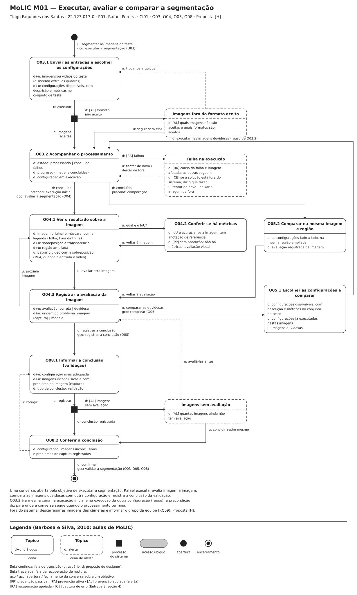
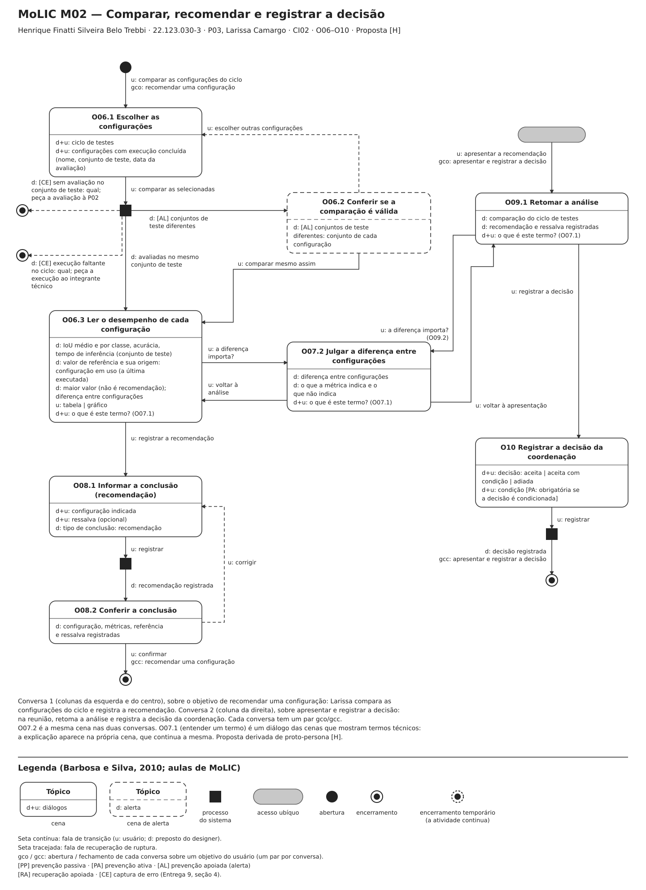

# Entrega 10 — MoLIC

**Data:** 14/11/2026 (início)  
**Status:** 🟨 em andamento  
**Responsabilidade:** 1 solução completa por integrante

## Objetivo da atividade

Modelar a interação como uma **conversa entre usuário e preposto do designer**, oferecendo visão global dos caminhos que permitem ao usuário atingir seus objetivos — incluindo alternativas e rupturas relevantes. MoLIC não deve ser reduzida a um fluxograma de telas.

> Use a **notação MoLIC ensinada na disciplina**. Este template foca critérios de qualidade e não substitui a legenda/notação apresentada em aula.

## Atenção a TCCs sem interface original

O MoLIC não modela o algoritmo por dentro. Ele modela a **conversa de interação necessária para que uma pessoa use a contribuição**.

Exemplos de conversas:

- usuário escolhe dados/parâmetros → sistema valida → usuário inicia análise → sistema comunica processamento → usuário interpreta resultado;
- usuário consulta histórico → refina filtros → abre execução → compara com outra;
- administrador seleciona perfil → altera permissão → sistema comunica consequências → administrador confirma/cancela;
- analista recebe alerta → examina evidências → classifica ocorrência → registra decisão.

Modele também rupturas plausíveis: entrada inválida, falha de processamento, ausência de resultado, permissão insuficiente, filtro sem resultados, conflito de alteração, cancelamento ou necessidade de recuperação.

## M01 — {{nome do cenário/objetivo}}

**Autor(a):** Tiago Fagundes dos Santos — 22.123.017-0  
**Cenário de interação de origem:** CI01 — Validação de segmentação e comparação de configurações sem scripts (P01, Rafael)  
**Objetivo(s):** O03, O04, O05, O08  
**Tarefa(s) relacionada(s):** T01, T02 (compartilhada com a P02), T03  
**Signos relevantes:** {{...}}

### Diagrama

**Fonte editável:** {{adicione aqui o link para o arquivo `.drawio`, `.svg` editável ou outro formato utilizado pela equipe}}

### Leitura do diagrama

Explique em texto o caminho principal e pelo menos os caminhos alternativos/rupturas mais importantes.

#### Caminho principal

1. {{ponto de abertura → cena...}}
2. {{...}}

#### Alternativas e rupturas

| Situação | Onde ocorre | Como o usuário percebe | Caminho de recuperação/saída |
|---|---|---|---|
| {{dado inválido}} | {{...}} | {{fala/feedback}} | {{...}} |

### Checklist específico de modelagem

- [ ] Existe **ponto de abertura** coerente com o início do objetivo.
- [ ] As **cenas de conversa** representam tópicos/assuntos, não nomes de páginas apenas.
- [ ] As transições/falas deixam claro o que o usuário ou o sistema comunica.
- [ ] Há **ponto(s) de encerramento** para objetivos concluídos/abandonados quando aplicável.
- [ ] Processamentos do sistema estão representados conforme a notação adotada em aula, sem “inventar” fala do usuário.
- [ ] Rupturas (breakdowns) relevantes têm feedback e caminho de recuperação, não becos sem saída.
- [ ] Acessos ubíquos/atalhos só aparecem quando semanticamente justificáveis.
- [ ] O diagrama cobre caminhos alternativos importantes, e não apenas o “happy path”.
- [ ] Nomes de objetivos, tópicos e signos são coerentes com a Entrega 9.
- [ ] O diagrama é legível em tamanho normal no GitHub.
- [ ] O MoLIC representa a conversa usuário–sistema, não o fluxo interno do algoritmo.
- [ ] Processamento, filtros, administração, relatórios e históricos incluem retornos/rupturas quando relevantes.

## M02 — Comparar, recomendar e registrar a decisão

**Autor(a):** Henrique Finatti Silveira Belo Trebbi — 22.123.030-3  
**Cenário de interação de origem:** CI02 — Recomendação de configuração a partir da comparação consolidada (P03, Larissa)  
**Objetivo(s):** O06, O07, O08, O09, O10  
**Tarefa(s) relacionada(s):** T04, T05  
**Signos relevantes:** ciclo de testes; configuração (nome, conjunto de teste, data da execução); IoU, acurácia e tempo de inferência; valor de referência e sua origem; maior valor; diferença entre configurações; conclusão do tipo recomendação; configuração indicada; ressalva; decisão da coordenação; condição (Entrega 9, seção 4)

### Diagrama

*Figura — MoLIC M02, por Henrique Finatti Silveira Belo Trebbi.*

**Fonte editável:** [`scripts/diagramas/molic_m02.py`](../scripts/diagramas/molic_m02.py),
 que usa os elementos de MoLIC de [`molic_svg.py`](../scripts/diagramas/molic_svg.py).

### Leitura do diagrama

Explique em texto o caminho principal e pelo menos os caminhos alternativos/rupturas mais importantes.

O diagrama tem um ponto de abertura do sistema e duas conversas sobre objetivos, cada uma com sua abertura (`gco`) e seu fechamento (`gcc`). A **conversa 1** (colunas da esquerda e do centro) acontece antes da reunião: Larissa compara as configurações do ciclo e registra a recomendação (O06, O07 e O08). A **conversa 2** (coluna da direita) acontece na reunião: ela retoma a análise e registra a decisão da coordenação (O09, O07 e O10). A conversa 1 começa no ponto de abertura; a conversa 2, em um acesso ubíquo.

#### Caminho principal

**Conversa 1 — comparar e recomendar**

1. **Ponto de abertura → O06.1 Escolher as configurações.** Com `u: comparar as configurações do ciclo` (`gco: comparar o desempenho, O06`), o sistema mostra o ciclo de testes e as configurações com execução concluída, cada uma com nome, conjunto de teste e data.
2. **O06.1 → processo do sistema.** Larissa escolhe as configurações e diz `u: comparar as selecionadas`. O sistema confere se todas têm execução concluída e se foram avaliadas no mesmo conjunto de teste.
3. **Processo → O06.3 Ler o desempenho de cada configuração.** Com `d: mesmo conjunto de teste`, o sistema mostra IoU médio e por classe, acurácia e tempo de inferência, o valor de referência e sua origem, o maior valor e a diferença entre configurações, em tabela ou em gráfico.
4. **O06.3 ⇄ O07.2 Julgar a diferença entre configurações.** Com `u: a diferença importa?`, o sistema mostra a diferença e o que a métrica indica e não indica, sem julgar se ela é relevante. Larissa volta com `u: voltar à análise`.
5. **O06.3 → O08.1 Informar a conclusão (recomendação).** Com `u: registrar a recomendação` (`gco: registrar a conclusão, O08`), Larissa informa a configuração indicada e, se quiser, uma ressalva.
6. **O08.1 → processo → O08.2 Conferir a conclusão.** Com `u: registrar`, o sistema guarda a recomendação e responde `d: recomendação registrada`, mostrando o que foi registrado.
7. **O08.2 → encerramento.** Com `u: confirmar` (`gcc: comparar e recomendar, O06 e O08`), a conversa termina.

**Conversa 2 — apresentar e decidir**

1. **Acesso ubíquo → O09.1 Retomar a análise.** Com `u: apresentar a recomendação` (`gco: apresentar, O09`), o sistema mostra a comparação do ciclo, a recomendação e a ressalva registradas.
2. **O09.1 ⇄ O07.2 Julgar a diferença entre configurações.** Se a coordenação pergunta se a diferença importa (O09.2), Larissa abre a **mesma cena** da conversa 1 e volta com `u: voltar à apresentação`.
3. **O09.1 → O10 Registrar a decisão da coordenação.** Com `u: registrar a decisão` (`gco: registrar a decisão, O10`), Larissa informa se a recomendação foi aceita, aceita com condição ou adiada e, se for o caso, a condição.
4. **O10 → processo → encerramento.** Com `u: registrar`, o sistema guarda a decisão e responde `d: decisão registrada` (`gcc: apresentar e decidir, O09 e O10`).

**Acesso ubíquo à explicação dos termos:** de qualquer cena, `u: o que é este termo?` leva a **O07.1 Entender um termo**, que mostra o que o termo indica e o que não indica. Com `u: voltar à cena anterior`, Larissa retorna à cena de onde veio; o diagrama desenha esse retorno para a O06.3, onde os termos aparecem com mais frequência.

#### Alternativas e rupturas

| Situação | Onde ocorre | Como o usuário percebe | Caminho de recuperação/saída |
|---|---|---|---|
| Uma configuração escolhida não tem execução concluída no ciclo | Processo depois da O06.1 | `d: [CE] configuração sem execução: peça ao integrante técnico` — o sistema diz qual configuração falta e o que fazer fora dele | Encerramento da conversa. Larissa pede a execução ao integrante técnico (fora do sistema) e volta depois pelo ponto de abertura |
| As configurações foram avaliadas em conjuntos de teste diferentes | Processo depois da O06.1 | `d: [AL] conjuntos de teste diferentes` — cena de alerta **O06.2 Conferir se a comparação é válida**, com o conjunto de teste de cada configuração | `u: escolher outras configurações` volta à O06.1 (seta tracejada); `u: comparar mesmo assim` segue para a O06.3, por decisão dela |
| Larissa não entende um termo (IoU, acurácia, referência) | Qualquer cena com métricas | Pede a explicação pelo acesso ubíquo | **O07.1** explica o que o termo indica e não indica (prevenção passiva) e ela volta à cena anterior |
| Larissa não sabe se a diferença entre as configurações importa | O06.3 ou O09.1 | `u: a diferença importa?` | **O07.2** mostra a diferença e os limites da métrica; o julgamento é dela, e ela pode registrar a incerteza como ressalva na O08.1 |
| A recomendação registrada tem um erro | O08.2 | Vê o registro na conferência e percebe o erro | `u: corrigir` volta à O08.1 (seta tracejada), com o que já foi informado |
| Decisão "aceita com condição" sem a condição | O10 | O sistema não aceita registrar a decisão sem a condição (`[PA]`, no diálogo da cena) | Prevenção ativa: a ruptura é evitada, por isso não há seta de erro |

### Checklist específico de modelagem

- [x] Existe **ponto de abertura** coerente com o início do objetivo. *(A conversa 1 começa no ponto de abertura do sistema; a conversa 2, no acesso ubíquo "apresentar a recomendação", porque a reunião pode começar de qualquer ponto.)*
- [x] As **cenas de conversa** representam tópicos/assuntos, não nomes de páginas apenas. *(Os tópicos usam os nomes oficiais da tabela de subtópicos da Entrega 9, seção 3.2.)*
- [x] As transições/falas deixam claro o que o usuário ou o sistema comunica. *(Falas `u:` e `d:` tiradas da conversa da Entrega 9, seção 2.2.)*
- [x] Há **ponto(s) de encerramento** para objetivos concluídos/abandonados quando aplicável. *(Três: fim da conversa 1 (`gcc` O06 e O08), fim da conversa 2 (`gcc` O09 e O10) e saída por captura de erro quando falta execução.)*
- [x] Processamentos do sistema estão representados conforme a notação adotada em aula, sem “inventar” fala do usuário. *(Três processos: validar a comparação, registrar a recomendação e registrar a decisão; as saídas são só falas `d:`.)*
- [x] Rupturas (breakdowns) relevantes têm feedback e caminho de recuperação, não becos sem saída. *(Conjuntos diferentes: alerta com duas saídas; execução faltante: captura de erro com orientação; recomendação errada: `u: corrigir`; condição obrigatória: prevenção ativa no diálogo.)*
- [x] Acessos ubíquos/atalhos só aparecem quando semanticamente justificáveis. *(Dois: explicação de termos, que aparecem em várias cenas (RC01), e apresentação da recomendação na reunião.)*
- [x] O diagrama cobre caminhos alternativos importantes, e não apenas o “happy path”. *(Ver "Alternativas e rupturas".)*
- [x] Nomes de objetivos, tópicos e signos são coerentes com a Entrega 9. *(Cenas O06.1–O10 e signos da seção 4; nomes alinhados em 14/11/2026, `PENDENCIAS.md`, INC-68.)*
- [x] O diagrama é legível em tamanho normal no GitHub. *(SVG gerado por script e conferido com `scripts/diagramas/verificar.js`: nenhum texto fora das caixas, sobreposto ou passando da borda.)*
- [x] O MoLIC representa a conversa usuário–sistema, não o fluxo interno do algoritmo. *(O cálculo das métricas não aparece; o sistema só exibe resultados e responde com falas `d:`.)*
- [x] Processamento, filtros, administração, relatórios e históricos incluem retornos/rupturas quando relevantes. *(Os processamentos têm saídas de erro. Filtros, administração, relatórios exportáveis e histórico estão fora do recorte (Entrega 1, seção 8; `PENDENCIAS.md`, INC-63; H08).)*

**Limitação conhecida:** a volta do acesso ubíquo O07.1 (`u: voltar à cena anterior`) está desenhada até a O06.3, onde os termos aparecem com mais frequência; na interação, ela leva de volta à cena de onde a pessoa veio.

## M03 — {{nome do cenário/objetivo}}

**Autor(a):** Mateus Marana Assuena — 22.123.026-1  
**Cenário de interação de origem:** CI03 — Treino e comparação de uma nova configuração em uma janela curta (P02, Andreia)  
**Objetivo(s):** O01, O02, O03, O05, O06 (O06.3, O06.4), O07 (O07.2), O08  
**Tarefa(s) relacionada(s):** T02 (compartilhada com a P01), T06, T07, T08  
**Signos relevantes:** {{...}}

### Diagrama

**Fonte editável:** {{adicione aqui o link para o arquivo `.drawio`, `.svg` editável ou outro formato utilizado pela equipe}}

### Leitura do diagrama

Explique em texto o caminho principal e pelo menos os caminhos alternativos/rupturas mais importantes.

#### Caminho principal

1. {{ponto de abertura → cena...}}
2. {{...}}

#### Alternativas e rupturas

| Situação | Onde ocorre | Como o usuário percebe | Caminho de recuperação/saída |
|---|---|---|---|
| {{dado inválido}} | {{...}} | {{fala/feedback}} | {{...}} |

### Checklist específico de modelagem

- [ ] Existe **ponto de abertura** coerente com o início do objetivo.
- [ ] As **cenas de conversa** representam tópicos/assuntos, não nomes de páginas apenas.
- [ ] As transições/falas deixam claro o que o usuário ou o sistema comunica.
- [ ] Há **ponto(s) de encerramento** para objetivos concluídos/abandonados quando aplicável.
- [ ] Processamentos do sistema estão representados conforme a notação adotada em aula, sem “inventar” fala do usuário.
- [ ] Rupturas (breakdowns) relevantes têm feedback e caminho de recuperação, não becos sem saída.
- [ ] Acessos ubíquos/atalhos só aparecem quando semanticamente justificáveis.
- [ ] O diagrama cobre caminhos alternativos importantes, e não apenas o “happy path”.
- [ ] Nomes de objetivos, tópicos e signos são coerentes com a Entrega 9.
- [ ] O diagrama é legível em tamanho normal no GitHub.
- [ ] O MoLIC representa a conversa usuário–sistema, não o fluxo interno do algoritmo.
- [ ] Processamento, filtros, administração, relatórios e históricos incluem retornos/rupturas quando relevantes.

## Consolidação da equipe

### Cobertura dos objetivos

| Objetivo | MoLIC que cobre | Lacunas/duplicidades | Decisão |
|---|---|---|---|
| O01 | M03 | {{...}} | {{...}} |
| O02 | M03 | {{...}} | {{...}} |
| O03 | M01, M03 | {{...}} | {{...}} |
| O04 | M01 | {{...}} | {{...}} |
| O05 | M01, M03 | {{...}} | {{...}} |
| O06 | M02, M03 | {{...}} | {{...}} |
| O07 | M02, M03 | {{...}} | {{...}} |
| O08 | M01, M02, M03 | {{...}} | {{...}} |
| O09 | M02 | {{...}} | {{...}} |
| O10 | M02 | {{...}} | {{...}} |

### Preparação para o Figma

Liste os estados/telas que serão necessários **a partir das conversas modeladas**, incluindo feedback, confirmação, erro e recuperação.

## Erros frequentes a evitar

- desenhar apenas caixas com nomes de telas e setas de navegação;
- não modelar falhas, cancelamento, volta ou recuperação;
- usar rótulos genéricos (“Tela 1”, “Processo 2”) sem tópico de conversa;
- criar no Figma fluxos que não existem no MoLIC;
- diagrama sem legenda/fonte editável e com texto ilegível.
