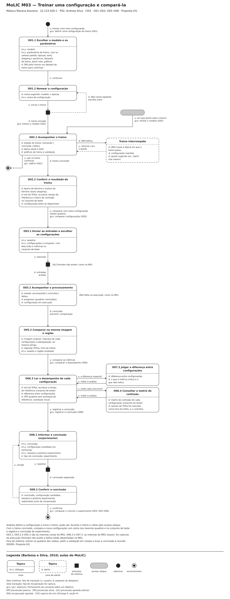

# Entrega 10 — MoLIC

**Data:** 14/11/2026 (início)  
**Status:** 🟨 em andamento  
**Responsabilidade:** 1 solução completa por integrante

## Objetivo da atividade

Modelar a interação como uma **conversa entre usuário e preposto do designer**, oferecendo visão global dos caminhos que permitem ao usuário atingir seus objetivos — incluindo alternativas e rupturas relevantes. MoLIC não deve ser reduzida a um fluxograma de telas.

> Use a **notação MoLIC ensinada na disciplina**. Este template foca critérios de qualidade e não substitui a legenda/notação apresentada em aula.

## Atenção a TCCs sem interface original

O MoLIC não modela o algoritmo por dentro. Ele modela a **conversa de interação necessária para que uma pessoa use a contribuição**.

Exemplos de conversas:

- usuário escolhe dados/parâmetros → sistema valida → usuário inicia análise → sistema comunica processamento → usuário interpreta resultado;
- usuário consulta histórico → refina filtros → abre execução → compara com outra;
- administrador seleciona perfil → altera permissão → sistema comunica consequências → administrador confirma/cancela;
- analista recebe alerta → examina evidências → classifica ocorrência → registra decisão.

Modele também rupturas plausíveis: entrada inválida, falha de processamento, ausência de resultado, permissão insuficiente, filtro sem resultados, conflito de alteração, cancelamento ou necessidade de recuperação.

## M01 — {{nome do cenário/objetivo}}

**Autor(a):** Tiago Fagundes dos Santos — 22.123.017-0  
**Cenário de interação de origem:** CI01 — Validação de segmentação e comparação de configurações sem scripts (P01, Rafael)  
**Objetivo(s):** O03, O04, O05, O08  
**Tarefa(s) relacionada(s):** T01, T02, T03  
**Signos relevantes:** {{...}}

### Diagrama

**Fonte editável:** {{adicione aqui o link para o arquivo `.drawio`, `.svg` editável ou outro formato utilizado pela equipe}}

### Leitura do diagrama

Explique em texto o caminho principal e pelo menos os caminhos alternativos/rupturas mais importantes.

#### Caminho principal

1. {{ponto de abertura → cena...}}
2. {{...}}

#### Alternativas e rupturas

| Situação | Onde ocorre | Como o usuário percebe | Caminho de recuperação/saída |
|---|---|---|---|
| {{dado inválido}} | {{...}} | {{fala/feedback}} | {{...}} |

### Checklist específico de modelagem

- [ ] Existe **ponto de abertura** coerente com o início do objetivo.
- [ ] As **cenas de conversa** representam tópicos/assuntos, não nomes de páginas apenas.
- [ ] As transições/falas deixam claro o que o usuário ou o sistema comunica.
- [ ] Há **ponto(s) de encerramento** para objetivos concluídos/abandonados quando aplicável.
- [ ] Processamentos do sistema estão representados conforme a notação adotada em aula, sem “inventar” fala do usuário.
- [ ] Rupturas (breakdowns) relevantes têm feedback e caminho de recuperação, não becos sem saída.
- [ ] Acessos ubíquos/atalhos só aparecem quando semanticamente justificáveis.
- [ ] O diagrama cobre caminhos alternativos importantes, e não apenas o “happy path”.
- [ ] Nomes de objetivos, tópicos e signos são coerentes com a Entrega 9.
- [ ] O diagrama é legível em tamanho normal no GitHub.
- [ ] O MoLIC representa a conversa usuário–sistema, não o fluxo interno do algoritmo.
- [ ] Processamento, filtros, administração, relatórios e históricos incluem retornos/rupturas quando relevantes.

## M02 — {{nome do cenário/objetivo}}

**Autor(a):** Henrique Finatti Silveira Belo Trebbi — 22.123.030-3  
**Cenário de interação de origem:** CI02 — Recomendação de configuração a partir da comparação consolidada (P03, Larissa)  
**Objetivo(s):** O06, O07, O08, O09, O10  
**Tarefa(s) relacionada(s):** T04, T05  
**Signos relevantes:** {{...}}

### Diagrama

**Fonte editável:** {{adicione aqui o link para o arquivo `.drawio`, `.svg` editável ou outro formato utilizado pela equipe}}

### Leitura do diagrama

Explique em texto o caminho principal e pelo menos os caminhos alternativos/rupturas mais importantes.

#### Caminho principal

1. {{ponto de abertura → cena...}}
2. {{...}}

#### Alternativas e rupturas

| Situação | Onde ocorre | Como o usuário percebe | Caminho de recuperação/saída |
|---|---|---|---|
| {{dado inválido}} | {{...}} | {{fala/feedback}} | {{...}} |

### Checklist específico de modelagem

- [ ] Existe **ponto de abertura** coerente com o início do objetivo.
- [ ] As **cenas de conversa** representam tópicos/assuntos, não nomes de páginas apenas.
- [ ] As transições/falas deixam claro o que o usuário ou o sistema comunica.
- [ ] Há **ponto(s) de encerramento** para objetivos concluídos/abandonados quando aplicável.
- [ ] Processamentos do sistema estão representados conforme a notação adotada em aula, sem “inventar” fala do usuário.
- [ ] Rupturas (breakdowns) relevantes têm feedback e caminho de recuperação, não becos sem saída.
- [ ] Acessos ubíquos/atalhos só aparecem quando semanticamente justificáveis.
- [ ] O diagrama cobre caminhos alternativos importantes, e não apenas o “happy path”.
- [ ] Nomes de objetivos, tópicos e signos são coerentes com a Entrega 9.
- [ ] O diagrama é legível em tamanho normal no GitHub.
- [ ] O MoLIC representa a conversa usuário–sistema, não o fluxo interno do algoritmo.
- [ ] Processamento, filtros, administração, relatórios e históricos incluem retornos/rupturas quando relevantes.

## M03 — {{nome do cenário/objetivo}}

**Autor(a):** Mateus Marana Assuena — 22.123.026-1  
**Cenário de interação de origem:** CI03 — Treino e comparação de uma nova configuração em uma janela curta (P02, Andreia)  
**Objetivo(s):** O01, O02, O03, O05, O06 (O06.3, O06.4), O07 (O07.2), O08  
**Tarefa(s) relacionada(s):** T02, T06, T07, T08  
**Signos relevantes:** {{...}}

### Diagrama

**Fonte editável:** {{adicione aqui o link para o arquivo `.drawio`, `.svg` editável ou outro formato utilizado pela equipe}}

### Leitura do diagrama

Explique em texto o caminho principal e pelo menos os caminhos alternativos/rupturas mais importantes.

#### Caminho principal

1. {{ponto de abertura → cena...}}
2. {{...}}

#### Alternativas e rupturas

| Situação | Onde ocorre | Como o usuário percebe | Caminho de recuperação/saída |
|---|---|---|---|
| {{dado inválido}} | {{...}} | {{fala/feedback}} | {{...}} |

### Checklist específico de modelagem

- [ ] Existe **ponto de abertura** coerente com o início do objetivo.
- [ ] As **cenas de conversa** representam tópicos/assuntos, não nomes de páginas apenas.
- [ ] As transições/falas deixam claro o que o usuário ou o sistema comunica.
- [ ] Há **ponto(s) de encerramento** para objetivos concluídos/abandonados quando aplicável.
- [ ] Processamentos do sistema estão representados conforme a notação adotada em aula, sem “inventar” fala do usuário.
- [ ] Rupturas (breakdowns) relevantes têm feedback e caminho de recuperação, não becos sem saída.
- [ ] Acessos ubíquos/atalhos só aparecem quando semanticamente justificáveis.
- [ ] O diagrama cobre caminhos alternativos importantes, e não apenas o “happy path”.
- [ ] Nomes de objetivos, tópicos e signos são coerentes com a Entrega 9.
- [ ] O diagrama é legível em tamanho normal no GitHub.
- [ ] O MoLIC representa a conversa usuário–sistema, não o fluxo interno do algoritmo.
- [ ] Processamento, filtros, administração, relatórios e históricos incluem retornos/rupturas quando relevantes.

## Consolidação da equipe

### Cobertura dos objetivos

| Objetivo | MoLIC que cobre | Lacunas/duplicidades | Decisão |
|---|---|---|---|
| O01 | M03 | {{...}} | {{...}} |
| O02 | M03 | {{...}} | {{...}} |
| O03 | M01, M03 | {{...}} | {{...}} |
| O04 | M01 | {{...}} | {{...}} |
| O05 | M01, M03 | {{...}} | {{...}} |
| O06 | M02, M03 | {{...}} | {{...}} |
| O07 | M02, M03 | {{...}} | {{...}} |
| O08 | M01, M02, M03 | {{...}} | {{...}} |
| O09 | M02 | {{...}} | {{...}} |
| O10 | M02 | {{...}} | {{...}} |

### Preparação para o Figma

Liste os estados/telas que serão necessários **a partir das conversas modeladas**, incluindo feedback, confirmação, erro e recuperação.

## Erros frequentes a evitar

- desenhar apenas caixas com nomes de telas e setas de navegação;
- não modelar falhas, cancelamento, volta ou recuperação;
- usar rótulos genéricos (“Tela 1”, “Processo 2”) sem tópico de conversa;
- criar no Figma fluxos que não existem no MoLIC;
- diagrama sem legenda/fonte editável e com texto ilegível.
