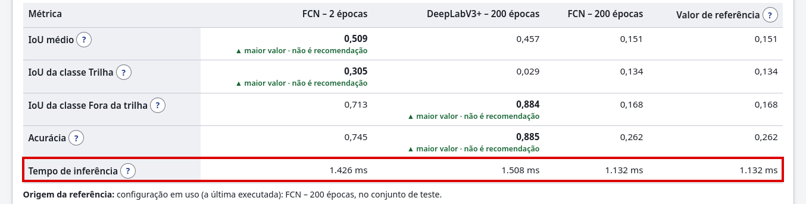
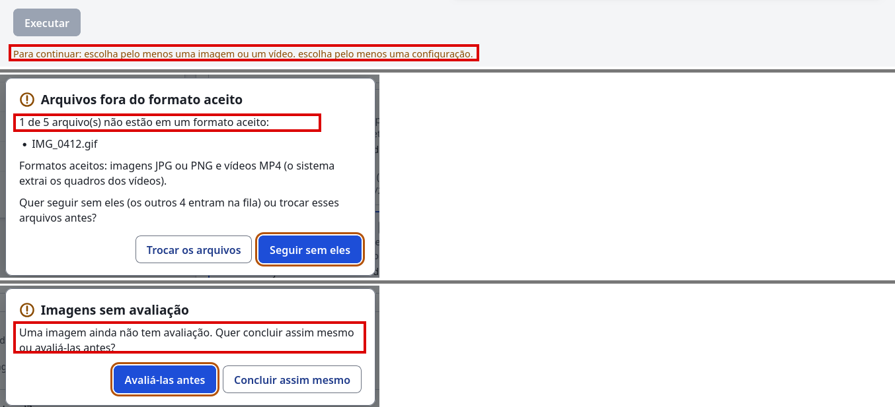
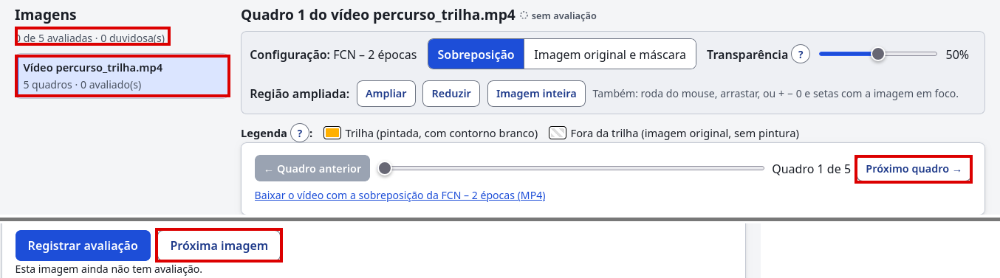
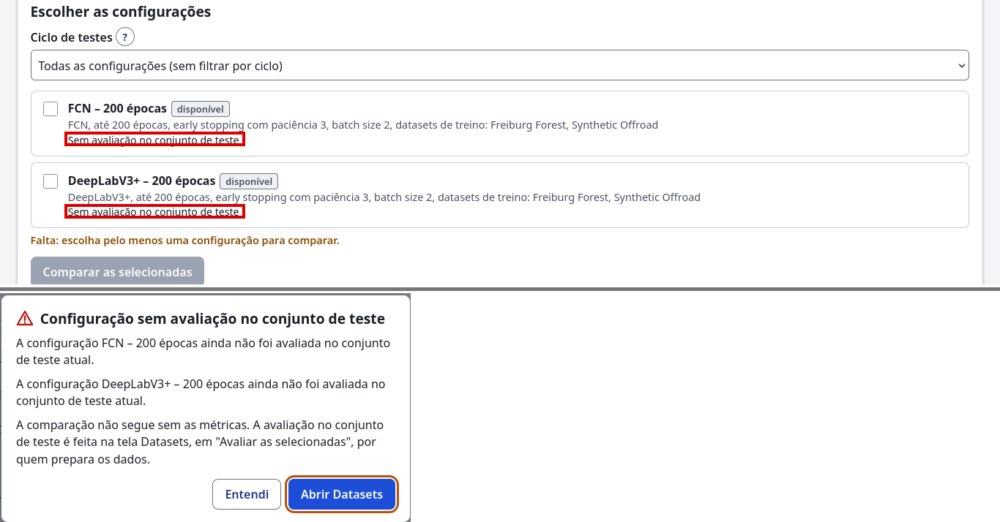
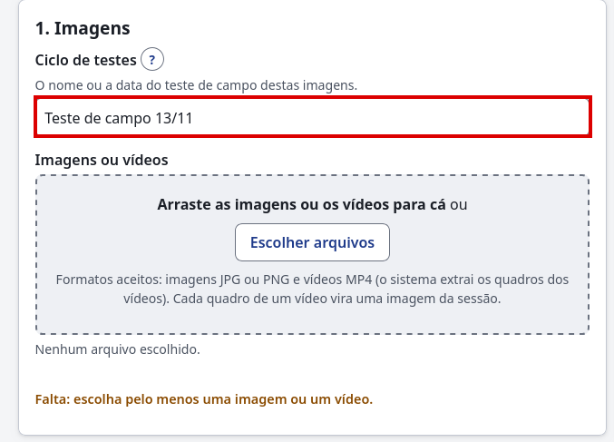
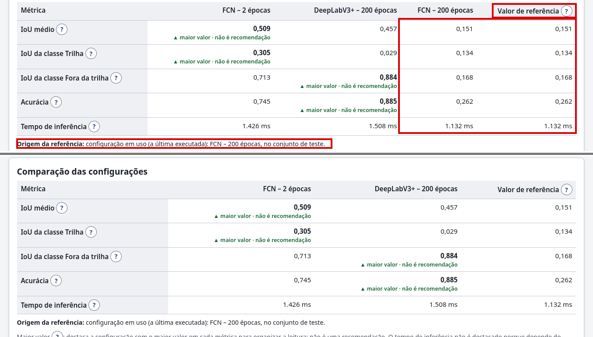
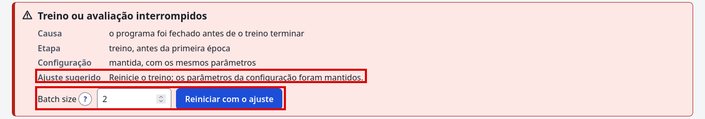
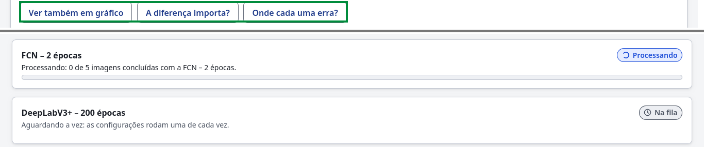
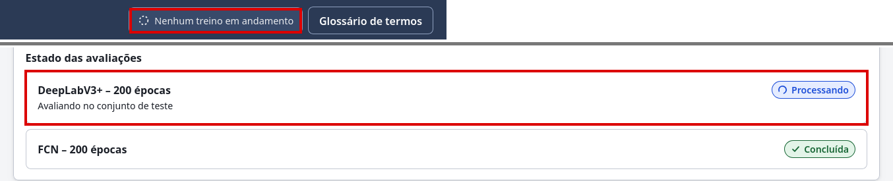

# Entrega 13 — Avaliação de IHC por inspeção heurística

**Data:** 20/11/2026 (início)  
**Status:** 🟨 em andamento  
**Responsabilidade:** 1 avaliação completa por integrante, sobre todas as telas/estados relevantes do projeto.

## Objetivo da atividade

Encontrar problemas de usabilidade por inspeção sistemática da interface com as **10 heurísticas de Nielsen**. Cada avaliador trabalha individualmente primeiro; depois a equipe consolida problemas duplicados e prioridades.

> **Parte de violações:** registre somente problemas reais. Não invente uma violação para “preencher” cada heurística. Para provar que todas foram exercitadas, use a **matriz de cobertura H1–H10**. Para heurísticas sem violação, a disciplina solicita um exemplo didático de boa prática.

## 1. Heurísticas adotadas

1. Visibilidade do status do sistema
2. Compatibilidade entre o sistema e o mundo real
3. Controle e liberdade do usuário
4. Consistência e padrões
5. Prevenção de erros
6. Reconhecimento em vez de memorização
7. Flexibilidade e eficiência de uso
8. Estética e design minimalista
9. Ajudar usuários a reconhecer, diagnosticar e recuperar-se de erros
10. Ajuda e documentação

## Cobertura especial para interfaces administrativas e analíticas

Quando existirem, não limite a avaliação às “telas principais”. Inspecione também:

- dashboard em estados normal, vazio e erro;
- filtros sem resultado e filtros combinados;
- relatórios e exportação;
- histórico/listas longas;
- formulários CRUD (criação, edição, exclusão, validação);
- alteração de perfil/permissão;
- confirmações de ações destrutivas;
- processamento/loading/progresso;
- falha e recuperação;
- comparação de resultados;
- mensagens de termos técnicos, métricas e recomendações;
- ajuda/documentação contextual.

Em TCCs técnicos, observe especialmente se a interface comunica o estado do processamento e traduz informações técnicas para o vocabulário do usuário escolhido.

## 2. Escopo da inspeção

| Item | Definição |
|---|---|
| Versão avaliada | Interface implementada na Entrega 11: https://github.com/HenriqueFinatti/Segmentacao-Semantica-Off-Road, ramo `interface`, commit `16a5bc1` (20/11/2026), identificado no rodapé de cada tela; é a versão única das Entregas 13 e 14 (Entrega 11, "Acesso ao protótipo") |
| Telas/estados | TL01 Configuração de treino: escolher o modelo e os parâmetros; sem dataset de treino (PA); nomear a configuração; nome repetido (RA). TL02 Estado do treino: na fila; treinando; avaliação no conjunto de teste; resultado do treino; treino ou avaliação interrompidos (RA); falta de memória, com sugestão de batch size menor (RA). TL03 Entradas e configurações: entradas e configurações obrigatórias (PA); envio de imagens ou vídeos e escolha das configurações; arquivos fora do formato aceito (AL). TL04 Processamento: na fila; processando; falha numa imagem e numa configuração inteira (RA e CE); concluído. TL05 Resultado e avaliação da imagem: sem sessão (vazio); sobreposição e sem métricas (PP); imagem original e máscara; região ampliada; avaliação registrada; quadro de vídeo e download do MP4. TL06 Comparação na mesma imagem: configuração obrigatória (PA); escolher as configurações a comparar; comparar na mesma região, com sobreposição e com máscara. TL07 Desempenho consolidado: configurações obrigatórias (PA); sem avaliação no conjunto de teste (CE); conjuntos de teste diferentes (AL); execução faltante no ciclo (CE); sem valor de referência (vazio); valor de referência e maior valor; gráfico; a diferença importa?; matriz de confusão. TL08 Conclusão: validação, experimento e recomendação, cada uma com campo obrigatório (PA), conferência e correção; imagens sem avaliação (AL). TL09 Apresentação e decisão: sem recomendação (vazio); retomar a análise; responder a uma dúvida; condição obrigatória (PA); decisão registrada. TL10 Explicação dos termos: explicação junto do termo, aberta pelo botão "?"; glossário de termos, aberto pelo botão do topo. TL11 Datasets: conferir os datasets; confirmar a remontagem (AL); montagem na fila; dataset montado; avaliar as selecionadas (PA); falha na avaliação (RA e CE); avaliando; avaliação concluída. Elementos de todas as telas: menu, indicador do treino e da avaliação no topo, rodapé com a versão. As capturas de referência são as da Entrega 11 (`assets/11_figma/`) |
| Fluxos | M01 (P01, Rafael), M02 (P03, Larissa) e M03 (P02, Andreia), da Entrega 10 revista em 20/11/2026; a TL11 é a conversa "preparar os dados de treino e de teste" (O11) do M03 |
| Percursos de acessibilidade | Os sete percursos completos da Entrega 11 ("Verificação de acessibilidade básica"), feitos só com teclado e com ampliação de 200% do navegador e, quando possível, com leitor de tela `[?]` |
| Dispositivo/viewport | Computador que executa os modelos, com mouse e teclado, e a interface no navegador desse computador, em endereço local e sem internet (Entrega 8, §1; Entrega 12, seção C). Resolução da tela e navegador: `[?]` |
| Avaliadores | AV01 — Henrique Finatti Silveira Belo Trebbi; AV02 — Tiago Fagundes dos Santos; AV03 — Mateus Marana Assuena. Cada um inspeciona sozinho, sem conhecer os achados dos outros, antes da consolidação (seção 7) |

**Identificadores desta entrega:** H1 a H10 são as heurísticas de Nielsen (não confundir com as hipóteses H01 a H12 da Entrega 1); AV01 a AV03 são os avaliadores; cada avaliador numera as próprias violações a partir de V01, e elas são citadas com o avaliador, como "V01 (AV02)"; HC01… são os problemas consolidados da equipe. As capturas de cada avaliador ficam em `assets/13_heuristica/av01/`, `av02/` e `av03/`.

## 3. Procedimento individual

Cada avaliador deve:

1. percorrer os fluxos/telas ao menos uma vez para familiarização;
2. inspecionar novamente aplicando sistematicamente H1–H10;
3. registrar cada problema com evidência e contexto;
4. atribuir severidade **depois de compreender bem o problema**, justificando a decisão;
5. não discutir achados com os demais antes de terminar a inspeção individual, quando o objetivo for preservar independência.

### Escala de severidade (0–4)

| Grau | Interpretação |
|---:|---|
| 0 | não é considerado problema de usabilidade |
| 1 | problema cosmético; corrigir se houver tempo |
| 2 | problema menor; baixa prioridade |
| 3 | problema maior; alta prioridade |
| 4 | catástrofe de usabilidade; correção imperativa antes de disponibilizar |

Ao justificar, considere **frequência, impacto e persistência** do problema no contexto real de uso.

---

## Avaliador AV01 — Henrique Finatti Silveira Belo Trebbi

**Autor(a):** Henrique Finatti Silveira Belo Trebbi — 22.123.030-3  
**Data da inspeção:** 20/11/2026  
**Versão inspecionada:** commit `16a5bc1`  
**Computador, tela, resolução e navegador:** a interface não foi executada nesta inspeção. Foram inspecionadas as 59 capturas da Entrega 11 (`assets/11_figma/`), feitas em 20/11/2026 no commit `16a5bc1`: capturas da área visível com 1366 × 814 px e capturas da página inteira com 1354 px de largura. Navegador das capturas: `[?]`  
**Tempo gasto na inspeção:** não medido  
**Forma da inspeção:** pelas capturas da Entrega 11, com apoio do Claude. Textos e comportamentos que as capturas não mostram foram conferidos no código da interface do mesmo commit. Como a interface não foi executada, os percursos de acessibilidade (teclado, ampliação e leitor de tela) não foram feitos.

### 4. Cobertura das telas, dos estados e das heurísticas

#### Telas e estados examinados

Os estados de cada tela são os da seção 2 ("Telas/estados"). A falta de memória no treino não pode ser provocada no equipamento: é examinada pela mensagem implementada (Entrega 11) e marcada como "examinada sem reproduzir". As capturas são citadas pela tela e pelo número, como TL02/05.

| Tela | Estados examinados | Examinado? | Observação (motivo, se não examinado) |
|---|---|---|---|
| TL01 Configuração de treino | Escolher o modelo e os parâmetros (TL01/01); sem dataset de treino, PA (TL01/02); nomear a configuração (TL01/03); nome repetido, RA (TL01/04) | sim | — |
| TL02 Estado do treino (inclui treino interrompido e falta de memória) | Na fila (TL02/01); treinando (TL02/02); treino concluído e avaliação no conjunto de teste na fila (TL02/03); resultado do treino depois da avaliação (TL02/04); treino ou avaliação interrompidos, RA, com a causa "programa fechado" (TL02/05); falta de memória | sim | Falta de memória examinada sem reproduzir: a mensagem foi conferida no código (causa "faltou memória no computador" e batch size sugerido, igual à metade do atual, já preenchido no campo). A avaliação no estado "processando" não foi capturada; só o estado "na fila" |
| TL03 Entradas e configurações | Entradas e configurações obrigatórias, PA (TL03/01); envio das imagens e escolha das configurações (TL03/02); arquivos fora do formato aceito, AL (TL03/03) | sim | O envio de um vídeo foi examinado pelo resultado (TL05/06) |
| TL04 Processamento (inclui falha na execução) | Na fila e processando (TL04/01); falha numa imagem, RA, e numa configuração inteira, CE (TL04/02); concluído (TL04/03) | sim | — |
| TL05 Resultado e avaliação da imagem | Sem sessão (TL05/01); sobreposição e sem métricas, PP (TL05/02); imagem original e máscara (TL05/03); região ampliada (TL05/04); avaliação registrada (TL05/05); quadro de vídeo e download do MP4 (TL05/06) | sim | O download do MP4 foi examinado só pelo link; o arquivo não foi aberto |
| TL06 Comparação na mesma imagem | Configuração obrigatória, PA (TL06/01); escolher as configurações a comparar (TL06/02); comparar na mesma região, com sobreposição (TL06/03) e com máscara (TL06/04) | sim | — |
| TL07 Desempenho consolidado | Configurações obrigatórias, PA (TL07/01); sem avaliação no conjunto de teste, CE (TL07/02); conjuntos de teste diferentes, AL (TL07/03); execução faltante no ciclo, CE (TL07/04); sem valor de referência (TL07/05); valor de referência e maior valor (TL07/06); gráfico (TL07/07); a diferença importa? (TL07/08); matriz de confusão (TL07/09) | sim | A TL07/04 está rolada e não mostra o topo da tela, mas o diálogo aparece inteiro. A variante do alerta de conjuntos diferentes vinda da TL06 ("Voltar aos quadros") foi conferida só no código |
| TL08 Conclusão | Validação: informar (TL08/01), imagens sem avaliação, AL (TL08/02), conferir (TL08/03). Experimento: conclusão obrigatória, PA (TL08/04), informar (TL08/05), conferir (TL08/06). Recomendação: configuração obrigatória, PA (TL08/07), informar (TL08/08), conferir (TL08/09), corrigir (TL08/10) | sim | A correção foi examinada só na recomendação; a da validação e a do experimento usam a mesma tela (Entrega 11) |
| TL09 Apresentação e decisão | Sem recomendação (TL09/01); retomar a análise (TL09/02); responder a uma dúvida (TL09/03); condição obrigatória, PA (TL09/04); decisão registrada (TL09/05) | sim | — |
| TL10 Explicação dos termos | Explicação junto do termo (TL10/01); glossário de termos (TL10/02) | sim | O fechamento pela tecla Esc e pelo clique fora da explicação foi conferido no código |
| TL11 Datasets | Conferir os datasets; confirmar a remontagem, AL (TL11/02); montagem na fila (TL11/03); dataset montado (TL11/04); avaliar as selecionadas, PA (TL11/05); falha na avaliação, RA e CE (TL11/06); avaliando (TL11/07); avaliação concluída (TL11/08) | sim | A TL11/01 mostra o diálogo da TL07 aberto sobre a tela Datasets, um estado que a interface não produz (`PENDENCIAS.md`, INC-74); a conferência dos datasets foi examinada nas TL11/02 a TL11/08. A montagem no estado "processando" não foi capturada |
| Elementos de todas as telas | Menu; indicador do treino e da avaliação no topo (na fila, treinando, avaliação na fila, concluído, interrompidos, nenhum treino em andamento); botão "Glossário de termos"; link "←" para a cena anterior; rodapé com o que o sistema faz e a versão | sim | Examinados nas 59 capturas |

#### Matriz das 10 heurísticas

| Heurística | Telas/fluxos examinados | Houve violação? | IDs dos achados | Exemplo de boa prática se não violada |
|---|---|---|---|---|
| H1 | TL02 (estados do treino e da avaliação), TL04 (estados da execução e falhas), TL05 (avaliação registrada), TL11 (montagem e avaliação), indicador do topo | sim | V01, V02 | — |
| H2 | Todas as telas: termos, legenda, rótulos, mensagens e formato das métricas | sim | V03, V04 | — |
| H3 | Diálogos com saída (TL03/03, TL07/03, TL08/02, TL11/02), "Corrigir" (TL08), link "←", explicação do termo e glossário (TL10) | sim | V05 | — |
| H4 | Rótulos e contagens entre telas, selos de estado, campo obrigatório (TL01, TL03, TL06, TL07, TL08, TL09, TL11), imagem e vídeo (TL05), dataset (TL01 × TL11) | sim | V06, V07 | — |
| H5 | Campos obrigatórios, nome repetido (TL01/04), formato (TL03/03), ciclo de testes (TL03), escolha de configurações (TL07), remontagem (TL11/02) | sim | V08, V09 | — |
| H6 | Tabelas de métricas (TL07, TL08, TL09), configurações com descrição e métricas (TL03, TL06), avaliação registrada visível (TL05, TL06) | sim | V10 | — |
| H7 | Visualizador (TL05, TL06), comparação das duvidosas (TL05 → TL06), avanço entre imagens (TL05) | não | — | Atalhos do visualizador (roda do mouse, arrastar, + − 0 e setas) ao lado dos botões, e imagens duvidosas já marcadas ao comparar (seção 6) |
| H8 | Todas as telas, com atenção à TL04 (processamento) e à TL07 (desempenho) | não | — | Gráfico, diferença e matriz de confusão aparecem só quando pedidos; a TL04 mostra só estado, progresso e configuração (seção 6) |
| H9 | Falhas na execução (TL04/02), treino ou avaliação interrompidos (TL02/05), falha na avaliação (TL11/06), CE e AL da TL07, imagens sem avaliação (TL08/02) | sim | V11, V12 | — |
| H10 | Explicação junto do termo e glossário (TL10), textos de ajuda dos campos (TL01, TL03), rodapé | não | — | Explicação de cada termo no ponto de uso, com o que indica e o que não indica (seção 6) |

### 5. Declaração de violações

| ID | Heurística | Tela/estado | Ação ou condição | Problema observado | Consequência para quem usa | Evidência | Severidade | Justificativa da severidade | Recomendação |
|---|---|---|---|---|---|---|---:|---|---|
| V01 | H1 | TL04, falha numa imagem (TL04/02) | A execução de uma configuração termina com uma imagem que falhou | O cartão da FCN – 2 épocas mostra o selo verde "Concluído", embora tenha uma falha esperando a decisão "Tentar de novo" ou "Deixar de fora" | Quem lê só os selos pode achar que a execução terminou sem pendência e seguir para a avaliação com uma imagem a menos, sem ter decidido o que fazer com ela |  | 2 | Frequência baixa (só quando uma imagem falha); impacto moderado, porque a caixa vermelha logo abaixo do selo reduz o risco de não ver a falha; persistência baixa, porque a pessoa aprende a olhar a caixa | Mostrar um selo próprio enquanto houver falha a decidir (ex.: "Concluído com 1 falha", em âmbar) e passar a "Concluído" só depois da decisão |
| V02 | H1 | TL05, avaliação registrada (TL05/05) | Rafael registra a avaliação de uma imagem | Depois do registro, a lista à esquerda e a linha "Registrado: duvidosa, problema no modelo" mostram a avaliação, mas o selo ao lado do nome da imagem, no título, continua "sem avaliação" | A tela diz duas coisas diferentes sobre a mesma imagem; a pessoa pode achar que o registro falhou e registrar de novo, ou desconfiar da contagem de avaliadas |  | 2 | Frequência alta (acontece em todo registro); impacto baixo, porque a lista e a linha de confirmação estão certas; persistência baixa, porque a pessoa aprende a confiar na lista | Atualizar o selo do título junto com a lista no momento do registro |
| V03 | H2 | TL07, valor de referência e maior valor (TL07/06); também TL02/04, TL08 e TL09 | Leitura do tempo de inferência na tabela de métricas | O tempo aparece como "1.426 ms", com ponto como separador de milhar, na mesma tabela em que as outras métricas usam vírgula decimal (0,509) | Quem tem o hábito de ler números com ponto decimal, como os integrantes da Baja que usam ferramentas de engenharia, pode ler 1,4 ms em vez de 1,4 s e julgar errado se a configuração atende ao tempo de resposta necessário no carro |  | 2 | Frequência alta (toda leitura do tempo de inferência); impacto moderado, porque a comparação entre configurações continua certa, mas o valor absoluto pode ser lido mil vezes menor; persistência moderada, porque o formato se repete em quatro telas | Mostrar o tempo em segundos com vírgula decimal (ex.: "1,43 s") ou em milissegundos sem separador de milhar, e explicar a unidade no "?" do termo |
| V04 | H2 | TL03, campos obrigatórios (TL03/01) e arquivos fora do formato (TL03/03); TL08, imagens sem avaliação (TL08/02) | Mensagens montadas pelo sistema a partir de partes | Erros de escrita nas mensagens: "…ou um vídeo. escolha pelo menos uma configuração" (minúscula depois do ponto); "1 de 5 arquivo(s) não estão"; "Uma imagem ainda não tem avaliação… avaliá-las antes" (plural para uma imagem) | A mensagem parece descuidada e exige uma segunda leitura, sem impedir a tarefa |  | 1 | Problema cosmético: aparece em três mensagens e não muda o entendimento nem a ação | Ajustar a concordância à quantidade ("1 arquivo não está", "avaliá-la") e começar cada mensagem com maiúscula ao juntar duas mensagens no resumo "Para continuar" |
| V05 | H3 | TL10, glossário de termos (TL10/02) | A pessoa abre o glossário pelo botão do topo | O único botão para fechar o painel, "Voltar à cena anterior", fica no fim da lista de termos, fora da área visível quando o painel abre; o título do painel ("O que é este termo?") também não é o nome do botão que o abriu ("Glossário de termos"). "Cena" é um termo do MoLIC, não da Baja | Quem abriu o glossário para consultar um termo não vê como sair dele; pode clicar no menu e perder o que estava fazendo na tela de baixo |  | 2 | Frequência moderada (a cada abertura do glossário); impacto moderado, porque há saídas (tecla Esc, menu), mas não visíveis; persistência baixa, porque a pessoa aprende onde está o botão | Pôr um botão "Fechar" fixo no topo do painel, ao lado do título, e usar o mesmo nome no botão e no título ("Glossário de termos") |
| V06 | H4 | TL05, quadro de vídeo (TL05/06) | Rafael avalia os quadros de um vídeo | A mesma tela usa "quadro" e "imagem" para a mesma coisa: "Próximo quadro" no navegador do vídeo e "Próxima imagem" junto de "Registrar avaliação"; a contagem diz "0 de 5 avaliadas" e, logo abaixo, "5 quadros · 0 avaliado(s)" | Não fica claro se "Próxima imagem" avança para o próximo quadro ou sai do vídeo; a pessoa pode pular quadros sem avaliá-los ou hesitar a cada quadro |  | 2 | Frequência alta quando a entrada é vídeo (a cada quadro); impacto moderado (risco de pular quadros); persistência baixa, porque a pessoa descobre o efeito depois do primeiro clique | Quando a entrada for vídeo, usar "quadro" em todos os rótulos e contagens ("Próximo quadro", "0 de 5 quadros avaliados") e deixar um único botão de avanço |
| V07 | H4 | TL11, montagem na fila (TL11/03); TL01, escolher o modelo e os parâmetros (TL01/01) | Andreia confere os dados antes de treinar ou avaliar | A TL11 diz "O dataset ainda não foi montado pela interface", logo abaixo de um conjunto de teste atual com 12 imagens; na TL01, os mesmos datasets aparecem como "5 imagens de treino no dataset montado" | A pessoa pode concluir que os dados não estão prontos e remontar o dataset sem necessidade; a remontagem pode mudar o conjunto de teste e obrigar a avaliar de novo todas as configurações |  | 2 | Frequência baixa (até a primeira montagem pela interface); impacto alto se levar à remontagem, reduzido pelo alerta de confirmação (TL11/02); persistência baixa, porque a mensagem some depois da primeira montagem | Dizer o que existe (ex.: "Dataset montado fora da interface; conjunto de teste atual: …") e reservar "não montado" para quando não houver dataset |
| V08 | H5 | TL07, escolher as configurações (TL07/01), sem avaliação no conjunto de teste (TL07/02) e execução faltante no ciclo (TL07/04) | Larissa ou Andreia escolhem as configurações a comparar | Os cartões já dizem "Sem avaliação no conjunto de teste" ou "Sem execução concluída neste ciclo de testes", mas essas configurações podem ser marcadas; o erro só aparece depois de "Comparar as selecionadas". Para Larissa, o diálogo oferece "Abrir Datasets", tela de uma tarefa da P02, e diz que a avaliação é feita "por quem prepara os dados" | A pessoa faz uma escolha que o sistema já sabe que não vai funcionar e só descobre depois de pedir a comparação; Larissa recebe um caminho para uma tela que não é dela |  | 2 | Frequência moderada (sempre que houver configuração nova ou ciclo incompleto); impacto baixo a moderado, porque há recuperação (o diálogo explica e devolve à escolha); persistência baixa | Impedir antes: deixar essas configurações sem caixa de seleção, com o motivo no próprio cartão e, para a P02, o atalho "Avaliar em Datasets"; para quem não prepara os dados, só a explicação |
| V09 | H5 | TL03, campos obrigatórios (TL03/01) | Rafael abre "Segmentar imagens" para enviar as imagens de um novo teste de campo | Com o formulário vazio, o campo "Ciclo de testes" já vem preenchido com o último ciclo usado ("Teste de campo 13/11"); conferido no código, que preenche o campo com o ciclo mais recente | Se a pessoa não reparar, as execuções do novo teste entram no ciclo anterior. A comparação por ciclo (TL07), a conclusão da validação (TL08) e a apresentação (TL09) passam a misturar dois testes de campo, sem nenhum aviso |  | 3 | Frequência alta (todo primeiro envio de um novo teste de campo); impacto alto, porque o erro é silencioso e contamina a conclusão levada à reunião; persistência alta, porque o campo preenchido parece correto e o erro se repete a cada teste. A TL04 e a TL05 mostram o nome do ciclo, o que permite notar o erro depois, mas não corrigi-lo | Começar o campo vazio e sugerir os ciclos existentes na lista; ou, se mantiver a sugestão, destacá-la como "ciclo anterior" e pedir confirmação quando as imagens forem de outra data |
| V10 | H6 | TL07, valor de referência e maior valor (TL07/06); também TL08 e TL09 (TL09/02) | Leitura da tabela de métricas | A coluna "Valor de referência" não diz no cabeçalho de qual configuração vem; a origem está numa linha abaixo da tabela. Quando a configuração em uso está na comparação, a coluna repete os valores dela (FCN – 200 épocas na TL07/06); quando não está, mostra valores de uma configuração que não aparece na tabela (TL09/02) | Para entender a coluna, a pessoa precisa lembrar ou procurar a linha de origem; pode ler a referência como uma quarta configuração ou como uma meta. Na reunião (TL09), Larissa fica sem resposta imediata para "referência de quê?" |  | 2 | Frequência alta (toda tabela de métricas, em três telas); impacto moderado, porque a explicação existe, mas longe da coluna; persistência moderada | Pôr a origem no cabeçalho (ex.: "Referência: FCN – 200 épocas, em uso") e, quando a configuração em uso estiver na tabela, marcar a coluna dela com "em uso" em vez de repeti-la |
| V11 | H9 | TL08, imagens sem avaliação (TL08/02) | Rafael registra a conclusão da validação com uma imagem ainda sem avaliação | O alerta diz que "uma imagem ainda não tem avaliação", mas não diz qual | Para decidir entre "Avaliá-las antes" e "Concluir assim mesmo", a pessoa não sabe se a imagem que falta é relevante; "Avaliá-las antes" leva à primeira imagem sem avaliação (conferido no código), o que reduz o impacto |  | 1 | Frequência baixa (só quando falta avaliar alguma imagem); impacto baixo, porque o caminho de volta leva à imagem certa; persistência baixa | Listar no alerta o nome das imagens sem avaliação |
| V12 | H9 | TL02, treino ou avaliação interrompidos (TL02/05) | O treino é interrompido porque o programa foi fechado | Para essa causa, o "Ajuste sugerido" é "Reinicie o treino", mas o botão se chama "Reiniciar com o ajuste" e o batch size aparece como campo editável, como na falta de memória | A pessoa pode achar que precisa mudar o batch size para reiniciar e alterar sem necessidade um parâmetro da configuração |  | 1 | Frequência baixa (só quando o programa é fechado durante o treino); impacto baixo, porque o valor já vem preenchido com o atual; persistência baixa | Quando a causa não pedir ajuste, chamar o botão de "Reiniciar o treino" e oferecer a mudança do batch size como opção à parte |

**Qualidade do relato:** o problema deve ser observável e localizado. Evite “interface confusa” sem dizer **o que**, **onde**, **quando** e **para quem**.

#### Percursos de acessibilidade

Os sete percursos da Entrega 11 ("Percursos completos a confirmar"), feitos de ponta a ponta. Cada problema encontrado também entra na declaração de violações.

Nesta inspeção, feita pelas capturas, os percursos não foram feitos: teclado, ampliação e leitor de tela exigem a interface executada. A tabela registra só o que as capturas e o código mostram, sem valer como verificação. Por isso, esta avaliação não responde à QA13 (Entrega 12); os percursos precisam ser feitos na interface executada antes da consolidação (seção 7) `[?]`. A coluna "IDs das violações" cita achados da seção 5 que afetam o percurso.

| Percurso | Só com teclado: concluído? Onde parou? | Foco visível e na ordem da tela? | Ampliação de 200%: legível, sem rolagem horizontal? | Leitor de tela: anuncia estados e mensagens? | IDs das violações |
|---|---|---|---|---|---|
| Configurar e iniciar um treino (TL01 → TL02) | Não feito: a interface não foi executada nesta inspeção | Não verificado (exige a interface executada). Nas capturas, o foco aparece com contorno laranja no título da tela (TL01/01) e no campo do nome (TL01/04) | Não verificado (exige a interface executada) | Não verificado (exige a interface executada). No código, as mensagens de estado usam uma região anunciada (`aria-live`) e os diálogos têm título ligado (`aria-labelledby`); a mensagem "Falta: …" fica ligada ao campo dos datasets | — |
| Enviar entradas e recuperar-se de um formato inválido (TL03 → TL04) | Não feito: a interface não foi executada nesta inspeção | Não verificado (exige a interface executada). Nas capturas, o foco aparece com contorno laranja no botão principal do diálogo "Arquivos fora do formato aceito" (TL03/03) | Não verificado (exige a interface executada) | Não verificado (exige a interface executada). No código, as mensagens de estado usam uma região anunciada (`aria-live`) e os diálogos têm título ligado (`aria-labelledby`) | — |
| Avaliar as imagens (TL05) | Não feito: a interface não foi executada nesta inspeção | Não verificado (exige a interface executada). Nas capturas, o foco aparece com contorno laranja em "Próxima imagem" depois do registro (TL05/05). O visualizador aceita + − 0 e as setas (texto da tela e código) | Não verificado (exige a interface executada) | Não verificado (exige a interface executada). No código, as mensagens de estado usam uma região anunciada (`aria-live`) e os diálogos têm título ligado (`aria-labelledby`) | V02 |
| Comparar configurações (TL06 → TL07) | Não feito: a interface não foi executada nesta inspeção | Não verificado (exige a interface executada). Nas capturas, o foco aparece com contorno laranja em "Abrir Datasets" no diálogo da TL07/02 e no título da explicação de um termo (TL10/01) | Não verificado (exige a interface executada) | Não verificado (exige a interface executada). No código, as mensagens de estado usam uma região anunciada (`aria-live`) e os diálogos têm título ligado (`aria-labelledby`); a explicação de um termo fecha com Esc. Os gráficos vêm com a tabela (TL07/07) | V05 |
| Registrar uma conclusão (TL08) | Não feito: a interface não foi executada nesta inspeção | Não verificado (exige a interface executada). Nas capturas, o foco aparece com contorno laranja em "Avaliá-las antes" (TL08/02) e no último campo preenchido (TL08/05, TL08/08) | Não verificado (exige a interface executada) | Não verificado (exige a interface executada). No código, as mensagens de estado usam uma região anunciada (`aria-live`) e os diálogos têm título ligado (`aria-labelledby`) | — |
| Apresentar uma recomendação (TL09) | Não feito: a interface não foi executada nesta inspeção | Não verificado (exige a interface executada). Nas capturas, o foco aparece com contorno laranja na seção "Registrar a decisão da coordenação" (TL09/04) | Não verificado (exige a interface executada) | Não verificado (exige a interface executada). No código, as mensagens de estado usam uma região anunciada (`aria-live`) e os diálogos têm título ligado (`aria-labelledby`) | — |
| Preparar os dados e avaliar as configurações (TL11) | Não feito: a interface não foi executada nesta inspeção | Não verificado (exige a interface executada). Nas capturas, o foco aparece com contorno laranja em "Confirmar" no diálogo da remontagem (TL11/02) | Não verificado (exige a interface executada) | Não verificado (exige a interface executada). No código, as mensagens de estado usam uma região anunciada (`aria-live`) e os diálogos têm título ligado (`aria-labelledby`) | — |

### 6. Boas práticas — heurísticas não violadas (atividade didática)

| Heurística sem violação | Exemplo no sistema | Evidência | Por que atende |
|---|---|---|---|
| H7 | No visualizador, além dos botões "Ampliar", "Reduzir" e "Imagem inteira", a região ampliada responde à roda do mouse, a arrastar e às teclas + − 0 e setas, avisado na própria tela (TL05/04). Ao comparar, as imagens duvidosas já vêm marcadas (TL06/01) |  | Oferece atalhos para quem usa a tela muitas vezes, como Rafael a cada teste, sem esconder o caminho pelos botões para quem está começando; a pré-seleção poupa repetir uma escolha que a pessoa já fez ao avaliar |
| H8 | Na TL07, a tabela de métricas vem primeiro; gráfico, diferença entre configurações e matriz de confusão aparecem só pelos botões "Ver também em gráfico", "A diferença importa?" e "Onde cada uma erra?" (TL07/06). Na TL04, cada configuração mostra só estado, progresso e o que acontece (TL04/01) |  | Cada tela mostra o que a tarefa daquele momento pede; a informação de apoio fica a um clique, sem competir com a leitura principal |
| H10 | O botão "?" junto de cada termo técnico abre, no mesmo lugar, o que o termo indica e o que não indica (TL10/01); os campos da TL01 trazem uma frase de ajuda com o valor padrão (TL01/01) |  | A ajuda está no ponto de uso, ligada à tarefa e curta; dizer o que a métrica não indica ("Nenhuma métrica garante que um trajeto é seguro") evita a interpretação errada mais perigosa para a Baja |

---

## Avaliador AV02 — Tiago Fagundes dos Santos

**Autor(a):** Tiago Fagundes dos Santos — 22.123.017-0  
**Data da inspeção:** {{dd/mm/aaaa}}  
**Versão inspecionada:** commit `16a5bc1`  
**Computador, tela, resolução e navegador:** {{...}}  
**Tempo gasto na inspeção:** {{...}}

### 4. Cobertura das telas, dos estados e das heurísticas

#### Telas e estados examinados

Os estados de cada tela são os da seção 2 ("Telas/estados"). A falta de memória no treino não pode ser provocada no equipamento: é examinada pela mensagem implementada (Entrega 11) e marcada como "examinada sem reproduzir".

| Tela | Estados examinados | Examinado? | Observação (motivo, se não examinado) |
|---|---|---|---|
| TL01 Configuração de treino | {{...}} | sim/não | {{...}} |
| TL02 Estado do treino (inclui treino interrompido e falta de memória) | {{...}} | sim/não | {{...}} |
| TL03 Entradas e configurações | {{...}} | sim/não | {{...}} |
| TL04 Processamento (inclui falha na execução) | {{...}} | sim/não | {{...}} |
| TL05 Resultado e avaliação da imagem | {{...}} | sim/não | {{...}} |
| TL06 Comparação na mesma imagem | {{...}} | sim/não | {{...}} |
| TL07 Desempenho consolidado | {{...}} | sim/não | {{...}} |
| TL08 Conclusão | {{...}} | sim/não | {{...}} |
| TL09 Apresentação e decisão | {{...}} | sim/não | {{...}} |
| TL10 Explicação dos termos | {{...}} | sim/não | {{...}} |
| TL11 Datasets | {{...}} | sim/não | {{...}} |
| Elementos de todas as telas | {{...}} | sim/não | {{...}} |

#### Matriz das 10 heurísticas

| Heurística | Telas/fluxos examinados | Houve violação? | IDs dos achados | Exemplo de boa prática se não violada |
|---|---|---|---|---|
| H1 | {{...}} | sim/não | {{V01...}} | {{...}} |
| H2 | {{...}} | sim/não | {{V01...}} | {{...}} |
| H3 | {{...}} | sim/não | {{V01...}} | {{...}} |
| H4 | {{...}} | sim/não | {{V01...}} | {{...}} |
| H5 | {{...}} | sim/não | {{V01...}} | {{...}} |
| H6 | {{...}} | sim/não | {{V01...}} | {{...}} |
| H7 | {{...}} | sim/não | {{V01...}} | {{...}} |
| H8 | {{...}} | sim/não | {{V01...}} | {{...}} |
| H9 | {{...}} | sim/não | {{V01...}} | {{...}} |
| H10 | {{...}} | sim/não | {{V01...}} | {{...}} |

### 5. Declaração de violações

| ID | Heurística | Tela/estado | Ação ou condição | Problema observado | Consequência para quem usa | Evidência | Severidade | Justificativa da severidade | Recomendação |
|---|---|---|---|---|---|---|---:|---|---|
| V01 | {{H...}} | {{TL...}} | {{em que ação ou condição}} | {{o que ocorre}} | {{o que isso causa a quem usa}} |  | {{0–4}} | {{frequência/impacto/persistência}} | {{correção específica}} |

**Qualidade do relato:** o problema deve ser observável e localizado. Evite “interface confusa” sem dizer **o que**, **onde**, **quando** e **para quem**.

#### Percursos de acessibilidade

Os sete percursos da Entrega 11 ("Percursos completos a confirmar"), feitos de ponta a ponta. Cada problema encontrado também entra na declaração de violações.

| Percurso | Só com teclado: concluído? Onde parou? | Foco visível e na ordem da tela? | Ampliação de 200%: legível, sem rolagem horizontal? | Leitor de tela: anuncia estados e mensagens? | IDs das violações |
|---|---|---|---|---|---|
| Configurar e iniciar um treino (TL01 → TL02) | {{...}} | {{...}} | {{...}} | {{...}} | {{...}} |
| Enviar entradas e recuperar-se de um formato inválido (TL03 → TL04) | {{...}} | {{...}} | {{...}} | {{...}} | {{...}} |
| Avaliar as imagens (TL05) | {{...}} | {{...}} | {{...}} | {{...}} | {{...}} |
| Comparar configurações (TL06 → TL07) | {{...}} | {{...}} | {{...}} | {{...}} | {{...}} |
| Registrar uma conclusão (TL08) | {{...}} | {{...}} | {{...}} | {{...}} | {{...}} |
| Apresentar uma recomendação (TL09) | {{...}} | {{...}} | {{...}} | {{...}} | {{...}} |
| Preparar os dados e avaliar as configurações (TL11) | {{...}} | {{...}} | {{...}} | {{...}} | {{...}} |

### 6. Boas práticas — heurísticas não violadas (atividade didática)

| Heurística sem violação | Exemplo no sistema | Evidência | Por que atende |
|---|---|---|---|
| {{H...}} | {{...}} | {{print}} | {{...}} |

---

## Avaliador AV03 — Mateus Marana Assuena

**Autor(a):** Mateus Marana Assuena — 22.123.026-1  
**Data da inspeção:** {{dd/mm/aaaa}}  
**Versão inspecionada:** commit `16a5bc1`  
**Computador, tela, resolução e navegador:** {{...}}  
**Tempo gasto na inspeção:** {{...}}

### 4. Cobertura das telas, dos estados e das heurísticas

#### Telas e estados examinados

Os estados de cada tela são os da seção 2 ("Telas/estados"). A falta de memória no treino não pode ser provocada no equipamento: é examinada pela mensagem implementada (Entrega 11) e marcada como "examinada sem reproduzir".

| Tela | Estados examinados | Examinado? | Observação (motivo, se não examinado) |
|---|---|---|---|
| TL01 Configuração de treino | {{...}} | sim/não | {{...}} |
| TL02 Estado do treino (inclui treino interrompido e falta de memória) | {{...}} | sim/não | {{...}} |
| TL03 Entradas e configurações | {{...}} | sim/não | {{...}} |
| TL04 Processamento (inclui falha na execução) | {{...}} | sim/não | {{...}} |
| TL05 Resultado e avaliação da imagem | {{...}} | sim/não | {{...}} |
| TL06 Comparação na mesma imagem | {{...}} | sim/não | {{...}} |
| TL07 Desempenho consolidado | {{...}} | sim/não | {{...}} |
| TL08 Conclusão | {{...}} | sim/não | {{...}} |
| TL09 Apresentação e decisão | {{...}} | sim/não | {{...}} |
| TL10 Explicação dos termos | {{...}} | sim/não | {{...}} |
| TL11 Datasets | {{...}} | sim/não | {{...}} |
| Elementos de todas as telas | {{...}} | sim/não | {{...}} |

#### Matriz das 10 heurísticas

| Heurística | Telas/fluxos examinados | Houve violação? | IDs dos achados | Exemplo de boa prática se não violada |
|---|---|---|---|---|
| H1 | {{...}} | sim/não | {{V01...}} | {{...}} |
| H2 | {{...}} | sim/não | {{V01...}} | {{...}} |
| H3 | {{...}} | sim/não | {{V01...}} | {{...}} |
| H4 | {{...}} | sim/não | {{V01...}} | {{...}} |
| H5 | {{...}} | sim/não | {{V01...}} | {{...}} |
| H6 | {{...}} | sim/não | {{V01...}} | {{...}} |
| H7 | {{...}} | sim/não | {{V01...}} | {{...}} |
| H8 | {{...}} | sim/não | {{V01...}} | {{...}} |
| H9 | {{...}} | sim/não | {{V01...}} | {{...}} |
| H10 | {{...}} | sim/não | {{V01...}} | {{...}} |

### 5. Declaração de violações

| ID | Heurística | Tela/estado | Ação ou condição | Problema observado | Consequência para quem usa | Evidência | Severidade | Justificativa da severidade | Recomendação |
|---|---|---|---|---|---|---|---:|---|---|
| V01 | {{H...}} | {{TL...}} | {{em que ação ou condição}} | {{o que ocorre}} | {{o que isso causa a quem usa}} |  | {{0–4}} | {{frequência/impacto/persistência}} | {{correção específica}} |

**Qualidade do relato:** o problema deve ser observável e localizado. Evite “interface confusa” sem dizer **o que**, **onde**, **quando** e **para quem**.

#### Percursos de acessibilidade

Os sete percursos da Entrega 11 ("Percursos completos a confirmar"), feitos de ponta a ponta. Cada problema encontrado também entra na declaração de violações.

| Percurso | Só com teclado: concluído? Onde parou? | Foco visível e na ordem da tela? | Ampliação de 200%: legível, sem rolagem horizontal? | Leitor de tela: anuncia estados e mensagens? | IDs das violações |
|---|---|---|---|---|---|
| Configurar e iniciar um treino (TL01 → TL02) | {{...}} | {{...}} | {{...}} | {{...}} | {{...}} |
| Enviar entradas e recuperar-se de um formato inválido (TL03 → TL04) | {{...}} | {{...}} | {{...}} | {{...}} | {{...}} |
| Avaliar as imagens (TL05) | {{...}} | {{...}} | {{...}} | {{...}} | {{...}} |
| Comparar configurações (TL06 → TL07) | {{...}} | {{...}} | {{...}} | {{...}} | {{...}} |
| Registrar uma conclusão (TL08) | {{...}} | {{...}} | {{...}} | {{...}} | {{...}} |
| Apresentar uma recomendação (TL09) | {{...}} | {{...}} | {{...}} | {{...}} | {{...}} |
| Preparar os dados e avaliar as configurações (TL11) | {{...}} | {{...}} | {{...}} | {{...}} | {{...}} |

### 6. Boas práticas — heurísticas não violadas (atividade didática)

| Heurística sem violação | Exemplo no sistema | Evidência | Por que atende |
|---|---|---|---|
| {{H...}} | {{...}} | {{print}} | {{...}} |

---

## 7. Consolidação da equipe

Problemas iguais ou muito semelhantes encontrados por avaliadores diferentes devem ser consolidados, preservando quem os encontrou. A consolidação só começa quando os três avaliadores terminam a inspeção individual. A heurística e a severidade que cada avaliador deu ficam registradas antes do consenso; quando não houver acordo, as posições ficam lado a lado na coluna "Divergências" (Entrega 12, E.5).

| ID consolidado | Achados individuais | Heurística e severidade de cada avaliador | Problema | Severidade final | Divergências | Prioridade | Responsável pela correção |
|---|---|---|---|---:|---|---|---|
| HC01 | {{V01 (AV01), V04 (AV02)}} | {{AV01: H.., ..; AV02: H.., ..}} | {{...}} | {{...}} | {{...}} | {{alta/média/baixa}} | {{...}} |

## 8. Síntese e plano de melhoria

- Quantidade de problemas por heurística e severidade.
- Problemas críticos/graves que bloqueiam teste ou release.
- Padrões recorrentes entre telas.
- Correções que serão feitas antes/para a avaliação com usuários.
- Respostas às perguntas QA09 a QA13 da Entrega 12 (E.5).
- A ausência de problemas encontrados não comprova alta usabilidade: indica só que esta inspeção, com esse escopo e esses avaliadores, não revelou outros problemas.

## Checklist

- [ ] Cada integrante fez uma inspeção completa e identificada.
- [ ] Todas as telas/estados relevantes foram examinados.
- [ ] Estados administrativos, filtros, relatórios, históricos, processamento e erros foram incluídos quando existentes.
- [ ] A inspeção avaliou a interface/protótipo, não o mérito técnico do algoritmo/modelo.
- [ ] H1–H10 aparecem na matriz de cobertura de cada avaliador.
- [ ] Cada avaliador fez os sete percursos de acessibilidade (teclado, ampliação de 200% e, quando possível, leitor de tela).
- [ ] Parte de violações contém apenas violações, sem “forçar” exemplos.
- [ ] Todo problema tem print/localização e contexto.
- [ ] Severidade possui justificativa, não apenas número.
- [ ] Recomendação resolve a causa ou reduz o impacto.
- [ ] Achados duplicados foram consolidados ao final.
