# Entrega 13 — Avaliação de IHC por inspeção heurística

**Data:** 20/11/2026 (início) · 21/11/2026 (conclusão)  
**Status:** 🟩 concluída  
**Responsabilidade:** 1 avaliação completa por integrante, sobre todas as telas/estados relevantes do projeto.

## Objetivo da atividade

Encontrar problemas de usabilidade por inspeção sistemática da interface com as **10 heurísticas de Nielsen**. Cada avaliador trabalha individualmente primeiro; depois a equipe consolida problemas duplicados e prioridades.

> **Parte de violações:** registre somente problemas reais. Não invente uma violação para “preencher” cada heurística. Para provar que todas foram exercitadas, use a **matriz de cobertura H1–H10**. Para heurísticas sem violação, a disciplina solicita um exemplo didático de boa prática.

## 1. Heurísticas adotadas

1. Visibilidade do status do sistema
2. Compatibilidade entre o sistema e o mundo real
3. Controle e liberdade do usuário
4. Consistência e padrões
5. Prevenção de erros
6. Reconhecimento em vez de memorização
7. Flexibilidade e eficiência de uso
8. Estética e design minimalista
9. Ajudar usuários a reconhecer, diagnosticar e recuperar-se de erros
10. Ajuda e documentação

## Cobertura especial para interfaces administrativas e analíticas

Quando existirem, não limite a avaliação às “telas principais”. Inspecione também:

- dashboard em estados normal, vazio e erro;
- filtros sem resultado e filtros combinados;
- relatórios e exportação;
- histórico/listas longas;
- formulários CRUD (criação, edição, exclusão, validação);
- alteração de perfil/permissão;
- confirmações de ações destrutivas;
- processamento/loading/progresso;
- falha e recuperação;
- comparação de resultados;
- mensagens de termos técnicos, métricas e recomendações;
- ajuda/documentação contextual.

Em TCCs técnicos, observe especialmente se a interface comunica o estado do processamento e traduz informações técnicas para o vocabulário do usuário escolhido.

## 2. Escopo da inspeção

| Item | Definição |
|---|---|
| Versão avaliada | Interface implementada na Entrega 11: https://github.com/HenriqueFinatti/Segmentacao-Semantica-Off-Road, ramo `interface`, commit `16a5bc1` (20/11/2026), identificado no rodapé de cada tela; é a versão única das Entregas 13 e 14 (Entrega 11, "Acesso ao protótipo") |
| Telas/estados | TL01 Configuração de treino: escolher o modelo e os parâmetros; sem dataset de treino (PA); nomear a configuração; nome repetido (RA). TL02 Estado do treino: na fila; treinando; avaliação no conjunto de teste; resultado do treino; treino ou avaliação interrompidos (RA); falta de memória, com sugestão de batch size menor (RA). TL03 Entradas e configurações: entradas e configurações obrigatórias (PA); envio de imagens ou vídeos e escolha das configurações; arquivos fora do formato aceito (AL). TL04 Processamento: na fila; processando; falha numa imagem e numa configuração inteira (RA e CE); concluído. TL05 Resultado e avaliação da imagem: sem sessão (vazio); sobreposição e sem métricas (PP); imagem original e máscara; região ampliada; avaliação registrada; quadro de vídeo e download do MP4. TL06 Comparação na mesma imagem: configuração obrigatória (PA); escolher as configurações a comparar; comparar na mesma região, com sobreposição e com máscara. TL07 Desempenho consolidado: configurações obrigatórias (PA); sem avaliação no conjunto de teste (CE); conjuntos de teste diferentes (AL); execução faltante no ciclo (CE); sem valor de referência (vazio); valor de referência e maior valor; gráfico; a diferença importa?; matriz de confusão. TL08 Conclusão: validação, experimento e recomendação, cada uma com campo obrigatório (PA), conferência e correção; imagens sem avaliação (AL). TL09 Apresentação e decisão: sem recomendação (vazio); retomar a análise; responder a uma dúvida; condição obrigatória (PA); decisão registrada. TL10 Explicação dos termos: explicação junto do termo, aberta pelo botão "?"; glossário de termos, aberto pelo botão do topo. TL11 Datasets: conferir os datasets; confirmar a remontagem (AL); montagem na fila; dataset montado; avaliar as selecionadas (PA); falha na avaliação (RA e CE); avaliando; avaliação concluída. Elementos de todas as telas: menu, indicador do treino e da avaliação no topo, rodapé com a versão. As capturas de referência são as da Entrega 11 (`assets/11_figma/`) |
| Fluxos | M01 (P01, Rafael), M02 (P03, Larissa) e M03 (P02, Andreia), da Entrega 10 revista em 20/11/2026; a TL11 é a conversa "preparar os dados de treino e de teste" (O11) do M03 |
| Percursos de acessibilidade | Os sete percursos completos da Entrega 11 ("Verificação de acessibilidade básica"), feitos só com teclado e com ampliação de 200% do navegador e, quando possível, com leitor de tela `[?]` |
| Dispositivo/viewport | Computador que executa os modelos, com mouse e teclado, e a interface no navegador desse computador, em endereço local e sem internet (Entrega 8, §1; Entrega 12, seção C). Resolução da tela e navegador: `[?]` |
| Avaliadores | AV01 — Henrique Finatti Silveira Belo Trebbi; AV02 — Tiago Fagundes dos Santos; AV03 — Mateus Marana Assuena. Cada um inspeciona sozinho, sem conhecer os achados dos outros, antes da consolidação (seção 7) |

**Identificadores desta entrega:** H1 a H10 são as heurísticas de Nielsen (não confundir com as hipóteses H01 a H12 da Entrega 1); AV01 a AV03 são os avaliadores; cada avaliador numera as próprias violações a partir de V01, e elas são citadas com o avaliador, como "V01 (AV02)"; HC01… são os problemas consolidados da equipe. As capturas de cada avaliador ficam em `assets/13_heuristica/av01/`, `av02/` e `av03/`.

## 3. Procedimento individual

Cada avaliador deve:

1. percorrer os fluxos/telas ao menos uma vez para familiarização;
2. inspecionar novamente aplicando sistematicamente H1–H10;
3. registrar cada problema com evidência e contexto;
4. atribuir severidade **depois de compreender bem o problema**, justificando a decisão;
5. não discutir achados com os demais antes de terminar a inspeção individual, quando o objetivo for preservar independência.

### Escala de severidade (0–4)

| Grau | Interpretação |
|---:|---|
| 0 | não é considerado problema de usabilidade |
| 1 | problema cosmético; corrigir se houver tempo |
| 2 | problema menor; baixa prioridade |
| 3 | problema maior; alta prioridade |
| 4 | catástrofe de usabilidade; correção imperativa antes de disponibilizar |

Ao justificar, considere **frequência, impacto e persistência** do problema no contexto real de uso.

---

## Avaliador AV01 — Henrique Finatti Silveira Belo Trebbi

**Autor(a):** Henrique Finatti Silveira Belo Trebbi — 22.123.030-3  
**Data da inspeção:** 20/11/2026  
**Versão inspecionada:** commit `16a5bc1`  
**Computador, tela, resolução e navegador:** a interface não foi executada nesta inspeção. Foram inspecionadas as 59 capturas da Entrega 11 (`assets/11_figma/`), feitas em 20/11/2026 no commit `16a5bc1`: capturas da área visível com 1366 × 814 px e capturas da página inteira com 1354 px de largura. Navegador das capturas: `[?]`  
**Tempo gasto na inspeção:** não medido  
**Forma da inspeção:** pelas capturas da Entrega 11, com apoio do Claude. Textos e comportamentos que as capturas não mostram foram conferidos no código da interface do mesmo commit. Os percursos de acessibilidade foram feitos pela equipe, na interface executada ("Percursos de acessibilidade da equipe").

### 4. Cobertura das telas, dos estados e das heurísticas

#### Telas e estados examinados

Os estados de cada tela são os da seção 2 ("Telas/estados"). A falta de memória no treino não pode ser provocada no equipamento: é examinada pela mensagem implementada (Entrega 11) e marcada como "examinada sem reproduzir". As capturas são citadas pela tela e pelo número, como TL02/05.

| Tela | Estados examinados | Examinado? | Observação (motivo, se não examinado) |
|---|---|---|---|
| TL01 Configuração de treino | Escolher o modelo e os parâmetros (TL01/01); sem dataset de treino, PA (TL01/02); nomear a configuração (TL01/03); nome repetido, RA (TL01/04) | sim | — |
| TL02 Estado do treino (inclui treino interrompido e falta de memória) | Na fila (TL02/01); treinando (TL02/02); treino concluído e avaliação no conjunto de teste na fila (TL02/03); resultado do treino depois da avaliação (TL02/04); treino ou avaliação interrompidos, RA, com a causa "programa fechado" (TL02/05); falta de memória | sim | Falta de memória examinada sem reproduzir: a mensagem foi conferida no código (causa "faltou memória no computador" e batch size sugerido, igual à metade do atual, já preenchido no campo). A avaliação no estado "processando" não foi capturada; só o estado "na fila" |
| TL03 Entradas e configurações | Entradas e configurações obrigatórias, PA (TL03/01); envio das imagens e escolha das configurações (TL03/02); arquivos fora do formato aceito, AL (TL03/03) | sim | O envio de um vídeo foi examinado pelo resultado (TL05/06) |
| TL04 Processamento (inclui falha na execução) | Na fila e processando (TL04/01); falha numa imagem, RA, e numa configuração inteira, CE (TL04/02); concluído (TL04/03) | sim | — |
| TL05 Resultado e avaliação da imagem | Sem sessão (TL05/01); sobreposição e sem métricas, PP (TL05/02); imagem original e máscara (TL05/03); região ampliada (TL05/04); avaliação registrada (TL05/05); quadro de vídeo e download do MP4 (TL05/06) | sim | O download do MP4 foi examinado só pelo link; o arquivo não foi aberto |
| TL06 Comparação na mesma imagem | Configuração obrigatória, PA (TL06/01); escolher as configurações a comparar (TL06/02); comparar na mesma região, com sobreposição (TL06/03) e com máscara (TL06/04) | sim | — |
| TL07 Desempenho consolidado | Configurações obrigatórias, PA (TL07/01); sem avaliação no conjunto de teste, CE (TL07/02); conjuntos de teste diferentes, AL (TL07/03); execução faltante no ciclo, CE (TL07/04); sem valor de referência (TL07/05); valor de referência e maior valor (TL07/06); gráfico (TL07/07); a diferença importa? (TL07/08); matriz de confusão (TL07/09) | sim | A TL07/04 está rolada e não mostra o topo da tela, mas o diálogo aparece inteiro. A variante do alerta de conjuntos diferentes vinda da TL06 ("Voltar aos quadros") foi conferida só no código |
| TL08 Conclusão | Validação: informar (TL08/01), imagens sem avaliação, AL (TL08/02), conferir (TL08/03). Experimento: conclusão obrigatória, PA (TL08/04), informar (TL08/05), conferir (TL08/06). Recomendação: configuração obrigatória, PA (TL08/07), informar (TL08/08), conferir (TL08/09), corrigir (TL08/10) | sim | A correção foi examinada só na recomendação; a da validação e a do experimento usam a mesma tela (Entrega 11) |
| TL09 Apresentação e decisão | Sem recomendação (TL09/01); retomar a análise (TL09/02); responder a uma dúvida (TL09/03); condição obrigatória, PA (TL09/04); decisão registrada (TL09/05) | sim | — |
| TL10 Explicação dos termos | Explicação junto do termo (TL10/01); glossário de termos (TL10/02) | sim | O fechamento pela tecla Esc e pelo clique fora da explicação foi conferido no código |
| TL11 Datasets | Conferir os datasets; confirmar a remontagem, AL (TL11/02); montagem na fila (TL11/03); dataset montado (TL11/04); avaliar as selecionadas, PA (TL11/05); falha na avaliação, RA e CE (TL11/06); avaliando (TL11/07); avaliação concluída (TL11/08) | sim | A TL11/01 mostra o diálogo da TL07 aberto sobre a tela Datasets, um estado que a interface não produz (`PENDENCIAS.md`, INC-74); a conferência dos datasets foi examinada nas TL11/02 a TL11/08. A montagem no estado "processando" não foi capturada |
| Elementos de todas as telas | Menu; indicador do treino e da avaliação no topo (na fila, treinando, avaliação na fila, concluído, interrompidos, nenhum treino em andamento); botão "Glossário de termos"; link "←" para a cena anterior; rodapé com o que o sistema faz e a versão | sim | Examinados nas 59 capturas |

#### Matriz das 10 heurísticas

| Heurística | Telas/fluxos examinados | Houve violação? | IDs dos achados | Exemplo de boa prática se não violada |
|---|---|---|---|---|
| H1 | TL02 (estados do treino e da avaliação), TL04 (estados da execução e falhas), TL05 (avaliação registrada), TL11 (montagem e avaliação), indicador do topo | sim | V01, V02 | — |
| H2 | Todas as telas: termos, legenda, rótulos, mensagens e formato das métricas | sim | V03, V04 | — |
| H3 | Diálogos com saída (TL03/03, TL07/03, TL08/02, TL11/02), "Corrigir" (TL08), link "←", explicação do termo e glossário (TL10) | sim | V05 | — |
| H4 | Rótulos e contagens entre telas, selos de estado, campo obrigatório (TL01, TL03, TL06, TL07, TL08, TL09, TL11), imagem e vídeo (TL05), dataset (TL01 × TL11) | sim | V06, V07 | — |
| H5 | Campos obrigatórios, nome repetido (TL01/04), formato (TL03/03), ciclo de testes (TL03), escolha de configurações (TL07), remontagem (TL11/02) | sim | V08, V09 | — |
| H6 | Tabelas de métricas (TL07, TL08, TL09), configurações com descrição e métricas (TL03, TL06), avaliação registrada visível (TL05, TL06) | sim | V10 | — |
| H7 | Visualizador (TL05, TL06), comparação das duvidosas (TL05 → TL06), avanço entre imagens (TL05) | não | — | Atalhos do visualizador (roda do mouse, arrastar, + − 0 e setas) ao lado dos botões, e imagens duvidosas já marcadas ao comparar (seção 6) |
| H8 | Todas as telas, com atenção à TL04 (processamento) e à TL07 (desempenho) | não | — | Gráfico, diferença e matriz de confusão aparecem só quando pedidos; a TL04 mostra só estado, progresso e configuração (seção 6) |
| H9 | Falhas na execução (TL04/02), treino ou avaliação interrompidos (TL02/05), falha na avaliação (TL11/06), CE e AL da TL07, imagens sem avaliação (TL08/02) | sim | V11, V12 | — |
| H10 | Explicação junto do termo e glossário (TL10), textos de ajuda dos campos (TL01, TL03), rodapé | não | — | Explicação de cada termo no ponto de uso, com o que indica e o que não indica (seção 6) |

### 5. Declaração de violações

| ID | Heurística | Tela/estado | Ação ou condição | Problema observado | Consequência para quem usa | Evidência | Severidade | Justificativa da severidade | Recomendação |
|---|---|---|---|---|---|---|---:|---|---|
| V01 | H1 | TL04, falha numa imagem (TL04/02) | A execução de uma configuração termina com uma imagem que falhou | O cartão da FCN – 2 épocas mostra o selo verde "Concluído", embora tenha uma falha esperando a decisão "Tentar de novo" ou "Deixar de fora" | Quem lê só os selos pode achar que a execução terminou sem pendência e seguir para a avaliação com uma imagem a menos, sem ter decidido o que fazer com ela | 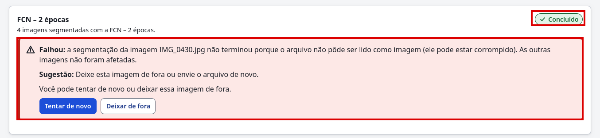 | 2 | Frequência baixa (só quando uma imagem falha); impacto moderado, porque a caixa vermelha logo abaixo do selo reduz o risco de não ver a falha; persistência baixa, porque a pessoa aprende a olhar a caixa | Mostrar um selo próprio enquanto houver falha a decidir (ex.: "Concluído com 1 falha", em âmbar) e passar a "Concluído" só depois da decisão |
| V02 | H1 | TL05, avaliação registrada (TL05/05) | Rafael registra a avaliação de uma imagem | Depois do registro, a lista à esquerda e a linha "Registrado: duvidosa, problema no modelo" mostram a avaliação, mas o selo ao lado do nome da imagem, no título, continua "sem avaliação" | A tela diz duas coisas diferentes sobre a mesma imagem; a pessoa pode achar que o registro falhou e registrar de novo, ou desconfiar da contagem de avaliadas | 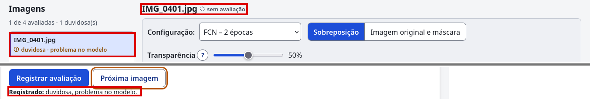 | 2 | Frequência alta (acontece em todo registro); impacto baixo, porque a lista e a linha de confirmação estão certas; persistência baixa, porque a pessoa aprende a confiar na lista | Atualizar o selo do título junto com a lista no momento do registro |
| V03 | H2 | TL07, valor de referência e maior valor (TL07/06); também TL02/04, TL08 e TL09 | Leitura do tempo de inferência na tabela de métricas | O tempo aparece como "1.426 ms", com ponto como separador de milhar, na mesma tabela em que as outras métricas usam vírgula decimal (0,509) | Quem tem o hábito de ler números com ponto decimal, como os integrantes da Baja que usam ferramentas de engenharia, pode ler 1,4 ms em vez de 1,4 s e julgar errado se a configuração atende ao tempo de resposta necessário no carro |  | 2 | Frequência alta (toda leitura do tempo de inferência); impacto moderado, porque a comparação entre configurações continua certa, mas o valor absoluto pode ser lido mil vezes menor; persistência moderada, porque o formato se repete em quatro telas | Mostrar o tempo em segundos com vírgula decimal (ex.: "1,43 s") ou em milissegundos sem separador de milhar, e explicar a unidade no "?" do termo |
| V04 | H2 | TL03, campos obrigatórios (TL03/01) e arquivos fora do formato (TL03/03); TL08, imagens sem avaliação (TL08/02) | Mensagens montadas pelo sistema a partir de partes | Erros de escrita nas mensagens: "…ou um vídeo. escolha pelo menos uma configuração" (minúscula depois do ponto); "1 de 5 arquivo(s) não estão"; "Uma imagem ainda não tem avaliação… avaliá-las antes" (plural para uma imagem) | A mensagem parece descuidada e exige uma segunda leitura, sem impedir a tarefa |  | 1 | Problema cosmético: aparece em três mensagens e não muda o entendimento nem a ação | Ajustar a concordância à quantidade ("1 arquivo não está", "avaliá-la") e começar cada mensagem com maiúscula ao juntar duas mensagens no resumo "Para continuar" |
| V05 | H3 | TL10, glossário de termos (TL10/02) | A pessoa abre o glossário pelo botão do topo | O único botão para fechar o painel, "Voltar à cena anterior", fica no fim da lista de termos, fora da área visível quando o painel abre; o título do painel ("O que é este termo?") também não é o nome do botão que o abriu ("Glossário de termos"). "Cena" é um termo do MoLIC, não da Baja | Quem abriu o glossário para consultar um termo não vê como sair dele; pode clicar no menu e perder o que estava fazendo na tela de baixo | 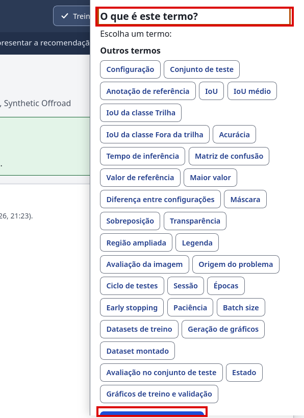 | 2 | Frequência moderada (a cada abertura do glossário); impacto moderado, porque há saídas (tecla Esc, menu), mas não visíveis; persistência baixa, porque a pessoa aprende onde está o botão | Pôr um botão "Fechar" fixo no topo do painel, ao lado do título, e usar o mesmo nome no botão e no título ("Glossário de termos") |
| V06 | H4 | TL05, quadro de vídeo (TL05/06) | Rafael avalia os quadros de um vídeo | A mesma tela usa "quadro" e "imagem" para a mesma coisa: "Próximo quadro" no navegador do vídeo e "Próxima imagem" junto de "Registrar avaliação"; a contagem diz "0 de 5 avaliadas" e, logo abaixo, "5 quadros · 0 avaliado(s)" | Não fica claro se "Próxima imagem" avança para o próximo quadro ou sai do vídeo; a pessoa pode pular quadros sem avaliá-los ou hesitar a cada quadro |  | 2 | Frequência alta quando a entrada é vídeo (a cada quadro); impacto moderado (risco de pular quadros); persistência baixa, porque a pessoa descobre o efeito depois do primeiro clique | Quando a entrada for vídeo, usar "quadro" em todos os rótulos e contagens ("Próximo quadro", "0 de 5 quadros avaliados") e deixar um único botão de avanço |
| V07 | H4 | TL11, montagem na fila (TL11/03); TL01, escolher o modelo e os parâmetros (TL01/01) | Andreia confere os dados antes de treinar ou avaliar | A TL11 diz "O dataset ainda não foi montado pela interface", logo abaixo de um conjunto de teste atual com 12 imagens; na TL01, os mesmos datasets aparecem como "5 imagens de treino no dataset montado" | A pessoa pode concluir que os dados não estão prontos e remontar o dataset sem necessidade; a remontagem pode mudar o conjunto de teste e obrigar a avaliar de novo todas as configurações | 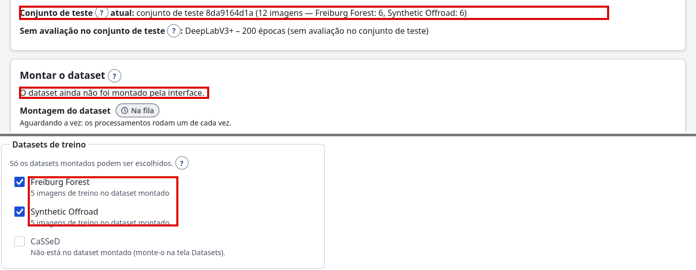 | 2 | Frequência baixa (até a primeira montagem pela interface); impacto alto se levar à remontagem, reduzido pelo alerta de confirmação (TL11/02); persistência baixa, porque a mensagem some depois da primeira montagem | Dizer o que existe (ex.: "Dataset montado fora da interface; conjunto de teste atual: …") e reservar "não montado" para quando não houver dataset |
| V08 | H5 | TL07, escolher as configurações (TL07/01), sem avaliação no conjunto de teste (TL07/02) e execução faltante no ciclo (TL07/04) | Larissa ou Andreia escolhem as configurações a comparar | Os cartões já dizem "Sem avaliação no conjunto de teste" ou "Sem execução concluída neste ciclo de testes", mas essas configurações podem ser marcadas; o erro só aparece depois de "Comparar as selecionadas". Para Larissa, o diálogo oferece "Abrir Datasets", tela de uma tarefa da P02, e diz que a avaliação é feita "por quem prepara os dados" | A pessoa faz uma escolha que o sistema já sabe que não vai funcionar e só descobre depois de pedir a comparação; Larissa recebe um caminho para uma tela que não é dela |  | 2 | Frequência moderada (sempre que houver configuração nova ou ciclo incompleto); impacto baixo a moderado, porque há recuperação (o diálogo explica e devolve à escolha); persistência baixa | Impedir antes: deixar essas configurações sem caixa de seleção, com o motivo no próprio cartão e, para a P02, o atalho "Avaliar em Datasets"; para quem não prepara os dados, só a explicação |
| V09 | H5 | TL03, campos obrigatórios (TL03/01) | Rafael abre "Segmentar imagens" para enviar as imagens de um novo teste de campo | Com o formulário vazio, o campo "Ciclo de testes" já vem preenchido com o último ciclo usado ("Teste de campo 13/11"); conferido no código, que preenche o campo com o ciclo mais recente | Se a pessoa não reparar, as execuções do novo teste entram no ciclo anterior. A comparação por ciclo (TL07), a conclusão da validação (TL08) e a apresentação (TL09) passam a misturar dois testes de campo, sem nenhum aviso |  | 3 | Frequência alta (todo primeiro envio de um novo teste de campo); impacto alto, porque o erro é silencioso e contamina a conclusão levada à reunião; persistência alta, porque o campo preenchido parece correto e o erro se repete a cada teste. A TL04 e a TL05 mostram o nome do ciclo, o que permite notar o erro depois, mas não corrigi-lo | Começar o campo vazio e sugerir os ciclos existentes na lista; ou, se mantiver a sugestão, destacá-la como "ciclo anterior" e pedir confirmação quando as imagens forem de outra data |
| V10 | H6 | TL07, valor de referência e maior valor (TL07/06); também TL08 e TL09 (TL09/02) | Leitura da tabela de métricas | A coluna "Valor de referência" não diz no cabeçalho de qual configuração vem; a origem está numa linha abaixo da tabela. Quando a configuração em uso está na comparação, a coluna repete os valores dela (FCN – 200 épocas na TL07/06); quando não está, mostra valores de uma configuração que não aparece na tabela (TL09/02) | Para entender a coluna, a pessoa precisa lembrar ou procurar a linha de origem; pode ler a referência como uma quarta configuração ou como uma meta. Na reunião (TL09), Larissa fica sem resposta imediata para "referência de quê?" |  | 2 | Frequência alta (toda tabela de métricas, em três telas); impacto moderado, porque a explicação existe, mas longe da coluna; persistência moderada | Pôr a origem no cabeçalho (ex.: "Referência: FCN – 200 épocas, em uso") e, quando a configuração em uso estiver na tabela, marcar a coluna dela com "em uso" em vez de repeti-la |
| V11 | H9 | TL08, imagens sem avaliação (TL08/02) | Rafael registra a conclusão da validação com uma imagem ainda sem avaliação | O alerta diz que "uma imagem ainda não tem avaliação", mas não diz qual | Para decidir entre "Avaliá-las antes" e "Concluir assim mesmo", a pessoa não sabe se a imagem que falta é relevante; "Avaliá-las antes" leva à primeira imagem sem avaliação (conferido no código), o que reduz o impacto | 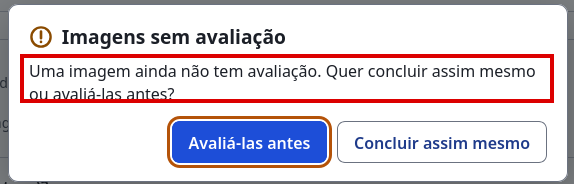 | 1 | Frequência baixa (só quando falta avaliar alguma imagem); impacto baixo, porque o caminho de volta leva à imagem certa; persistência baixa | Listar no alerta o nome das imagens sem avaliação |
| V12 | H9 | TL02, treino ou avaliação interrompidos (TL02/05) | O treino é interrompido porque o programa foi fechado | Para essa causa, o "Ajuste sugerido" é "Reinicie o treino", mas o botão se chama "Reiniciar com o ajuste" e o batch size aparece como campo editável, como na falta de memória | A pessoa pode achar que precisa mudar o batch size para reiniciar e alterar sem necessidade um parâmetro da configuração |  | 1 | Frequência baixa (só quando o programa é fechado durante o treino); impacto baixo, porque o valor já vem preenchido com o atual; persistência baixa | Quando a causa não pedir ajuste, chamar o botão de "Reiniciar o treino" e oferecer a mudança do batch size como opção à parte |

**Qualidade do relato:** o problema deve ser observável e localizado. Evite “interface confusa” sem dizer **o que**, **onde**, **quando** e **para quem**.

#### Percursos de acessibilidade

Os sete percursos foram feitos uma vez pela equipe, na interface executada; os resultados e as violações encontradas (VA01 a VA04) estão em "Percursos de acessibilidade da equipe", depois do AV03.

### 6. Boas práticas — heurísticas não violadas (atividade didática)

| Heurística sem violação | Exemplo no sistema | Evidência | Por que atende |
|---|---|---|---|
| H7 | No visualizador, além dos botões "Ampliar", "Reduzir" e "Imagem inteira", a região ampliada responde à roda do mouse, a arrastar e às teclas + − 0 e setas, avisado na própria tela (TL05/04). Ao comparar, as imagens duvidosas já vêm marcadas (TL06/01) | 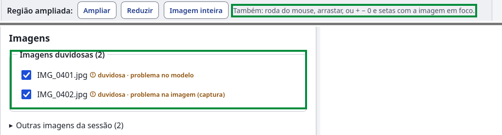 | Oferece atalhos para quem usa a tela muitas vezes, como Rafael a cada teste, sem esconder o caminho pelos botões para quem está começando; a pré-seleção poupa repetir uma escolha que a pessoa já fez ao avaliar |
| H8 | Na TL07, a tabela de métricas vem primeiro; gráfico, diferença entre configurações e matriz de confusão aparecem só pelos botões "Ver também em gráfico", "A diferença importa?" e "Onde cada uma erra?" (TL07/06). Na TL04, cada configuração mostra só estado, progresso e o que acontece (TL04/01) |  | Cada tela mostra o que a tarefa daquele momento pede; a informação de apoio fica a um clique, sem competir com a leitura principal |
| H10 | O botão "?" junto de cada termo técnico abre, no mesmo lugar, o que o termo indica e o que não indica (TL10/01); os campos da TL01 trazem uma frase de ajuda com o valor padrão (TL01/01) | 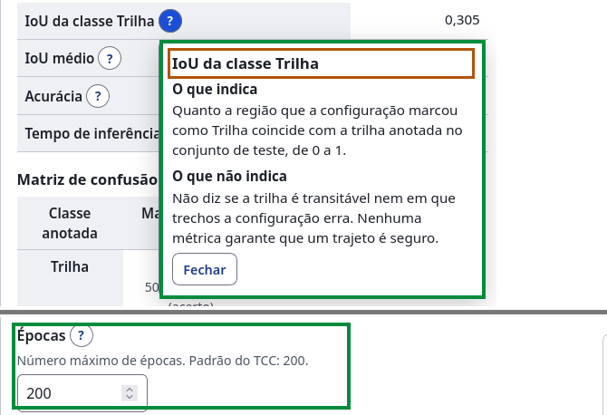 | A ajuda está no ponto de uso, ligada à tarefa e curta; dizer o que a métrica não indica ("Nenhuma métrica garante que um trajeto é seguro") evita a interpretação errada mais perigosa para a Baja |

---

## Avaliador AV02 — Tiago Fagundes dos Santos

**Autor(a):** Tiago Fagundes dos Santos — 22.123.017-0  
**Data da inspeção:** 21/11/2026
**Versão inspecionada:** commit `16a5bc1`
**Computador, tela, resolução e navegador:** a interface não foi executada nesta inspeção. Foram inspecionadas as 59 capturas da Entrega 11 (`assets/11_figma/`), feitas em 20/11/2026 no commit `16a5bc1`: capturas da área visível com 1366 × 814 px e capturas da página inteira com 1354 px de largura. Navegador das capturas: `[?]`
**Tempo gasto na inspeção:** não medido
**Forma da inspeção:** pelas capturas da Entrega 11, com apoio do Claude. Todas as telas foram percorridas, com atenção maior aos fluxos do M01 (P01, Rafael): envio das imagens, processamento, avaliação imagem a imagem, comparação das duvidosas e conclusão da validação. Textos e comportamentos que as capturas não mostram foram conferidos no código da interface do mesmo commit. Os percursos de acessibilidade foram feitos pela equipe, na interface executada ("Percursos de acessibilidade da equipe").

### 4. Cobertura das telas, dos estados e das heurísticas

#### Telas e estados examinados

Os estados de cada tela são os da seção 2 ("Telas/estados"). A falta de memória no treino não pode ser provocada no equipamento: é examinada pela mensagem implementada (Entrega 11) e marcada como "examinada sem reproduzir". As capturas são citadas pela tela e pelo número, como TL02/05.

| Tela | Estados examinados | Examinado? | Observação (motivo, se não examinado) |
|---|---|---|---|
| TL01 Configuração de treino | Escolher o modelo e os parâmetros (TL01/01); sem dataset de treino, PA (TL01/02); nomear a configuração (TL01/03); nome repetido, RA (TL01/04) | sim | O M01 não passa pelo treino; a tela foi examinada para a cobertura completa |
| TL02 Estado do treino (inclui treino interrompido e falta de memória) | Na fila (TL02/01); treinando (TL02/02); treino concluído e avaliação no conjunto de teste na fila (TL02/03); resultado do treino depois da avaliação (TL02/04); treino ou avaliação interrompidos, RA, com a causa "programa fechado" (TL02/05); falta de memória | sim | Falta de memória examinada sem reproduzir: a mensagem foi conferida no código (causa "faltou memória no computador" e batch size sugerido já preenchido). A avaliação no estado "processando" não foi capturada |
| TL03 Entradas e configurações | Entradas e configurações obrigatórias, PA (TL03/01); envio das imagens, com a lista de arquivos e "Retirar", e escolha das configurações (TL03/02); arquivos fora do formato aceito, AL (TL03/03) | sim | O preenchimento inicial do ciclo de testes foi conferido no código |
| TL04 Processamento (inclui falha na execução) | Na fila e processando (TL04/01); falha numa imagem, RA, e numa configuração inteira, CE (TL04/02); concluído (TL04/03) | sim | O efeito de "Tentar de novo" numa imagem corrompida foi conferido no código |
| TL05 Resultado e avaliação da imagem | Sem sessão (TL05/01); sobreposição e sem métricas, PP (TL05/02); imagem original e máscara (TL05/03); região ampliada (TL05/04); avaliação registrada (TL05/05); quadro de vídeo e download do MP4 (TL05/06) | sim | O download do MP4 foi examinado só pelo link. Como a avaliação é guardada por imagem e qual imagem "Próxima imagem" abre foram conferidos no código |
| TL06 Comparação na mesma imagem | Configuração obrigatória, PA (TL06/01); escolher as configurações a comparar, com as duvidosas marcadas (TL06/02); comparar na mesma região, com sobreposição (TL06/03) e com máscara (TL06/04) | sim | — |
| TL07 Desempenho consolidado | Configurações obrigatórias, PA (TL07/01); sem avaliação no conjunto de teste, CE (TL07/02); conjuntos de teste diferentes, AL (TL07/03); execução faltante no ciclo, CE (TL07/04); sem valor de referência (TL07/05); valor de referência e maior valor (TL07/06); gráfico (TL07/07); a diferença importa? (TL07/08); matriz de confusão (TL07/09) | sim | O M01 não passa pela TL07; a tela foi examinada para a cobertura completa. A TL07/04 está rolada e não mostra o topo da tela |
| TL08 Conclusão | Validação: informar (TL08/01), imagens sem avaliação, AL (TL08/02), conferir (TL08/03). Experimento: conclusão obrigatória, PA (TL08/04), informar (TL08/05), conferir (TL08/06). Recomendação: configuração obrigatória, PA (TL08/07), informar (TL08/08), conferir (TL08/09), corrigir (TL08/10) | sim | Para onde "Avaliá-las antes" leva foi conferido no código |
| TL09 Apresentação e decisão | Sem recomendação (TL09/01); retomar a análise (TL09/02); responder a uma dúvida (TL09/03); condição obrigatória, PA (TL09/04); decisão registrada (TL09/05) | sim | — |
| TL10 Explicação dos termos | Explicação junto do termo (TL10/01); glossário de termos (TL10/02) | sim | — |
| TL11 Datasets | Conferir os datasets; confirmar a remontagem, AL (TL11/02); montagem na fila (TL11/03); dataset montado (TL11/04); avaliar as selecionadas, PA (TL11/05); falha na avaliação, RA e CE (TL11/06); avaliando (TL11/07); avaliação concluída (TL11/08) | sim | A TL11/01 mostra o diálogo da TL07 aberto sobre a tela Datasets, um estado que a interface não produz (`PENDENCIAS.md`, INC-74); a conferência dos datasets foi examinada nas TL11/02 a TL11/08 |
| Elementos de todas as telas | Menu; indicador do treino e da avaliação no topo; botão "Glossário de termos"; link "←" para a cena anterior; rodapé com o que o sistema faz e a versão | sim | Examinados nas 59 capturas |

#### Matriz das 10 heurísticas

| Heurística | Telas/fluxos examinados | Houve violação? | IDs dos achados | Exemplo de boa prática se não violada |
|---|---|---|---|---|
| H1 | TL04 (estados da execução e falhas), TL05 (avaliação registrada), TL08 (conclusão registrada), indicador do topo | sim | V01, V02, V03 | — |
| H2 | Todas as telas, com atenção às mensagens da TL03, da TL04 e da TL08 | sim | V04 | — |
| H3 | TL03 (retirar arquivos, trocar os arquivos), TL04 (deixar de fora), TL08 ("Corrigir"), link "←", diálogos | não | — | "Retirar" em cada arquivo escolhido e "Trocar os arquivos" ou "Seguir sem eles" no alerta de formato (seção 6) |
| H4 | Botões e rótulos da TL05 e da TL06, imagem e vídeo (TL05/06), selos de estado | sim | V05, V06 | — |
| H5 | Ciclo de testes (TL03), campos obrigatórios (TL03, TL06, TL08), avaliação da imagem com mais de uma configuração (TL05, TL06) | sim | V07, V08 | — |
| H6 | Conclusão da validação (TL08/01), configurações com descrição e métricas (TL03, TL06), avaliação registrada na comparação (TL06) | não | — | Na conclusão da validação, cada imagem aparece com a avaliação e a origem do problema já registradas, e as caixas vêm marcadas conforme essa origem (seção 6) |
| H7 | Avaliação imagem a imagem (TL05), visualizador (TL05, TL06), comparação das duvidosas (TL06) | não | — | Depois do registro, o foco vai para "Próxima imagem", que abre a próxima imagem ainda sem avaliação (seção 6) |
| H8 | Todas as telas, com atenção à TL04 e à TL05 | não | — | A TL04 concluída mostra só o resumo, o estado de cada configuração e o próximo passo (seção 6) |
| H9 | Falha numa imagem e numa configuração inteira (TL04/02), formato não aceito (TL03/03), imagens sem avaliação (TL08/02) | sim | V09, V10 | — |
| H10 | "?" dos termos na TL05, formatos aceitos na TL03, explicação junto do termo e glossário (TL10) | não | — | O quadro "Sem métricas" explica por que não há IoU nem acurácia, com "?" em cada termo (seção 6) |

### 5. Declaração de violações

| ID | Heurística | Tela/estado | Ação ou condição | Problema observado | Consequência para quem usa | Evidência | Severidade | Justificativa da severidade | Recomendação |
|---|---|---|---|---|---|---|---:|---|---|
| V01 | H1 | TL04, falha numa imagem (TL04/02) | A execução termina com uma imagem que não pôde ser lida | O cartão da configuração mostra o selo verde "Concluído", com a caixa vermelha da falha logo abaixo, ainda esperando a decisão "Tentar de novo" ou "Deixar de fora" | Rafael pode ler o selo, achar que está tudo pronto e seguir para a avaliação sem decidir sobre a imagem que falhou |  | 2 | Frequência baixa (só com falha); impacto moderado, porque a caixa vermelha chama a atenção; persistência baixa | Usar um selo próprio enquanto houver falha a decidir (ex.: "Concluído com 1 falha") e mudar para "Concluído" depois da decisão |
| V02 | H1 | TL05, avaliação registrada (TL05/05) | Rafael registra a avaliação de uma imagem | A lista à esquerda e a linha "Registrado: …" mostram a avaliação, mas o selo ao lado do nome da imagem, no título, continua "sem avaliação" | Informação contraditória na mesma tela: Rafael pode registrar de novo ou duvidar de que o registro foi feito |  | 2 | Frequência alta (todo registro); impacto baixo, porque a lista está certa; persistência baixa | Atualizar o selo do título no momento do registro |
| V03 | H1 | TL08, conferir a conclusão da validação (TL08/03) | Rafael registra a conclusão da validação | A tela diz "Conclusão registrada" e, abaixo, pede "Confirmar" ou "Corrigir", com o texto "Confira o que foi registrado antes de sair"; não fica claro se a conclusão já está guardada ou se só fica guardada depois de "Confirmar" | Rafael pode sair sem confirmar achando que perdeu o registro, ou voltar para registrar de novo | 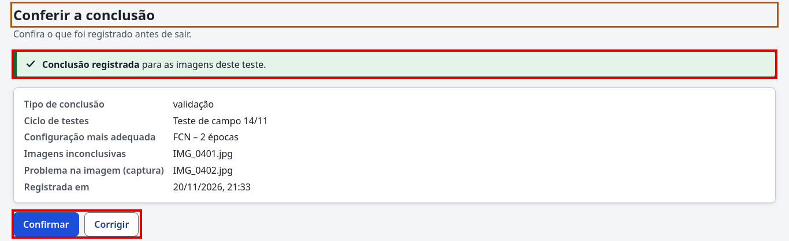 | 1 | Frequência moderada (toda conclusão); impacto baixo, porque o registro já está feito; persistência baixa | Deixar claro o estado: "Conclusão registrada. Confira os dados; se algo estiver errado, corrija", com "Concluir" em vez de "Confirmar" |
| V04 | H2 | TL03, campos obrigatórios (TL03/01) e arquivos fora do formato (TL03/03) | Mensagens que o sistema monta a partir de partes | "…ou um vídeo. escolha pelo menos uma configuração" (minúscula depois do ponto) e "1 de 5 arquivo(s) não estão em um formato aceito" (concordância errada) | A mensagem parece descuidada e pede uma segunda leitura | 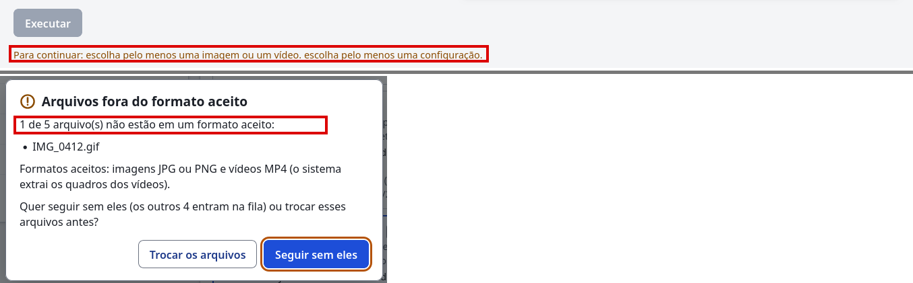 | 1 | Problema cosmético: não muda o entendimento nem a ação | Ajustar a concordância à quantidade e começar com maiúscula cada mensagem juntada no resumo "Para continuar" |
| V05 | H4 | TL05, sobreposição e sem métricas (TL05/02) | Rafael termina de avaliar e procura como comparar | A seção "Depois de avaliar" tem dois botões de comparar com comportamentos diferentes: "Comparar as duvidosas (0)", desabilitado, e "Comparar na mesma imagem e região", habilitado. O texto abaixo diz que "Comparar fica disponível quando houver imagens duvidosas", embora um dos botões de comparar já esteja disponível | Não fica claro o que cada botão faz nem por que um está desabilitado e o outro não; Rafael pode abrir a comparação errada ou achar que precisa marcar duvidosas para comparar | 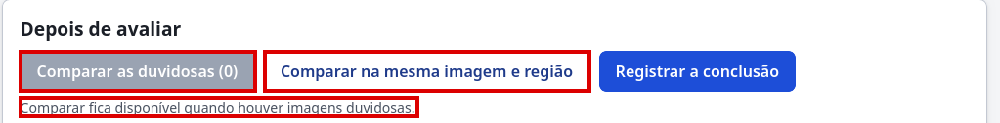 | 2 | Frequência alta (a seção aparece em toda imagem); impacto moderado (escolha do caminho errado, com volta); persistência baixa, depois de usar os dois | Dar nomes que digam a diferença (ex.: "Executar outra configuração nas duvidosas" e "Ver as configurações já executadas lado a lado") e ligar o texto de ajuda só ao botão desabilitado |
| V06 | H4 | TL05, quadro de vídeo (TL05/06) | Rafael avalia os quadros de um vídeo | "Próximo quadro" no navegador do vídeo e "Próxima imagem" junto de "Registrar avaliação"; a contagem diz "0 de 5 avaliadas" e, abaixo, "5 quadros · 0 avaliado(s)" | Rafael não sabe se "Próxima imagem" vai para o próximo quadro ou sai do vídeo, e pode pular quadros | 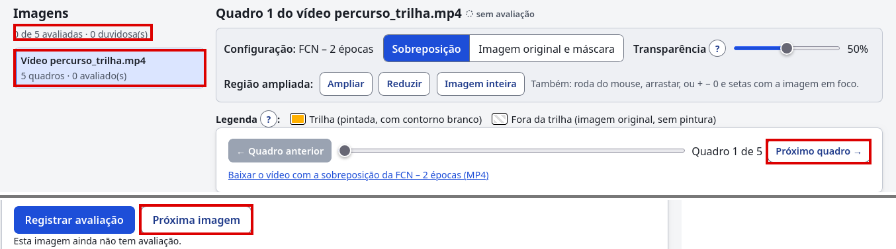 | 2 | Frequência alta quando a entrada é vídeo; impacto moderado; persistência baixa | Usar "quadro" em todos os rótulos e contagens quando a entrada é vídeo, com um único botão de avanço |
| V07 | H5 | TL03, campos obrigatórios (TL03/01) | Rafael abre "Segmentar imagens" para enviar as imagens de um novo teste de campo | Com o formulário vazio, o "Ciclo de testes" já vem preenchido com o ciclo anterior ("Teste de campo 13/11"); conferido no código | Se Rafael não trocar o nome, as imagens do novo teste entram no ciclo anterior, e a conclusão da validação e as comparações por ciclo passam a misturar dois testes, sem aviso | 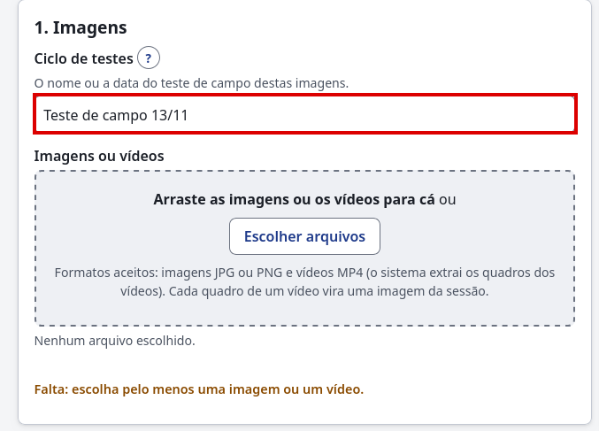 | 3 | Frequência alta (todo primeiro envio de um novo teste); impacto alto (erro silencioso que chega à conclusão); persistência alta, porque o campo preenchido parece certo | Começar o campo vazio e sugerir os ciclos existentes; ou destacar a sugestão como "ciclo anterior" e pedir confirmação |
| V08 | H5 | TL05, avaliação registrada (TL05/05); TL06, comparar as máscaras (TL06/04) | Rafael avalia uma imagem numa sessão executada com mais de uma configuração | A avaliação é uma só por imagem e não diz a qual configuração se refere: a lista mostra "duvidosa · problema no modelo" e a TL06/04 mostra "Avaliação registrada desta imagem" ao lado de três configurações. Se Rafael trocar a configuração no seletor e registrar de novo, a avaliação anterior é substituída (conferido no código) | Rafael pode julgar a FCN como correta, olhar a DeepLabV3+ e registrar "duvidosa" sem perceber que apagou a primeira avaliação; a conclusão da validação passa a se apoiar numa avaliação que não diz de qual configuração é | 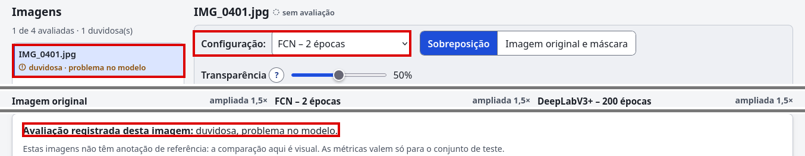 | 2 | Frequência moderada (sessões com mais de uma configuração); impacto moderado, reduzido porque o formulário mostra a avaliação já registrada antes de alterar; persistência moderada | Mostrar no registro a configuração avaliada (ex.: "duvidosa · FCN – 2 épocas") e, ao registrar com outra configuração selecionada, perguntar se substitui a avaliação anterior ou se registra uma para cada configuração |
| V09 | H9 | TL04, falha numa imagem (TL04/02) | Uma imagem enviada está corrompida | A sugestão diz "Deixe esta imagem de fora ou envie o arquivo de novo", mas a tela não oferece como enviar o arquivo de novo; o botão principal é "Tentar de novo", que processa o mesmo arquivo e, por isso, falha de novo (conferido no código) | Rafael tenta de novo, a falha se repete, e ele não encontra onde reenviar o arquivo; acaba deixando a imagem de fora sem ter tido a opção que a própria mensagem sugeriu | 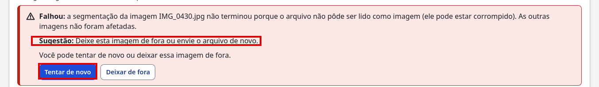 | 2 | Frequência baixa (arquivos corrompidos são raros); impacto moderado (perde a imagem ou tenta várias vezes em vão); persistência moderada | Para arquivo que não pôde ser lido, trocar "Tentar de novo" por "Enviar o arquivo de novo", com o seletor de arquivos, e manter "Deixar de fora" |
| V10 | H9 | TL08, imagens sem avaliação (TL08/02) | Rafael registra a conclusão com uma imagem ainda sem avaliação | O alerta diz que "uma imagem ainda não tem avaliação", sem dizer qual | Para decidir entre avaliar antes ou concluir assim mesmo, Rafael não sabe se a imagem que falta importa; "Avaliá-las antes" leva à primeira sem avaliação (conferido no código), o que reduz o impacto |  | 1 | Frequência baixa; impacto baixo; persistência baixa | Listar no alerta o nome das imagens sem avaliação |

**Qualidade do relato:** o problema deve ser observável e localizado. Evite “interface confusa” sem dizer **o que**, **onde**, **quando** e **para quem**.

#### Percursos de acessibilidade

Os sete percursos foram feitos uma vez pela equipe, na interface executada; os resultados e as violações encontradas (VA01 a VA04) estão em "Percursos de acessibilidade da equipe", depois do AV03.

### 6. Boas práticas — heurísticas não violadas (atividade didática)

| Heurística sem violação | Exemplo no sistema | Evidência | Por que atende |
|---|---|---|---|
| H3 | Cada arquivo escolhido tem "Retirar" ao lado (TL03/02), e o alerta de formato oferece "Trocar os arquivos" ou "Seguir sem eles" (TL03/03) | 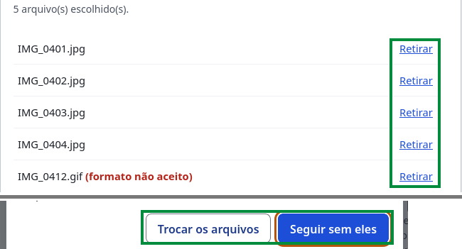 | Rafael desfaz uma escolha errada antes de executar, sem recomeçar o envio, e decide o que fazer com os arquivos recusados em vez de o sistema decidir por ele |
| H6 | Na conclusão da validação, cada imagem aparece com a avaliação e a origem do problema registradas na TL05, e as caixas vêm marcadas conforme essa origem (TL08/01) | 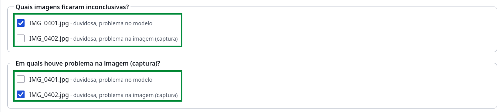 | Rafael não precisa lembrar o que registrou em cada imagem: a informação de que ele precisa para concluir está na própria tela |
| H7 | Depois de "Registrar avaliação", o foco vai para "Próxima imagem" (TL05/05), que abre a próxima imagem ainda sem avaliação, e não simplesmente a seguinte da lista (conferido no código) | 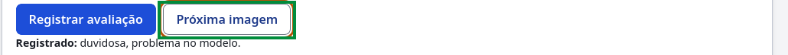 | Quem avalia muitas imagens segue com o teclado, sem procurar na lista quais faltam; quem prefere o mouse usa a lista normalmente |
| H8 | Com a execução concluída, a TL04 mostra só o resumo, o estado de cada configuração e o próximo passo (TL04/03) | 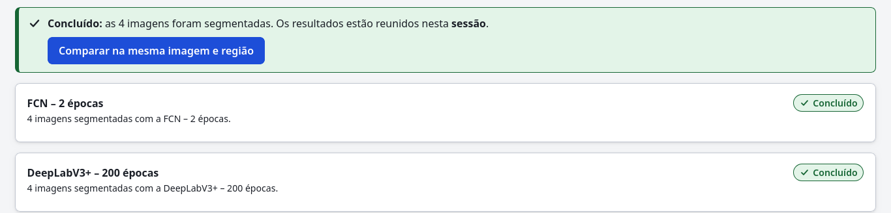 | Nada compete com a informação de que a pessoa precisa naquele momento: terminou e o que fazer agora |
| H10 | Na TL05, o quadro "Sem métricas: avaliação visual" explica por que não há IoU nem acurácia para a imagem de campo e onde ficam as métricas, com "?" em cada termo (TL05/02); na TL03, os formatos aceitos estão escritos junto da área de envio (TL03/01) | 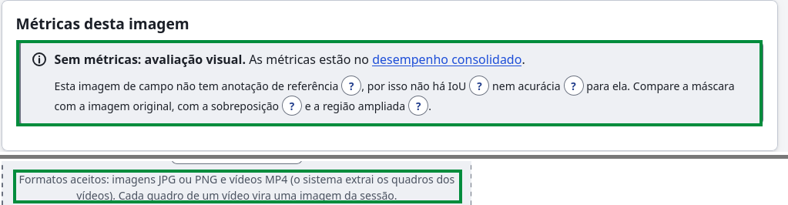 | A ajuda responde à dúvida no momento em que ela aparece e evita a interpretação errada de que a imagem de campo deveria ter métricas |

---

## Avaliador AV03 — Mateus Marana Assuena

**Autor(a):** Mateus Marana Assuena — 22.123.026-1  
**Data da inspeção:** 21/11/2026  
**Versão inspecionada:** commit `16a5bc1`  
**Computador, tela, resolução e navegador:** a interface não foi executada nesta inspeção. Foram inspecionadas as 59 capturas da Entrega 11 (`assets/11_figma/`), feitas em 20/11/2026 no commit `16a5bc1`: capturas da área visível com 1366 × 814 px e capturas da página inteira com 1354 px de largura. Navegador das capturas: `[?]`  
**Tempo gasto na inspeção:** não medido  
**Forma da inspeção:** pelas capturas da Entrega 11, com apoio do Claude. Todas as telas foram percorridas, com atenção maior aos fluxos do M03 (P02, Andreia): treino, preparação dos dados e conclusão do experimento. Textos e comportamentos que as capturas não mostram foram conferidos no código da interface do mesmo commit. Os percursos de acessibilidade foram feitos pela equipe, na interface executada ("Percursos de acessibilidade da equipe").

### 4. Cobertura das telas, dos estados e das heurísticas

#### Telas e estados examinados

Os estados de cada tela são os da seção 2 ("Telas/estados"). A falta de memória no treino não pode ser provocada no equipamento: é examinada pela mensagem implementada (Entrega 11) e marcada como "examinada sem reproduzir". As capturas são citadas pela tela e pelo número, como TL02/05.

| Tela | Estados examinados | Examinado? | Observação (motivo, se não examinado) |
|---|---|---|---|
| TL01 Configuração de treino | Escolher o modelo e os parâmetros, com outro treino em andamento no indicador do topo (TL01/01); sem dataset de treino, PA (TL01/02); nomear a configuração (TL01/03); nome repetido, RA (TL01/04) | sim | — |
| TL02 Estado do treino (inclui treino interrompido e falta de memória) | Na fila (TL02/01); treinando (TL02/02); treino concluído e avaliação no conjunto de teste na fila (TL02/03); resultado do treino depois da avaliação (TL02/04); treino ou avaliação interrompidos, RA, com a causa "programa fechado" (TL02/05); falta de memória | sim | Falta de memória examinada sem reproduzir: a mensagem foi conferida no código (causa "faltou memória no computador", ajuste "reduzir o batch size" com o novo valor já preenchido). A ausência de ação para cancelar o treino na fila ou em andamento também foi conferida no código. A avaliação no estado "processando" não foi capturada |
| TL03 Entradas e configurações | Entradas e configurações obrigatórias, PA (TL03/01); envio das imagens e escolha das configurações (TL03/02); arquivos fora do formato aceito, AL (TL03/03) | sim | O caminho do M03, que chega aqui pela TL02 ("Comparar com outra configuração no vídeo"), foi examinado pelos botões da TL02/04 |
| TL04 Processamento (inclui falha na execução) | Na fila e processando (TL04/01); falha numa imagem, RA, e numa configuração inteira, CE (TL04/02); concluído (TL04/03) | sim | — |
| TL05 Resultado e avaliação da imagem | Sem sessão (TL05/01); sobreposição e sem métricas, PP (TL05/02); imagem original e máscara (TL05/03); região ampliada (TL05/04); avaliação registrada (TL05/05); quadro de vídeo e download do MP4 (TL05/06) | sim | O M03 não passa pela avaliação imagem a imagem; a tela foi examinada para a cobertura completa |
| TL06 Comparação na mesma imagem | Configuração obrigatória, PA (TL06/01); escolher as configurações a comparar (TL06/02); comparar na mesma região, com sobreposição (TL06/03) e com máscara (TL06/04), e a saída "Comparar as métricas no conjunto de teste" | sim | — |
| TL07 Desempenho consolidado | Configurações obrigatórias, PA (TL07/01); sem avaliação no conjunto de teste, CE (TL07/02); conjuntos de teste diferentes, AL (TL07/03); execução faltante no ciclo, CE (TL07/04); sem valor de referência (TL07/05); valor de referência e maior valor (TL07/06); gráfico (TL07/07); a diferença importa? (TL07/08); matriz de confusão (TL07/09); saídas para registrar a conclusão | sim | A TL07/04 está rolada e não mostra o topo da tela, mas o diálogo aparece inteiro |
| TL08 Conclusão | Experimento: conclusão obrigatória, PA (TL08/04), informar (TL08/05), conferir (TL08/06). Validação: informar (TL08/01), imagens sem avaliação, AL (TL08/02), conferir (TL08/03). Recomendação: configuração obrigatória, PA (TL08/07), informar (TL08/08), conferir (TL08/09), corrigir (TL08/10) | sim | A correção foi examinada só na recomendação; a do experimento usa a mesma tela (Entrega 11) |
| TL09 Apresentação e decisão | Sem recomendação (TL09/01); retomar a análise (TL09/02); responder a uma dúvida (TL09/03); condição obrigatória, PA (TL09/04); decisão registrada (TL09/05) | sim | Examinada também como destino de uma recomendação registrada no caminho do M03 |
| TL10 Explicação dos termos | Explicação junto do termo (TL10/01); glossário de termos (TL10/02) | sim | — |
| TL11 Datasets | Conferir os datasets; confirmar a remontagem, AL (TL11/02); montagem na fila (TL11/03); dataset montado (TL11/04); avaliar as selecionadas, PA (TL11/05); falha na avaliação, RA e CE (TL11/06); avaliando (TL11/07); avaliação concluída (TL11/08) | sim | A TL11/01 mostra o diálogo da TL07 aberto sobre a tela Datasets, um estado que a interface não produz (`PENDENCIAS.md`, INC-74); a conferência dos datasets foi examinada nas TL11/02 a TL11/08. A montagem no estado "processando" não foi capturada. O que o indicador do topo mostra durante a montagem e a avaliação foi conferido no código |
| Elementos de todas as telas | Menu; indicador do treino e da avaliação no topo (na fila, treinando, avaliação na fila, concluído, interrompidos, nenhum treino em andamento); botão "Glossário de termos"; link "←" para a cena anterior; rodapé com o que o sistema faz e a versão | sim | Examinados nas 59 capturas |

#### Matriz das 10 heurísticas

| Heurística | Telas/fluxos examinados | Houve violação? | IDs dos achados | Exemplo de boa prática se não violada |
|---|---|---|---|---|
| H1 | TL01 e TL02 (estados do treino, fila), TL11 (montagem e avaliação), TL04, indicador do topo | sim | V01, V02 | — |
| H2 | Todas as telas, com atenção aos termos e números da TL01, TL02, TL07 e TL11 | sim | V03 | — |
| H3 | TL02 (treino na fila, treinando, interrompido), TL11 (montagem e avaliação na fila), diálogos com "Cancelar" (TL11/02), "Corrigir" (TL08), link "←" | sim | V04 | — |
| H4 | Datasets na TL01 e na TL11, selos de estado, campos obrigatórios, rótulos entre telas | sim | V05 | — |
| H5 | Campos obrigatórios (TL01, TL07, TL08, TL11), nome repetido (TL01/04), saídas para registrar a conclusão (TL07), remontagem (TL11/02) | sim | V06, V07 | — |
| H6 | Resultado do treino (TL02/04), tabelas de métricas (TL07, TL08, TL09), configurações com descrição e métricas (TL03, TL06) | sim | V08 | — |
| H7 | Caminho da TL01 para a TL11, atalhos do visualizador (TL05, TL06), saídas da TL02/04 | sim | V09 | — |
| H8 | Todas as telas, com atenção à TL02 (estado do treino) e à TL11 (Datasets) | não | — | O cartão "Estado do treino" mostra só o estado, o aviso e o que falta para as métricas (seção 6) |
| H9 | Treino ou avaliação interrompidos (TL02/05), falha na avaliação (TL11/06), falhas na execução (TL04/02), CE e AL da TL07 | sim | V10 | — |
| H10 | Explicação junto do termo e glossário (TL10), "?" dos termos da TL01 e da TL11, textos de ajuda dos campos | não | — | Os termos da preparação dos dados têm "?" no ponto de uso e entram no glossário (seção 6) |

### 5. Declaração de violações

| ID | Heurística | Tela/estado | Ação ou condição | Problema observado | Consequência para quem usa | Evidência | Severidade | Justificativa da severidade | Recomendação |
|---|---|---|---|---|---|---|---:|---|---|
| V01 | H1 | TL11, montagem na fila (TL11/03) e avaliando (TL11/07) | Andreia inicia na TL11 a montagem do dataset ou a avaliação de configurações e sai da tela | Enquanto a montagem ou a avaliação está na fila ou processando, o indicador do topo diz "Nenhum treino em andamento"; o indicador só acompanha o último treino (conferido no código) | Fora da TL11, ninguém vê que o computador está ocupado: Andreia não sabe quando a avaliação termina sem voltar à tela, e quem envia imagens na TL03 não entende por que a execução fica na fila |  | 2 | Frequência moderada (toda avaliação ou montagem pela TL11); impacto moderado (espera sem explicação e volta à tela só para conferir); persistência moderada, porque o indicador continua mostrando "nenhum" a cada vez | Fazer o indicador do topo mostrar qualquer processamento em andamento ou na fila (treino, avaliação, montagem, execução), com o nome e o estado, e levar à tela de origem |
| V02 | H1 | TL02, treino na fila (TL02/01) e avaliação na fila (TL02/03); TL01 com outro treino em andamento (TL01/01); TL11, montagem na fila (TL11/03) | Andreia inicia um treino, uma avaliação ou uma montagem com outro processamento em andamento | A interface diz só "Aguardando a vez: os processamentos rodam um de cada vez"; não diz o que está à frente nem quantos processamentos faltam. Na TL01, nada avisa, antes de "Iniciar o treino", que o novo treino vai esperar | Numa janela curta de tempo (CI03), Andreia não consegue estimar quando o treino vai começar nem decidir se vale esperar ou deixar para depois | 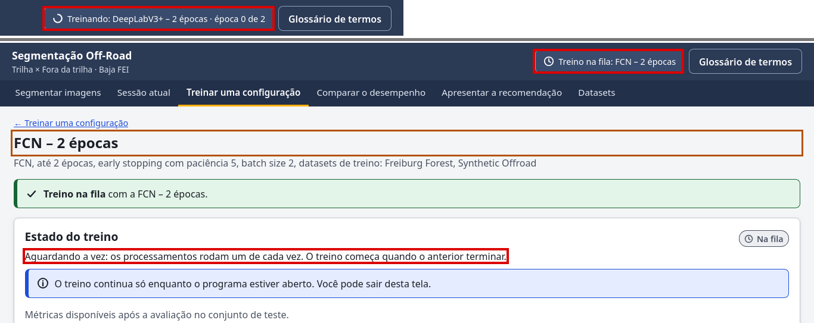 | 2 | Frequência moderada (sempre que há outro processamento); impacto moderado, porque afeta o planejamento do tempo, não o resultado; persistência alta, porque a informação nunca aparece | Mostrar a posição na fila e o processamento à frente (ex.: "2º na fila, depois do treino da DeepLabV3+ – 2 épocas, época 1 de 2") e avisar na TL01/03, antes de iniciar, que o treino vai para a fila |
| V03 | H2 | TL02, resultado do treino (TL02/04); também TL07, TL08 e TL09 | Andreia lê o resultado da nova configuração no conjunto de teste | O tempo de inferência aparece como "1.426 ms", com ponto como separador de milhar, logo abaixo de métricas com vírgula decimal (0,305; 0,509) | Quem lê o ponto como separador decimal pode entender 1,4 ms em vez de 1,4 s e tirar uma conclusão errada sobre a velocidade da configuração | 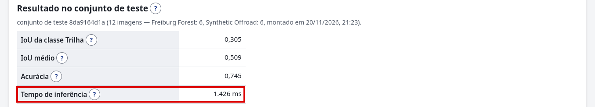 | 2 | Frequência alta (todo resultado de treino e toda comparação); impacto moderado, porque a comparação relativa continua certa; persistência moderada | Mostrar o tempo em segundos com vírgula decimal (ex.: "1,43 s") ou em milissegundos sem separador de milhar |
| V04 | H3 | TL02, treino na fila (TL02/01) e treinando (TL02/02); TL11, montagem na fila (TL11/03) | Andreia inicia um treino com um parâmetro errado (ex.: 200 épocas em vez de 2) ou desiste de uma montagem ou avaliação | Não há como cancelar um treino na fila ou em andamento, nem tirar uma montagem ou avaliação da fila (conferido no código). A única saída é fechar o programa, que interrompe todos os processamentos (TL02/05) | O erro ocupa o computador por horas e atrasa tudo o que está na fila, inclusive as execuções de outras pessoas; para corrigir, Andreia precisa fechar o programa e perder também o que estava certo | 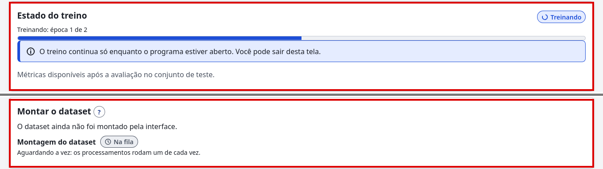 | 3 | Frequência baixa a moderada (engano de parâmetro ou mudança de plano); impacto alto, porque bloqueia a única fila de processamento por horas e a saída disponível interrompe tudo; persistência alta, porque não há alternativa dentro da interface | Oferecer "Cancelar o treino" (na fila ou em andamento) e "Tirar da fila" na TL02 e na TL11, com confirmação dizendo o que se perde; incluir o cancelamento no MoLIC M03 antes de implementar (Entrega 10, "Preparação para o Figma") |
| V05 | H4 | TL11, montagem na fila (TL11/03); TL01, escolher o modelo e os parâmetros (TL01/01) | Andreia confere se os dados estão prontos | A TL11 diz "O dataset ainda não foi montado pela interface" logo abaixo do conjunto de teste atual, com 12 imagens; na TL01, Freiburg Forest e Synthetic Offroad aparecem com "5 imagens de treino no dataset montado" | As duas telas dizem coisas opostas sobre os mesmos dados; Andreia pode remontar sem necessidade e correr o risco de mudar o conjunto de teste |  | 2 | Frequência baixa (até a primeira montagem pela interface); impacto alto se levar a uma remontagem desnecessária, reduzido pelo alerta de confirmação; persistência baixa | Dizer o que existe (ex.: "Dataset montado fora da interface") e usar "não montado" só quando não houver dataset |
| V06 | H5 | TL07, registrar a conclusão (TL07/06), vindo da TL06 (TL06/04); TL09, retomar a análise (TL09/02) | Andreia compara as métricas para fechar um experimento | Na TL07, o botão principal é "Registrar a recomendação" e a conclusão do experimento é o botão secundário, também no caminho do M03. Uma recomendação registrada vira a "Recomendação do ciclo" apresentada à coordenação na TL09 | Andreia pode registrar, pelo botão em destaque, uma recomendação do ciclo quando queria só registrar um experimento; a coordenação passa a ver como recomendação uma conclusão provisória | 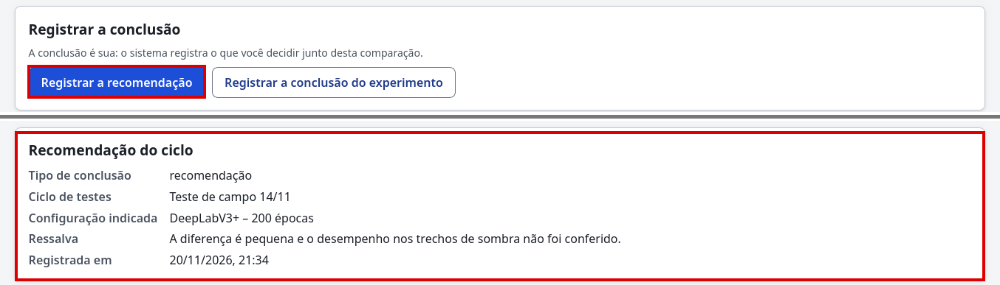 | 2 | Frequência moderada (todo experimento que termina na TL07); impacto alto se ocorrer, reduzido pela conferência (TL08/09) com "Corrigir"; persistência baixa | Não destacar nenhuma das duas saídas (dois botões do mesmo peso) ou destacar a que corresponde ao caminho de origem (vindo da TL06 ou da TL02, o experimento); na conferência da recomendação, lembrar que ela aparecerá na apresentação à coordenação |
| V07 | H5 | TL11, confirmar a remontagem (TL11/02); dataset montado (TL11/04) | Andreia pede para remontar o dataset | O alerta diz que "o conjunto de teste pode mudar" e, logo abaixo, que os arquivos brutos "não mudam"; não diz se o conjunto vai mudar desta vez nem quais configurações perderiam a avaliação. Depois de confirmar, o conjunto continuou o mesmo (8da9164d1a) e a FCN – 200 épocas continuou avaliada (TL11/04) | Andreia decide sem saber a consequência: pode evitar uma remontagem necessária, por medo de perder as avaliações, ou remontar sem precisar | 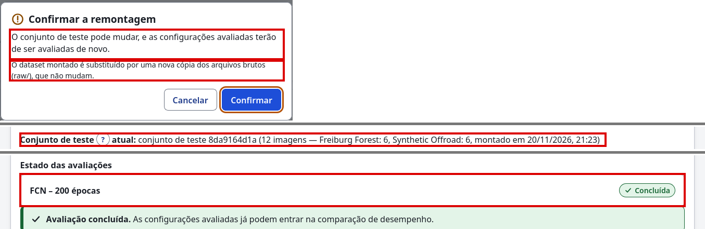 | 2 | Frequência baixa (remontagens são raras); impacto moderado (decisão às cegas sobre dados que afetam todas as comparações); persistência moderada, porque a dúvida se repete a cada remontagem | Dizer no alerta se o conjunto de teste vai mudar (comparando os arquivos brutos com o dataset atual) e listar as configurações que precisariam ser avaliadas de novo |
| V08 | H6 | TL02, resultado do treino (TL02/04) | Andreia confere se a nova configuração melhorou | O resultado mostra o IoU, a acurácia e o tempo de inferência da nova configuração, sem o valor de referência (configuração em uso) ao lado | Para saber se o treino valeu a pena, Andreia precisa lembrar os valores da configuração em uso ou ir à TL07 montar uma comparação | 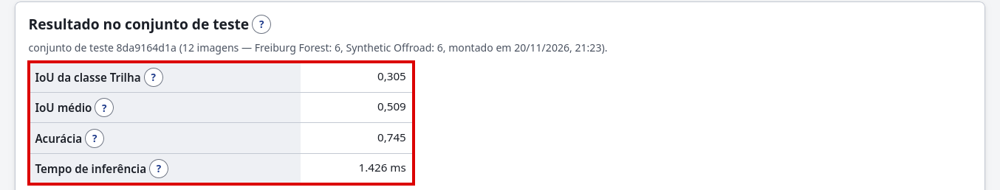 | 2 | Frequência alta (todo treino concluído); impacto moderado, porque a informação existe em outra tela; persistência alta, porque a comparação imediata nunca aparece | Mostrar no resultado do treino a coluna da configuração em uso (valor de referência) e a diferença, com a mesma regra da TL07 |
| V09 | H7 | TL01, escolher o modelo e os parâmetros (TL01/01) | Andreia quer treinar com o CaSSeD, que ainda não está no dataset montado | O aviso "monte-o na tela Datasets" não é um link; a pessoa precisa sair da configuração pelo menu, montar o dataset na TL11 e voltar à TL01 | Um passo a mais num caminho que se repete sempre que um dataset novo entra no treino | 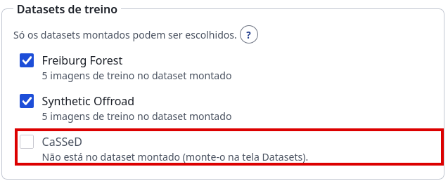 | 1 | Frequência baixa (só quando um dataset ainda não está montado); impacto baixo (um desvio pelo menu); persistência baixa | Transformar o aviso num link para a TL11 e, depois da montagem, oferecer a volta à configuração de treino |
| V10 | H9 | TL02, treino ou avaliação interrompidos (TL02/05) | O treino é interrompido porque o programa foi fechado | O "Ajuste sugerido" é "Reinicie o treino", mas o botão é "Reiniciar com o ajuste" e o batch size aparece como campo editável | A pessoa pode achar que precisa mudar o batch size e alterar um parâmetro da configuração sem necessidade | 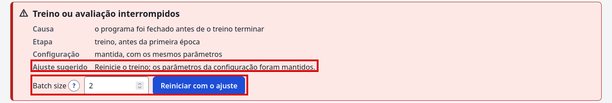 | 1 | Frequência baixa; impacto baixo, porque o campo já vem com o valor atual; persistência baixa | Quando a causa não pedir ajuste, chamar o botão de "Reiniciar o treino" e deixar a mudança do batch size como opção |

**Qualidade do relato:** o problema deve ser observável e localizado. Evite “interface confusa” sem dizer **o que**, **onde**, **quando** e **para quem**.

#### Percursos de acessibilidade

Os sete percursos foram feitos uma vez pela equipe, na interface executada; os resultados e as violações encontradas (VA01 a VA04) estão em "Percursos de acessibilidade da equipe", depois do AV03.

### 6. Boas práticas — heurísticas não violadas (atividade didática)

| Heurística sem violação | Exemplo no sistema | Evidência | Por que atende |
|---|---|---|---|
| H8 | O cartão "Estado do treino" mostra só o estado ("Na fila"), uma frase sobre o que acontece, o aviso de que o treino continua só com o programa aberto e o que falta para as métricas (TL02/01); os gráficos só entram quando há épocas para mostrar (TL02/02) | 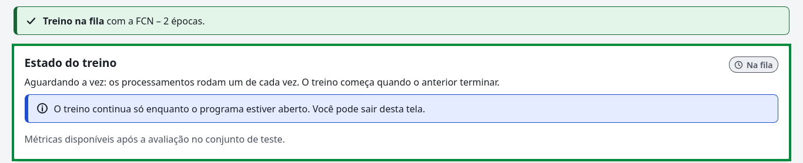 | Durante a espera, a tela não enche de campos vazios nem de métricas provisórias; a pessoa vê de relance em que ponto está e o que vem a seguir |
| H10 | Na TL11, "Conjunto de teste", "Sem avaliação no conjunto de teste" e "Montar o dataset" têm "?" junto do termo (TL11/04); na TL01, a regra "Só os datasets montados podem ser escolhidos" também tem "?" (TL01/01); os mesmos termos estão no glossário (TL10/02) | 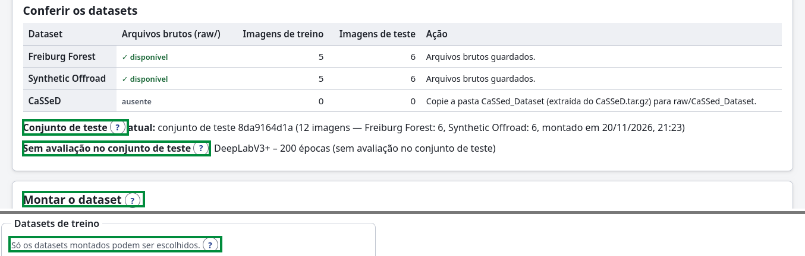 | Os termos da preparação dos dados, menos conhecidos fora da equipe do TCC, são explicados no ponto em que a decisão é tomada, sem mandar a pessoa a um manual |

---

## Percursos de acessibilidade da equipe

Os sete percursos da Entrega 11 ("Percursos completos a confirmar") foram feitos uma vez pela equipe, em 21/11/2026, com apoio do Claude, na interface executada no computador da equipe sobre uma cópia dos dados do TCC (versão `16a5bc1`, confirmada no rodapé).

- **Teclado:** cada percurso foi feito só com o teclado (Tab, Shift+Tab, Enter, Espaço, setas e Esc), com a janela em 1366 × 814 px. Depois de cada tecla, foram conferidos o elemento com foco, o contorno de foco e as mensagens da região anunciada (`aria-live`).
- **Ampliação de 200%:** as telas foram abertas com a largura útil de uma tela de 1366 px ampliada a 200% (683 × 407 px), conferindo se aparece rolagem horizontal e se algum conteúdo sai da tela.
- **Limites:** a janela de escolher arquivos é do sistema operacional e não foi percorrida; foram usadas imagens geradas para o teste (desenhos, não fotos do TCC), entregues direto ao campo, e a abertura da janela por Enter ou Espaço em "Escolher arquivos" foi conferida no código. A remontagem do dataset (TL11) não pôde ser feita, porque a cópia não tinha os arquivos brutos; "Remontar" ficou desabilitado, com o motivo escrito. As teclas + e − do visualizador não puderam ser enviadas pela ferramenta; os botões "Ampliar", "Reduzir" e "Imagem inteira" e as setas funcionaram pelo teclado.

| Percurso | Só com teclado: concluído? Onde parou? | Foco visível e na ordem da tela? | Ampliação de 200%: legível, sem rolagem horizontal? | Leitor de tela: anuncia estados e mensagens? | IDs das violações |
|---|---|---|---|---|---|
| Configurar e iniciar um treino (TL01 → TL02) | Concluído: modelo pelas setas, épocas, "Continuar", nome sugerido e "Iniciar o treino"; o treino foi para a fila | Sim. A ordem segue a coluna da esquerda e depois a da direita; ao trocar de tela, o foco vai para o título | Sim, sem rolagem horizontal; as duas colunas passam a uma | Não feito | VA01 |
| Enviar entradas e recuperar-se de um formato inválido (TL03 → TL04) | Concluído: ciclo de testes, arquivos, configuração, "Executar", diálogo de formato ("Seguir sem eles") e, no fim do processamento, "Avaliar as imagens", que recebe o foco | Em parte: depois de "Escolher arquivos", o Tab passa por um campo invisível (VA02). No diálogo, o foco vai para "Seguir sem eles" e circula entre os dois botões | Sim, sem rolagem horizontal | Não feito | VA01, VA02 |
| Avaliar as imagens (TL05) | Concluído: visualizador, avaliação "Duvidosa", origem do problema, "Registrar avaliação" e "Próxima imagem", que recebe o foco depois do registro | Em parte: o contorno de foco do visualizador não aparece (VA02); da imagem até a avaliação são 17 paradas de Tab (VA04) | Sim, sem rolagem horizontal | Não feito | VA01, VA02, VA04 |
| Comparar configurações (TL06 → TL07) | Concluído: imagens duvidosas, outra configuração, execução, comparação lado a lado e "Comparar as métricas no conjunto de teste"; diálogo "sem avaliação" com "Abrir Datasets"; tabela, "?" dos termos (fecha com Esc e devolve o foco), "A diferença importa?" e "Voltar à análise", que devolve o foco ao botão | Sim, exceto o visualizador (VA02) | Sim; a tabela de métricas cabe na largura, com rolagem própria se precisar | Não feito | VA01, VA02 |
| Registrar uma conclusão (TL08) | Concluído: recomendação, configuração indicada, ressalva, "Registrar", conferência e "Confirmar" | Sim; depois do registro, o foco vai para o título da conferência | Sim, sem rolagem horizontal | Não feito | VA01 |
| Apresentar uma recomendação (TL09) | Concluído: "Registrar a decisão", "Aceita com condição", condição e "Registrar" | Em parte: depois de registrar a decisão, o foco volta ao início da página (VA03) | Sim, sem rolagem horizontal | Não feito | VA01, VA03 |
| Preparar os dados e avaliar as configurações (TL11) | Concluído até a avaliação: duas configurações escolhidas e "Avaliar as selecionadas"; a remontagem não pôde ser feita (sem arquivos brutos na cópia) | Em parte: depois de "Avaliar as selecionadas", o foco volta ao início da página (VA03) | Sim, sem rolagem horizontal | Não feito | VA01, VA03 |

Elementos de todas as telas: o link "Pular para o conteúdo" é a primeira parada de Tab e leva a uma tela de erro (VA01); o indicador do topo e o botão "Glossário de termos" funcionam pelo teclado, e o glossário fecha com Esc, devolvendo o foco ao botão. Com 200%, o botão de fechar o glossário fica abaixo da área visível do painel, o que reforça a V05 do AV01.

| ID | Heurística | Tela/estado | Ação ou condição | Problema observado | Consequência para quem usa | Evidência | Severidade | Justificativa da severidade | Recomendação |
|---|---|---|---|---|---|---|---:|---|---|
| VA01 | H4 | Todas as telas | A pessoa usa o primeiro link da página, "Pular para o conteúdo" | O link leva ao endereço `#conteudo`, que a interface trata como uma tela: a tela atual some e aparece "Esta tela não existe" | Quem navega pelo teclado e usa o atalho padrão para pular o menu perde a tela em que estava, inclusive o que tinha preenchido, e precisa voltar pelo menu | 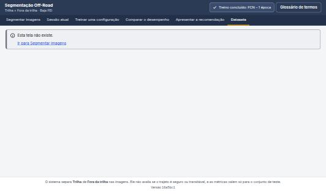 | 3 | Frequência alta para quem usa o teclado (é a primeira parada de Tab de toda tela); impacto alto (perde a tela e o que estava preenchido); persistência moderada, porque a pessoa aprende a evitar o link, mas fica sem o atalho | Fazer o link levar o foco ao conteúdo sem mudar o endereço (por exemplo, tratar o clique e chamar o foco do `main`), ou fazer o roteador ignorar `#conteudo` |
| VA02 | H1 | TL03 (envio das imagens) e TL05/TL06 (visualizador) | A pessoa avança com Tab | Depois de "Escolher arquivos", o Tab para num campo de arquivo escondido (1 × 1 px), sem contorno visível; no visualizador, o contorno de foco existe, mas fica fora do quadro, que corta o que passa da borda | A pessoa perde de vista onde está o foco: no envio, aperta Tab sem ver nada acontecer; no visualizador, não sabe que as setas e os atalhos já estão ativos | 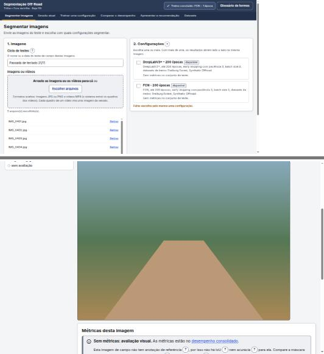 | 2 | Frequência alta (todo envio e toda imagem); impacto moderado, porque um Tab a mais recupera o foco visível; persistência moderada | Tirar o campo escondido da ordem de Tab (o rótulo "Escolher arquivos" já abre a janela) e desenhar o contorno de foco do visualizador por dentro do quadro (`outline-offset` negativo) |
| VA03 | H1 | TL11, avaliar as selecionadas; TL09, registrar a decisão | A pessoa aciona o botão pelo teclado | A tela é redesenhada e o botão some; o foco volta ao início da página, sem ir para a mensagem de resultado | Quem usa o teclado precisa recomeçar a navegação desde o topo para chegar ao estado da avaliação ou à decisão registrada | Sem captura: o foco foi conferido pelo elemento ativo depois da ação (corpo da página) | 2 | Frequência moderada (duas ações do fluxo); impacto moderado (vários Tabs para voltar ao ponto); persistência alta, porque acontece toda vez | Depois de redesenhar, levar o foco para a mensagem de resultado ou para o título da seção atualizada, como já é feito na TL07 e na TL08 |
| VA04 | H7 | TL05, avaliar as imagens | Rafael avalia imagem por imagem com o teclado | Do título da imagem até a escolha "Correta" ou "Duvidosa" são 17 paradas de Tab (controles do visualizador e os "?" do quadro de métricas), em cada imagem | Avaliar uma sessão inteira pelo teclado fica lento; a pessoa repete o mesmo caminho longo a cada imagem | Sem captura: ordem de Tab conferida na TL05 | 2 | Frequência alta (toda imagem); impacto moderado (lentidão, não impede a tarefa); persistência alta | Depois de "Próxima imagem", levar o foco direto para a escolha da avaliação, ou oferecer um atalho de teclado para "Correta" e "Duvidosa" |

## 7. Consolidação da equipe

Problemas iguais ou muito semelhantes encontrados por avaliadores diferentes devem ser consolidados, preservando quem os encontrou. A consolidação só começa quando os três avaliadores terminam a inspeção individual. A heurística e a severidade que cada avaliador deu ficam registradas antes do consenso; quando não houver acordo, as posições ficam lado a lado na coluna "Divergências" (Entrega 12, E.5).

Os 36 achados (12 do AV01, 10 do AV02, 10 do AV03 e 4 dos percursos de acessibilidade da equipe) foram reunidos em 27 problemas. Todos os achados repetidos receberam a mesma heurística e a mesma severidade dos avaliadores que os encontraram; por isso, a coluna "Divergências" ficou vazia. O responsável pela correção é o integrante dono da tela na Entrega 11; problemas de várias telas ou de telas compartilhadas ficam com a equipe.

| ID consolidado | Achados individuais | Heurística e severidade de cada avaliador | Problema | Severidade final | Divergências | Prioridade | Responsável pela correção |
|---|---|---|---|---:|---|---|---|
| HC01 | V09 (AV01), V07 (AV02) | AV01: H5, 3; AV02: H5, 3 | Na TL03, o ciclo de testes vem preenchido com o ciclo anterior; as imagens de um novo teste podem entrar no ciclo errado sem aviso | 3 | — | alta | Tiago Fagundes dos Santos (TL03) |
| HC02 | V04 (AV03) | AV03: H3, 3 | Não há como cancelar um treino na fila ou em andamento nem tirar uma montagem ou avaliação da fila; a única saída é fechar o programa | 3 | — | alta | Mateus Marana Assuena (TL02, TL11; cancelamento a incluir antes no MoLIC M03) |
| HC03 | VA01 (equipe) | Equipe: H4, 3 | O link "Pular para o conteúdo" leva a "Esta tela não existe" e tira a pessoa da tela em que estava | 3 | — | alta | Equipe (todas as telas) |
| HC04 | V01 (AV01), V01 (AV02) | AV01: H1, 2; AV02: H1, 2 | Na TL04, selo "Concluído" numa configuração com falha ainda sem decisão | 2 | — | média | Tiago Fagundes dos Santos (TL04) |
| HC05 | V02 (AV01), V02 (AV02) | AV01: H1, 2; AV02: H1, 2 | Na TL05, o título da imagem continua "sem avaliação" depois do registro | 2 | — | média | Tiago Fagundes dos Santos (TL05) |
| HC06 | V03 (AV01), V03 (AV03) | AV01: H2, 2; AV03: H2, 2 | Tempo de inferência como "1.426 ms", com ponto de milhar numa tabela com vírgula decimal (TL02, TL07, TL08, TL09) | 2 | — | média | Equipe (TL02, TL07 a TL09) |
| HC07 | V07 (AV01), V05 (AV03) | AV01: H4, 2; AV03: H4, 2 | "O dataset ainda não foi montado pela interface" na TL11, ao lado de um conjunto de teste atual e do "dataset montado" da TL01 | 2 | — | média | Mateus Marana Assuena (TL11) |
| HC08 | V06 (AV01), V06 (AV02) | AV01: H4, 2; AV02: H4, 2 | Na avaliação de vídeo (TL05), "quadro" e "imagem" misturados nos botões e nas contagens | 2 | — | média | Tiago Fagundes dos Santos (TL05) |
| HC09 | V08 (AV01) | AV01: H5, 2 | Na TL07, configurações sem avaliação no conjunto de teste ou sem execução no ciclo podem ser marcadas; o erro só aparece depois de comparar | 2 | — | média | Henrique Finatti Silveira Belo Trebbi (TL07) |
| HC10 | V10 (AV01) | AV01: H6, 2 | A coluna "Valor de referência" não diz no cabeçalho de qual configuração vem (TL07, TL08, TL09) | 2 | — | média | Henrique Finatti Silveira Belo Trebbi (TL07 a TL09) |
| HC11 | V05 (AV01) | AV01: H3, 2 | O botão para fechar o glossário fica no fim da lista, fora da área visível (também com 200%), e se chama "Voltar à cena anterior" | 2 | — | média | Equipe (TL10) |
| HC12 | V01 (AV03) | AV03: H1, 2 | O indicador do topo não mostra a montagem nem a avaliação iniciadas na TL11 | 2 | — | média | Mateus Marana Assuena (TL11, indicador do topo) |
| HC13 | V02 (AV03) | AV03: H1, 2 | A fila não mostra a posição nem o processamento à frente (TL01, TL02, TL11) | 2 | — | média | Mateus Marana Assuena (TL01, TL02, TL11) |
| HC14 | V06 (AV03) | AV03: H5, 2 | Na TL07, o botão em destaque é "Registrar a recomendação", também no caminho do experimento | 2 | — | média | Henrique Finatti Silveira Belo Trebbi (TL07) |
| HC15 | V07 (AV03) | AV03: H5, 2 | O alerta da remontagem não diz se o conjunto de teste vai mudar nem quais configurações perderiam a avaliação | 2 | — | média | Mateus Marana Assuena (TL11) |
| HC16 | V08 (AV03) | AV03: H6, 2 | O resultado do treino (TL02) não mostra o valor de referência ao lado das métricas | 2 | — | média | Mateus Marana Assuena (TL02) |
| HC17 | V05 (AV02) | AV02: H4, 2 | Na TL05, dois botões de comparar com comportamentos diferentes e um texto de ajuda que contradiz o que está habilitado | 2 | — | média | Tiago Fagundes dos Santos (TL05) |
| HC18 | V08 (AV02) | AV02: H5, 2 | A avaliação é uma só por imagem, não diz de qual configuração é e é substituída ao registrar com outra configuração | 2 | — | média | Tiago Fagundes dos Santos (TL05, TL06) |
| HC19 | V09 (AV02) | AV02: H9, 2 | Na falha de imagem corrompida (TL04), a sugestão de reenviar o arquivo não tem caminho, e "Tentar de novo" falha de novo | 2 | — | média | Tiago Fagundes dos Santos (TL04) |
| HC20 | VA02 (equipe) | Equipe: H1, 2 | Foco invisível: campo de arquivo escondido na ordem do Tab (TL03) e contorno cortado no visualizador (TL05, TL06) | 2 | — | média | Tiago Fagundes dos Santos (TL03, TL05, TL06) |
| HC21 | VA03 (equipe) | Equipe: H1, 2 | Depois de "Avaliar as selecionadas" (TL11) e de registrar a decisão (TL09), o foco volta ao início da página | 2 | — | média | Equipe (TL09, TL11) |
| HC22 | VA04 (equipe) | Equipe: H7, 2 | Na TL05, 17 paradas de Tab do título da imagem até a escolha da avaliação, em cada imagem | 2 | — | média | Tiago Fagundes dos Santos (TL05) |
| HC23 | V04 (AV01), V04 (AV02) | AV01: H2, 1; AV02: H2, 1 | Erros de escrita nas mensagens montadas pelo sistema (TL03, TL08) | 1 | — | baixa | Equipe |
| HC24 | V11 (AV01), V10 (AV02) | AV01: H9, 1; AV02: H9, 1 | O alerta de imagens sem avaliação (TL08) não diz quais imagens faltam | 1 | — | baixa | Equipe (TL08) |
| HC25 | V12 (AV01), V10 (AV03) | AV01: H9, 1; AV03: H9, 1 | "Reiniciar com o ajuste" quando a causa da interrupção não pede ajuste (TL02) | 1 | — | baixa | Mateus Marana Assuena (TL02) |
| HC26 | V03 (AV02) | AV02: H1, 1 | Na conferência da conclusão (TL08), "Conclusão registrada" e, abaixo, "Confirmar": não fica claro se já está guardada | 1 | — | baixa | Equipe (TL08) |
| HC27 | V09 (AV03) | AV03: H7, 1 | "Monte-o na tela Datasets" (TL01) não é um link | 1 | — | baixa | Mateus Marana Assuena (TL01) |

## 8. Síntese e plano de melhoria

**Quantidade de problemas por heurística e severidade (problemas consolidados):**

| Heurística | Severidade 3 | Severidade 2 | Severidade 1 | Total |
|---|---:|---:|---:|---:|
| H1 Visibilidade do status do sistema | 0 | 6 | 1 | 7 |
| H2 Compatibilidade com o mundo real | 0 | 1 | 1 | 2 |
| H3 Controle e liberdade | 1 | 1 | 0 | 2 |
| H4 Consistência e padrões | 1 | 3 | 0 | 4 |
| H5 Prevenção de erros | 1 | 4 | 0 | 5 |
| H6 Reconhecimento em vez de memorização | 0 | 2 | 0 | 2 |
| H7 Flexibilidade e eficiência | 0 | 1 | 1 | 2 |
| H8 Estética e design minimalista | 0 | 0 | 0 | 0 |
| H9 Reconhecer, diagnosticar e recuperar-se de erros | 0 | 1 | 2 | 3 |
| H10 Ajuda e documentação | 0 | 0 | 0 | 0 |
| **Total** | **3** | **19** | **5** | **27** |

Nenhum problema recebeu severidade 4. H8 e H10 não tiveram violação em nenhuma avaliação; os exemplos de boa prática estão na seção 6 de cada avaliador.

**Problemas que bloqueiam o teste com usuários:** os três de severidade 3, que a Entrega 12 manda corrigir antes do piloto.

- **HC01**, ciclo de testes preenchido com o anterior: afeta a UT01 e a UT02, que começam pelo envio das imagens.
- **HC02**, sem cancelar treino ou fila: afeta a UT04. O cancelamento não está modelado (Entrega 10, "Preparação para o Figma"); antes de implementar, ele entra no MoLIC M03.
- **HC03**, "Pular para o conteúdo" leva a uma tela de erro: afeta qualquer participante que use o teclado.

**Padrões recorrentes entre telas:**

1. **O estado mostrado não acompanha o que aconteceu** (H1): selo "Concluído" com falha pendente, título "sem avaliação" depois do registro, indicador do topo que não vê a TL11, fila sem posição e foco que se perde depois de redesenhar a tela (HC04, HC05, HC12, HC13, HC20, HC21).
2. **Prevenção que chega tarde** (H5): o sistema já sabe que a escolha vai dar errado, mas só avisa depois da ação (HC01, HC09, HC14, HC15, HC18).
3. **Termos e números ambíguos** (H2, H4): "quadro" e "imagem", "1.426 ms", "dataset montado" e "não montado" (HC06, HC07, HC08, HC17).
4. **Referência longe da decisão** (H6): o valor de referência não aparece no resultado do treino nem diz de onde vem no cabeçalho (HC10, HC16).

**Correções antes da avaliação com usuários:**

- **Obrigatórias (severidade 3):** HC01, HC02 e HC03.
- **Recomendadas, por estarem nas tarefas do teste:** HC04, HC05 e HC08 (UT01, avaliação das imagens); HC12, HC13 e HC16 (UT04, treino); HC09 (UT03, comparação).
- **Depois da Entrega 14:** os demais problemas de severidade 2 e os de severidade 1.
- O valor de referência (HC10) fica para depois do teste, porque a Entrega 12 prevê observar se os participantes o entendem.
- As correções geram um novo commit, que é registrado na Entrega 12 ("Cronograma, equipamento e responsáveis") e na Entrega 14.

**Respostas às perguntas da Entrega 12 (QA09 a QA13):**

| Pergunta | Evidência na inspeção | Meta | Resultado |
|---|---|---|---|
| QA09 — Estado e recuperação nas falhas da execução e do treino | H1 e H9 nos estados de falha da TL02, da TL04 e da TL11: HC04 (2), HC19 (2) e HC25 (1) | Nenhuma violação de severidade 3 ou 4 | Atingida |
| QA10 — Prevenção e explicação dos erros previstos nos MoLIC | H5 e H9 na TL01, TL03, TL07, TL09 e TL11: HC01 (3), HC09 (2), HC14 (2) e HC15 (2) | Nenhuma violação de severidade 3 ou 4 | Não atingida (HC01) |
| QA11 — Termos, legenda e cores iguais em todas as telas e explicados no ponto de uso | H2, H4 e H10: HC03 (3), HC06, HC07, HC08 e HC17 (2) e HC23 (1); H10 sem violação | Nenhuma violação de severidade 3 ou 4 | Não atingida (HC03) |
| QA12 — A decisão fica com a pessoa | H2 e H3 na TL07, TL08 e TL09: HC06 (2). Fora dessas heurísticas, o botão em destaque "Registrar a recomendação" (HC14, H5) também pesa na decisão | Nenhuma violação de severidade 3 ou 4 | Atingida, com a ressalva do HC14 |
| QA13 — Critérios de acessibilidade da Entrega 8 | Os sete percursos foram concluídos só com o teclado, e nenhuma tela teve rolagem horizontal com 200%; o leitor de tela não foi usado. Problemas: HC03 (3), HC20, HC21 e HC22 (2) | Os cinco pontos prioritários da Entrega 8, §2, atendidos | Não atingida (HC03 e foco invisível, HC20) |

A ausência de problemas encontrados não comprova alta usabilidade: indica só que esta inspeção, com esse escopo e esses avaliadores, não revelou outros problemas.

## Checklist

- [x] Cada integrante fez uma inspeção completa e identificada.
- [x] Todas as telas/estados relevantes foram examinados.
- [x] Estados administrativos, filtros, relatórios, históricos, processamento e erros foram incluídos quando existentes.
- [x] A inspeção avaliou a interface/protótipo, não o mérito técnico do algoritmo/modelo.
- [x] H1–H10 aparecem na matriz de cobertura de cada avaliador.
- [x] A equipe fez os sete percursos de acessibilidade (teclado e ampliação de 200%).
- [x] Parte de violações contém apenas violações, sem “forçar” exemplos.
- [x] Todo problema tem print/localização e contexto.
- [x] Severidade possui justificativa, não apenas número.
- [x] Recomendação resolve a causa ou reduz o impacto.
- [x] Achados duplicados foram consolidados ao final.
