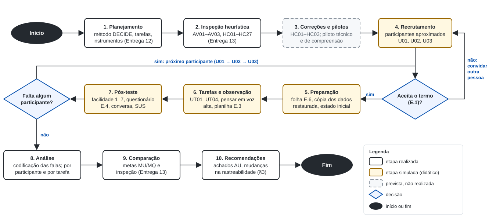

# Entrega 14 — Avaliação de usabilidade por observação de usuários

**Data:** 21/11/2026 (início e conclusão)  
**Status:** 🟩 concluída  
**Responsabilidade:** solução consolidada por equipe. O número de participantes finais observados deve ser igual ao número de integrantes, conforme o modelo da disciplina; recomenda-se que cada integrante seja responsável por conduzir/analisar ao menos um participante.

> **Sessões simuladas.** No prazo desta entrega, a equipe não teve acesso a integrantes da equipe Baja FEI para o teste. Por isso, as sessões de U01, U02 e U03 foram **simuladas pela equipe, para fins didáticos**, com um participante aproximado (*proxy*) por perfil, como prevê a Entrega 12 (seção C), e com base na interface real, commit `16a5bc1`. Os registros das seções C a G (sucesso, erros, ajudas, falas, notas e SUS) exercitam o método planejado na Entrega 12 e **não são resultados observados**: não substituem um teste com usuários reais, e as conclusões valem só como hipóteses `[H]`. O teste piloto não foi feito, e os problemas de severidade 3 da Entrega 13 (HC01, HC02 e HC03) não foram corrigidos antes das sessões (`PENDENCIAS.md`, INC-81).

## Objetivo da atividade

Observar usuários representativos realizando tarefas reais ou realisticamente simuladas para identificar problemas de eficácia, eficiência, compreensão e satisfação que não podem ser inferidos apenas por inspeção.

> **Participantes finais não devem ser membros da equipe.** Um integrante pode participar do teste piloto apenas para validar roteiro/equipamentos, sem contar na amostra final.

### Quando o usuário é um perfil profissional especializado

Em TCCs técnicos, o público pode ser DBA, analista, pesquisador, administrador, técnico ou outro especialista. Priorize participantes que possuam relação real com as tarefas. Se não for possível recrutar o perfil ideal, qualquer participante aproximado/proxy deve ser **justificado previamente e tratado como limitação**; não apresente o resultado como equivalente ao de especialistas reais.

O teste avalia a **interação com o protótipo**. Não é necessário que o participante valide o desempenho científico do algoritmo. Resultados simulados podem ser usados quando declarados e coerentes com a tarefa.

Tarefas podem envolver, por exemplo, interpretar um dashboard, configurar uma análise, encontrar uma execução no histórico usando filtros, comparar resultados, gerar relatório, revisar alerta ou administrar permissões.

## A. Fluxograma do processo — equipe

*Figura A.1 — Processo seguido nesta entrega, do planejamento (Entrega 12) às recomendações. Mostra a ordem das etapas, as duas decisões do processo (aceite do termo e repetição para cada participante) e quais etapas foram realizadas, simuladas ou não realizadas.*

<!-- O fluxograma deve representar, no mínimo: planejamento → recrutamento → consentimento → preparação → execução das tarefas/observação → pós-teste → consolidação/análise → recomendações. -->

| Etapa | O que acontece | Onde está |
|---|---|---|
| 1. Planejamento | Perguntas QA01 a QA14, tarefas UT01 a UT04, critérios de sucesso e instrumentos E.1 a E.6, definidos antes do teste | Entrega 12 |
| 2. Inspeção heurística | Três avaliadores, 27 problemas consolidados (HC01 a HC27) | Entrega 13 |
| 3. Correções e pilotos | Previstos na Entrega 12 antes das sessões; **não realizados**: o teste usou a versão `16a5bc1`, com HC01, HC02 e HC03 | Seção B, passos 1 e 4 |
| 4. Recrutamento | Um participante aproximado por perfil: U01 (P01), U02 (P02), U03 (P03) | Seção B, passo 2 |
| Decisão: aceita o termo? | Sem aceite, a sessão não começa e outra pessoa do mesmo perfil é convidada | Seção B, passo 3 |
| 5. Preparação | Folha E.6: versão no rodapé, cópia dos dados restaurada e estado inicial de cada participante | Seção B, passo 6 |
| 6. Tarefas e observação | Cenários neutros, pensar em voz alta e registro na planilha E.3 | Seções B (passo 5) e C |
| 7. Pós-teste | Facilidade de 1 a 7 depois de cada tarefa, questionário de compreensão (U01 e U03), conversa e SUS | Seção C |
| Decisão: falta algum participante? | O ciclo de consentimento a pós-teste se repete para U01, U02 e U03 | — |
| 8. Análise | Falas codificadas pelas metas MQ01 a MQ07; resultados por participante e por tarefa | Seções C e D |
| 9. Comparação | Metas da Entrega 8 e problemas da inspeção (Entrega 13) | Seções D e F |
| 10. Recomendações | Achados AU com a mudança proposta, registrada na `RASTREABILIDADE.md`, §3 | Seção E |

## B. Procedimento de preparação e execução — equipe

### Passo 1 — Objetivos e versão avaliada

**Objetivo:** verificar, com um participante aproximado de cada perfil, se a interface permite fazer as tarefas UT01 a UT04 com eficácia e compreensão do que se vê, e encontrar o que impede isso (Entrega 12, seção A). O teste avalia a **interação**. A qualidade das máscaras, os valores de IoU e a escolha entre FCN e DeepLabV3+ aparecem só como material das tarefas; o sucesso não depende de qual configuração o participante prefere, e sim de ele citar a configuração, a foto e a métrica corretas.

**Versão avaliada:** interface implementada na Entrega 11, repositório https://github.com/HenriqueFinatti/Segmentacao-Semantica-Off-Road, ramo `interface`, commit `16a5bc1` (20/11/2026), mostrado no rodapé de cada tela. É a mesma versão inspecionada na Entrega 13. Os problemas de severidade 3 da inspeção não foram corrigidos (`PENDENCIAS.md`, INC-81): **HC01** (ciclo de testes preenchido com o anterior, TL03), **HC02** (sem cancelar treino ou fila, TL02) e **HC03** ("Pular para o conteúdo" leva a uma tela de erro) estão presentes nas sessões.

**Metas de usabilidade relacionadas** (Entrega 8, §3):

| Meta | O que verifica | Tarefa e participante | Critério |
|---|---|---|---|
| MU01 | Conclusão sem ajuda da execução e da avaliação das fotos | UT01; U01 | Conclui sem ajuda e aponta ao menos uma região mal classificada |
| MU02 | Conclusão sem ajuda da comparação na mesma foto | UT02; U01 e U02, relatados separadamente | Cada um conclui sem ajuda, citando a configuração e a foto corretas |
| MU03 | Conclusão sem ajuda da recomendação | UT03; U03 | Conclui sem ajuda; a recomendação cita a métrica e uma ressalva |
| MU04 | Erros críticos não percebidos | UT01 a UT04; U01 a U03 | 0 para cada participante |
| MU07 | Ajudas do moderador (solicitadas ou oferecidas) | UT01 a UT04; U01 a U03 | No máximo 1 por tarefa |
| MU08 | Acertos no questionário de compreensão (E.4) | Depois da UT01 (U01) e da UT03 (U03) | Pelo menos 3 de 4 |
| MU09 | Facilidade percebida, de 1 a 7 | Depois de cada tarefa; U01 a U03 | Pelo menos 5 em cada tarefa |
| MU10 | SUS, de 0 a 100 | Fim da sessão; U01 a U03 | Pelo menos 68 |
| MU11 | Conclusão sem ajuda da definição e do acompanhamento do treino | UT04; U02 | Conclui sem ajuda e, ao voltar, diz o estado do treino e por que terminou |

As metas qualitativas MQ01 a MQ07 são verificadas pelas falas e pelo comportamento, codificados depois de cada sessão (Entrega 12, seção F). A MU05 (recuperação de falhas) foi verificada só na inspeção (Entrega 13, QA09), e a MU06 (tempo) está retirada desde a Entrega 8: o tempo das tarefas é dominado pelo processamento e pelo treino.

### Passo 2 — Participantes

Um participante por perfil, como na Entrega 12 (seção C). Sem acesso aos integrantes da equipe Baja FEI, os três são **participantes aproximados (*proxy*)**, escolhidos pelas alternativas que a Entrega 7 previu para cada perfil, e as sessões foram simuladas (ver o aviso no topo). Os perfis abaixo são hipotéticos `[H]`. Nenhum participante é autor deste projeto ou do TCC, nenhum participou de piloto e nenhum usou a interface antes. Como os três são aproximados, não há resultado de participante real para comparar: todos os resultados são lidos caso a caso e como limitação.

| ID | Perfil | Critérios que justificam participação | Integrante responsável |
|---|---|---|---|
| U01 | Aproximado de P01 (Rafael): aluno de Ciência da Computação da FEI com experiência em visão computacional fora da Baja `[H]` | Executou e analisou resultados de segmentação semântica em um projeto de iniciação científica no último semestre; costuma ver as máscaras em notebooks `[H]`. **Limitação:** conhece segmentação, mas não as trilhas nem a rotina dos testes de campo da Baja | Moderador: Henrique Finatti Silveira Belo Trebbi; anotador: Mateus Marana Assuena |
| U02 | Aproximado de P02 (Andreia): pós-graduando em visão computacional da FEI, fora da Baja `[H]` | Treinou modelos de segmentação no último ano e acompanha treinos longos com gráficos de perda `[H]`. **Limitação:** conhece o treino, mas não o contexto da Baja nem a decisão da configuração usada em campo | Moderador: Tiago Fagundes dos Santos; anotador: Henrique Finatti Silveira Belo Trebbi |
| U03 | Aproximado de P03 (Larissa): gestor técnico de outra equipe de competição da FEI `[H]` | No último semestre, participou da escolha entre soluções técnicas da sua equipe com base em resultados de teste `[H]`. **Limitação:** decide com base em números, mas nunca escolheu uma configuração de modelo de segmentação nem leu IoU | Moderador: Mateus Marana Assuena; anotador: Tiago Fagundes dos Santos |

Ninguém modera a sessão da persona que escreveu (Entrega 12, seção C).

### Passo 3 — Consentimento e privacidade

- **Termo de consentimento:** [E.1 da Entrega 12](12_planejamento_avaliacao.md#e1-termo-de-consentimento), lido e aceito antes da sessão; sem aceite, a sessão não começa. Nas sessões simuladas, nenhum termo foi assinado.
- **Gravação:** prevista a gravação da tela da interface e do áudio, sem vídeo do rosto, só com autorização no termo e só para conferir as anotações. Nas sessões simuladas não houve gravação; os registros são as planilhas de observação (E.3) simuladas, resumidas na seção C.
- **Anonimização:** códigos U01 a U03; papéis descritos de forma genérica; a lista que liga código e nome ficaria fora do repositório. O desempenho de cada participante não seria repassado à liderança da equipe de origem.
- **Armazenamento:** pasta privada dos três autores, fora do repositório; gravações apagadas depois da análise; anotações e lista de códigos apagadas ao fim do semestre letivo (Entrega 12, seção A, etapa D do DECIDE).

### Passo 4 — Teste piloto

**Data:** não realizado (`PENDENCIAS.md`, INC-81).  
**O que seria validado:** no piloto técnico, com um integrante, a gravação, a preparação dos dados e do estado inicial (E.6), a duração da sessão e o tempo do treino rápido da UT04; no piloto de compreensão, com uma pessoa de fora do projeto, se as instruções da UT01 à UT04, o questionário de compreensão e as perguntas pós-tarefa são entendidos sem dizer onde clicar (Entrega 12, seção C).  
**Consequência de não fazer:** as instruções e o questionário não foram testados antes das sessões; os parâmetros do treino rápido e a duração da sessão foram definidos sem medição `[H]` (passo 5, "Preparação das sessões").  
**Mudanças após piloto:** nenhuma, porque não houve piloto. Sem piloto, só foram preenchidas as palavras entre colchetes dos cenários (passo 5).

### Passo 5 — Tarefas

Os cenários são os da Entrega 12 (seção D). O moderador lê o cenário em voz alta e entrega uma cópia impressa; os cenários não usam os nomes de menus nem de botões. O tempo das tarefas não é medido (MU06 retirada); a coluna "Métricas" lista o que é registrado na planilha E.3.

| ID | Cenário/instrução apresentada | Critério de sucesso | Métricas | Ligação com modelo |
|---|---|---|---|---|
| UT01 | "Você voltou do teste de campo de 08/11 com as fotos que estão na pasta. A equipe quer saber se a configuração que está sendo usada hoje delimita bem a trilha nessas fotos. Analise as fotos e deixe registrado, para cada uma, se o resultado está bom e, quando houver algum problema, de onde ele vem." | U01, sem ajuda: envia as fotos e executa com a configuração em uso; registra a avaliação de cada foto; aponta ao menos uma região mal classificada; não trata a falta de métricas como erro nem conclui que o trecho é seguro | Sucesso, erros (de execução, de interpretação, críticos), ajudas, facilidade de 1 a 7, questionário E.4 | T02 e T01; O03 e O04; M01; TL03, TL04, TL05; MU01, MU04, MU08; MQ01, MQ02, MQ04; QA01 a QA04 |
| UT02 | "A foto deixou dúvida sobre o resultado. A equipe tem outra configuração treinada e quer saber se ela delimita melhor a trilha nessa foto. Veja o resultado das duas configurações nessa foto e deixe registrada a sua conclusão." | U01 e U02, cada um sem ajuda: executa a outra configuração na mesma foto; vê as duas na mesma região; registra a conclusão (uma das configurações, nenhuma ou inconclusiva) citando a configuração e a foto corretas; não atribui um resultado à configuração errada | Sucesso, erros, ajudas, facilidade de 1 a 7 | T03 e T07; O05 e O08; M01 e M03; TL06, TL04, TL08; MU02, MU04; MQ04, MQ05; QA04, QA05 |
| UT03 | "Amanhã a coordenação vai decidir qual configuração usar nos próximos testes. As configurações usadas nos testes já foram avaliadas. Veja como elas se saíram e deixe registrado o que você indicaria à coordenação, por que e o que ainda não se sabe sobre essa escolha." | U03, sem ajuda: lê o desempenho das configurações do ciclo; registra uma recomendação (uma configuração, nenhuma ou adiar) que cita ao menos uma métrica e uma ressalva; julga com as próprias palavras se a diferença importa; não atribui a escolha ao sistema | Sucesso, erros, ajudas, consultas aos termos (TL10), facilidade de 1 a 7, questionário E.4 | T04 e T05 até a recomendação; O06, O07, O08; M02; TL07, TL10, TL08; MU03, MU04, MU08; MQ03, MQ07; QA06, QA07 |
| UT04 | **Parte 1:** "Antes de rodar o experimento completo, você quer um teste rápido do DeepLabV3+ treinado só com as imagens do Freiburg Forest, que termine durante esta sessão. Prepare esse treino e deixe-o rodando." **Parte 2**, depois da conversa pós-teste: "Você voltou ao computador. Diga como está o treino que você deixou rodando." | U02, sem ajuda: escolhe o DeepLabV3+, só o Freiburg Forest e um número de épocas compatível com um teste rápido; inicia o treino; na parte 2, diz se o treino está em andamento ou terminou e, se terminou, por quê | Sucesso, erros, ajudas, facilidade de 1 a 7 (depois da parte 2) | T08; O01 e O02; M03; TL01, TL02; MU11, MU04; MQ06; QA08 |

**Preparação das sessões** (folha E.6 da Entrega 12, preenchida para as sessões simuladas `[H]`):

| Item | U01 | U02 | U03 |
|---|---|---|---|
| Versão no rodapé | `16a5bc1` | `16a5bc1` | `16a5bc1` |
| Configurações | FCN – 200 épocas (em uso) e DeepLabV3+ – 200 épocas, ambas avaliadas no conjunto de teste atual | as mesmas; a "outra configuração" da UT02 é a DeepLabV3+ – 200 épocas | as mesmas, executadas no ciclo "Teste de campo 08/11" |
| Ciclo de testes | o último ciclo usado é "Teste de campo 25/10"; o participante deve criar o "Teste de campo 08/11" | sessão já criada no ciclo "Teste de campo 08/11" | ciclo "Teste de campo 08/11" com as duas execuções |
| Arquivos | pasta com 3 fotos de campo: `foto_01` (trilha seca, sol de frente), `foto_02` (trilha sob sombra de árvores, em que a configuração em uso marca parte da sombra como *Fora da trilha*) e `foto_03` (trilha com lama) | as mesmas fotos, já executadas e avaliadas, com a `foto_02` marcada como duvidosa | — |
| Estado inicial | nenhuma sessão aberta | nenhum treino em andamento; fila vazia | nenhuma recomendação registrada |
| Treino rápido da UT04 | — | resposta esperada: DeepLabV3+, só Freiburg Forest, até 10 épocas; batch size 4, early stopping ligado com paciência 5 (valores padrão) | — |
| Palavras entre colchetes | "08/11" (UT01) | "a foto que deixou dúvida" = `foto_02` | — |

### Passo 6 — Protocolo do moderador

O protocolo segue o roteiro E.2 da Entrega 12. Em cada sessão, um integrante modera e outro anota; o anotador não fala com o participante.

1. Conferir a folha de preparação: versão no rodapé, cópia dos dados restaurada, estado inicial e fotos na pasta; fechar os outros programas.
2. Ler a abertura padronizada: **quem está sendo avaliada é a interface, não a pessoa**; os modelos e os resultados deles também não estão em avaliação.
3. Entregar o termo (E.1) e registrar o aceite; sem aceite, a sessão não começa.
4. Fazer o perfil pré-teste (P1 a P5) para confirmar o perfil aproximado e o critério de exclusão.
5. Explicar o pensar em voz alta e lembrar o participante de falar se ele ficar em silêncio.
6. Ler cada cenário e entregar a cópia impressa. O moderador pode reler o cenário e dizer onde estão as fotos, mas **não ensina o caminho**: não diz nomes de menus e de botões, não explica termos, não confirma se uma ação está certa.
7. Dar ajuda só quando o participante pedir ou ficar cerca de 2 minutos parado sem progresso `[H]`, sempre a menor possível (em que parte da tela procurar). O anotador registra a ajuda como **solicitada** ou **oferecida**; sem progresso depois de uma ajuda, a tarefa é encerrada como abandono.
8. Durante o processamento ou o treino, tratar a espera como **pausa técnica**: ela não conta como dificuldade, e o participante pode comentar o que vê.
9. Depois de cada tarefa, pedir a nota de facilidade de 1 a 7 e perguntar o que tornou a atividade fácil ou difícil (MU09).
10. Aplicar o questionário de compreensão (E.4) ao U01, depois da UT01, e ao U03, depois da UT03, sem comentar as respostas.
11. Fazer a conversa pós-teste (C1 a C6) e aplicar o SUS (MU10).
12. Encerrar: responder às dúvidas, explicar o uso dos dados e o direito à exclusão e agradecer. Depois, moderador e anotador codificam as falas separadamente e chegam a um código comum (Entrega 12, seção F).

Ordem de cada sessão:

| Participante | Ordem |
|---|---|
| U01 | termo e perfil → UT01 → questionário E.4 (versão U01) → UT02, na sessão criada na UT01 → conversa pós-teste e SUS |
| U02 | termo e perfil → UT02 → UT04, parte 1 → conversa pós-teste e SUS, enquanto o treino roda → UT04, parte 2 |
| U03 | termo e perfil → UT03 → questionário E.4 (versão U03) → conversa pós-teste e SUS |

## C. Resultados — por participante

### U01 — aproximado de P01 (Rafael): aluno de Ciência da Computação com experiência em segmentação

*Sessão simulada `[H]`: os registros abaixo exercitam a planilha E.3 da Entrega 12 e não foram observados.*

| Campo | Registro |
|---|---|
| Participante | U01 · perfil P01 · aproximado: aluno de Ciência da Computação da FEI com experiência em visão computacional fora da Baja |
| Duração da sessão | 52 min (dentro do limite de 60 min) |
| Moderador e anotador | Henrique Finatti Silveira Belo Trebbi (moderador); Mateus Marana Assuena (anotador) |
| Versão (rodapé) | `16a5bc1` |
| Perfil pré-teste (P1 a P5) | Não é da equipe Baja; 7º semestre; analisou máscaras de segmentação de imagens urbanas em iniciação científica no último semestre; nunca usou a interface; usa notebooks em Python para ver os resultados; sem necessidade de acessibilidade |

| Tarefa | Grau de sucesso | Erros | Tipos de erro/dificuldade | Ajudas | Tempo | Satisfação | Evidência/observação |
|---|---|---:|---|---:|---|---|---|
| UT01 | total | 3 | **Execução, não percebido:** enviou as fotos com o ciclo de testes que já vinha preenchido ("Teste de campo 25/10") em vez de criar o do teste de 08/11 (TL03; HC01). **Execução, percebido e corrigido:** registrou de novo a avaliação da `foto_01` porque o título da imagem continuou "sem avaliação" (TL05; HC05). **Interpretação:** registrou a `foto_01` (sol de frente) como "problema no modelo", quando o reflexo vinha da captura (TL05; RQ05) | 0 | não medido; pausa técnica de 2 min (TL04) | 6 | Leu a sobreposição e a legenda sem pedir ajuda; ampliou a região da sombra na `foto_02` e apontou a área mal classificada. Diante de "Sem métricas: avaliação visual": "Não tem IoU aqui... ah, é foto do campo, não tem a máscara certa pra comparar." Depois de registrar a `foto_01`: "Ué, continua sem avaliação? Não salvou?", e registrou de novo. Facilidade: "Foi tranquilo, só fiquei na dúvida se tinha salvado." |
| UT02 | total | 1 | **Hesitação:** ficou entre "Comparar as duvidosas (2)" e "Comparar na mesma imagem e região" (TL05; HC17). **Execução, não percebido:** na comparação, registrou a `foto_02` como "correta" olhando a DeepLabV3+, o que substituiu a avaliação "duvidosa" feita para a FCN (TL06; HC18) | 0 | não medido; pausa técnica de 3 min (TL04) | 5 | "Qual dos dois? A foto é duvidosa, vou nesse." Escolheu a DeepLabV3+ – 200 épocas e comparou a mesma região da `foto_02`: "A DeepLab pegou a sombra como trilha, quase toda." Registrou a conclusão de validação: DeepLabV3+ – 200 épocas mais adequada para a `foto_02`; `foto_01` com problema de captura. Na conferência (TL08), viu o ciclo: "Peraí, 25/10? Eu não mudei isso lá no começo", e confirmou assim mesmo; perguntou "já foi ou tenho que confirmar?" (HC26), sem resposta do moderador. Facilidade: "Os dois botões de comparar me confundiram, e esse ciclo errado me deixou inseguro." |

**Questionário de compreensão (E.4, versão do U01):** 3 de 4 acertos (meta: pelo menos 3).

| # | Resposta (resumo) | Moderador | Anotador | Nota final |
|---|---|---:|---:|---:|
| 1 | "É onde tem trilha na foto." | 0 | 1 | 0 (sem acordo, vale a menor; a resposta não diz que é a classificação do modelo) |
| 2 | "Porque não tem a marcação certa dessa foto; as métricas são do conjunto de teste." | 1 | 1 | 1 |
| 3 | "Contraluz ou foto borrada é da foto; sombra marcada como fora da trilha numa foto boa é do modelo." | 1 | 1 | 1 |
| 4 | "Não. Ela só separa trilha de fora da trilha, não diz se dá pra passar." | 1 | 1 | 1 |

**SUS:** 72,5 (respostas de 1 a 5 aos itens 1 a 10: 4, 2, 4, 2, 4, 2, 4, 2, 3, 2).

**Link da gravação (se autorizado):** não há; sessão simulada.  
**Resposta pós-teste:**

- C1 (fazer de novo sozinho): "Faria, mas agora ia olhar o nome do ciclo antes de mandar."
- C2 (não saber o que o sistema fazia): "Quando registrei a primeira foto e continuou 'sem avaliação'."
- C3 (explicar a conclusão): "Na foto 2, a DeepLab pegou a sombra e a FCN não. Na 1 o problema era o sol, na 3 as duas estavam boas."
- C6 (o que mudaria): "Deixar o ciclo vazio e ter um botão só de comparar."

**Falas codificadas** (código comum de moderador e anotador):

| Fala ou observação | Meta | Código |
|---|---|---|
| "Não tem IoU aqui... ah, é foto do campo, não tem a máscara certa pra comparar." | MQ02 | compreensão correta |
| Apontou a sombra marcada como *Fora da trilha* na `foto_02` ampliada | MQ01 | compreensão correta |
| `foto_01` registrada como "problema no modelo" | MQ01 | erro de interpretação |
| "Ué, continua sem avaliação? Não salvou?" | MQ04 | dúvida (estado do registro) |
| "Qual dos dois? A foto é duvidosa, vou nesse." | MQ05 | comentário sobre a interface |
| "Peraí, 25/10? Eu não mudei isso lá no começo." | MQ04 | erro percebido tarde, não corrigido |
| "Já foi ou tenho que confirmar?" | MQ04 | dúvida (estado da conclusão) |

### U02 — aproximado de P02 (Andreia): pós-graduando em visão computacional

*Sessão simulada `[H]`: os registros abaixo exercitam a planilha E.3 da Entrega 12 e não foram observados.*

| Campo | Registro |
|---|---|
| Participante | U02 · perfil P02 · aproximado: pós-graduando em visão computacional da FEI, fora da Baja |
| Duração da sessão | 58 min (dentro do limite de 60 min) |
| Moderador e anotador | Tiago Fagundes dos Santos (moderador); Henrique Finatti Silveira Belo Trebbi (anotador) |
| Versão (rodapé) | `16a5bc1` |
| Perfil pré-teste (P1 a P5) | Não é da equipe Baja; mestrado em visão computacional; treinou modelos de segmentação no último ano e acompanha os treinos por gráficos de perda; nunca usou a interface; sem necessidade de acessibilidade |

| Tarefa | Grau de sucesso | Erros | Tipos de erro/dificuldade | Ajudas | Tempo | Satisfação | Evidência/observação |
|---|---|---:|---|---:|---|---|---|
| UT02 | total | 1 | **Execução, percebido e corrigido:** na tabela de métricas (TL07), clicou no botão em destaque "Registrar a recomendação" querendo registrar o experimento; o formulário de recomendação (TL08) o fez voltar e usar o botão secundário (HC14) | 0 | não medido; pausa técnica de 2 min (TL04) | 5 | Foi direto em "Comparar as duvidosas (1)", escolheu a DeepLabV3+ – 200 épocas e comparou as máscaras da `foto_02` na mesma região: "Essa aqui segue a borda da sombra, a FCN corta." Abriu "Comparar as métricas no conjunto de teste" por conta própria. No formulário de recomendação: "Recomendação? Não, eu não quero recomendar nada ainda, é uma foto só." Registrou a conclusão do experimento: DeepLabV3+ – 200 épocas como candidata para trilhas com sombra, com a ressalva "só olhei a `foto_02`". Facilidade: "Comparar foi fácil; o botão grande de recomendação quase me pegou." |
| UT04 | falha | 1 | **Execução, percebido tarde e sem como corrigir:** iniciou o treino com o Freiburg Forest e o Synthetic Offroad, que vieram marcados, em vez de só o Freiburg Forest (TL01). Ao ver os datasets no estado do treino (TL02), quis cancelar e não encontrou como (HC02) | 1 (solicitada) | não medido; o treino rodou durante a conversa pós-teste | 3 | **Parte 1:** escolheu o DeepLabV3+, baixou as épocas de 200 para 10 ("pra ser rápido, 10 tá bom") e manteve batch size, early stopping e paciência no padrão, lendo a ajuda de cada campo. Não desmarcou o Synthetic Offroad e iniciou o treino. Na TL02: "Opa, tá com o Synthetic também. Como eu paro isso?" Procurou um botão de cancelar por cerca de 2 min e pediu ajuda; o moderador disse que esta versão não tem como interromper o treino sem fechar o programa. Decidiu deixar rodando: "Fechar o programa não, vai que perde o resto." **Parte 2:** pelo indicador do topo e pela TL02, disse corretamente: "Tá treinando ainda, época 6 de 10. Quando acabar, ele avalia no teste, e só aí aparecem as métricas." Não chegou ao resultado pedido (treino só com o Freiburg Forest). Facilidade: "Configurar é claro, mas não poder cancelar um treino errado é grave." |

A UT04 foi classificada como **falha**: o participante não chegou ao resultado pedido (um treino só com o Freiburg Forest) e precisou de uma ajuda. As definições da Entrega 12 (seção F) não tratam do caso em que falta um item do critério **e** houve uma ajuda; a equipe adotou a leitura mais conservadora.

**SUS:** 67,5 (respostas de 1 a 5 aos itens 1 a 10: 4, 2, 4, 3, 4, 2, 3, 2, 3, 2).

**Link da gravação (se autorizado):** não há; sessão simulada.  
**Resposta pós-teste** (feita enquanto o treino rodava, entre as partes 1 e 2 da UT04):

- C1 (fazer de novo sozinho): "Faria, mas ia conferir os datasets duas vezes antes de mandar treinar."
- C2 (não saber o que o sistema fazia): "Não, o estado do treino é bem claro. O problema foi não conseguir parar."
- C3 (explicar a conclusão): "Na foto com sombra, a DeepLab delimitou melhor. Mas é uma foto; precisa ver mais antes de trocar."
- C5 (deixar um treino rodando e voltar depois): "Eu faço isso direto. Aqui eu gostei do aviso no topo, mas sem cancelar eu ficaria preso com um treino errado por horas."
- C6 (o que mudaria): "Botão de cancelar o treino, e não deixar o Synthetic marcado se eu não pedi."

**Falas codificadas** (código comum de moderador e anotador):

| Fala ou observação | Meta | Código |
|---|---|---|
| "Essa aqui segue a borda da sombra, a FCN corta." | MQ05 | compreensão correta |
| "Recomendação? Não, eu não quero recomendar nada ainda, é uma foto só." | MQ07 | erro percebido e corrigido; comentário sobre a interface |
| Leu a ajuda de épocas, early stopping e paciência antes de mudar as épocas | MQ06 | compreensão correta |
| "Opa, tá com o Synthetic também. Como eu paro isso?" | MQ06 | erro percebido; dúvida (cancelar) |
| "Fechar o programa não, vai que perde o resto." | MQ06 | comentário sobre a interface |
| "Tá treinando ainda, época 6 de 10. Quando acabar, ele avalia no teste, e só aí aparecem as métricas." | MQ06 | compreensão correta |
| "Sem cancelar eu ficaria preso com um treino errado por horas." | MQ06 | comentário sobre a interface |

### U03 — aproximado de P03 (Larissa): gestor técnico de outra equipe de competição

*Sessão simulada `[H]`: os registros abaixo exercitam a planilha E.3 da Entrega 12 e não foram observados.*

| Campo | Registro |
|---|---|
| Participante | U03 · perfil P03 · aproximado: gestor técnico de outra equipe de competição da FEI |
| Duração da sessão | 41 min (dentro do limite de 60 min) |
| Moderador e anotador | Mateus Marana Assuena (moderador); Tiago Fagundes dos Santos (anotador) |
| Versão (rodapé) | `16a5bc1` |
| Perfil pré-teste (P1 a P5) | Não é da equipe Baja; coordena a parte técnica da sua equipe e, no último semestre, participou da escolha entre soluções com base em resultados de teste; nunca escolheu uma configuração de modelo de segmentação nem leu IoU; usa planilhas para comparar resultados; nunca usou a interface; sem necessidade de acessibilidade |

| Tarefa | Grau de sucesso | Erros | Tipos de erro/dificuldade | Ajudas | Tempo | Satisfação | Evidência/observação |
|---|---|---:|---|---:|---|---|---|
| UT03 | parcial | 4 | **Execução, percebido e corrigido:** abriu primeiro a apresentação da decisão (TL09), viu que não havia recomendação e voltou pelo menu. **Interpretação:** leu a coluna "Valor de referência" como a meta da equipe (TL07; HC10). **Interpretação:** leu o tempo de inferência "1.426 ms" como pouco mais de 1 milissegundo (TL07; HC06). **Interpretação, não crítico:** atribuiu a escolha ao destaque "maior valor" da tabela, apesar do aviso "não é recomendação" (TL07; MQ07). **Dificuldade:** demorou cerca de 1 min para fechar o glossário (TL10; HC11) | 0 | não medido; sem pausa técnica (as configurações já estavam avaliadas) | 4 | No menu: "Comparar o desempenho ou apresentar a recomendação? Vou na recomendação, que é o que eu quero." Na TL07, escolheu o ciclo e as duas configurações sem dificuldade. Abriu a explicação do IoU junto do termo e depois o glossário; para fechar, rolou a lista até o fim: "Voltar à cena anterior... que cena?" Sobre a referência: "Então a meta é essa, e a DeepLab passou." Sobre o tempo: "1,4 milissegundo, isso é rapidíssimo." Em "A diferença importa?", disse com as próprias palavras: "É pouca coisa no IoU, mas na trilha toda pode fazer diferença; eu não trocaria só por isso." Perguntou ao moderador: "Qual vocês acham melhor?" (sem resposta; não conta como ajuda). Ao registrar: "Vou com a que o sistema marcou como maior." Recomendação registrada (TL08): DeepLabV3+ – 200 épocas, citando o IoU médio, com a ressalva "medido no conjunto de teste, falta ver nas fotos da equipe". Facilidade: "Muito número junto; precisei abrir as explicações." |

A UT03 foi classificada como **parcial**: sem ajuda e sem erro crítico, o participante leu o desempenho, registrou uma recomendação com métrica e ressalva e julgou a diferença com as próprias palavras, mas faltou um item do critério: **não atribuir a escolha ao sistema**. Esse item não está entre os erros críticos da MU04.

**Questionário de compreensão (E.4, versão do U03):** 2 de 4 acertos (meta: pelo menos 3).

| # | Resposta (resumo) | Moderador | Anotador | Nota final |
|---|---|---:|---:|---:|
| 1 | "É o acerto médio das regiões no teste; não diz em que tipo de trilha ele erra." | 1 | 1 | 1 |
| 2 | "É a meta que a equipe quer atingir. É uma recomendação de onde chegar." | 0 | 0 | 0 |
| 3 | "Sim. Se o IoU é maior, ela é melhor; o sistema já mostra qual é o maior." | 0 | 0 | 0 |
| 4 | "Valem para o conjunto de teste, não para as fotos da equipe. Segurança, não." | 1 | 1 | 1 |

**SUS:** 60 (respostas de 1 a 5 aos itens 1 a 10: 3, 2, 4, 3, 3, 2, 3, 2, 3, 3).

**Link da gravação (se autorizado):** não há; sessão simulada.  
**Resposta pós-teste:**

- C1 (fazer de novo sozinho): "Agora sim, porque já sei onde ficam as explicações. Na primeira vez eu ia precisar de alguém do lado."
- C2 (não saber o que o sistema fazia): "Não sei se aquela coluna de referência era uma meta ou o quê."
- C4 (explicar a recomendação e a escolha): "Diria que a DeepLab teve o IoU maior, que o sistema marcou ela e que ainda falta ver nas fotos da equipe. A escolha foi pelo número que estava em destaque."
- C6 (o que mudaria): "Dizer na própria coluna de onde vem a referência e ter um resumo em uma frase do que os números querem dizer."

**Falas codificadas** (código comum de moderador e anotador):

| Fala ou observação | Meta | Código |
|---|---|---|
| "Vou na recomendação, que é o que eu quero." (abriu a TL09 antes da TL07) | — | comentário sobre a interface (nome do menu) |
| "Então a meta é essa, e a DeepLab passou." | MQ03 | erro de interpretação |
| "1,4 milissegundo, isso é rapidíssimo." | MQ03 | erro de interpretação |
| "É pouca coisa no IoU, mas na trilha toda pode fazer diferença; eu não trocaria só por isso." | MQ03 | compreensão correta |
| "Qual vocês acham melhor?" | MQ07 | dúvida (busca de validação externa) |
| "Vou com a que o sistema marcou como maior." | MQ07 | erro de interpretação (escolha atribuída ao sistema) |
| "Voltar à cena anterior... que cena?" | — | comentário sobre a interface (termo do MoLIC) |

## D. Consolidação por tarefa

*Resultados das sessões simuladas `[H]` (seção C).* Com um participante por perfil, a "taxa de sucesso" é o resultado de cada caso, sem médias nem generalização para a equipe Baja (Entrega 12, seção F). O tempo das tarefas não foi medido (MU06 retirada); a satisfação é a nota de facilidade de 1 a 7 (MU09).

| Tarefa | Taxa de sucesso | Tempo típico | Erros recorrentes | Satisfação | Meta atendida? | Problemas prioritários |
|---|---|---|---|---|---|---|
| UT01 | U01: total (1 de 1) | não medido; pausa técnica de 2 min | Nenhum erro se repetiu em outro participante. U01: ciclo de testes errado, não percebido (HC01); avaliação registrada duas vezes (HC05); origem do problema trocada na `foto_01` | U01: 6 | sim: MU01, MU04, MU07 e MU09 | HC01 (erro silencioso que chegou à conclusão da UT02); HC05 |
| UT02 | U01: total; U02: total (2 de 2) | não medido; pausas técnicas de 3 min (U01) e 2 min (U02) | Escolha do botão para comparar ou registrar: U01 hesitou entre os dois botões de comparar (HC17); U02 clicou em "Registrar a recomendação" e corrigiu (HC14). U01: avaliação da `foto_02` substituída sem perceber (HC18) | U01: 5; U02: 5 | sim: MU02 (nos dois casos), MU04, MU07 e MU09 | HC18 (erro silencioso); HC17 e HC14 (botões que não dizem a diferença) |
| UT03 | U03: parcial (0 de 1 total) | não medido; sem pausa técnica | U03: valor de referência lido como meta (HC10); tempo de inferência lido mil vezes menor (HC06); escolha atribuída ao destaque "maior valor" (MQ07); TL09 aberta antes da TL07 | U03: 4 | em parte: MU03, MU04 e MU07 sim; MU08 (2 de 4) e MU09 não | Destaque "maior valor" atribuído como recomendação; HC10; HC06 |
| UT04 | U02: falha (0 de 1) | não medido; o treino rodou durante a conversa pós-teste | U02: datasets já marcados não foram desmarcados; treino errado sem como cancelar (HC02) | U02: 3 | não: MU11 e MU09 não; MU04 e MU07 sim | HC02; datasets marcados por padrão na TL01 |

**Metas quantitativas por participante** (Entrega 8, §3.2):

| Meta | Critério | U01 | U02 | U03 |
|---|---|---|---|---|
| MU01 | UT01 sem ajuda, com uma região mal classificada apontada | atingida | — | — |
| MU02 | UT02 sem ajuda, com a configuração e a foto corretas | atingida | atingida | — |
| MU03 | UT03 sem ajuda, com métrica e ressalva na recomendação | — | — | atingida |
| MU04 | 0 erro crítico | atingida (0) | atingida (0) | atingida (0) |
| MU07 | No máximo 1 ajuda por tarefa | atingida (0 e 0) | atingida (0 e 1) | atingida (0) |
| MU08 | Pelo menos 3 de 4 no questionário | atingida (3) | — | **não atingida (2)** |
| MU09 | Facilidade de pelo menos 5 em cada tarefa | atingida (6 e 5) | **não atingida (5 e 3)** | **não atingida (4)** |
| MU10 | SUS de pelo menos 68 | atingida (72,5) | **não atingida (67,5)** | **não atingida (60)** |
| MU11 | UT04 sem ajuda, com o estado do treino identificado | — | **não atingida** | — |

**Perguntas de avaliação** (Entrega 12, seção B). As QA01 a QA08 e a QA14 vêm do teste simulado; as QA09 a QA13 vêm da inspeção (Entrega 13, seção 8) e são repetidas aqui para completar a tabela.

| QA | Pergunta (resumo) | U01 | U02 | U03 | Evidência |
|---|---|---|---|---|---|
| QA01 | P01 executa a segmentação e avalia as fotos sem ajuda | atingida | — | — | UT01 total, 0 ajudas; sombra da `foto_02` apontada |
| QA02 | P01 entende a máscara e separa problema da foto de problema do modelo | atingida | — | — | Leu a legenda sem pedir ajuda (critério da QA02); ressalva: registrou a `foto_01` como problema no modelo, embora a causa fosse a captura |
| QA03 | Sem métricas na foto de campo, P01 entende por que e não conclui que o trecho é seguro | atingida | — | — | 0 erro crítico; questionário 3 de 4; "não tem a máscara certa pra comparar" |
| QA04 | A pessoa sabe o estado de cada configuração durante a segmentação | atingida | atingida | — | Nenhuma pergunta sobre o estado na TL04; as dúvidas do U01 foram sobre o registro da avaliação (HC05) e da conclusão (HC26), não sobre a execução |
| QA05 | Na comparação, a pessoa sabe a que configuração e foto cada resultado se refere | atingida | atingida | — | Conclusões com a configuração e a foto corretas; nenhum resultado atribuído à configuração errada |
| QA06 | P03 lê o desempenho e julga a diferença sem que o sistema julgue por ele | — | — | **não atingida** | Julgou a diferença com as próprias palavras, mas o questionário teve 2 de 4 (referência lida como meta; "se o IoU é maior, ela é melhor") |
| QA07 | P03 registra a recomendação sem atribuir a escolha ao sistema | — | — | **não atingida** | Recomendação com métrica e ressalva (MU03), mas "vou com a que o sistema marcou como maior" |
| QA08 | P02 define o treino entendendo os parâmetros e, ao voltar, identifica o estado | — | **não atingida** | — | Identificou o estado na parte 2, mas treinou com os datasets errados e precisou de ajuda (UT04 falha) |
| QA09 | Estado e recuperação nas falhas (inspeção) | — | — | — | Atingida na Entrega 13 |
| QA10 | Prevenção e explicação dos erros previstos (inspeção) | — | — | — | Não atingida na Entrega 13 (HC01); o teste confirmou o HC01 com o U01 |
| QA11 | Termos, legenda e cores consistentes (inspeção) | — | — | — | Não atingida na Entrega 13 (HC03) |
| QA12 | A decisão fica com a pessoa (inspeção) | — | — | — | Atingida com ressalva na Entrega 13; o comportamento do U03 contradiz esse resultado (seção F) |
| QA13 | Acessibilidade (inspeção) | — | — | — | Não atingida na Entrega 13 (HC03, HC20) |
| QA14 | Ajudas, facilidade e SUS de cada participante | atingida | **não atingida** | **não atingida** | MU07 atingida pelos três; MU09 e MU10 não atingidas pelo U02 e pelo U03 |

## E. Achados e recomendações

*Achados das sessões simuladas `[H]`.* Cada achado junta dificuldades do teste e, quando é o mesmo problema, a violação da Entrega 13 (HC). A severidade segue a escala de Nielsen (0 a 4) e a regra da Entrega 12 (seção F): considera a frequência, o impacto e a persistência, e todo problema que causou uma falha ou um erro crítico recebe pelo menos 3. A ordem é: severidade, depois as tarefas da P01 (persona prioritária) e depois a frequência. Como os problemas de severidade 3 da inspeção não serão corrigidos na disciplina (`PENDENCIAS.md`, INC-81), as recomendações ficam registradas como melhorias propostas na `RASTREABILIDADE.md`, §3.

| ID | Achado | Evidência (quant. + qual.) | Impacto | Recomendação | Artefatos a revisar |
|---|---|---|---|---|---|
| AU01 | O ciclo de testes vem preenchido com o anterior, e as fotos de um novo teste entram no ciclo errado sem aviso (HC01) | 1 de 1 participante na UT01 (U01) enviou as fotos ao "Teste de campo 25/10"; percebeu só na conferência da conclusão (TL08): "Peraí, 25/10? Eu não mudei isso lá no começo" | **Severidade 3.** Erro silencioso que chegou à conclusão da validação e misturaria dois testes de campo na comparação por ciclo (TL07) e na decisão (TL09). Já tinha severidade 3 na inspeção | Começar o campo vazio, com os ciclos existentes como sugestão; se a pessoa escolher um ciclo antigo, pedir confirmação ("Adicionar ao ciclo de 25/10?"); mostrar o ciclo no topo da TL04 e da TL05 | TL03 (E11); cena O03.1 do M01 e do M03 (E10); critério de sucesso da UT01 (E12) |
| AU02 | Não há como cancelar um treino iniciado com um parâmetro errado; a única saída é fechar o programa (HC02) | 1 de 1 participante na UT04 (U02) quis parar o treino, procurou por cerca de 2 min e pediu ajuda: "Como eu paro isso?"; deixou rodando: "Fechar o programa não, vai que perde o resto." UT04 com falha | **Severidade 3.** Contribuiu para a falha da UT04; prende o computador por horas com um treino que a pessoa sabe estar errado. Já tinha severidade 3 na inspeção | Incluir "Cancelar o treino" na fila e durante o treino, com confirmação e a consequência dita ("o progresso deste treino será perdido; os outros processamentos continuam") | TL02 (E11); M03, conversa de treino, com o cancelamento como fala do usuário (E10); signos do estado do treino (E9 §4) |
| AU03 | Na configuração de treino, os datasets montados vêm todos marcados, e a pessoa não confere o que vai treinar (**não encontrado na inspeção**) | 1 de 1 participante na UT04 (U02) iniciou o treino com o Freiburg Forest e o Synthetic Offroad, embora a tarefa pedisse só o Freiburg Forest; percebeu só na TL02. C6: "não deixar o Synthetic marcado se eu não pedi" | **Severidade 3.** Causa direta da falha da UT04; sem o AU02, não há como desfazer | Não marcar nenhum dataset por padrão, ou mostrar os datasets em destaque no resumo antes de "Iniciar o treino" (TL01/03) | TL01 (E11); cena O01.1 do M03 (E10) |
| AU04 | O destaque "maior valor" na tabela de métricas é lido como indicação do sistema, apesar do texto "não é recomendação" (**a inspeção considerou a QA12 atingida**) | 1 de 1 participante na UT03 (U03): "Vou com a que o sistema marcou como maior"; no questionário: "se o IoU é maior, ela é melhor; o sistema já mostra qual é o maior"; C4: "a escolha foi pelo número que estava em destaque". QA07 não atingida | **Severidade 3.** Atinge a meta central da P03 (MQ07) e o princípio de que a decisão é da pessoa (Entrega 8, N2); o participante não percebe que delegou a escolha | Tirar o destaque visual do maior valor ou mostrá-lo só quando a pessoa pedir; trocar por uma frase neutra ("diferença de X no IoU médio"); na recomendação (TL08), pedir "Por que esta configuração?" com as palavras da pessoa | TL07 e TL08 (E11); signo "maior valor" no esquema de signos (E9 §4); cena O07.2 do M02 (E10) |
| AU05 | Botões com nomes parecidos não dizem o efeito: dois botões de comparar na TL05 (HC17) e "Registrar a recomendação" em destaque no caminho do experimento (HC14) | 2 de 2 participantes na UT02: U01 hesitou ("Qual dos dois?"); U02 clicou em "Registrar a recomendação" e voltou ("Recomendação? Não, eu não quero recomendar nada ainda") | **Severidade 2.** Os dois perceberam e seguiram sem ajuda; o mesmo padrão aparece em duas telas e com dois perfis | Dar nomes que digam o efeito ("Executar outra configuração nesta imagem", "Registrar a conclusão do experimento"); no caminho do M03, a conclusão do experimento é o botão principal | TL05 e TL07 (E11) |
| AU06 | A avaliação da imagem é uma só e é substituída ao registrar olhando outra configuração (HC18) | 1 de 2 participantes na UT02 (U01) registrou a `foto_02` como "correta" olhando a DeepLabV3+ e apagou, sem perceber, a avaliação "duvidosa" da FCN | **Severidade 2.** Erro silencioso: a conclusão da validação passa a se apoiar numa avaliação que não diz de qual configuração é; frequência baixa (só com mais de uma configuração) | Guardar uma avaliação por imagem **e** configuração e mostrar a configuração junto da avaliação; se já houver avaliação, perguntar antes de substituir | TL05 e TL06 (E11); cena O04.3 do M01 (E10); signo "avaliação da imagem" (E9 §4) |
| AU07 | Depois de registrar a avaliação, o título da imagem continua "sem avaliação" (HC05) | 1 de 1 participante na UT01 (U01) registrou de novo: "Ué, continua sem avaliação? Não salvou?"; C2 citou o momento | **Severidade 2.** A pessoa duvida do registro e repete a ação; frequência alta (todo registro) | Atualizar o selo do título junto com a lista no momento do registro | TL05 (E11) |
| AU08 | A pessoa confunde problema da foto com problema do modelo ao registrar a origem (**não encontrado na inspeção**) | 1 de 1 participante na UT01 (U01) registrou a `foto_01`, com sol de frente, como "problema no modelo"; no questionário, explicou a diferença corretamente | **Severidade 2.** Uma origem errada leva a equipe a culpar o modelo por um problema de captura (RQ05); o participante sabe a regra, mas não a aplica na hora | Dar um exemplo curto junto de cada opção de origem ("foto: contraluz, desfoque, poeira"; "modelo: foto boa, máscara errada") | TL05 (E11); signo "origem do problema" (E9 §4) |
| AU09 | A coluna "Valor de referência" é lida como meta (HC10) | 1 de 1 participante na UT03 (U03): "Então a meta é essa, e a DeepLab passou"; questionário, pergunta 2, com 0; C2: "não sei se aquela coluna de referência era uma meta" | **Severidade 2.** Leva a uma justificativa errada na recomendação e contribuiu para a MU08 não atingida; a explicação existe, mas longe da coluna | Pôr a origem no cabeçalho ("Referência: FCN – 200 épocas, em uso") e uma linha curta: "é a configuração em uso, não uma meta" | TL07, TL08 e TL09 (E11); signo "valor de referência" (E9 §4) |
| AU10 | O tempo de inferência "1.426 ms" é lido mil vezes menor (HC06) | 1 de 1 participante na UT03 (U03): "1,4 milissegundo, isso é rapidíssimo" | **Severidade 2.** Valor absoluto lido errado; a comparação entre configurações continua certa | Mostrar em segundos com vírgula decimal ("1,4 s") ou em milissegundos sem separador de milhar | TL02, TL07, TL08 e TL09 (E11) |
| AU11 | O glossário não tem saída visível e usa "cena", termo do MoLIC (HC11) | 1 de 1 participante na UT03 (U03) rolou a lista até o fim para fechar: "Voltar à cena anterior... que cena?" | **Severidade 1.** Atraso de cerca de 1 min, sem impedir a tarefa | Botão "Fechar" fixo no topo do painel; trocar "cena" por "tela" | TL10 (E11) |
| AU12 | O nome do menu "Apresentar a recomendação" atrai quem ainda vai preparar a recomendação (**não encontrado na inspeção**) | 1 de 1 participante na UT03 (U03) abriu a TL09 antes da TL07: "Vou na recomendação, que é o que eu quero"; voltou sozinho | **Severidade 1.** Um desvio, corrigido pelo próprio participante | Na TL09 sem recomendação, oferecer o caminho "Comparar o desempenho para preparar a recomendação" | TL09 e menu (E11) |
| AU13 | Na conferência da conclusão, "Conclusão registrada" e "Confirmar" na mesma tela (HC26) | 1 de 2 participantes que registraram conclusão de validação (U01): "Já foi ou tenho que confirmar?" | **Severidade 1.** Dúvida sem perda de dados | "Conclusão registrada. Confira e, se precisar, corrija", com "Concluir" no lugar de "Confirmar" | TL08 (E11) |

**Recomendações para um próximo teste** (método, não interface):

1. Incluir no critério de sucesso da UT01 "as fotos entram no ciclo do teste de campo informado": o U01 teve sucesso total com as fotos no ciclo errado (AU01).
2. Completar as definições da Entrega 12 (seção F) para o caso em que falta um item do critério **e** houve uma ajuda (UT04 do U02).
3. Incluir no critério da QA02 o registro correto da origem do problema (AU08).
4. Fazer o piloto de compreensão antes das sessões e repetir o teste com integrantes reais da equipe Baja, substituindo os dados simulados desta entrega.

## F. Comparação com a avaliação heurística

A tabela compara os 27 problemas consolidados da Entrega 13 (HC01 a HC27) com o que apareceu nas sessões simuladas `[H]`. "Não" na coluna dos usuários pode significar que o problema não apareceu ou que o teste não passava por aquela tela ou estado (ver a última coluna).

| Problema | Detectado na heurística? | Detectado por usuários? | O que aprendemos |
|---|---|---|---|
| Ciclo de testes preenchido com o anterior (HC01; AU01) | sim (severidade 3) | sim (U01) | A inspeção previu o erro silencioso; o teste mostrou que ele chega à conclusão e que o critério da UT01 não o captura (sucesso total com as fotos no ciclo errado) |
| Sem cancelar o treino (HC02; AU02) | sim (severidade 3) | sim (U02) | A inspeção disse que a pessoa ficaria presa; o teste mostrou o que ela faz: deixa o treino errado rodando para não perder o resto |
| Selo "sem avaliação" depois do registro (HC05; AU07) | sim (2) | sim (U01) | Confirmado: a contradição na tela leva a repetir a ação |
| Tempo de inferência com ponto de milhar (HC06; AU10) | sim (2) | sim (U03) | A leitura errada prevista (mil vezes menor) aconteceu com quem vem de fora da área |
| Origem do valor de referência fora do cabeçalho (HC10; AU09) | sim (2) | sim (U03) | A inspeção viu a ambiguidade e deixou para o teste; o teste mostrou qual é a leitura errada: "é a meta" |
| Glossário sem saída visível (HC11; AU11) | sim (2) | sim (U03) | Confirmado, com impacto menor que o previsto (cerca de 1 min) |
| Dois botões de comparar (HC17) e "Registrar a recomendação" em destaque (HC14) (AU05) | sim (2 e 2, separados) | sim (U01 e U02) | No teste, os dois têm a mesma causa (rótulo que não diz o efeito) e passam a contar como um problema com dois casos |
| Avaliação única por imagem, substituída (HC18; AU06) | sim (2) | sim (U01) | Confirmado; o participante não percebeu, o que o torna mais grave do que a frequência sugere |
| "Conclusão registrada" + "Confirmar" (HC26; AU13) | sim (1) | sim (U01) | Confirmado como dúvida, sem perda de dados |
| Destaque "maior valor" lido como indicação (AU04) | **não** (QA12 atingida, com o aviso "não é recomendação") | **sim** (U03) | O avaliador, que sabe ler métricas, lê o aviso; quem não sabe segue o destaque. Um signo visual forte pesa mais que o texto que o nega. Só o usuário mostrou essa ruptura |
| Datasets marcados por padrão na configuração de treino (AU03) | **não** | **sim** (U02) | Um padrão parece ajudar até a tarefa pedir outra coisa; o problema depende do objetivo da pessoa naquele momento |
| Origem do problema: foto × modelo (AU08) | **não** | **sim** (U01) | O participante sabia a regra (questionário certo) e não a aplicou na tarefa; inspeção e questionário sozinhos não mostram isso |
| Nome do menu "Apresentar a recomendação" (AU12) | **não** | **sim** (U03) | O nome atrai quem ainda vai preparar a recomendação; o avaliador já conhece o fluxo |
| "Pular para o conteúdo" leva a uma tela de erro (HC03) | sim (3) | não | Os participantes usaram o mouse; só a inspeção com teclado encontra esse problema |
| Foco invisível, foco que volta ao início e muitas paradas de Tab (HC20, HC21, HC22) | sim (2) | não | Idem: acessibilidade por teclado precisa de percurso próprio ou de participante que use o teclado |
| Estados de falha: selo "Concluído" com falha (HC04), reenvio sem caminho (HC19), "Reiniciar com o ajuste" (HC25) | sim (1 e 2) | não (falhas não provocadas) | O teste não cobre falhas, por decisão da Entrega 12; a inspeção é o único método que as avalia (QA09) |
| Tela Datasets (HC07, HC12, HC13, HC15, HC27) | sim (1 e 2) | não (fora do teste) | A preparação dos dados (O11) ficou só na inspeção; nenhuma sessão passou por ela |
| Configurações sem avaliação podem ser marcadas (HC09) | sim (2) | não | A preparação do U03 tinha as duas configurações avaliadas, por isso o estado não apareceu |
| Resultado do treino sem valor de referência (HC16) | sim (2) | não | O treino do U02 não terminou durante a sessão |
| "Quadro" e "imagem" no vídeo (HC08) | sim (2) | não | Nenhuma tarefa usou vídeo |
| Demais problemas (HC23 e HC24) | sim (1) | não | Problemas cosméticos ou de estados que o teste não percorreu |

**Síntese da comparação:** dos 27 problemas da inspeção, 10 foram confirmados nas sessões (HC01, HC02, HC05, HC06, HC10, HC11, HC14, HC17, HC18, HC26), e 4 problemas apareceram só com os participantes (AU03, AU04, AU08, AU12). Os 17 restantes não apareceram, a maioria porque o teste não passava pelo estado ou pela tela: falhas não provocadas, a tela Datasets, vídeo e navegação por teclado. Os métodos se completam. A inspeção cobre estados que o teste não provoca e problemas de consistência e acessibilidade. O teste mostra **como** a pessoa interpreta e decide e revela problemas de compreensão que o avaliador não tem, porque já conhece a área e o fluxo. O caso do destaque "maior valor" (AU04) mostra que um resultado "atingido" na inspeção (QA12) pode não se sustentar no uso. Como as sessões são simuladas, estes resultados são hipóteses sobre o que um teste real mostraria.

## G. Conclusão

<!-- A conclusão deve responder:

1. Quais metas de usabilidade foram atingidas?
2. Quais problemas foram recorrentes e com quais perfis/tarefas?
3. O que surpreendeu a equipe?
4. Quais mudanças são prioritárias?
5. Que limitações do teste impedem generalizações amplas? -->

Os resultados abaixo vêm de **sessões simuladas para fins didáticos** `[H]` e descrevem o que cada participante aproximado fez nas condições avaliadas, sem generalizar para a equipe Baja.

**1. Metas de usabilidade atingidas.** O U01 (aproximado de P01) atingiu todas as suas metas: concluiu a UT01 e a UT02 sem ajuda (MU01, MU02), acertou 3 de 4 no questionário (MU08), deu notas 6 e 5 (MU09) e SUS 72,5 (MU10). Nenhum participante cometeu erro crítico (MU04) nem precisou de mais de uma ajuda por tarefa (MU07). A comparação na mesma imagem funcionou para os dois que a fizeram (MU02, MQ05). Não foram atingidas: a MU11 (U02, falha na UT04), a MU08 (U03, 2 de 4), a MU09 (U02 na UT04 e U03 na UT03) e a MU10 (U02 com 67,5 e U03 com 60). Entre as metas qualitativas, a MQ02 (limites do resultado) e a MQ05 (comparação) apareceram atingidas; a MQ01 e a MQ03, em parte (origem do problema trocada e referência lida como meta); a MQ06 dividiu-se entre compreensão do estado do treino, atingida, e execução, não atingida; a MQ07 (decisão que continua sendo da pessoa) não foi atingida.

**2. Problemas recorrentes.** Nenhum erro idêntico se repetiu entre participantes, mas três padrões aparecem: (a) **rótulos que não dizem o efeito da ação**, com o U01 e o U02 na UT02 (AU05); (b) **erros silenciosos no registro**, com o U01, perfil P01, nas UT01 e UT02 (ciclo errado, AU01; avaliação substituída, AU06); (c) **leitura dos números da comparação**, com o U03, perfil P03, na UT03 (referência como meta, tempo mil vezes menor, maior valor como indicação: AU09, AU10, AU04). Os participantes com formação na área (U01 e U02) erraram mais na execução; o de fora da área (U03), na interpretação.

**3. O que surpreendeu a equipe.** O destaque "maior valor · não é recomendação", que a inspeção considerou suficiente, levou o U03 a atribuir a escolha ao sistema. O U01 teve sucesso total na UT01 com as fotos no ciclo errado, porque o critério não verificava o ciclo. E os datasets marcados por padrão, que nenhum avaliador apontou, causaram a única falha do teste.

**4. Mudanças prioritárias.** Pela severidade e pela ordem da Entrega 12 (P01 primeiro): (1) ciclo de testes vazio, com sugestões e confirmação (AU01); (2) cancelar o treino e não marcar datasets por padrão (AU02 e AU03), com o cancelamento incluído antes no MoLIC M03; (3) tirar o destaque visual do maior valor e pedir a justificativa da pessoa na recomendação (AU04); (4) avaliação por imagem e configuração (AU06) e rótulos que digam o efeito (AU05). Essas mudanças estão registradas na `RASTREABILIDADE.md`, §3, como melhorias propostas; elas não serão implementadas na disciplina (`PENDENCIAS.md`, INC-81).

**5. Limitações.**

- **Sessões simuladas:** nenhum dado desta entrega foi observado. As sessões foram construídas pela equipe com base na interface real e nos problemas da Entrega 13, e por isso tendem a confirmar o que a equipe já sabia; os achados novos (AU03, AU04, AU08, AU12) são hipóteses a verificar.
- **Participantes aproximados:** os três perfis são *proxy*, sem o contexto da equipe Baja; em especial, o U03 não conhece segmentação, ao contrário de uma gestora da Baja.
- **Um participante por perfil:** cada resultado é um caso; os números não têm valor estatístico, e a ausência de um problema não comprova que ele não existe.
- **Sem piloto:** as instruções e o questionário não foram testados antes; os parâmetros do treino rápido não foram medidos.
- **Versão sem correções:** o teste usou o commit `16a5bc1`, com HC01, HC02 e HC03.
- **Escopo:** sem medição de tempo (MU06), sem falhas provocadas, sem a tela Datasets e sem vídeo; teste em laboratório, fora do contexto de campo.
- **Moderadores autores:** os três integrantes conduziriam as sessões de uma interface que eles mesmos modelaram.

Um teste real com integrantes da equipe Baja, depois de um piloto, é necessário para confirmar ou descartar estas conclusões.

## Checklist

- [ ] Número de participantes finais atende ao enunciado. *(3 participantes, igual ao número de integrantes, mas em sessões simuladas: INC-81.)*
- [ ] Participantes são representativos do público e não são membros da equipe. *(Não são membros da equipe, mas são aproximados e simulados.)*
- [x] Se foram usados participantes proxy, a justificativa e a limitação estão explícitas. *(Seção B, passo 2; seção G, item 5.)*
- [x] O teste avalia a interação; não confunde usabilidade do protótipo com desempenho técnico do TCC. *(Seção B, passo 1.)*
- [x] Tarefas administrativas/analíticas usadas no teste são rastreáveis a objetivos e cenários. *(Seção B, passo 5, coluna "Ligação com modelo".)*
- [ ] Há consentimento e anonimização. *(Anonimização com U01 a U03; não houve termo assinado, porque as sessões foram simuladas.)*
- [ ] Foi realizado teste piloto. *(Não realizado: seção B, passo 4.)*
- [x] Tarefas têm critérios de sucesso definidos antes do teste. *(Entrega 12, seção D; seção B, passo 5.)*
- [x] Moderadores não ensinaram o caminho durante a tarefa. *(Protocolo E.2; as ajudas estão registradas como solicitadas ou oferecidas na seção C.)*
- [x] Resultados estão separados por usuário e por tarefa. *(Seções C e D.)*
- [x] Foram registrados sucesso, erros, ajudas, tempo e satisfação quando aplicáveis. *(Tempo não medido, por decisão da Entrega 8 (MU06); pausas técnicas registradas.)*
- [x] Conclusão combina evidência quantitativa e qualitativa.
- [x] Achados geram recomendações e atualização da rastreabilidade. *(Seção E; `RASTREABILIDADE.md`, §3.)*

## Histórico de revisões

| Data | O que mudou | Motivo |
|---|---|---|
| 21/11/2026 | Entrega elaborada: fluxograma (A); procedimento com participantes aproximados, sem piloto e com a versão `16a5bc1` sem correções (B); sessões simuladas de U01, U02 e U03 (C); consolidação por tarefa, metas e QA01–QA14 (D); achados AU01 a AU13 (E); comparação com a Entrega 13 (F); conclusão e limitações (G) | Entrega 14; sessões simuladas por decisão da equipe (`PENDENCIAS.md`, INC-81) |
